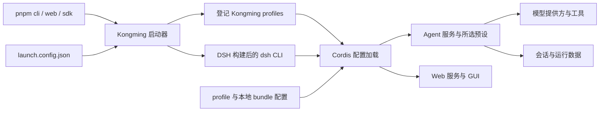

# Kongming 当前运行架构

当前 Kongming 使用完整 DeepSeek Harness（DSH）作为 Node 后端。Kongming 管理应用启动、profile、产品配置、自有 bundle 和业务插件；DSH 提供 Cordis 插件运行时、Agent 执行、模型接入、工具、会话与客户端能力。实现以本仓库及实际检出的 DSH 子模块源码为准。

## 目录与维护归属

| 路径 | 当前职责 | 维护归属 |
| --- | --- | --- |
| `third_party/dsh/` | 完整 DSH Git 子模块，包括 packages、apps、vendor、native、测试和构建工具 | 自有 DSH Fork 的 `kmh/runtime-core` 分支 |
| `scripts/kmh.mjs` | 安装底座、构建、登记 profile 和启动 CLI/Web/SDK | Kongming |
| `launch.config.json` | 短命令对应的 profile 选择 | Kongming |
| `profiles/` | profile 清单、应用配置和 Web 原版对照 | Kongming |
| `bundles/kongming/` | headless/SDK 使用的产品 persona | Kongming |
| `packages/` | 模型提供方、日志、提示词和团队等自有插件，以及开发预设 bundle；按[插件索引](../kmh/plugin-index.md)查找入口 | Kongming |
| `tests/runtime/` 与自有包测试目录 | 启动、配置、插件和客户端测试，由根 package.json 的 test 入口收集 | Kongming |
| `.githooks/` | 当前 Node 提交和推送检查 | Kongming |
| `.kmh/` | 本地运行数据 | 本地状态，Git 忽略 |

Kongming 与 DSH 分别维护 pnpm 工作区和锁文件。根工作区包含自有 `bundles/*` 和 `packages/*`；DSH 在子模块内管理自己的 workspace 依赖。安装以 Kongming Git 记录的子模块提交为准，工作区源码还可能包含各自未提交的修改；升级流程见 [DSH 接入与升级](../kmh/README.md#版本升级)。

## 启动链路



启动器读取 `launch.config.json`，默认将 `cli`、`web`、`sdk` 映射至 `kmh-headless`、`kmh-web`、`kmh-sdk`。它在 `$KMH_HOME/profiles/` 建立指向仓库 profile 的目录链接，为 profile 声明的本地 bundle 注册依赖链接，再启动 `third_party/dsh/apps/cli/lib/bin.js`。

子进程保留调用者的工作目录，环境变量按[数据目录与运行记录](../kmh/runtime-records.md#父进程影响)中的规则转发，退出状态返回给调用者。`cli` 使用一次性 headless 任务入口，`web` 使用 DSH Web 应用，`sdk` 使用标准输入输出上的 JSON-RPC 服务。当前 `pnpm web` 的前端由 DSH 子模块提供。

```sh
pnpm install --frozen-lockfile
pnpm run setup
pnpm build
pnpm cli "任务内容"
pnpm web
pnpm sdk
```

`setup` 初始化固定版本子模块、按 DSH 锁文件安装依赖并登记 profile；`build` 依次构建 DSH 和 Kongming 自有插件。跨机器初始化要求 Fork 可获取所记录的子模块提交，发布前应验证该提交的远程可用性。

## 配置归属与组合

| 入口 | 当前组合方式 | 编辑位置 |
| --- | --- | --- |
| headless | DSH base → headless → Kongming bundle → profile | `bundles/kongming/`、`profiles/kmh-headless/` |
| SDK | DSH base → sdk-app → Kongming bundle → profile | `bundles/kongming/`、`profiles/kmh-sdk/` |
| Web | 清单声明的 bundles → profile 自有插件与覆盖 → home → 调用级 patch | `bundles/dsh-web/`、`profiles/kmh-web/` |

Web 的 DSH 基础服务、GUI/API、Web 承载和 standard/PTC/minimal/Cordis 预设由 [DSH Web Bundle](../../bundles/dsh-web/README.md)提供；profile patch 插入 KMH 自有插件并覆盖部署配置。Bundle 按清单顺序先于 profile patch 应用，开发预设也由 Bundle 提供。原版展开保存于 `profiles/kmh-web/upstream.cordis.yml`，用于查阅和升级对照。`pnpm config:web` 展示最终配置。机器偏好 `$KMH_HOME/cordis.patch.yml` 和调用级 overlay 按顺序在 profile 配置之后应用。

| 修改目标 | 配置位置 |
| --- | --- |
| 短命令使用哪个 profile | `launch.config.json` 的 `profiles` |
| Web 监听地址与端口 | `webserver.config.host`、`webserver.config.port`，当前为 `127.0.0.1:3080` |
| 自动打开浏览器 | `web-runtime.config.openBrowser` 引用启动选项；`--no-open` 关闭本次浏览器交接 |
| Agent 预设默认选择 | `agent-preset-registry.config.default`，当前为 `standard` |
| 某个 Web Agent 的 persona 和工具 | 对应 `preset-*.config.plugins` 中的条目 |
| 欢迎提示确认版本 | `ui-settings-general.config.welcomeNoticeVersion` |

`id` 定位插件实例，`name` 指定插件入口，`config` 设置公开配置，`inject` 声明服务依赖，`disabled` 声明禁用条件。Cordis patch 会整体替换目标的 `config`；修改时保留该条目需要的完整字段。预设内相同插件入口可出现在不同作用域，按实例位置和预设定位修改。

## 功能模块与作用域

| 范围 | 主要模块 | 当前作用 |
| --- | --- | --- |
| 通用能力 | Agent、模型、会话、存储 | 提供执行与数据服务 |
| 通用能力 | 文件、命令、沙箱、审批 | 提供工具执行和权限控制 |
| 通用能力 | 指令、技能、压缩、子 Agent、工作流、目标与调度 | 管理上下文与任务协作 |
| 通用能力 | 联网搜索、抓取和 MCP | 提供模型使用的外部能力 |
| GUI 相关 | Connection、API Gateway 与 controllers | 连接图形客户端和宿主能力 |
| GUI 共用 | 聊天、工具卡片、侧栏、设置、外观 | 组成用户界面，可供 Web/桌面表层复用 |
| Web 承载 | Web 启动、HTTP 服务、地址公告 | 管理本应用的 Web 服务与浏览器入口 |
| Agent 预设 | standard、ptc、minimal、cordis 与开发预设 | 声明每个 Agent 的子插件组合；开发预设由本地 bundle 提供 |

`dsh-web` 是 Agent 的搜索与抓取服务，属于通用能力；`dsh-host-webserver` 在当前应用承担 HTTP 服务。Web 中部分顶层工具条目被禁用，所选预设在 Agent 作用域内加载对应工具。配置清单与实际激活状态分别核对，平台条件、服务依赖和预设选择都会影响加载。

能力归属与官方说明见 [插件索引](../kmh/plugin-index.md)，实际实例、作用域和配置以合成后的 profile 为准。

## 状态与凭据

运行数据目录、日志与父进程环境由[数据目录与运行记录](../kmh/runtime-records.md) 定义；KMH 启动器和 profile 共同固定相关路径。profile 源文件受 Kongming 版本控制，运行数据、profile 依赖与 DSH 生成的空 `cordis.yml` 由 Git 忽略。

本地 `.env` 与历史 `.kongming/` 数据保留。当前模型凭据使用 DSH 提供方的配置与环境变量，例如 `DEEPSEEK_API_KEY`。

## 扩展、维护与验证

新增业务插件在 Kongming 自有包中实现，逐文件接入清单见[新增 Kongming 自有插件包](../kmh/adding-a-plugin-package.md)，通过 DSH 现有服务、事件与 effect 接入。DSH 核心更新在自有 Fork 的 `kmh/runtime-core` 上维护，审查上游变化、完成相关检查后，再更新 Kongming 子模块指针。Web 配置升级同时审查新版原配置与 Kongming 配置的差异。

[`kmh-echo`](../../packages/kmh-echo/README.md) 使用函数式入口，在 headless、Web、SDK profile 中各加载一个实例。日志路径、阶段名字、写入与清理语义由包 README 说明。自有插件快速构建与类型检查使用 `pnpm build:kmh` 和 `pnpm typecheck:kmh`。

当前检查为 `pnpm lint`、`pnpm typecheck:kmh`、`pnpm format:check` 和 `pnpm test`。运行测试覆盖插件生命周期与文件追加、配置校验、目录链接冲突、配置保持、真实 profile 加载、Web 端口与欢迎版本编辑、配置文件选择 profile、headless 启动和 SDK shutdown。测试前自动构建 Kongming 自有插件；涉及仓库配置修改的测试按文件串行执行。Web 启动与用户流程另外使用实际浏览器验证。

`pnpm hooks` 安装 Node Git 钩子。pre-commit 检查暂存格式、代码文档分离与脚本语法；pre-push 运行当前启动测试。

## 官方资料

- [包分组地图](../../third_party/dsh/packages/README.zh.md)
- [架构与 profile/bundle](../../third_party/dsh/docs/architecture.zh.md)
- [Web bundle](../../third_party/dsh/packages/bundle/web-app/README.zh.md)
- [配置字段目录](../../third_party/dsh/docs/config-catalog.zh.md)
- [GUI 包地图](../../third_party/dsh/packages/client/README.zh.md)
- [Agent 预设](../../third_party/dsh/packages/preset/agent-preset/README.zh.md)
