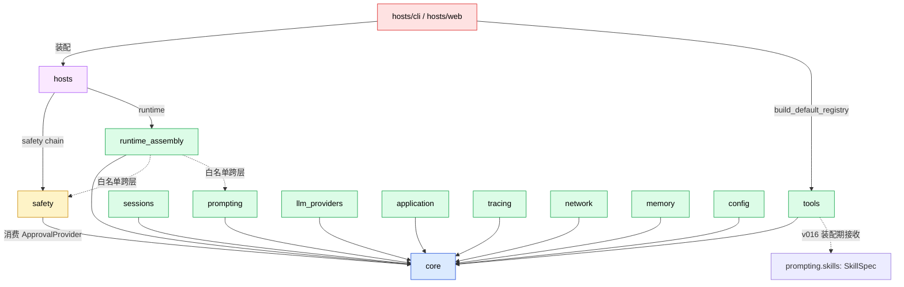
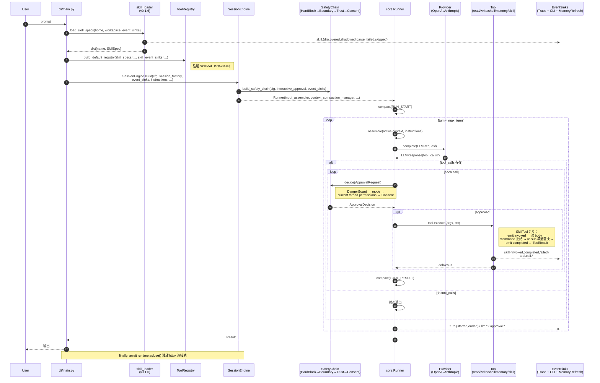
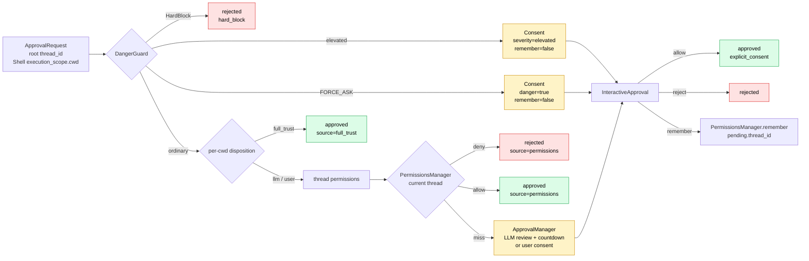
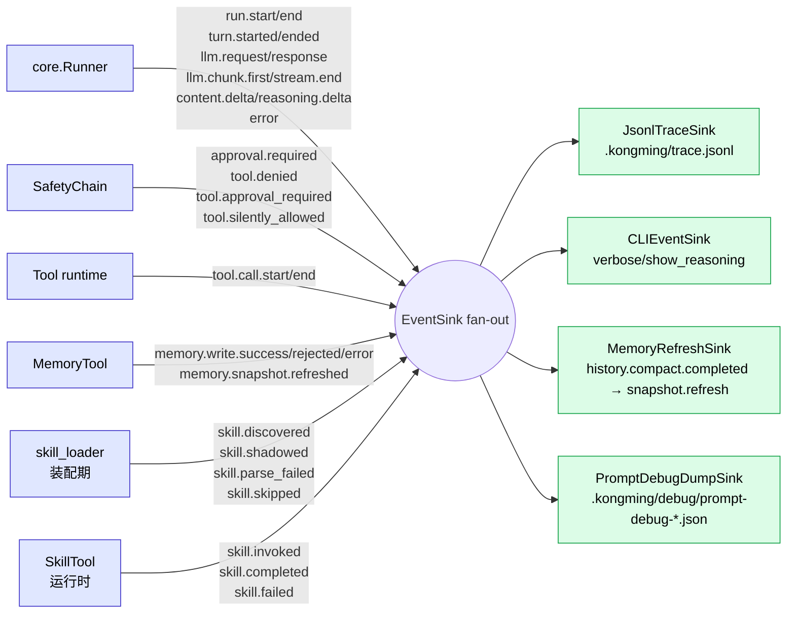
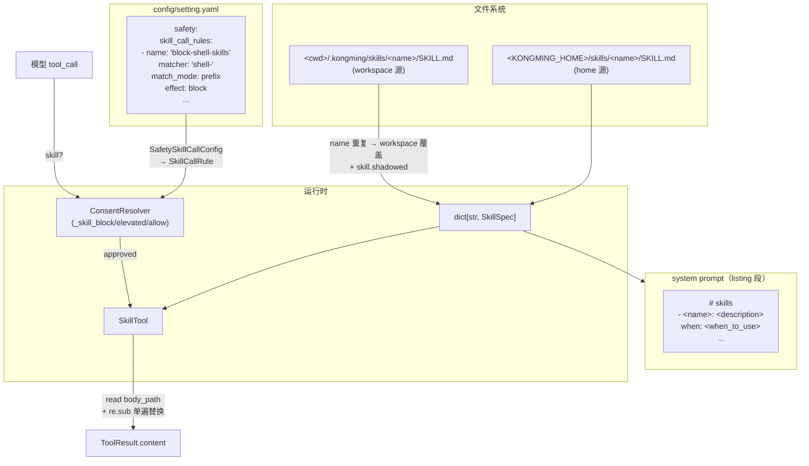

# 架构总览（v0.1.6 skill-system 后）

> 本图反映 v0.1.6 skill 系统合入后的整体形态：模块依赖、CLI 主链路、安全决策链、事件总线。
> 以 [CLAUDE.md](../CLAUDE.md) 的"代码地图"和"数据流"为根据，图与文字必须保持一致。

## 模块依赖（layered）

`.importlinter` 强制的分层方向；箭头 = 允许的依赖方向，反向被 CI 拦下。



**强约束**（来自 CLAUDE.md 的 12 条 + import-linter 5 contracts）：

- `core/` 不能 import 任何 sibling
- `tools/` 不能 import `safety.capability_policy` / `safety.permission_policy` / `safety.guards.*` / `safety.decision_engine` / `safety.boundary_resolver` / `safety._path_trie` / `safety.grant_store`
- 跨层 import 仅两条白名单：`runtime_assembly.session_engine → safety` 和 `→ prompting`
- 跨模块协议真源只在 `core.contracts/`

## CLI 主链路（一次对话）



## 安全决策链（v0.7）



## 事件总线（EventKind 全集）

runner / safety / tool / memory / skill 五条线汇入 `list[EventSink]`：



## v0.1.6 skill-system 数据态



## 关键文件索引

| 关注点 | 文件 | 来源 task |
|---|---|---|
| 协议真源（含 EventKind） | `src/core/contracts/` | core baseline + v0.1.6 加 skill.* 7 项 |
| skill 装载 | `src/prompting/skills/` | skill-loader-v0.1.6 |
| skill 工具 | `src/tools/builtin/skill_tool.py` | skill-tool-v0.1.6 |
| skill 装配糖 | `src/tools/__init__.py::build_default_registry` | skill-tool-v0.1.6 |
| skill 安全决策 | `src/safety/guards/consent.py::_classify_skill` | skill-tool-v0.1.6 |
| skill 数据类型 | `src/safety/types.py::SkillCallRule` | skill-tool-v0.1.6 |
| skill yaml schema | `src/infrastructure/config/models.py::SafetySkillCallConfig` | skill-tool-v0.1.6 |
| 默认空表锚点 | `src/safety/default_rules.py::DEFAULT_SKILL_CALL_RULES` | skill-tool-v0.1.6 |

## 渲染

GitHub / VS Code Markdown Preview / typora 等都原生支持 mermaid。

预导出的 SVG 在 [`diagrams/`](./diagrams/)：

| 文件 | 对应 |
|---|---|
| [`diagrams/01-module-dependency.svg`](./diagrams/01-module-dependency.svg) | 模块依赖（layered） |
| [`diagrams/02-cli-mainline.svg`](./diagrams/02-cli-mainline.svg) | CLI 主链路时序 |
| [`diagrams/04-event-bus.svg`](./diagrams/04-event-bus.svg) | 事件总线 |
| [`diagrams/05-skill-system-data.svg`](./diagrams/05-skill-system-data.svg) | v0.1.6 skill-system 数据态 |

重新导出（图改动后）：

```bash
# 一次性安装到 /tmp（需 ~400MB，含 chromium）
npm install --no-save --prefix /tmp/mmdc-tools @mermaid-js/mermaid-cli

# 导出全部 5 张图
/tmp/mmdc-tools/node_modules/.bin/mmdc \
  -i docs/architecture-overview.md \
  -o docs/diagrams/arch.svg

# 然后手工 mv arch-{1..5}.svg 到对应有意义文件名
```

## 维护

每次模块新增 / EventKind 扩展 / 安全链改动 / 重要装配点变化都应：

1. 改对应模块 `docs/modules/<name>/README.md`
2. 改 `CLAUDE.md` 代码地图 / 数据流（仅当 ~60 行索引地图被影响）
3. 改本文件的对应图段（图与代码必须同步）
