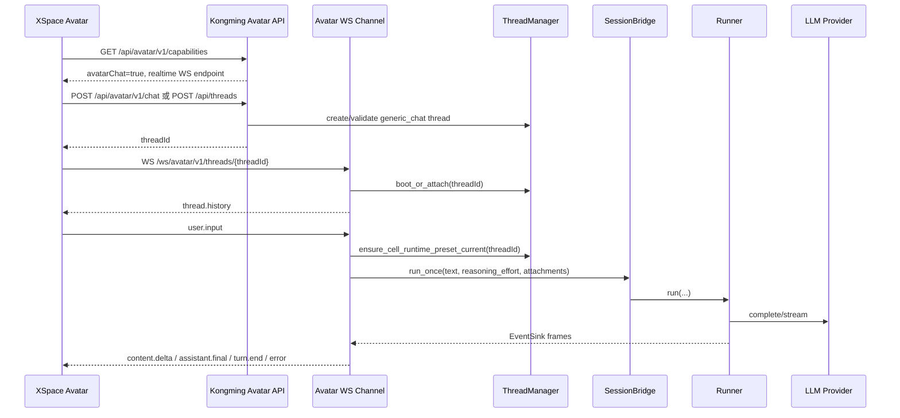

# Avatar Channel Interface v0.1

> 状态：目标合同，供 Kongming 实现与 XSpace 接入并行开发  
> 适用对象：XSpace Desktop Avatar、XSpace Android Avatar、Kongming Web backend  
> 主目标：Avatar 作为独立 channel 收发对话消息，消息 payload 复用普通 `generic_chat` 频道，运行逻辑复用现有 ThreadCell / SessionBridge / Runner。

## 核心结论

Avatar channel 是新的传输入口，thread / history / runtime 仍使用 Kongming 现有 `generic_chat` 主链路。XSpace 发送的用户消息使用普通频道的 `user.input` frame；Kongming 收到后调用现有 `ThreadManager.boot_or_attach()`、`SessionBridge.run_once()` 和 `Runner`；LLM 输出通过 avatar channel 返回给 XSpace Avatar。

当前 `AvatarMessageRegistry` 继续负责提醒类消息，例如 approval 待处理、任务状态、系统提示。新的 Avatar channel 负责实时对话：用户从 Avatar 输入，assistant 回复回 Avatar。

## 术语

| 名称 | 含义 |
|---|---|
| Avatar channel | 面向 XSpace Avatar 的独立传输通道，路径为 `/ws/avatar/v1/threads/{threadId}` |
| generic thread | `backend_kind="generic_chat"` 的 Kongming thread，承载 session/history/runtime |
| message registry | 已存在的 `/api/avatar/v1/messages` 拉取和 ack 能力 |
| C2S frame | XSpace 发给 Kongming 的 WebSocket frame |
| S2C frame | Kongming 发给 XSpace 的 WebSocket frame |

## 总体流程



## 鉴权

XSpace 端优先使用 mobile device token：

```http
Authorization: Bearer kgm_dt_...
```

WebView 已通过 `web_session_url` 登录时可使用 `kongming_session` cookie。Native WebSocket 客户端优先传 `Authorization` header；浏览器 WebSocket 使用 cookie。

Scope 要求：

| 能力 | Scope |
|---|---|
| 查询 capabilities | public 或已登录 |
| 拉取 avatar registry 消息 | `avatar.read` 或 `thread.read` |
| ack avatar registry 消息 | `avatar.ack` |
| 打开 avatar 对话 channel | `avatar.chat` |
| 对话关联 thread history | `thread.read` |
| 审批回复 | `avatar.chat` + 当前 approval 权限 |

## Kongming REST 接口

### 1. Capabilities

```http
GET /api/avatar/v1/capabilities
Authorization: Bearer kgm_dt_...
```

目标响应：

```json
{
  "protocolVersion": "1",
  "messageRegistry": true,
  "restList": true,
  "restAck": true,
  "wsNotifications": true,
  "avatarChat": true,
  "avatarRealtimeChat": true,
  "chatTransports": {
    "websocket": "/ws/avatar/v1/threads/{threadId}",
    "rest": "/api/avatar/v1/chat"
  },
  "requiredScopes": {
    "list": ["avatar.read", "thread.read"],
    "ack": ["avatar.ack"],
    "chat": ["avatar.chat", "thread.read"]
  }
}
```

字段说明：

| 字段 | 说明 |
|---|---|
| `avatarChat` | Avatar 可向 Kongming 发送对话消息 |
| `avatarRealtimeChat` | LLM 输出可通过 WS 实时返回 |
| `chatTransports.websocket` | 实时 channel 路径模板 |
| `chatTransports.rest` | REST 首发或无 WS fallback 路径 |

### 2. 创建或选择 thread

Avatar channel 使用 `generic_chat` thread。XSpace 可以走现有 thread API，也可以走 avatar chat REST 的自动创建能力。

#### 2.1 使用现有 thread API 创建空 thread

```http
POST /api/threads
Content-Type: application/json
Authorization: Bearer kgm_dt_...
```

```json
{
  "name": "Avatar",
  "preset_id": "local-default",
  "backend_kind": "generic_chat",
  "cwd": "/Volumes/machub_app/proj/XSpace"
}
```

返回 `ThreadMetadataDTO`，其中 `id` 是后续 WS 的 `threadId`。

#### 2.2 使用 avatar chat REST 首发创建 thread

```http
POST /api/avatar/v1/chat
Content-Type: application/json
Authorization: Bearer kgm_dt_...
```

```json
{
  "threadId": null,
  "presetId": "local-default",
  "cwd": "/Volumes/machub_app/proj/XSpace",
  "message": {
    "text": "帮我看一下当前任务",
    "reasoningEffort": "medium",
    "attachments": [],
    "metadata": {
      "source": "xspace-avatar",
      "surface": "desktop-avatar"
    }
  },
  "client": {
    "deviceId": "xspace-desktop-main",
    "clientMessageId": "xav_msg_01J...",
    "capabilities": {
      "realtime": true,
      "approvalUi": true,
      "markdown": true
    }
  }
}
```

目标响应：

```json
{
  "accepted": true,
  "threadId": "thread-a1b2c3d4e5f6",
  "runId": "thread-a1b2c3d4e5f6-1",
  "transport": "websocket",
  "websocketUrl": "/ws/avatar/v1/threads/thread-a1b2c3d4e5f6",
  "serverTime": "2026-06-16T00:00:00Z"
}
```

语义：

- `threadId=null` 时 Kongming 创建 `generic_chat` thread，`presetId` 必填。
- `threadId` 非空时 Kongming 校验 thread 存在且 `backend_kind="generic_chat"`。
- `message` 进入普通 `user.input` 等价路径。
- `accepted=true` 表示消息已进入 Kongming run 队列。
- 实时输出通过 avatar WS 返回。

### 3. Message registry list

提醒类消息继续使用已有接口：

```http
GET /api/avatar/v1/messages?limit=50&status=active
Authorization: Bearer kgm_dt_...
```

响应沿用当前 `AvatarMessage` DTO。审批提醒、系统提醒、任务提醒都走这里。

### 4. Message registry ack

```http
POST /api/avatar/v1/messages/{messageId}/ack
Content-Type: application/json
Authorization: Bearer kgm_dt_...
```

```json
{
  "status": "consumed",
  "consumerId": "xspace-avatar",
  "at": "2026-06-16T00:00:00Z"
}
```

ack 只处理 registry 消息生命周期。对话消息的 user/assistant history 由 thread session 管理。

## Avatar WebSocket 接口

### 连接

```text
WS /ws/avatar/v1/threads/{threadId}
```

连接条件：

- `threadId` 格式匹配 `^thread-[a-f0-9]{12}$`。
- thread 存在。
- thread `backend_kind` 为 `generic_chat`。
- token 或 cookie 具备 `avatar.chat` 和 `thread.read`。

连接成功后 Kongming 立即发送 `thread.history`，消息结构与普通 `/ws/threads/{threadId}` 完全一致。

### C2S frames

Avatar channel 的 C2S frame 复用普通频道。

```typescript
/**
 * XSpace Avatar 向 Kongming 发送一轮用户输入。
 * 该结构等价于普通 generic_chat 的 UserInputFrame。
 */
export interface AvatarUserInputFrame {
  /** 固定值，Pydantic union discriminator。 */
  frame_type: "user.input";
  /** 用户输入文本，Kongming 会写入当前 thread session。 */
  text: string;
  /** XSpace 生成的客户端请求 ID，用于日志、去重和错误关联。 */
  request_id: string;
  /** 可选推理强度，直接透传给普通 generic_chat runtime。 */
  reasoning_effort?: "low" | "medium" | "high" | null;
  /** 已上传附件引用，结构复用 UserInputAttachment。 */
  attachments?: UserInputAttachment[] | null;
}

/**
 * XSpace Avatar 请求中断当前 run。
 */
export interface AvatarInterruptFrame {
  frame_type: "interrupt";
  /** 可选 run_id，空值表示打断当前 active run。 */
  run_id?: string | null;
}

/**
 * 心跳。Kongming 返回 pong。
 */
export interface AvatarPingFrame {
  frame_type: "ping";
  /** 客户端毫秒时间戳，用于 RTT 计算。 */
  ts?: number | null;
}
```

### S2C frames

Kongming 返回普通频道同款 S2C frames。每个 S2C frame 都带 `timestamp_ms`。

```typescript
export type AvatarServerFrame =
  | ThreadHistoryFrame
  | TurnStartFrame
  | ContentDeltaFrame
  | ReasoningDeltaFrame
  | AssistantFinalFrame
  | ToolCallStartFrame
  | ToolCallEndFrame
  | ApprovalDecisionFrame
  | TurnEndFrame
  | RunInterruptedFrame
  | ErrorFrame
  | SystemNoticeFrame
  | UsageFrame
  | PongFrame
  | CellEvictedFrame;
```

核心 S2C frame 字段：

```typescript
/**
 * 一轮 assistant 回复开始。
 */
export interface TurnStartFrame {
  frame_type: "turn.start";
  timestamp_ms: number;
  turn: number;
  run_id: string;
}

/**
 * assistant 文本流式增量。
 */
export interface ContentDeltaFrame {
  frame_type: "content.delta";
  timestamp_ms: number;
  delta: string;
  turn: number;
  seq: number;
  run_id: string;
}

/**
 * assistant reasoning 流式增量。
 */
export interface ReasoningDeltaFrame {
  frame_type: "reasoning.delta";
  timestamp_ms: number;
  delta: string;
  turn: number;
  seq: number;
  run_id: string;
}

/**
 * assistant 本轮最终文本。
 */
export interface AssistantFinalFrame {
  frame_type: "assistant.final";
  timestamp_ms: number;
  content: string;
  turn: number;
  run_id: string;
}

/**
 * 一轮 turn 结束。
 */
export interface TurnEndFrame {
  frame_type: "turn.end";
  timestamp_ms: number;
  turn: number;
  run_id: string;
}

/**
 * 工具调用开始。
 */
export interface ToolCallStartFrame {
  frame_type: "tool.call.start";
  timestamp_ms: number;
  tool_name: string;
  call_id: string;
  turn: number;
  arguments: Record<string, unknown>;
  run_id: string;
}

/**
 * 工具调用结束。
 */
export interface ToolCallEndFrame {
  frame_type: "tool.call.end";
  timestamp_ms: number;
  call_id: string;
  turn: number;
  ok: boolean;
  error_message?: string | null;
  content: string;
  data?: Record<string, unknown> | null;
  run_id: string;
}

/**
 * 审批结果通知。
 */
export interface ApprovalDecisionFrame {
  frame_type: "approval.decision";
  timestamp_ms: number;
  call_id: string;
  outcome: "approved" | "rejected" | "cancelled";
  turn: number;
}

/**
 * 当前 run 被用户中断。
 */
export interface RunInterruptedFrame {
  frame_type: "run.interrupted";
  timestamp_ms: number;
  run_id: string;
  cancelled_at_turn: number;
  cancelled_tool_call_id?: string | null;
  cancel_reason: "user_interrupt" | string;
}

/**
 * 服务端错误。
 */
export interface ErrorFrame {
  frame_type: "error";
  timestamp_ms: number;
  error_code: "network" | "llm_error" | "tool_error" | "approval_timeout" | "internal";
  message: string;
  turn?: number | null;
}

/**
 * token 用量，usage 内部按 provider 分支。
 */
export interface UsageFrame {
  frame_type: "usage";
  timestamp_ms: number;
  turn: number;
  run_id: string;
  usage: Record<string, unknown>;
}
```

XSpace 第一阶段最低处理：

| Frame | 必须动作 |
|---|---|
| `thread.history` | 恢复历史气泡，按 `messages[]` 渲染 |
| `turn.start` | 标记 Avatar 进入回复中 |
| `content.delta` | 追加 assistant 文本流 |
| `assistant.final` | 收尾 assistant 文本，覆盖或确认最终内容 |
| `turn.end` | 标记本轮完成 |
| `error` | 展示失败状态并停止当前流式态 |
| `run.interrupted` | 标记用户中断 |

## 共享 DTO

### UserInputAttachment

```typescript
/**
 * 上传资产引用。Avatar channel 直接复用普通 Composer 的附件结构。
 */
export interface UserInputAttachment {
  /** Kongming 上传服务分配的资产 ID。 */
  asset_id: string;
  /** 资源类型，当前重点支持 image。 */
  kind: "image" | "video" | "file";
  /** MIME 类型，例如 image/png。 */
  mime_type: string;
  /** 文件字节数。 */
  size_bytes: number;
  /** 图片宽度，非图片可为空。 */
  width?: number | null;
  /** 图片高度，非图片可为空。 */
  height?: number | null;
  /** 视频时长，非视频可为空。 */
  duration_ms?: number | null;
  /** 预览 URL，XSpace 可用于缩略图。 */
  preview_url: string;
  /** 上传状态。ready 才能进入 user.input。 */
  status: "ready" | "processing" | "failed";
}
```

### ThreadHistoryFrame

```typescript
/**
 * 连接建立后服务端主动下发的历史消息。
 */
export interface ThreadHistoryFrame {
  frame_type: "thread.history";
  timestamp_ms: number;
  /** NormalizedMessage[]，与普通 Web chat 历史一致。 */
  messages: NormalizedMessage[];
}
```

### NormalizedMessage

`NormalizedMessage` 保持三频道统一形态。XSpace 渲染时按 `frame_type` 分支。

```typescript
export type NormalizedMessage =
  | NormalizedTextMessage
  | NormalizedToolUseMessage
  | NormalizedToolResultMessage;

export interface NormalizedTextMessage {
  id: string;
  provider: "generic_chat" | "claude_code" | "codex";
  frame_type: "text";
  role: "user" | "assistant";
  content: string;
  timestamp: number;
}

export interface NormalizedToolUseMessage {
  id: string;
  provider: "generic_chat" | "claude_code" | "codex";
  frame_type: "tool_use";
  role: "assistant";
  toolId: string;
  toolName: string;
  toolInput: Record<string, unknown>;
  timestamp: number;
}

export interface NormalizedToolResultMessage {
  id: string;
  provider: "generic_chat" | "claude_code" | "codex";
  frame_type: "tool_result";
  role: "tool";
  toolId: string;
  toolName: string;
  content: string;
  isError: boolean;
  timestamp: number;
}
```

## XSpace 侧函数接口

XSpace 建议实现一个单一 client 门户，供 Avatar UI、Tauri/Rust overlay、Android 层调用。

```typescript
/**
 * Kongming Avatar channel 客户端门户。
 *
 * 设计目标：
 * - 所有 REST/WS 细节收口到一个对象。
 * - Avatar UI 只订阅事件和调用发送函数。
 * - 对话 payload 复用普通 generic_chat 协议。
 */
export interface KongmingAvatarChannelClient {
  /**
   * 读取 Kongming Avatar 能力。
   *
   * 输入：无。
   * 输出：协议版本、registry 能力、chat 能力、scope 需求和 endpoint 模板。
   * 失败：网络失败或权限失败时抛 AvatarClientError。
   */
  getCapabilities(): Promise<AvatarCapabilities>;

  /**
   * 拉取 Avatar registry 消息。
   *
   * 输入：cursor/filter/status 等查询条件。
   * 输出：提醒类消息列表和 nextCursor。
   * 使用场景：启动补齐、断线补齐、审批提醒列表。
   */
  listMessages(input?: AvatarMessageListInput): Promise<AvatarMessageListResult>;

  /**
   * ack 或 consumed 单条 Avatar registry 消息。
   *
   * 输入：messageId、目标状态、consumerId。
   * 输出：服务端最终消息快照。
   * 幂等：重复调用返回同一终态。
   */
  ackMessage(input: AvatarAckMessageInput): Promise<AvatarMessage>;

  /**
   * 批量 ack Avatar registry 消息。
   *
   * 输入：messageIds 和同一目标状态。
   * 输出：逐条成功或稳定错误。
   */
  ackMessages(input: AvatarAckMessagesInput): Promise<AvatarAckBatchResult>;

  /**
   * 确保 Avatar 对话 thread 可用。
   *
   * 输入：已有 threadId 或 presetId/cwd/name。
   * 输出：generic_chat thread metadata。
   * 语义：传 threadId 时只校验；未传 threadId 时创建新 generic_chat thread。
   */
  ensureAvatarThread(input: EnsureAvatarThreadInput): Promise<ThreadMetadataDTO>;

  /**
   * 打开 Avatar 实时对话 channel。
   *
   * 输入：threadId、认证凭据、事件回调。
   * 输出：连接句柄，可发送 frame、关闭连接、读取状态。
   * 首帧：连接成功后 Kongming 会主动推 thread.history。
   */
  connectAvatarThread(input: AvatarConnectInput): AvatarChannelConnection;

  /**
   * 通过已打开的 WS 发送一轮用户输入。
   *
   * 输入：text、可选 reasoningEffort、attachments、metadata。
   * 输出：发送完成只代表 frame 已进入本地 socket，不代表 LLM 完成。
   * 后续：assistant 内容从 onFrame 的 content.delta / assistant.final 获得。
   */
  sendAvatarMessage(input: AvatarSendMessageInput): Promise<void>;

  /**
   * 通过 REST 发送一轮用户输入。
   *
   * 输入：threadId 或 presetId/cwd + message。
   * 输出：accepted、threadId、runId、websocketUrl。
   * 使用场景：首发创建 thread，或 WS 暂不可用时排队发送。
   */
  sendAvatarMessageViaRest(input: AvatarRestChatInput): Promise<AvatarChatAccepted>;

  /**
   * 中断当前 Avatar run。
   *
   * 输入：threadId 和可选 runId。
   * 输出：发送 interrupt frame 完成。
   * 后续：服务端会返回 run.interrupted 和 turn.end。
   */
  interruptAvatarRun(input: AvatarInterruptInput): Promise<void>;

  /**
   * 回复 Avatar registry 中 action.type=open_approval 的审批消息。
   *
   * 输入：threadId、callId 和 action。
   * 输出：POST /api/avatar/v1/approvals/{callId}/resolve 完成。
   */
  resolveAvatarApproval(input: AvatarApprovalResolveInput): Promise<void>;

  /**
   * 关闭 Avatar channel，释放 socket、timer 和回调。
   */
  close(): void;
}
```

### XSpace client 输入输出类型

```typescript
export interface AvatarCapabilities {
  protocolVersion: "1";
  messageRegistry: boolean;
  restList: boolean;
  restAck: boolean;
  wsNotifications: boolean;
  avatarChat: boolean;
  avatarRealtimeChat: boolean;
  chatTransports: {
    websocket: string;
    rest: string;
  };
  requiredScopes: {
    list: string[];
    ack: string[];
    chat: string[];
  };
}

export interface AvatarMessageListInput {
  cursor?: string | null;
  limit?: number;
  since?: string | null;
  level?: Array<"info" | "success" | "warning" | "error">;
  source?: string[];
  threadId?: string | null;
  status?: Array<"active" | "acked" | "consumed" | "expired">;
}

export interface AvatarMessageListResult {
  items: AvatarMessage[];
  nextCursor: string | null;
  serverTime: string;
}

export interface AvatarMessage {
  messageId: string;
  sequence: number;
  revision: number;
  status: "active" | "acked" | "consumed" | "expired";
  source: string;
  title: string;
  body?: string | null;
  level: "info" | "success" | "warning" | "error";
  priority: number;
  threadId?: string | null;
  runId?: string | null;
  requestId?: string | null;
  action?: AvatarMessageAction | null;
  dedupeKey?: string | null;
  expiresAt?: string | null;
  ackedAt?: string | null;
  consumedAt?: string | null;
  createdAt: string;
  updatedAt: string;
  metadata?: Record<string, unknown>;
}

export interface AvatarMessageAction {
  type: "open_thread" | "open_approval" | "open_url" | "none";
  label?: string | null;
  target?: string | null;
  payload?: Record<string, unknown>;
}

export interface AvatarAckMessageInput {
  messageId: string;
  status?: "acked" | "consumed";
  consumerId?: string;
  at?: string | null;
}

export interface AvatarAckMessagesInput {
  messageIds: string[];
  status?: "acked" | "consumed";
  consumerId?: string;
  at?: string | null;
}

export interface AvatarAckBatchResult {
  results: AvatarAckItemResult[];
}

export interface AvatarAckItemResult {
  messageId: string;
  ok: boolean;
  message?: AvatarMessage | null;
  error?: string | null;
}

export interface EnsureAvatarThreadInput {
  /** 已有 generic_chat thread。传入时 client 只做校验和连接。 */
  threadId?: string | null;
  /** 创建新 thread 时使用的 preset。 */
  presetId?: string | null;
  /** 创建新 thread 时使用的 workspace cwd。 */
  cwd?: string | null;
  /** 新 thread 名称。 */
  name?: string | null;
}

export interface AvatarConnectInput {
  threadId: string;
  /** Kongming origin，例如 http://127.0.0.1:60000。 */
  serverUrl: string;
  /** Native 客户端使用 device token；WebView 可为空并使用 cookie。 */
  deviceToken?: string | null;
  /** 收到任意 S2C frame 时触发。 */
  onFrame(frame: AvatarServerFrame): void;
  /** socket 状态变化时触发。 */
  onState?(state: AvatarChannelState): void;
  /** 网络或协议错误时触发。 */
  onError?(error: AvatarClientError): void;
}

export type AvatarChannelState =
  | "connecting"
  | "open"
  | "reconnecting"
  | "closed"
  | "failed";

export interface AvatarChannelConnection {
  threadId: string;
  state: AvatarChannelState;
  send(frame: AvatarClientFrame): void;
  close(): void;
}

export type AvatarClientFrame =
  | AvatarUserInputFrame
  | AvatarInterruptFrame
  | AvatarPingFrame;

export interface AvatarSendMessageInput {
  threadId: string;
  text: string;
  requestId?: string;
  reasoningEffort?: "low" | "medium" | "high" | null;
  attachments?: UserInputAttachment[] | null;
  metadata?: Record<string, unknown> | null;
}

export interface AvatarRestChatInput {
  threadId?: string | null;
  presetId?: string | null;
  cwd?: string | null;
  message: {
    text: string;
    reasoningEffort?: "low" | "medium" | "high" | null;
    attachments?: UserInputAttachment[] | null;
    metadata?: Record<string, unknown> | null;
  };
  client: {
    deviceId?: string | null;
    clientMessageId: string;
    capabilities?: Record<string, boolean>;
  };
}

export interface AvatarChatAccepted {
  accepted: true;
  threadId: string;
  runId: string;
  transport: "websocket" | "rest";
  websocketUrl: string;
  serverTime: string;
}

export interface AvatarInterruptInput {
  threadId: string;
  runId?: string | null;
}

export interface AvatarApprovalResolveInput {
  threadId: string;
  callId: string;
  action: "accept_once" | "accept_for_session" | "reject";
}

export interface AvatarClientError {
  code:
    | "avatar_forbidden"
    | "avatar_invalid_request"
    | "avatar_thread_not_found"
    | "avatar_invalid_thread"
    | "avatar_preset_required"
    | "avatar_runtime_refresh_failed"
    | "avatar_run_failed"
    | "avatar_invalid_frame"
    | "avatar_network_error";
  message: string;
  details?: Record<string, unknown>;
}
```

## Kongming 后端函数接口

Kongming 侧实现时建议把真实 chat 能力收口到 `AvatarAssistantManager`，由 `AvatarManager.chat()` 委托。

```python
class AvatarAssistantManager:
    """Avatar 实时对话门户。

    职责：把 Avatar channel 的输入转换为 generic_chat thread run。
    关键依赖：ThreadManagerProtocol、AvatarChannelBroadcaster、现有 WS frame DTO。
    """

    async def ensure_thread(
        self,
        request: AvatarEnsureThreadRequest,
    ) -> AvatarThreadBinding:
        """确保 Avatar 对话 thread 可用。

        关键输入：已有 thread_id，或 preset_id/cwd/name。
        关键输出：generic_chat thread metadata 和 avatar channel 绑定信息。
        """

    async def send_message(
        self,
        request: AvatarChatRequest,
    ) -> AvatarChatAccepted:
        """接收 Avatar 用户消息并启动普通 generic_chat run。

        关键输入：thread_id、text、reasoning_effort、attachments、client_message_id。
        关键输出：accepted/run_id/thread_id。LLM 实时输出通过 Avatar channel EventSink 发送。
        """

    async def interrupt(
        self,
        request: AvatarInterruptRequest,
    ) -> None:
        """中断当前 Avatar thread 上的 active run。

        关键输入：thread_id 和可选 run_id。
        关键输出：无；结果通过 run.interrupted / turn.end frame 通知。
        """

    async def resolve_approval(
        self,
        request: AvatarApprovalResolveRequest,
    ) -> None:
        """处理 Avatar UI 对 registry 审批消息的回复。

        关键输入：thread_id、call_id、action。
        关键输出：ApprovalManager resolve 结果。
        """
```

实现约束：

- `AvatarAssistantManager.send_message()` 只能通过 `ThreadManager` / `ThreadCell` / `SessionBridge` 调用现有 run。
- `Runner` 保持唯一 turn 推进逻辑。
- avatar WS 使用专用 fanout 或 writer，避免与普通 Web chat 的 `/ws/threads/{threadId}` socket 混在同一连接集合。
- Avatar channel 的 S2C frame DTO 复用 `hosts.web.protocol.ws_frames`。
- REST chat 和 WS user.input 最终走同一个内部方法，保证语义一致。

## 错误合同

REST 错误响应：

```json
{
  "error": {
    "code": "avatar_invalid_thread",
    "message": "thread backend_kind must be generic_chat"
  }
}
```

WS 错误 frame：

```json
{
  "frame_type": "error",
  "timestamp_ms": 1781548800000,
  "error_code": "internal",
  "message": "avatar runtime refresh failed",
  "turn": null
}
```

目标错误码：

| Code | HTTP | 场景 |
|---|---:|---|
| `avatar_forbidden` | 403 | token/cookie 缺失或 scope 缺失 |
| `avatar_invalid_request` | 400 | 请求体非法 |
| `avatar_thread_not_found` | 404 | thread 不存在 |
| `avatar_invalid_thread` | 400 | thread 格式非法或 backend_kind 非 `generic_chat` |
| `avatar_preset_required` | 400 | 创建 thread 时缺 `presetId` |
| `avatar_runtime_refresh_failed` | 409 | preset/runtime 刷新失败 |
| `avatar_run_failed` | 500 | `SessionBridge.run_once()` 抛异常 |
| `avatar_invalid_frame` | 400 / WS error | frame_type 或字段非法 |
| `avatar_frame_too_large` | WS error | 单帧超过 1MB |

## XSpace 渲染建议

| 输入事件 | Avatar 行为 |
|---|---|
| 用户发送成功 | 立即显示用户气泡，状态为 sending/running |
| `turn.start` | Avatar 进入思考或回复状态 |
| `reasoning.delta` | 可折叠显示推理内容，默认可隐藏 |
| `content.delta` | 追加 assistant 气泡 |
| `assistant.final` | 固化 assistant 气泡内容 |
| `tool.call.start` | 显示工具执行中，可用紧凑状态 |
| `tool.call.end` | 更新工具结果，可默认折叠 |
| `approval.decision` | 关闭审批待处理态 |
| `error` | 当前气泡标记失败，保留重试入口 |
| `run.interrupted` | 当前回复标记已中断 |

## 验收 fixture

### user.input

```json
{
  "frame_type": "user.input",
  "text": "现在该做什么？",
  "request_id": "xav_req_01J...",
  "reasoning_effort": "medium",
  "attachments": null
}
```

### content.delta

```json
{
  "frame_type": "content.delta",
  "timestamp_ms": 1781548800000,
  "delta": "下一步建议先完成接口文档。",
  "turn": 1,
  "seq": 1,
  "run_id": "thread-a1b2c3d4e5f6-1"
}
```

### assistant.final

```json
{
  "frame_type": "assistant.final",
  "timestamp_ms": 1781548800200,
  "content": "下一步建议先完成接口文档，然后按同一合同实现 Kongming 和 XSpace 两侧。",
  "turn": 1,
  "run_id": "thread-a1b2c3d4e5f6-1"
}
```

## Kongming 实现任务拆分建议

| 优先级 | 任务 | 验收 |
|---|---|---|
| P0 | 扩展 `AvatarCapabilities` 和 `/api/avatar/v1/capabilities` | 返回 `avatarChat=true`、`avatarRealtimeChat=true`、endpoint 模板 |
| P0 | 实现 `AvatarAssistantManager.send_message()` | 调用现有 `ThreadManager` / `SessionBridge.run_once()`，不复制 runner |
| P0 | 新增 `/ws/avatar/v1/threads/{threadId}` | 连接后发送 `thread.history`，C2S/S2C frame 复用普通频道 |
| P0 | REST `/api/avatar/v1/chat` accepted 语义 | 支持已有 thread 和首发创建 thread |
| P1 | Avatar 审批联动 | registry 推送 `open_approval`，XSpace 调用 approval resolve REST API |
| P1 | 合同测试 | TestClient + WS 测成功、非法 thread、run_once 异常、runtime refresh 失败 |
| P2 | XSpace client fixture | 保存 TS fixture，双侧协议漂移测试 |

## XSpace 接入顺序

1. 实现 `KongmingAvatarChannelClient.getCapabilities()`。
2. 实现 `ensureAvatarThread()`，先支持已有 `threadId`，再支持创建。
3. 实现 `connectAvatarThread()`，先处理 `thread.history`、`content.delta`、`assistant.final`、`turn.end`、`error`。
4. 实现 `sendAvatarMessage()`，发送 `user.input`。
5. 把 registry 的 `approval` 消息与实时审批 UI 合并展示，并接入 approval resolve REST API。
