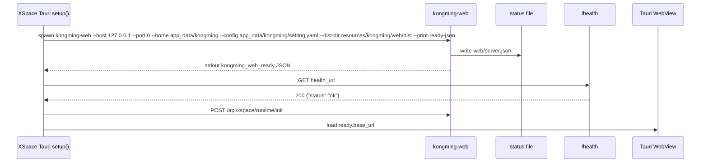

# XSpace / Tauri / Kongming Web 宿主契约

状态：kongming-agent 侧 v0.1 已实现；x-space 侧待接入。本文是 [safety-application-hosts-migration-0608.md](safety-application-hosts-migration-0608.md) 阶段 3 的外部集成契约。

打包交付手册见 [docs/modules/XSpace打包/](modules/XSpace打包/README.md)：覆盖 exe / web dist / runtime config / resources 布局 / ready JSON。

## 目标

XSpace 打包为一个桌面程序，包内自带 kongming Web 前端和 Python 后端。启动 XSpace 时，Tauri 启动内置 kongming Web 服务，再由 WebView 加载本地服务 URL。

XSpace 只依赖稳定宿主入口和运行时契约：

```text
console script
ready JSON
status 文件
health endpoint
app data 目录
包内静态资源路径
```

XSpace 避免依赖 kongming 仓库源码目录结构。

## 必须交付的稳定入口

```bash
kongming-web \
  --host 127.0.0.1 \
  --port 0 \
  --home <xspace-app-data>/kongming \
  --config <xspace-app-data>/kongming/setting.yaml \
  --dist-dir <bundle-resource>/kongming/web/dist \
  --print-ready-json
curl -X POST <base_url>/api/xspace/runtime/init \
  -H 'X-Requested-With: XMLHttpRequest' \
  -H 'Content-Type: application/json' \
  -d '{"host_environment":"xspace"}'
kongming-web-ctl status --home <xspace-app-data>/kongming
```

`pyproject.toml` 需要提供：

```toml
[project.scripts]
kongming = "hosts.cli.main:main"
kongming-web = "hosts.web.run:main"
kongming-web-ctl = "hosts.web.ctl:main"
```

兼容入口：

```bash
python -m hosts.web.run
python -m hosts.web.ctl
```

## 启动参数契约

| 参数 | 必须支持 | 说明 |
|---|---:|---|
| `--host` | 是 | XSpace 默认传 `127.0.0.1` |
| `--port` | 是 | XSpace 默认配置值是 `60000`；支持显式传 `0` 由 OS 分配空闲端口 |
| `--home` | 是 | 指向 XSpace app data 下的 kongming 运行目录 |
| `--config` | 是 | 指向 `<home>/setting.yaml` 用户配置；启动前由 XSpace 从资源默认配置创建或合并 |
| `--dist-dir` | 是 | 指向 bundled frontend dist；缺省时使用包内资源路径 |
| `--print-ready-json` | 是 | 启动成功后 stdout 输出一行 ready JSON，方便 sidecar smoke |
| `--once-ready-json` | 是 | 兼容别名，语义等同于 `--print-ready-json` |

XSpace 在 ready JSON 和 `/health` 成功后调用 `POST /api/xspace/runtime/init`，再加载 WebView。

端口优先级：

```text
--port 参数 > KONGMING_WEB_PORT > config.web.port > kongming Config 默认值
```

代码约束：

```text
源码只能读取端口配置值。
60000 是 XSpace 侧资源配置或启动参数默认值；kongming-agent 业务逻辑保持无硬编码端口常量。
```

环境变量等价入口：

```text
KONGMING_HOME=<xspace-app-data>/kongming
KONGMING_CONFIG=<bundle-resource>/kongming/config/setting.yaml
KONGMING_WEB_PORT=60000
KONGMING_WEB_DIST=<bundle-resource>/kongming/web/dist
```

`KONGMING_CONFIG` 可指向 `<xspace-app-data>/kongming/config/setting.yaml` 作为用户覆盖配置入口；产品默认配置来自 resources 内的 `kongming/config/setting.yaml`。

XSpace 默认配置示例：

```yaml
session:
  backend: file
  store_path: .kongming/sessions.db
  file_store_path: .kongming/sessions

trace:
  output_path: .kongming/trace.jsonl

scheduler:
  home:

workflow:
  home:

sitian:
  output_subdir:

web:
  enabled: true
  host: 127.0.0.1
  port: 60000
  dev_mode: false
  full_log:
    path: .kongming/logs/full_log.jsonl
```

该默认配置由 x-space 打包 task 提供。kongming-agent 交付运行时参数、读取能力和构建产物；
本仓库 `config/xspace/setting.yaml` 是 x-space 产品默认配置真源，复制到 resources 后作为
`<resource>/kongming/config/setting.yaml` 使用；仓库根 `config/setting.yaml` 继续服务本地开发默认值。

## Ready JSON

服务成功绑定端口并完成 FastAPI app 装配后，stdout 输出单行 JSON：

```json
{
  "type": "kongming_web_ready",
  "host": "127.0.0.1",
  "port": 60000,
  "base_url": "http://127.0.0.1:60000",
  "health_url": "http://127.0.0.1:60000/health",
  "pid": 12345,
  "home": "/Users/me/Library/Application Support/XSpace/kongming",
  "server_json": "/Users/me/Library/Application Support/XSpace/kongming/web/server.json",
  "dist_dir": "/Applications/XSpace.app/Contents/Resources/kongming/web/dist",
  "started_at": "2026-06-09T12:00:00Z"
}
```

同一 payload 写入：

```text
<home>/web/server.json
```

写入要求：

```text
使用临时文件 + os.replace 原子写入。
启动失败时写 <home>/web/startup.json 的 error 字段。
stdout 只输出 ready JSON；常规日志走 stderr 或 <home>/logs。
```

## Health Endpoint

必须提供：

```http
GET /health
```

响应：

```json
{"status":"ok"}
```

同时保留当前兼容端点：

```http
GET /api/health
```

XSpace 启动流程只需要检查 HTTP 200。

## 静态资源路径

开发形态：

```text
web/dist
```

打包形态：

```text
<bundle-resource>/kongming/web/dist
```

代码要求：

```text
hosts.web.static 通过 --dist-dir / KONGMING_WEB_DIST / 包内资源路径定位 dist。
源码仓库 cwd 只作为开发 fallback。
StaticFiles 挂载和 SPA fallback 行为保持。
dist 缺失时，生产模式启动失败并写清楚错误。
```

## 运行时数据目录

所有运行数据写入必须落在 `--home` / `KONGMING_HOME` 指向的 `kongming_home` 下：

```text
<home>/web/startup.json
<home>/web/server.json
<home>/web/threads/
<home>/web/uploads/
<home>/web/auto_approval/
<home>/logs/
<home>/sessions/
<home>/sessions.db
<home>/memory/
<home>/evolution/
<home>/cron/
<home>/workflows/
<home>/whiteboard/
<home>/sitian/
```

迁移阶段需要审计这些路径：

```text
默认 runtime config: <bundle-resource>/kongming/config/setting.yaml
用户配置 config: <home>/setting.yaml（由 XSpace 启动前创建或合并，sidecar 通过 --config 读取）
前端 dist: <bundle-resource>/kongming/web/dist
.kongming/* 配置字段: 运行期统一派生到 <home>
logs / sessions / uploads / memory / evolution / cron / workflows / whiteboard / sitian
```

审计目标：

```text
桌面打包运行时，当前工作目录可以是任意目录。
XSpace 指定 app data 后，kongming 不向源码目录写运行时文件。
```

## XSpace 启动流程



## 平台边界

首版验收平台为 Windows，构建产物为：

```text
dist/kongming-web-backend/kongming-web-backend.exe
```

`packaging/kongming-web-backend.build.yaml` 已预留 macOS / Linux 字段，当前两个平台字段保持 disabled，后续补对应宿主 smoke 后再启用。

## 最小 Smoke

阶段 3 完成后必须提供一个可重复 smoke：

```bash
tmp_home="$(mktemp -d)"
resource_config="<bundle-resource>/kongming/config/setting.yaml"
resource_dist="<bundle-resource>/kongming/web/dist"
home_config="$tmp_home/setting.yaml"
cp "$resource_config" "$home_config"
# smoke 使用 --port 0 覆盖默认 60000，避免本机固定端口冲突并验证端口可配置。
kongming-web --host 127.0.0.1 --port 0 --home "$tmp_home" --config "$home_config" --dist-dir "$resource_dist" --print-ready-json > "$tmp_home/ready.jsonl" 2> "$tmp_home/web.log" &
web_pid=$!
sleep 2
jq -r '.health_url' "$tmp_home/web/server.json" | xargs curl --fail
base_url="$(jq -r '.base_url' "$tmp_home/web/server.json")"
curl --fail -X POST "$base_url/api/xspace/runtime/init" \
  -H 'X-Requested-With: XMLHttpRequest' \
  -H 'Content-Type: application/json' \
  -d '{"host_environment":"xspace"}'
jq -r '.base_url' "$tmp_home/web/server.json"
kongming-web-ctl status --home "$tmp_home"
kill "$web_pid"
```

验收：

```text
进程启动成功。
server.json 存在且包含 base_url / health_url / pid。
GET /health 返回 200。
GET /api/health 返回 200。
GET / 返回 HTML 或 SPA fallback。
运行时文件只写入 tmp_home。
```

## 与 hosts 迁移的关系

`src/web -> src/hosts/web` 可以接受，条件是迁移同时交付上述契约。推荐实现方式：

```text
hosts.web.run 负责 console script 参数解析、动态端口、ready JSON、server.json。
hosts.web.run 读取 config.web.port，XSpace 默认配置为 60000；--port / env 可覆盖。
hosts.web.app 继续提供 create_app。
hosts.web.static 负责包内 dist 解析。
hosts.web.ctl 负责 start / stop / restart / status / log。
hosts.shared 继续放 SessionBridge / HostAdapter。
```

对 XSpace 的稳定面：

```text
kongming-web
kongming-web-ctl
server.json
GET /health
GET /api/health
```

这些稳定面保持后，XSpace 打包只需要携带 kongming 后端可执行入口、前端 dist、默认配置模板和 app data 路径。
