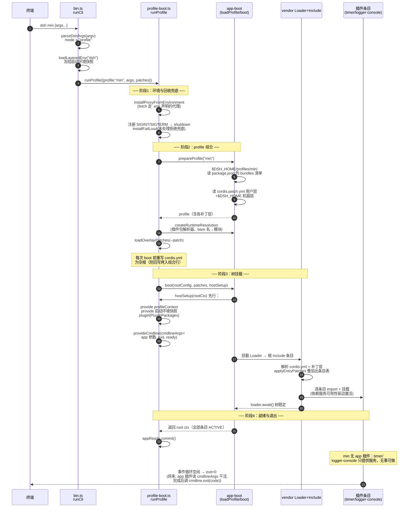

# DSH CLI 启动入口与时序（KMH 迁移版）

记录迁移后的 `dsh` CLI 入口脚本与一次 `dsh <profile>` 启动的完整时序。
代码基线：DSH `85805356`（KMH 仓库根工作区，2026-10 迁移）。

## 入口脚本

```
DSH_HOME=<绝对路径> pnpm dsh <profile>
                     │
                     ▼
package.json → "scripts": { "dsh": "node --import tsx/esm apps/cli/src/bin.ts" }
                     │
                     ▼
apps/cli/src/bin.ts        ← 源码入口（runCli，import.meta.main 触发）
apps/cli/lib/bin.js        ← 预构建入口（package.json bin 字段，不依赖 tsx）
```

tsx 源码启动时，根 `tsconfig.json`（extends `tsconfig.paths.json`）的 paths 把
`@deepseek-ai/*` 解析到各包 `src/`——`FiberState` 等 `const enum` 仅源码形态存在。

## 命令分发（bin.ts）

`parseDshArgs` 把一次调用归入四种模式，各自动态 import 对应模块：

| mode | 模块 | 行为 |
|---|---|---|
| `profile` | `profile-boot.ts` | 完整启动（下节时序） |
| `plugin` | `plugin.ts` | 插件包管理（pnpm 操作；本轮受 dsh-subprocess 缺失限制） |
| `dump-config` | `dump-config.ts` | 只组合补丁层并打印条目树，不挂载 |
| `dump-config-schema` | `dump-config-schema.ts` | 打印条目/补丁 JSON Schema，不挂载 |

`StartupError` 由 `startup-diagnostics.ts` 报告（含 home/version/profile 定位信息）后以
退出码 1 结束；其余异常原样抛出。

## 启动时序（mode = profile）



## 关键语义

- **app 参数不经引导器**：`--profile` 之后的参数通过 `ctx.cmdlineArgs` 服务注入全树，
  任何 app 插件读到同一份不可变快照（`provideCmdline`）。
- **hostSetup 先于任何条目挂载**：`profileContext`、启动环境快照、`PluginPackages`、
  cmdline 服务在树挂载前就绪，插件的 `inject` 声明才能命中。
- **`cordis.yml` 每次 boot 重写为空根**：loader 的回写机制可能把组合行烤进该文件，
  导致下次启动重复插入 bundle 条目（源码注释明言此动机）。
- **进程存活性由插件决定**：引导器不持有事件循环句柄；没有保持句柄的插件
  （server/stdio 监听/定时器/watcher）时，树稳定后进程即退出。
- **退出路径**：SIGINT → exit 130（用户中断）；SIGTERM → exit 0（监督者常规停止）；
  二者均先 `dispose()`（根 fiber 回收 + 代理释放），失败聚合上报。
