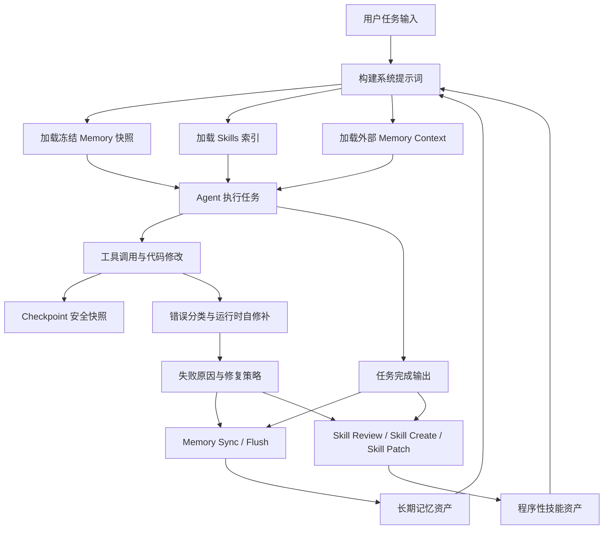
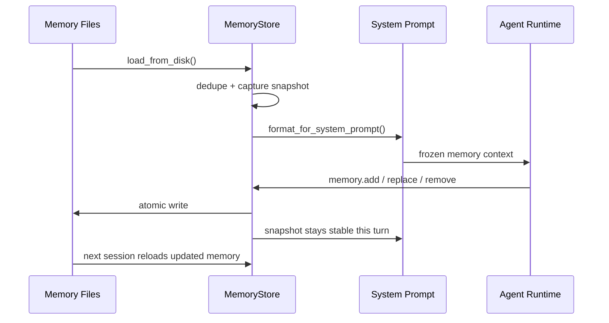
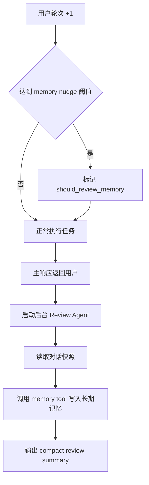
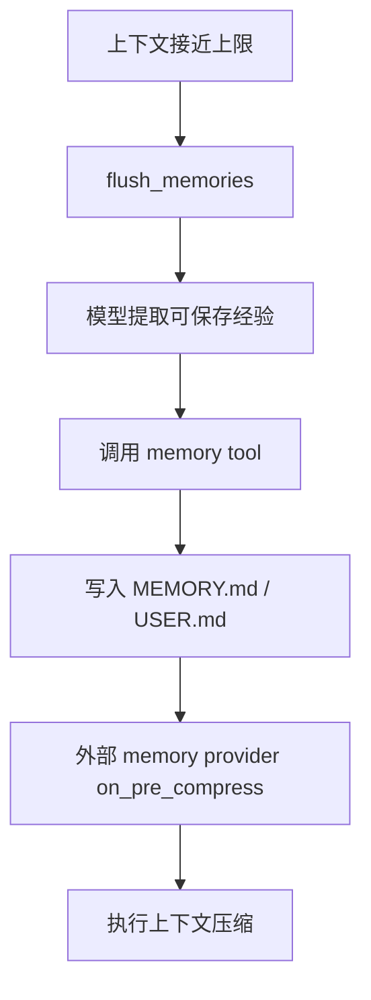
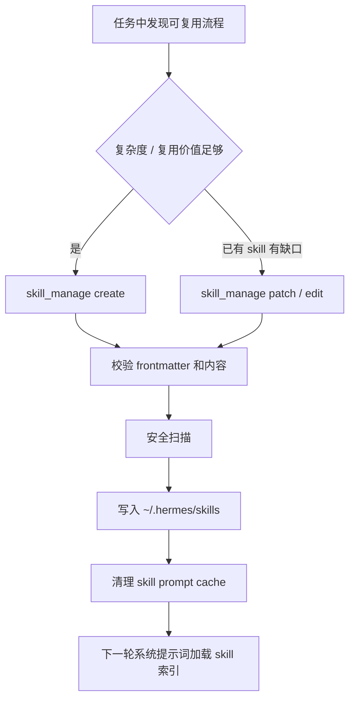
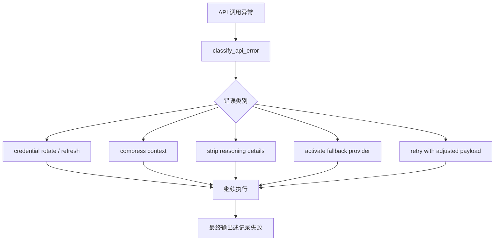
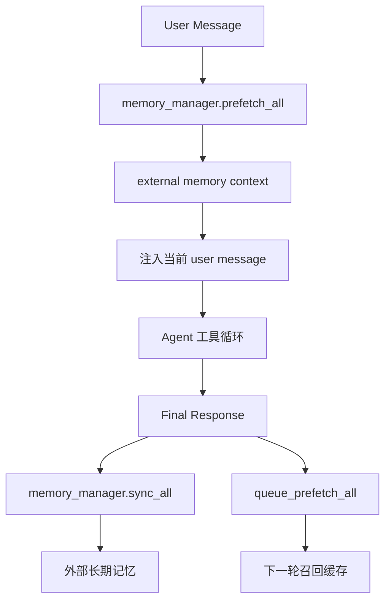
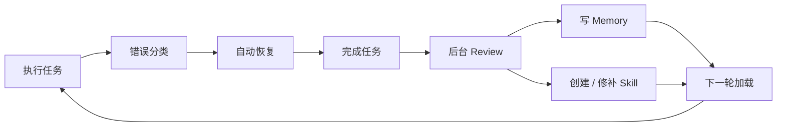

# Hermes Agent 自我进化模块挖掘笔记

> 范围：轻量挖掘 Hermes Agent 的自我进化机制，聚焦模块流程、核心原理、学习闭环和对 `kongming-agent` 的可借鉴设计。

## 1. 核心定位

Hermes 的自我进化体系由三类长期资产驱动：陈述性记忆、程序性技能、运行时经验。Memory 保存用户偏好、环境事实、工具经验；Skill 保存可复用流程、命令、坑点和操作规范；Error Repair 与 Checkpoint 把失败变成可恢复、可记录、可沉淀的经验。

整套闭环的关键点是“运行中学习，后台沉淀，下一轮自动加载”。主对话持续完成任务；后台 review、memory flush、skill nudge、错误分类和 checkpoint 在关键节点介入，把一次任务里的有效经验转成下一次任务可用的上下文。

## 2. 总体闭环

## 3. 模块分层

| 层级 | Hermes 模块 | 职责 | 自我进化价值 |
|---|---|---|---|
| 陈述性记忆 | `tools/memory_tool.py` | 保存用户偏好、环境事实、可复用经验 | 让 Agent 下一次自动知道用户和环境 |
| 记忆编排 | `agent/memory_manager.py` | 统一内置记忆和外部记忆 provider | 支持长期记忆扩展、检索、同步 |
| 外部记忆插件 | `plugins/memory/honcho` | 画像、搜索、上下文召回、结论沉淀 | 引入跨会话语义记忆 |
| 程序性记忆 | `tools/skill_manager_tool.py` | 自动创建、修改、删除 skill | 把成功流程固化成可复用操作手册 |
| Skill 加载 | `tools/skills_tool.py`、`agent/prompt_builder.py` | 构建 skill 索引，按需查看完整 skill | 控制上下文体积，同时保留技能触发能力 |
| 错误分类 | `agent/error_classifier.py` | 识别鉴权、限流、上下文溢出、模型错误等 | 给自动恢复提供明确分支 |
| 运行时修补 | `run_agent.py` | 压缩上下文、切换凭证、fallback、清理 payload | 把失败转成可继续执行的恢复路径 |
| 安全快照 | `tools/checkpoint_manager.py` | 在写文件、patch、危险命令前创建快照 | 支持回滚，降低自修补风险 |
| 会话日志 | session 持久化与 `session_search` | 保存历史对话和任务轨迹 | 支持后续复盘、搜索和经验提取 |

## 4. 冻结 Memory 快照

Hermes 的 Memory 进入系统提示词时采用冻结快照模型。会话开始或 Agent 初始化时，`MemoryStore.load_from_disk()` 读取 `~/.hermes/memories/MEMORY.md` 与 `USER.md`，去重后生成 `_system_prompt_snapshot`。随后 `format_for_system_prompt()` 始终返回这份启动时快照。

运行中调用 `memory` tool 可以继续 `add`、`replace`、`remove` 并写回磁盘，当前系统提示词里的 memory 内容保持本轮稳定。这个设计让“本轮认知”稳定，让“下轮认知”吸收新经验。

### Memory 内容边界

Memory schema 引导 Agent 主动保存这些内容：

- 用户偏好、长期目标、输出风格。
- 本机环境、路径、工具链、常用命令。
- 已验证可行的工作流。
- 工具失败、平台差异、操作坑点。
- 可复用方法，适合升级为 skill 的流程。

Memory 写入前会经过内容扫描，拦截 prompt injection、隐私外泄、越权提示等高风险内容。

## 5. Memory Nudge 与后台 Review

Hermes 在对话轮次中维护 memory nudge 计数。用户轮次达到阈值后，主响应完成后触发后台 review。后台 review 使用一份对话快照，运行一个 quiet agent，共享当前 `MemoryStore`，只负责提取值得沉淀的 memory 或 skill。

后台 review 的价值是把学习动作从主链路拆出来。主任务保持响应速度，经验沉淀在后台完成。

## 6. Flush Before Compression

当上下文需要压缩、会话重置或退出时，Hermes 会先执行 `flush_memories(messages, min_turns)`。它向消息列表追加一个系统 flush 指令，让模型在压缩前主动调用 memory tool，把关键偏好、环境事实、任务进展和错误经验写入长期记忆。

流程重点：

- 压缩前先保存经验，再压缩上下文。
- flush 只暴露 memory tool，减少额外副作用。
- flush 完成后移除临时系统指令和工具调用痕迹。
- `memory_manager.on_pre_compress()` 允许外部 provider 同步上下文压缩事件。

## 7. 自动创建与修补 Skill

Hermes 把 Skill 当作程序性记忆。Memory 适合存事实，Skill 适合存流程。成功完成复杂任务、克服错误、用户纠正方法、发现稳定工作流时，Agent 可以调用 `skill_manage` 创建或更新 skill。

`skill_manager_tool.py` 提供这些动作：

- `create`：创建新 skill，写入 `SKILL.md` 和辅助文件。
- `patch`：用 fuzzy replace 修改已有 skill 片段。
- `edit`：编辑 skill 文件内容。
- `write_file`：给 skill 增加脚本、模板、引用文件。
- `remove_file`：删除 skill 内文件。
- `delete`：删除整个 skill。

Skill 创建与修改会经过名称校验、frontmatter 校验、体积限制、安全扫描、原子写入、失败回滚。`prompt_builder.py` 会构建轻量 skill 索引，并缓存到磁盘快照，减少每轮扫描成本。`skills_tool.py` 负责列出 skill、查看完整 skill、识别平台兼容性和 setup 需求。

### Skill 触发信号

Hermes 的 skill schema 明确引导这些场景触发创建或修补：

- 复杂任务完成，工具调用次数较多。
- 任务中遇到错误，并形成稳定解决方法。
- 用户指出更优方法，且该方法可复用。
- 加载过的 skill 存在错误命令、缺少步骤、缺少坑点。
- 某类任务在未来会重复出现。

## 8. 自动记录错误与运行时自修补

Hermes 的错误处理由 `agent/error_classifier.py` 和 `run_agent.py` 配合完成。API 异常先被分类成明确原因，再由运行时选择恢复策略。

| 错误类型 | 识别来源 | 自动恢复方式 |
|---|---|---|
| 鉴权失败 | HTTP 状态、provider pattern、错误码 | 切换凭证、刷新 provider 凭证 |
| 余额或配额 | billing / usage limit pattern | 凭证池轮换、fallback provider |
| 限流 | 429、rate limit pattern | 退避、fallback、凭证轮换 |
| 上下文溢出 | payload size、context overflow pattern | 触发上下文压缩后重试 |
| payload 过大 | 413 或 body size pattern | 压缩消息、裁剪 payload |
| thinking signature 错误 | provider-specific pattern | 清理 reasoning details 后重试 |
| 模型缺失 | 404、model_not_found | fallback 模型或 provider |
| 服务端错误 | 5xx、overloaded、timeout | 重试或 fallback |

错误经验进入学习闭环有两条路径：运行时日志记录分类结果，后续 review 或 flush 把稳定坑点写入 memory；当错误修复流程具备复用价值时，Agent 可把它沉淀成 skill。

## 9. Checkpoint 安全网

Hermes 在文件写入、patch、危险终端命令前调用 `ensure_checkpoint()`。Checkpoint 使用 shadow git repo 存储在 `~/.hermes/checkpoints/<hash>`，每个目录每轮最多创建一次快照。

关键机制：

- 修改前创建目录级快照。
- 宽泛目录、超大目录、无变化目录会跳过。
- checkpoint 失败以日志记录为主，主任务继续推进。
- restore 前再创建 pre-rollback 快照，保留回滚前状态。
- 快照定期 prune，控制磁盘体积。

这个模块给自修补提供安全边界。Agent 可以更积极地修改文件，因为关键写操作前已有恢复点。

## 10. 外部 Memory Provider

`agent/memory_manager.py` 把内置 memory 和外部 provider 编排在一起。Provider 接口定义了完整生命周期：

- `initialize`：初始化外部记忆服务。
- `system_prompt_block`：向系统提示词注入 provider 规则。
- `prefetch`：用户消息进入工具循环前预取相关记忆。
- `queue_prefetch`：回合结束后异步预取下一轮上下文。
- `sync_turn`：把用户与助手消息同步到外部记忆。
- `on_pre_compress`：上下文压缩前同步。
- `on_memory_write`：内置 memory 写入时通知外部 provider。
- `on_session_end`：会话结束时 flush。

Honcho 插件实现了画像、搜索、上下文召回、结论沉淀。它可以在第一轮烘焙画像上下文，也可以在每轮按 cadence 召回相关记忆，并在回合结束后异步同步消息。

## 11. 会话搜索与经验复用

Hermes 会持久化 session JSON 和 SQLite 记录。`session_search` 给 Agent 提供历史会话检索能力。它补足 memory 和 skill 的粒度：Memory 存压缩后的事实，Skill 存稳定流程，Session 存完整上下文轨迹。

这让学习资产分成三层：

- Memory：短句事实与偏好。
- Skill：可执行流程和工具规范。
- Session：完整历史证据和任务过程。

## 12. 对 Kongming Agent 的模块映射建议

| Kongming 模块 | 可借鉴 Hermes 设计 | 建议优先级 |
|---|---|---|
| `memory_store` | 冻结快照、原子写入、内容扫描、用户画像分区 | v0.1 |
| `learning_loop` | memory nudge、后台 review、flush before compress | v0.1 |
| `skill_store` | skill create / patch / validate / rollback | v0.2 |
| `skill_loader` | 轻量索引、按需加载、磁盘快照缓存 | v0.2 |
| `error_classifier` | 错误归类、恢复策略分发、日志沉淀 | v0.1 |
| `checkpoint_manager` | 修改前 shadow git 快照、restore、prune | v0.2 |
| `session_store` | session JSON + SQLite + search tool | v0.2 |
| `memory_provider` | 外部记忆接口、prefetch、sync_turn、on_memory_write | v0.3 |

### 推荐的最小闭环

v0.1 可以先实现四件事：

- MemoryStore：读取、冻结、写入、扫描。
- ErrorClassifier：把失败原因结构化。
- FlushReview：在压缩和会话结束前保存经验。
- BackgroundReview：主响应后异步抽取 memory。

v0.2 再加入 Skill 体系和 Checkpoint。Skill 负责把重复流程固化，Checkpoint 负责给自动修改提供回滚能力。

## 13. 关键代码索引

| 文件 | 关注点 |
|---|---|
| `tools/memory_tool.py` | MemoryStore、冻结快照、memory schema、内容扫描 |
| `run_agent.py` | 系统提示词构建、memory nudge、background review、flush、错误恢复 |
| `agent/memory_manager.py` | 内置与外部 memory provider 编排 |
| `agent/memory_provider.py` | 外部记忆 provider 生命周期接口 |
| `plugins/memory/honcho/__init__.py` | Honcho 画像、召回、同步、结论沉淀 |
| `agent/prompt_builder.py` | skill 索引构建、缓存、skill 使用规则 |
| `tools/skill_manager_tool.py` | skill create / patch / edit / delete |
| `tools/skills_tool.py` | skill list / view、平台兼容性、setup 检查 |
| `agent/error_classifier.py` | API 错误分类和恢复信号 |
| `tools/checkpoint_manager.py` | shadow git checkpoint、restore、prune |

## 14. 结论

Hermes 的自我进化框架可以抽象成“稳定认知快照 + 后台经验抽取 + 程序性技能沉淀 + 错误自恢复 + 修改前快照”的组合系统。Kongming Agent 可以先实现 MemoryStore、ErrorClassifier、FlushReview、BackgroundReview 四个最小模块，再接入 SkillStore 和 CheckpointManager，形成可运行、可恢复、可学习的基础闭环。
