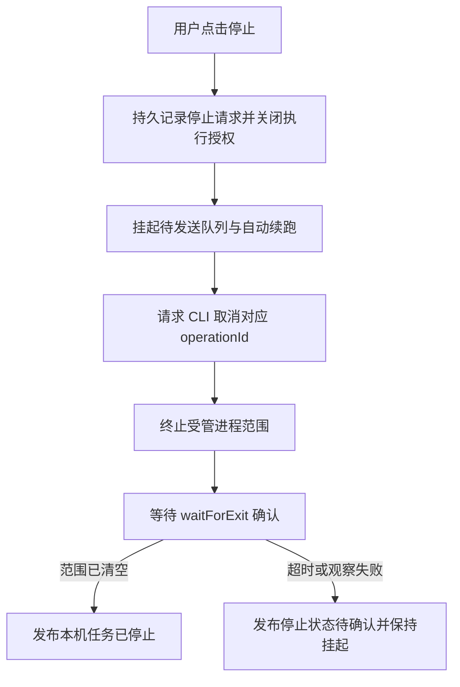

# KMH ZCode CLI 请求监督方案

## 概述

本方案让用户查看每次模型请求的阶段、耗时、重试和结束原因，并取得本机任务停止的确认。KMH 保持提示、工具与 Agent 循环的执行归属，ZCode CLI 承担模型通信。实施范围包含 `@kmh/zcode-cli`、DSH 的会话停止与队列行为，以及对应 Web 展示。本文于 2026-10-06 完成源码、已安装 CLI 和真实运行记录调查；实施状态为待开发，下述目标与验收项均属于拟实施设计。

## 目录

- [已确认事实](#已确认事实)
- [用户可见行为](#用户可见行为)
- [停止与退出确认](#停止与退出确认)
- [最小运行配置](#最小运行配置)
- [请求记录与追踪](#请求记录与追踪)
- [责任与实施顺序](#责任与实施顺序)
- [验收与限制](#验收与限制)
- [参考](#参考)

-----

## 已确认事实

现有提供方使用 `workspace/generateText` 传入 KMH 的消息和工具声明，每次请求创建一个 CLI app-server。此次失败记录包含一次约五分钟的 `Headers Timeout Error`、一次重试和总请求约六分钟时的进程关闭。这些事实与插件现有 `requestTimeoutMs = 360000` 及其取消分类实现吻合。

| 已核对的实现 | 当前行为 | 所需改进 |
| --- | --- | --- |
| [ZCode 运行时](../../packages/zcode-cli/src/runtime.ts) | 用户取消、超时和插件卸载合并成一个 abort signal；中止后统一报 `ZCODE_REQUEST_CANCELLED` | 保留首个终止原因，并分别记录清理结果 |
| [会话停止接口](../../third_party/dsh/packages/api/session-controller/src/commands.ts) | 返回 `accepted: true`，调用取消时保留待发送队列 | 分别展示请求接收、停止完成，并明确队列挂起策略 |
| [客户端取消约定](../../third_party/dsh/packages/api/session-controller/src/client/contract/session.ts) | 待发送队列可在取消收敛后继续执行 | 用户点击“停止”时挂起队列；“继续”显式恢复 |
| [子进程接口](../../third_party/dsh/packages/subprocess/subprocess/src/types.ts) | `done` 提供直接命令的退出结果；`waitForExit` 确认提供方受管范围清空 | 插件在发布停止确认前调用 `waitForExit` |
| [账号状态](../../packages/zcode-cli/src/status.ts) | 状态集中在登录与连接，缺少按会话、按请求的运行信息 | 为每次模型请求提供独立状态和历史 |

本机 `/Applications/ZCode.app/Contents/Resources/glm/zcode.cjs` 中存在 `workspace/cancelGenerateText`。它接受 `{ operationId }`，返回 `{ operationId, cancelled }`；取消消息绕过普通消息处理队列。当前插件已为生成请求传入 `operationId`，其停止路径仍通过关闭 RPC 和终止进程完成。上述协议行为来自已安装产物检查，真实取消往返列入后续兼容性验收。

此次请求的 CLI 启动日志还记录了 `enabledPluginCount: 11`、`mcpServerCount: 8`，以及启用的 MCP 和记忆配置。记录证明这些组件参与初始化；其具体业务活动需要对应事件确认。该初始化范围应在最小模型通信模式中收紧。

-----

## 用户可见行为

用户应在会话内看到当前模型通信的阶段和停止结果。普通界面展示“启动模型通道”“等待模型回复”“第 2 次尝试”“正在停止”“本机任务已停止”或“停止状态待确认”，详情展示具体证据和日志入口。

请求结果与本机执行状态分别记录。例如，结果为“模型请求超时”，本机执行状态可以先为“正在停止”，再变为“已确认停止”。账号登录状态独立保留。CLI 控制通道的取消确认、本机进程回收确认和模型服务端的处理状态各自展示。

“停止”定义为终止本轮并挂起待发送队列及该会话的自动续跑入口。“继续”恢复被挂起的工作；“补充本轮”将内容送入下一步。后台调度、目标续跑和子 Agent 投递遵循同一会话暂停状态，待处理输入继续保存。

终止原因至少区分用户停止、启动超时、模型请求总超时、提供方错误、CLI 提前退出、宿主卸载和清理失败。最先生效的终止原因保持不变，随后发生的清理错误作为独立信息保存。

进程存活、RPC 活动、模型输出和日志追加采用独立时间字段。监督器心跳只说明监督器仍可观测；模型输出进度取自实际协议事件。全局日志追加使用会话与请求关联后才更新对应卡片。

-----

## 停止与退出确认

请求监督器放在 `@kmh/zcode-cli` 内，复用 DSH 的子进程服务。它持有请求身份、操作身份、当前执行授权、截止时间、RPC 和进程句柄。停止操作使用唯一的取消身份，并允许重复查询同一结果。

停止接收后立即关闭该轮的执行授权。KMH 工具执行器在开始新的工具调用前核对授权和取消信号；晚到的模型响应按已撤销请求处理。执行授权的关闭顺序先于 CLI 清理，因此清理等待期间的新工具调用也会被拒绝。

CLI 取消请求使用独立、短时限的控制信号。模型请求的取消与进程终止分别管理，让控制消息有机会取得回执。`cancelled: true` 表示 CLI 触发了对应操作的中止；`cancelled: false` 触发当前请求与进程状态复核。两个回执均继续走本机退出确认流程。

CLI 回执超时、RPC 断开和直接进程退出统一进入受管范围清理。复用底座的 TERM、宽限期和 KILL 升级过程，随后以 `waitForExit` 的确认发布本机停止完成。主进程退出和 CLI 的关闭日志保存为辅助证据。观察失败或达到清理截止时间时，保持会话挂起并展示“停止状态待确认”；受管范围的失败结果持续保留供后续回收。

请求总截止时间从 KMH 接收请求开始计时，包含准备、启动、模型等待与 CLI 内部重试。回收使用独立截止时间。保留现有请求总时限作为首轮兼容基线；取消回执目标 1 秒、清理确认目标 5 秒、慢请求提示目标 30 秒，均作为拟实施的可配置项并经真实平台测试校准。

宿主恢复时，对尚无清理确认的请求执行恢复调查。检查使用受管身份及其启动身份，避免仅凭历史 PID 采取操作。完成回收确认后恢复可用状态；观察结果未知的会话保持挂起。宿主强制退出的覆盖由外部监督进程或 OS 管理者提供，沿用底座的平台能力与限制。

-----

## 最小运行配置

模型通信进程应只加载账号、模型提供方与协议必需组件。启动配置由 KMH 持有，CLI 版本、配置摘要与初始化能力清单纳入请求记录。CLI 的插件、MCP、记忆写入、hooks、调度和工具执行入口按经过验证的官方配置关闭，KMH 继续将自己的工具声明传给模型并执行模型返回的工具调用。

实现时逐项验证已安装版本支持的参数和配置字段，并对初始化事件建立验收。每次兼容性验证要求额外插件数、MCP 服务数和 hooks 数为零，记忆写入与自动任务功能关闭。官方配置无法满足该条件时，该版本的最小运行模式标记为不可用，进一步采用官方提供的轻量模型通信入口或更强的 OS 隔离。

CLI 使用专属运行目录和受控配置根；任务项目目录与 KMH 工具的执行目录保持明确映射。操作系统权限限制 CLI 的文件、进程和网络访问。权限策略包含账号服务、模型端点、已验证的日志与配置路径，并通过真实账号、TLS 与平台代理测试校准。项目文件写入、浏览器动作等业务操作的审计归属集中在 KMH 工具执行器。

保留当前每个模型请求独立创建进程的方式，以缩小取消与回收范围。可执行文件版本变更经过能力检查和故障测试后进入支持名单。

-----

## 请求记录与追踪

每个模型请求使用一个 KMH 请求身份，并建立会话、turn、step、CLI `operationId`、CLI 内部 session/trace、受管范围身份的映射。跨组件标识使用品牌类型。CLI 原生追踪身份通过已验证的日志或协议事件关联，协议扩展字段依照其实际 schema 校验。

拟新增的本地目录为 `$KMH_HOME/logs/zcode-cli/<sessionId>/<requestId>/`。其中保存结构化生命周期事件、脱敏诊断和退出回执。停止请求、CLI 取消回执、主进程退出、受管范围清空和清理失败均拥有独立事件。动态 Web 状态由同一记录及实时观察生成，页面刷新后能重建状态。

生命周期事件采用 OpenTelemetry 的请求、子操作和关联日志结构，首期使用本地输出；后续按部署需要接入 OTLP。现有原始对话继续由 KMH session 保存，诊断默认保存元数据、耗时、重试与受控错误。凭据回调、鉴权头和令牌经过写入前脱敏，日志文件保持私有权限并设置保留策略。

`ZCODE_LOG_DIR` 的运行日志重定向须经过固定版本兼容测试。已安装 CLI 的模型 I/O rollout 使用其自己的用户 home 路径，其路径与关联方式在诊断入口明确展示；KMH 自有事件作为用户状态的事实来源。CLI 内部重试的展示依赖实际事件，无法取得的阶段标为“等待 CLI 响应”。

-----

## 责任与实施顺序

控制与观测围绕已有拥有者实施，通用会话行为归 DSH，自有模型通信归 Kongming。

| 阶段 | 交付内容 | 主要拥有者 |
| --- | --- | --- |
| P0 | 区分终止原因，复用原生取消，确认受管范围清空，失败保持挂起，晚到响应拒绝执行 | `packages/zcode-cli`；DSH Agent 的通用执行授权 |
| P0 | 明确“停止并挂起队列”和“继续”，记录接收与完成，阻断自动续跑；最小 CLI 配置的兼容验收 | DSH session controller/Agent；`packages/zcode-cli` |
| P1 | 请求记录、关联日志、实时状态、慢请求与重试展示、诊断导出 | `packages/zcode-cli` 与其 Client；DSH 会话界面 |
| P2 | 外部宿主监督、恢复调查、版本兼容矩阵与按平台加强隔离 | KMH 启动/运行层与 DSH subprocess/sandbox 提供方 |

当前停止按钮请求是否发出仍待浏览器与 API 复现确认。第一阶段同时覆盖按钮动作、请求接收、Agent 中止、CLI 取消与清理确认的全链路调查。

修改 DSH 的持久会话事件、生命周期与 SDK 投影时，同步遵循子模块的持久类型确认、升级指南、TypeScript/Python SDK 和快照要求。用户可见的错误与停止语义在所属 README、JSDoc 与升级说明中一并更新。

-----

## 验收与限制

下表是后续实施的必需验收场景，本轮执行内容为只读调查和方案文档验证。

| 场景 | 必需观察结果 |
| --- | --- |
| 模型长时间等待后点击停止 | 停止接收立即可见；在真实 macOS 上核对 5 秒清理目标，结果为确认清空或明确未知 |
| 同时存在补充消息、待发送队列和自动续跑 | 队列与续跑保持挂起，显式继续后按记录恢复 |
| CLI 接受取消、忽略取消或 RPC 断开 | 每条路径都到达受管范围确认，回执与终止信号分别记录 |
| 主进程退出而子进程仍存活 | 状态保持回收中或未知；范围清空后才发布停止完成 |
| 网络超时并发生内部重试 | 显示网络超时和实际重试，总预算到期后记录总超时与回收结果 |
| 两个会话同时运行，停止其中一个 | 只撤销目标会话执行授权并回收其请求，另一会话正常完成 |
| 取消后收到模型文本或工具调用 | 保存晚到结果的处置记录，旧授权的工具调用被拒绝 |
| 宿主强制退出并重启 | 原未确认请求保持可见，恢复调查完成前会话保持挂起 |
| 初始化多余 MCP/plugin 或审计写入失败 | 模型请求被拒绝启动或进入停止清理，失败原因可见 |

进程日志停止追加提供活动证据，受管范围确认提供本机停止证据。已完成的文件修改、浏览器动作和外部请求保留既有影响；停止回执记录正在回收的操作及其结果。

macOS 当前底座使用进程组观察，脱离受管范围的后代可能超出观测能力。强保证部署采用经过测试的 OS 隔离或虚拟机，把受限运行单元整体回收。普通本机部署按实际受管范围发布确认，并在观察失败时保留未知状态，具体限制见 [subprocess-local](../../third_party/dsh/packages/subprocess/subprocess-local/README.md#known-limitations-and-deferred-work)。

本机停止确认覆盖 KMH 持有的执行授权和受管进程范围。云端模型请求的计算、计费与取消效果以服务方支持的协议和回执为依据，详情单独报告其可确认状态。

-----

## 参考

- [ZCode CLI 包说明](../../packages/zcode-cli/README.md)：账号、模型通信与当前运行日志归属。
- [KMH 数据目录与运行记录](../kmh/runtime-records.md)：现有运行数据与日志入口。
- [OpenTelemetry Traces](https://opentelemetry.io/docs/concepts/signals/traces/) 与 [Context propagation](https://opentelemetry.io/docs/concepts/context-propagation/)：跨进程请求和日志关联的标准结构。
- [Node.js subprocess.killed](https://nodejs.org/api/child_process.html#subprocesskilled)：信号发送状态与进程退出事实的区分。

## 开发备注

实现前需要完成原生取消的真实往返、最小运行配置支持项和停止按钮全链路复现。本文定义实施目标；具体配置字段与平台回收时限以这三项调查及验收结果确定。
