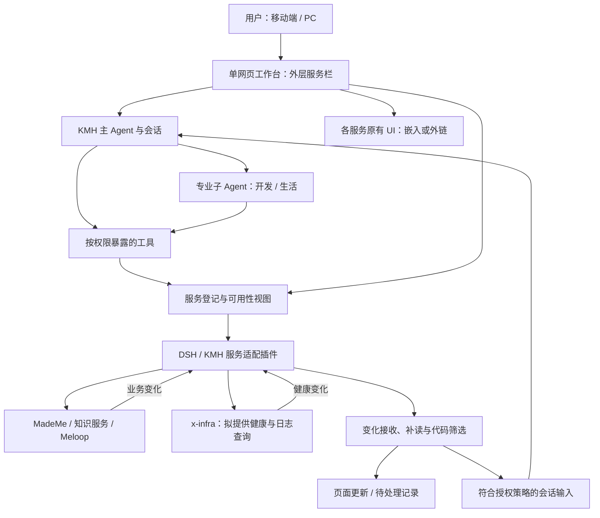
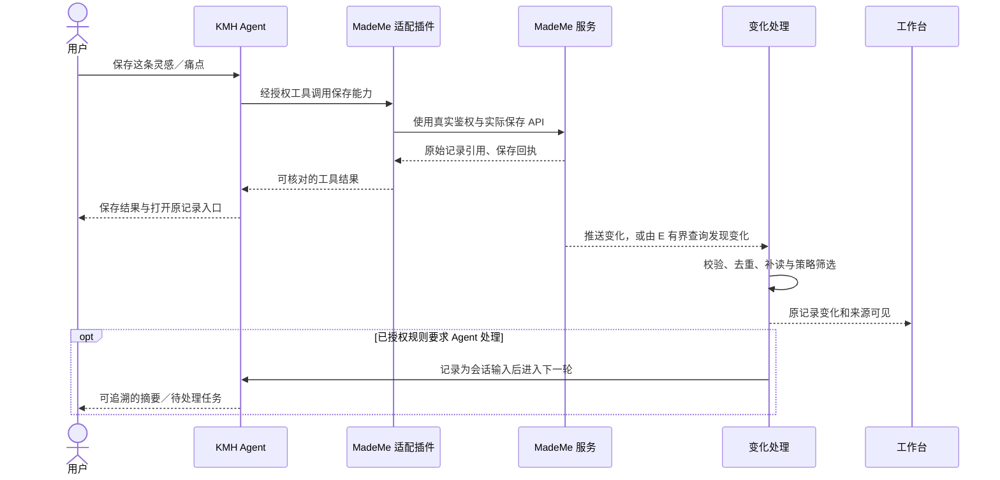

# KMH Agent OS：第一版服务接入方案与长期愿景

## 概述

用户可以主要面对一个 KMH Agent，由它调用独立服务，并委派开发、生活等专业子 Agent。第一版通过服务适配插件接入现有服务，以一个网页聚合入口，让用户看见保存结果和服务变化。用户已明确第一版不做自包含打包，不把全部服务搬进 KMH。本文记录截至 2026-10-10 的已确认方向、源码核查、实施建议与长期愿景；除明确标为已确认的产品边界外，设计细节仍待评审，本文不代表功能已实现。

## 目录

- [愿景与要解决的问题](#愿景与要解决的问题)
- [已确认的第一版边界](#已确认的第一版边界)
- [现状与证据](#现状与证据)
- [建议架构与维护归属](#建议架构与维护归属)
- [服务接入与能力注册](#服务接入与能力注册)
- [调用、事件与任务协调](#调用事件与任务协调)
- [业务数据与知识派生](#业务数据与知识派生)
- [统一网页入口](#统一网页入口)
- [鉴权、授权与秘密](#鉴权授权与秘密)
- [失败恢复与可观测性](#失败恢复与可观测性)
- [实施阶段与验收](#实施阶段与验收)
- [长期演进](#长期演进)
- [进一步探索](#进一步探索)
- [开发备注与待验证项](#开发备注与待验证项)

-----

## 愿景与要解决的问题

长期目标是让 KMH 成为移动端与 PC 共享的 Agent 入口。这里的 Agent OS 指围绕用户意图、服务能力、任务和持续维护形成的工作环境，不涉及替换底层操作系统。用户主要与一个 Agent 协作，专业子 Agent 保留明确任务、权限和交付物；独立服务继续管理自己的业务，也可以保留自己的 UI。

| 当前痛点 | 希望得到的结果 | 第一版的切入点 |
| --- | --- | --- |
| 灵感、痛点和思考说完就沉寂 | 内容有归属，后续可检索、可跟进 | 保存到 MadeMe，返回原始记录引用；后续处理必须有任务或订阅依据 |
| 多个项目需要逐一进入 session | 主 Agent 能跨项目理解进度并委派工作 | 保留统一入口与项目、session 引用；跨项目自主开发留待后续 |
| 服务入口分散 | 能在同一网页打开服务，也能直接让 Agent 调用 | 外层服务栏聚合 UI，适配插件提供调用能力 |
| 项目做到可用后缺少维护 | 持续看见健康变化、阻塞和维护需求 | 先显示健康与变化，再按明确策略产生维护任务 |

目标服务的产品归属如下。服务名称不等于已验证的接口、实现或部署状态。

| 服务 | 用户期望的职责 | 接入时必须保留的界限 |
| --- | --- | --- |
| MadeMe | 私有 Obsidian 笔记、备忘、思考碎片、读书总结 | 原始内容和编辑权限归 MadeMe；KMH 保存记录引用与执行回执 |
| 知识／记忆服务 | 用户称 OpenViking 模块；计划提供项目 wiki、codegraph 等知识能力 | 逐个核对真实后端、数据集与 API；不把不同知识库实现等同，不宣称已迁移 |
| Meloop | 音乐相关服务及其独立 UI | 音乐数据、播放状态和业务操作由服务解释 |
| x-infra | 基础设施服务；拟承担进程、注册、健康与日志能力 | 实际 API 和管理权限待核对；不把分工建议写成现成能力 |

远大设想还包括：意图跨 session 延续，记录逐步转化为行动，知识随项目变化更新，专业 Agent 维护已有成果。将来可以探索可独立交付或自包含的产品形态。这些目标保留为演进方向，不计入 V1 交付承诺。

## 已确认的第一版边界

用户已确认服务接入方式与 UI 方向。首个服务、接口和实现拆分属于下文建议，需要先完成事实核查，再进入开发。

| 范围 | 已确认方向 |
| --- | --- |
| 部署 | 不做自包含打包，不迁入全部服务；连接现有独立服务 |
| 扩展 | 可以编写服务适配插件，复用 DSH 服务、工具、事件和 effect 扩展 |
| 用户入口 | 单网页聚合，外层窄服务栏，服务内部可保留自己的导航 |
| Agent | KMH 是主要交互入口；专业子 Agent 的委派是整体方向 |
| 生命周期 | V1 KMH 不管理共享外部服务的启动与退出；关闭 KMH 不能终止这些服务 |

V1 的建议交付范围是一个真实服务纵向闭环、可扩展的接入方式和有界变化感知。其余服务先登记入口和待核查能力，不要求首版全部接通。网页入口可用与 Agent 能力可用分别呈现，不能用“能打开页面”证明“能调用服务”。

V1 不包含全部服务统一安装、数据库合并、知识库迁移、通用持久消息总线、全局事件溯源或任意多 Agent 自主运行。它也不承诺统一登录所有服务、所有页面可嵌入、离线执行写操作、后台永远在线或端到端恰好一次处理。持续自治、跨设备系统通知和大范围项目维护需另行定义权限、成本和验收。

本次文档工作只写方案：不实现功能，不启动或重启服务，不安装依赖，不修改配置、认证或业务代码，不提交或推送。本文的阶段与验收表是未来开发目标，不是本次运行结果。

-----

## 现状与证据

本地核查以 Git 和源码为依据，上游核查固定到一个提交。源码中存在接口只证明可作为设计依据，不能证明当前 profile 成功加载、外部服务连通或浏览器流程通过。本次未进行服务运行测试。

### 本地基线

Kongming 使用 `third_party/dsh` 完整子模块，自有启动器、profiles、bundles 和插件包仍由 Kongming 管理；目录分工见[当前架构](../../architecture/kongming-runtime.md)。下表记录方案调研时的 Git 指针与源码核对；实施时以实际检出的子模块版本和公开 API 为准。

| 项目 | 本次观察 |
| --- | --- |
| Kongming 分支 | `private-main`；工作区已有其他未提交修改，本方案避开这些文件 |
| Git 记录与实际子模块 HEAD | 均为 `9de374a8f3ea3564c71eb8c9cd007c8ac563b452`；子模块为 detached HEAD，无未提交修改 |
| DSH 版本字段 | [根 package.json](../../../third_party/dsh/package.json) 为 `0.2.1-alpha.1`；本次查看的 gateway、schedule、mcp-client、tools 同为该版本 |
| 子模块维护来源 | [.gitmodules](../../../.gitmodules) 指向自有 Fork，维护分支为 `kmh/runtime-core`；该配置不意味着当前 checkout 在分支上 |
| Web 接入声明 | [Web 配置](../../../profiles/kmh-web/cordis.patch.yml) 声明 Gateway、Schedule，以及 `serverName: openviking`、`transport: stdio` 的 MCP 条目 |

最后一项只确认配置声明。其服务实现、真实连通性、授权范围、数据目录和与其他知识库的关系均未核实。本次没有读取凭据或运行数据。

### 本地可复用接口

现有 DSH 不只负责启动插件。插件可以在 Cordis Context 上提供命名服务，其他插件通过依赖声明和直接调用消费服务；面向模型的工具、面向网页的 Remote API 和事件各自有独立接入路径。

| 本地依据 | 已核查事实 | 对方案的约束 |
| --- | --- | --- |
| [服务与依赖](../../../third_party/dsh/docs/user/develop/framework/service.md) | `Service` 提供 `ctx` 命名服务，`inject` 等待依赖就绪；必需服务消失会卸载依赖方 | 同进程依赖直接使用服务，不通过消息总线模拟 RPC |
| [Cordis events.ts](../../../third_party/dsh/vendor/cordis/src/events.ts) | `EventsService._hooks` 保存内存监听器，`ctx.on()` 随 effect 释放；支持 emit、parallel、serial、bail、waterfall | 普通 Cordis event 没有持久队列、确认与重放保证 |
| [ToolRuntime 源码](../../../third_party/dsh/packages/core/tools/src/index.ts) | `ctx.tools.register()` 接受 `ToolDefinition`，返回 disposer；工具须有输出 schema 与呈现定义，执行携带取消信号 | 注册服务不会自动成为模型工具；复用现有工具执行与结果记录 |
| [Gateway 说明](../../../third_party/dsh/packages/api/gateway/README.md) | `ctx.typertGateway` 与 `ctx.remote` 复用 Typert 描述符；有 HTTP 单次调用、WebSocket 流与重连 | 网页到 KMH Host 复用 Remote，不另建同义 RPC 协议 |
| [JournalStream 源码](../../../third_party/dsh/packages/api/gateway/src/client/journal-stream.ts) | `RemoteJournalStream` 由业务域提供游标比较、分页、follow 与发布逻辑，协调补读和去重 | 必须先有真实可补读的数据源；不能为普通通知虚构历史 |
| [Gateway 事件注册源码](../../../third_party/dsh/packages/api/gateway/src/index.ts) | `registerRemoteEvents()` 只接受一个应用选择的转发源 | 沿现有 [API Remotes](../../../third_party/dsh/packages/api/remotes/README.md) 组合扩展，适配插件不能各自覆盖全局转发源 |
| [Agent 说明](../../../third_party/dsh/packages/core/agent/README.md) | `followup()` 进入 inbox 并唤醒驱动，`inject()` 只加入下一步上下文 | 收到变化、把变化写入会话、启动模型执行是不同动作 |
| [Schedule 说明](../../../third_party/dsh/packages/schedule/schedule/README.md) | Session inbox 落盘与任务 receipt 分别写入；崩溃可能重复投递，receipt 不代表模型完成 | Schedule 可作为定时入口，不用来保证业务恰好一次或充当跨服务任务系统 |
| [MCP client 说明](../../../third_party/dsh/packages/mcp/mcp-client/README.md)与[transport 源码](../../../third_party/dsh/packages/mcp/mcp-client/src/transport.ts) | 可连接外部 MCP 工具；Streamable HTTP 连 URL，stdio 启动子进程；资源订阅与 MCP task 扩展存在限制 | 共享服务优先连接已有远程端点；stdio 的进程归属须另行核对，工具变化不等于业务数据变化 |

### 固定上游证据

上游参考提交是 `d743267388641bc76f17c45ce8b4c231aed1d32c`，[版本字段](https://github.com/deepseek-ai/deepseek-harness/blob/d743267388641bc76f17c45ce8b4c231aed1d32c/package.json)为 `0.2.1-alpha.2`。它与本地版本不同。本地 Git 对象库未能解析该上游提交，本次没有 fetch，也没有判定两者祖先关系或完整差异。

该提交的[服务文档](https://github.com/deepseek-ai/deepseek-harness/blob/d743267388641bc76f17c45ce8b4c231aed1d32c/docs/user/develop/framework/service.md)和[事件源码](https://github.com/deepseek-ai/deepseek-harness/blob/d743267388641bc76f17c45ce8b4c231aed1d32c/vendor/cordis/src/events.ts)支持命名服务、依赖生命周期与 typed events。[Gateway 文档](https://github.com/deepseek-ai/deepseek-harness/blob/d743267388641bc76f17c45ce8b4c231aed1d32c/packages/api/gateway/README.md)说明 Remote 调用、流、重连和域游标补读，同时明确普通通知不重放。[Schedule 文档](https://github.com/deepseek-ai/deepseek-harness/blob/d743267388641bc76f17c45ce8b4c231aed1d32c/packages/schedule/schedule/README.md)明确非原子写入可能重复投递。[MCP client 文档](https://github.com/deepseek-ai/deepseek-harness/blob/d743267388641bc76f17c45ce8b4c231aed1d32c/packages/mcp/mcp-client/README.md)提供外部服务工具接入路径。这些资料用于核对方向；实现参数仍须以当时固定的本地版本为准。

### UI 参考

[云端交互原型](https://service-workbench-preview.goldenscarf5.chatgpt.site)作为用户已提供的布局参考：外栏 72px，KMH 内会话栏可收起，服务内部导航可保留。它是纯交互原型，未对接真实服务。本次网页读取工具未能访问该地址，没有重新验证页面行为；上述布局来自任务输入。

-----

## 建议架构与维护归属

以下分工是建议，不代表用户已逐项批准，也不代表 x-infra 等服务已经提供全部能力。第一版保持独立服务边界，KMH 负责连接和协调。



图中箭头表示运行时调用或数据流；静态代码依赖按下文约束。

| 所属层 | 建议职责 | 不承担的职责 |
| --- | --- | --- |
| x-infra 或实际部署管理者 | 共享服务进程生命周期、注册、健康和日志 | 不解释业务数据，不决定 Agent 如何处理用户意图 |
| DSH／KMH | Agent、工具权限、会话与任务协调、工作台入口 | 不接管独立业务数据库，不把所有外部服务当子进程 |
| 服务适配插件 | 认证连接、能力映射、结果与事件转换、恢复和诊断 | 不复制完整业务，不新增独立任务调度器 |
| 独立业务服务 | API、UI、真实业务数据、业务事务及操作状态 | 不依赖 KMH 才能运行 |
| 知识／记忆服务 | 在授权范围内索引、检索和派生知识 | 不默认成为全部服务的业务数据主库 |

适配插件卸载时，释放自己的注册、连接、监听器与定时器。它可以关闭自己拥有的轻量桥接进程，但不能停止共享业务服务。现有 stdio MCP 条目的进程是否为桥接器，需逐项核对；不能把 stdio 接入天然解释为“共享服务生命周期独立”。

### 建议目录与单向依赖

代码仍落在 Kongming 自有 `packages/`；不因这项方案搬迁 DSH 包或改写 loop。以下名称是候选目录，不是已经存在的包。第一条闭环只建立实际需要的包；通用 transport 与规则可以先放服务包内，出现独立消费者后再提取。

```text
packages/
  service-contracts/       # 新增边界 schema、服务与能力标识；不含业务实现
  service-registry/        # 接入登记、可用性及 UI / 工具共有的服务视图
  service-mademe/          # 首个候选适配插件
    src/
      index.ts            # Cordis 装配、inject、effect 清理
      config.ts           # 已校验连接与策略配置
      mapping.ts          # 真实服务协议到能力、结果、事件的映射
      transport/          # 本服务实际需要的连接实现
  service-tools/          # 把允许的能力映射到 DSH ToolDefinition
  service-events/         # 有界变化接收、补读、筛选与待处理记录
  service-workbench/      # Host Remote 投影与 Client 外栏，分开编译面
```

静态依赖箭头从消费者指向被使用的定义：工具／事件消费／工作台 → 登记接口与协议；适配插件 → 登记接口与协议；登记服务 → 协议。登记接口不导入具体 MadeMe 包，适配插件不能反向依赖 UI 或主 Agent 提示词。工作台 Client 只导入 Client 协议，不导入 Host 凭据与 transport。跨包用包名导入，由 profile 组合实现，准确接入步骤沿用[自有插件包清单](../../kmh/adding-a-plugin-package.md)。

不要同时维护适配配置、UI 服务清单和模型能力清单三个手写版本。服务声明与部署配置形成一个 Host 登记视图，UI 和工具按各自权限派生。健康、调用历史和事件处理记录各有自己的事实来源，不能在登记表里再保存一份可写业务状态。

-----

## 服务接入与能力注册

一个服务适配插件至少要完成真实接口连接、明确授权范围、公布可调用能力、解释失败以及按需读取变化。只有链接、只有工具名称或只有进程注册都不足以称为完整接入。

### 接入职责与 transport

| 接入职责 | 第一版要求 |
| --- | --- |
| 标识与发现 | 稳定 `serviceId`、能力标识与版本；核对来源，重复标识拒绝加载；展示实际已接入能力 |
| 连接与鉴权 | 分清 Host 调用地址、浏览器 UI 地址与秘密引用；校验地址和协议；连接失败可见 |
| 能力与结果 | 复用真实 schema；声明读写、副作用和授权要求；保留原始对象引用、服务回执与错误分类 |
| 变化与健康 | 按真实服务选择推送、补读或有界轮询；区分业务事件、工具目录变化和健康变化 |
| 生命周期 | 用 `ctx.effect()`、注册 disposer 和 `ctx.on()` 绑定归属；卸载后无监听器或轮询遗留 |
| 诊断 | 记录脱敏的调用关联、连接与补读状态；提供下一步恢复入口 |

能力语义应与 transport 分开。调用方不拼服务 URL，也不依赖外部协议细节。

| 实际服务条件 | 建议路径 | 必须说明的限制 |
| --- | --- | --- |
| 同一 Cordis 进程内提供服务 | 命名服务与 `inject`，直接类型化调用 | 只适用于当前进程与作用域，不连接独立远程进程 |
| 已有 HTTP API | 薄适配插件调用服务正式 API | 路由、认证、幂等与取消须先核实；不编造统一 `/invoke` |
| 已有 MCP 端点 | 复用 DSH MCP client；共享服务优先远程连接 | 确认工具和事件能力；MCP 工具列表更新不代表业务变更订阅 |
| 已有事件流或 webhook | 独立接收通路与服务查询配合 | 验签、游标、保留期和重试按服务实际能力决定 |
| 只有 UI，没有可调用 API | 登记网页入口，标明能力未接入 | 不能以页面嵌入替代后端 API；新增服务侧插件另立任务 |

HTTP、MCP、流式连接可以替换，替换时保持能力标识、权限和结果语义稳定。不为了可能的未来 transport 建设多协议框架；先验证 MadeMe 所需路径，再抽取复用点。

### 能力登记与模型工具暴露

能力登记是插件之间的发现与调用契约。模型工具暴露则是把某项能力转换为模型可见名称、说明、输入 schema、执行和输出呈现，两者不能合并为“安装插件即全部可调用”。

建议 Host 登记视图拥有服务标识、能力描述、UI 入口和健康来源引用。模型工具由 `service-tools` 根据 Agent 作用域与授权选择，再使用真实 `ToolDefinition` 和 `ctx.tools.register()` 注册；UI 按用户身份派生入口和能力可用状态。服务离线时保留可诊断入口，调用显示离线；授权撤回后停止暴露或执行相关能力。服务升级不应通过改名隐藏协议不兼容。

使用原生 MCP 工具时复用既有命名和执行语义。若需要更窄的业务包装工具，必须明确它是同一能力的策略投影，并避免同一作用域无理由同时暴露两套同义写入工具。登记表本身不给调用方任何权限。

### 协议与类型约束

新增 KMH TypeScript 的网络、持久化和模型输入边界以 Zod schema 为源，用 `z.infer` 派生类型；Python 服务以 Pydantic 为源。跨语言需要协议时指定一侧权威 schema 并生成消费类型，不两侧手写 DTO。已有服务的公开 schema、DSH [Typert 生成协议](../../../third_party/dsh/packages/typert/protocol/README.md)和工具协议优先复用，不重定义同名 Remote 请求、结果或错误封装。

本方案不规定未经核实的服务 DTO。最小关联信息应能表达服务／能力身份、调用关联、原始对象引用和操作回执；变化记录应能表达来源事件标识或对象版本、发生时间及可选来源游标。具体字段在接口核查后由所属 schema 定义一次。来源游标不能由 KMH 时间戳替代，`serviceId` 也不能当成已认证的调用者身份。

同进程已类型化参数遵循 DSH 约定，不为它们重复做网络校验。适配器只在实际接收边界校验未知内容，转换后使用严格类型；时间、批量数量、并发、重试、保留期及端点集中在所属插件的可校验配置中。本次不分配端口；后续确需新增端口时优先大于 60000，并先核对冲突与部署条件。

-----

## 调用、事件与任务协调

调用表达意图，结果表达这次请求的结论，事件表达已发生的变化，任务状态表达一段工作走到了哪里。四者使用关联引用连接，不互相冒充。

| 概念 | 示例语义 | 成功与持久性判定 |
| --- | --- | --- |
| 调用 | 请 MadeMe 保存这段灵感 | 已发送不代表已保存；模型生成意图也不代表服务接收 |
| 结果 | 服务返回记录引用与保存回执 | 依服务写入契约确认；若只接受后台作业，应显示待完成 |
| 业务事件 | 记录已修改，或后台索引已完成 | 服务事实；必须区分实时提示与可补读历史 |
| KMH 任务状态 | 待处理、执行中、等待用户、完成或失败 | 复用 DSH 的权威任务／会话事实，业务 operation 状态仍归服务 |

UI 可以映射这些状态便于展示，但不能新增可独立修改的“真实进度”表。收到 `accepted` 不能标成业务完成，Schedule 投递 receipt 也不能标成 Agent 完成。

### 首个候选闭环：MadeMe 保存与变化可见

建议选择以下最小路径。MadeMe 的真实保存、读取、事件和鉴权 API 均未核实；以下为场景和验收目标，不是接口名称或配置示例。



保存成功后用原服务读取或打开记录核对内容，并返回真实回执。若用户之后从 MadeMe UI 修改同一记录，KMH 页面能显示变化，用户可主动让 Agent 处理；自动唤醒只在规则和授权明确时启用。保存触发的自身事件通过调用关联或对象版本识别，不能再自动保存一遍形成循环。

### 变化发现与恢复等级

每个服务先选择实际能支持的等级，页面应显示该等级和最后同步时间。没有历史 API 的服务不能承诺找回离线期间的全部事件。

| 服务能力 | 接收与补读建议 | 可承诺范围 |
| --- | --- | --- |
| 有持久变更日志、稳定游标与推送 | 推送降低延迟；游标分页补读并去重 | 在真实保留期内恢复已记录的变化；游标过期显示缺口并重新建立基线 |
| 有版本／更新时间查询，无推送 | 有界增量轮询、重叠窗口与稳定对象版本去重 | 按服务查询语义观察变化；删除、同时间戳及分页漂移需单独验证 |
| 只有当前快照 | 有界快照比较，保存必要基线 | 发现当前状态差异，不能还原中间事件顺序或已消失对象 |
| 只有实时通知 | 显示实时提示，重连后查询当前状态（若可查询） | 通知可能丢失，离线历史不可恢复 |

轮询间隔、页大小、单轮页数／时间上限、并发、退避与保留期限由配置决定。停止、卸载或授权撤回后取消轮询；超出预算延后续页，不无限扫描笔记库和代码仓库。源游标只在对应页已被可靠接收后推进，处理失败的事件必须仍可查到。

需要后续处理的变化先持久接收，再推进来源游标；同一持久域能原子提交时，一并保存待处理记录和游标。不能原子提交时，先保存记录，崩溃后允许重读并去重，不能先推进游标而丢失工作。实时提示和临时 UI 更新不充当持久接收确认。

### 先由代码筛选，再决定是否唤醒 Agent

建议处理顺序为校验来源和授权、规范化、去重、关联自身调用、合并同对象变化，再执行已配置规则。规则输出三类动作：更新 UI；保存待处理记录；按授权将有界摘要加入指定会话并唤醒 Agent。健康轮询、音乐进度、工具目录变化和日志心跳默认只更新页面，不逐条请求 LLM。

规则至少限定服务／项目／对象范围、事件种类、目标会话、静默时段、合并窗口、最大待处理量和模型调用预算。超额时保留待处理或显示缺口，不无限堆消息。主 Agent 忙碌时优先走普通 next-turn inbox，避免事件打断正在执行的工具；目标会话不存在或不可恢复时保留待处理，不能偷偷改投其他 session。

进入模型的摘要必须通过现有会话记录通路保存来源、原记录引用和筛选结论，才能复核模型看到了什么。外部内容按数据处理，不把笔记或日志中的指令自动当作用户授权。专业子 Agent 接收明确任务与最小权限，委派结果回到原任务；跨项目自治属于后续阶段。

变化接收、会话投递和业务写入之间不假设存在跨服务事务。第一版只为需要处理的变化保存必要游标、去重键和处理回执，复用现有存储能力，不建设大而全 bus。重复唤醒仍可能发生；不可逆或非幂等业务动作须独立防重，不能依赖事件去重或模型记忆。

-----

## 业务数据与知识派生

原始业务记录由原服务拥有，KMH 的执行记录和知识派生各自保存引用。唯一来源按实体和字段定义，不要求所有系统共用一个数据库。

| 数据 | 权威来源 | KMH／知识服务可保存的内容 |
| --- | --- | --- |
| 笔记、备忘、读书总结 | MadeMe 的实际存储契约；与 Obsidian 文件的关系待核实 | 原记录标识、版本、链接；授权的短摘要或派生索引 |
| 项目代码 | 对应代码仓库及固定 commit／工作树状态 | wiki、codegraph 等带版本引用的派生内容 |
| 音乐和业务播放状态 | Meloop | 显示投影及操作回执，不做第二个可写播放状态源 |
| 服务进程、健康、日志 | 实际部署管理者；若采用 x-infra，按其真实接口 | 最后观察、诊断关联和入口，不复制一套进程控制状态 |
| Agent 会话、执行与交付 | DSH 的权威会话／任务记录 | 工作台读视图，不再维护同义可写任务状态 |
| 接入配置、变化游标、处理回执 | KMH 所属插件的配置和持久域 | 连接元数据与恢复事实，避免整库业务镜像 |

知识派生记录需要带来源标识、版本和索引时间。源记录修改或删除后，派生内容应失效、更新或显示过期；索引未完成不能显示为最新。回答引用原记录，无法访问原服务时说明使用的是何时的派生数据。项目 wiki／codegraph 的 API、权限和更新方式另行验证，不因接入了名为 OpenViking 的工具就推断它们已存在。

编辑原内容通过原服务能力执行。知识服务可以保存原生记忆，但这类记忆与引用 MadeMe 的派生摘要必须有明确类别和归属，不能形成相互同步的两个可写主副本。私有笔记默认按最小范围检索，不为方便检索把全库复制进提示词或公开页面。

## 统一网页入口

第一版聚合服务入口与 KMH 交互。外层服务栏解决“去哪儿”，内部导航解决“在该服务里做什么”；两层保留清晰归属。

桌面布局参考 72px 外栏，宽度作为集中设计配置。KMH 会话栏可收起，MadeMe、Meloop 等服务内部可保留原导航。移动端需要响应式服务切换，具体样式待设计和浏览器验证，不机械套用桌面固定宽度。

### 服务入口与能力视图一致

UI registry 与能力 registry 消费同一 Host 登记视图：服务身份、显示资料、UI 入口和能力状态由适配声明与部署配置派生。两者按权限产生不同投影，含义不必一一对应：有 UI 的服务可以尚未接入工具，有工具的服务也可以没有 UI。前端不根据硬编码名单猜测服务已连通。

外栏点击打开服务，状态指示显示可达、需认证或离线；KMH 内能看到该服务相关调用回执和最近变化。未接入能力明确展示为待接入。服务页和 KMH 会话中的记录引用指向同一真实对象，刷新或重新连接后重新读取所属来源。

### 本地、远程地址与嵌入

Host 调用地址、浏览器页面地址和回调地址必须分别配置。手机浏览器的 `localhost` 指手机本身，不能复用 PC Host 的本地 API 地址；跨设备入口需采用设备可达地址与对应认证。远程网页也不能默认访问用户 PC 的回环服务。

服务 UI 能否嵌入取决于服务的 CSP [`frame-ancestors`](https://developer.mozilla.org/en-US/docs/Web/HTTP/Reference/Headers/Content-Security-Policy/frame-ancestors)、[`X-Frame-Options`](https://developer.mozilla.org/en-US/docs/Web/HTTP/Reference/Headers/X-Frame-Options)、登录 cookie 策略、HTTPS 混合内容和浏览器限制。实现前逐个验证；允许嵌入才用受限 frame，不能嵌入则外链打开并保留返回 KMH 的入口。不擅自删除服务防护头或把私有文件映射为公开 URL。若需要反向代理或统一域名，单独核对服务授权、路径与 cookie 行为后再设计。

跨 frame 消息只允许预定义动作，验证 origin、发送窗口与消息 schema，发送时使用准确的目标 origin；[postMessage 安全要求](https://developer.mozilla.org/en-US/docs/Web/API/Window/postMessage)说明这些校验的必要性。所有导航地址按注册策略校验，动态目标不能直接成为 Host 任意请求目的地。页面可打开不证明后端能力已授权；UI 登录态也不能直接当作 Agent 的服务凭据。

-----

## 鉴权、授权与秘密

认证回答“谁在调用”，授权回答“可以对哪个项目或对象做什么”。统一入口并不自动获得全部服务权限，插件安装也不构成用户授权。

建议使用服务原有认证机制，由 KMH Host 持有最小服务权限的秘密引用。浏览器只接收所需状态和短期用户侧凭据，不接收服务长期 token；模型上下文、工具参数、日志、文档和 URL 查询串均不携带秘密。实际秘密存储优先核对既有 DSH／部署设施，不在本方案承诺尚未验证的统一凭据管理。

授权从用户到主 Agent、再到子 Agent 和具体能力逐级收窄，至少限定读写、服务、项目／笔记范围与触发来源。用户请求一次保存不自动授权长期监测或后续自主开发；常驻规则需要明确启用范围、可暂停入口和有效期限。撤销授权后停止新调用、订阅与已排队的未执行动作，派生数据保留政策按所属服务另行确定。

服务变化携带的是来源证据，不是用户命令。webhook 若被采用，验证服务实际签名、时间与重放策略；错误凭据或过期授权显示需重新连接，不能作为普通网络错误自动无限重试。真实业务读写仍需由原服务校验对象权限，KMH 的能力过滤不能替代服务端授权。

## 失败恢复与可观测性

V1 应让用户区分未执行、已确认失败、结果未知和已完成。连接恢复只恢复可读取事实，不把不确定的写入自动重做。

| 情况 | 建议处理 | 必须展示或记录的事实 |
| --- | --- | --- |
| 请求超时或网络中断 | 限定预算；读操作按策略重试；写操作先查服务回执或对象 | 超时不代表服务未写入；无法确认则显示结果未知 |
| 用户取消 | 传递 DSH `AbortSignal` 至 transport；服务支持才执行远程取消 | 本地停止等待不等于远端回滚；已提交副作用仍需读回 |
| 临时离线 | 退避重连，保留最后观察和来源时间 | 不显示为当前健康；V1 不排队自动补执行离线写入 |
| 认证／权限失败 | 停止相关能力与自动处理，提供重新连接入口 | 与超时、业务校验和内部故障区分 |
| 重复请求 | 服务支持时使用稳定幂等键并复用回执；同键不同参数拒绝 | 无服务端幂等或查询依据时，禁止盲重试非幂等写入 |
| 事件重复／乱序 | 来源事件标识或对象版本去重；按域定义顺序与补读 | 不假设所有服务共享全局顺序；无版本证据时说明限制 |
| 游标过期／历史缺口 | 显示缺口，重新取基线；保留已知处理记录 | 当前状态可以恢复，中间事件可能无法恢复 |
| 崩溃发生在投递与回执之间 | 对照持久待处理、Session 消息与工具结果后恢复 | 不宣称跨域原子投递；不确定项留待处理，业务副作用单独防重 |
| 外部后台作业 | 保留服务 operation 引用并查询其状态 | 请求已接受、Agent 回合结束和业务作业完成分别显示 |

工具、transport 与服务自身的重试要合并计算预算，避免三层重试相乘。是否可取消、可幂等、可补读按能力声明，不提供一个默认万能开关。协议常量固定，部署可调的超时、重试、分页、窗口和保留上限集中配置并在入口校验。

日志使用同一调用关联贯穿 Agent 工具、适配请求、服务回执和变化记录。记录服务／能力标识、耗时、重试次数、结果分类、源游标、最后成功同步时间和处理去向；笔记正文、代码内容与秘密不进入默认诊断日志。必要正文仍由业务服务与 DSH 的授权会话记录拥有。

第一版诊断页至少能回答：服务是否可达；工具是否已暴露且已授权；最近调用为何失败；变化来自哪里；是否补读、合并或丢弃；是否进入会话；是否形成任务或交付。记录规则命中／未命中原因、待处理量、缺口与模型调用数量，使主动感知的成本和噪声可评估。

-----

## 实施阶段与验收

阶段顺序以真实接口核查为起点。建议先交付 MadeMe 闭环，再扩展另一种服务，通用抽象只从已验证的重复需求提取。

| 阶段 | 具体产物 | 进入下一阶段的条件 |
| --- | --- | --- |
| S0 接口核查 | MadeMe 保存／读取 schema、真实认证方式、回执和幂等语义；变化来源；UI 可达与嵌入结果；数据归属清单 | 可用接口有真实证据；缺口明确归给服务侧插件或 KMH 适配任务，不虚构接口 |
| S1 单次保存 | MadeMe 适配、最小工具、原记录入口与真实凭据验证；保存后读回 | 真实服务读写通过，回执可核对；错误与结果未知可见 |
| S2 变化与网页闭环 | 统一服务栏、同源登记视图、一条业务变化接收／轮询路径、去重与刷新 | 外部 UI 修改可见；断连恢复符合声明等级；默认事件不请求 LLM |
| S3 有限主动处理 | 一条显式授权的变化规则、有界摘要与指定会话投递、暂停入口 | 规则触发可复核，预算和暂停生效，重复事件不会重复业务写入 |
| S4 第二个服务 | 按实际能力选择知识服务、Meloop 或 x-infra；接入矩阵与复用评审 | 第二个服务不复制第一套 registry、DTO 或可写状态；实际 transport 可替换 |

首版验收建议以 S1、S2 为必需，以 S3 的一条规则作为可选增量；是否纳入 S3、第二个服务选谁仍待用户确认。专业 Agent 扩展和全面维护不作为完成 MadeMe 闭环的前置条件。

### 可执行验收场景

以下步骤用于未来测试。开发时需记录固定代码版本、所用服务环境和真实结果；源码检查、模拟测试与真实浏览器结果分别报告，测试证据中秘密脱敏。

| 编号 | 操作 | 通过条件 |
| --- | --- | --- |
| A1 真实保存 | 使用已授权真实凭据，对 KMH 说“把这段灵感保存到 MadeMe”，再从原服务读取或打开 | 原服务仅有预期记录，内容一致；KMH 有真实回执和可打开引用 |
| A2 写入不确定 | 使请求在可能提交后中断或超时，再恢复查询 | 显示结果未知并读回；有幂等依据才重试，无重复记录 |
| A3 外部变化 | 在 MadeMe 原 UI 修改同一记录，不向 KMH 发消息 | 工作台在配置预算内显示对应变化和来源；默认没有模型调用 |
| A4 恢复等级 | 中断连接，在服务端改记录，再恢复；另测游标过期 | 按已声明等级补读或刷新；重复不重复处理，历史缺口明确可见 |
| A5 策略筛选 | 发送重复、自身保存、高频无关与一条规则匹配变化 | 合并与忽略理由可查；只有符合已授权规则的摘要进入目标会话，调用量受预算限制 |
| A6 授权撤回 | 撤回笔记范围权限或禁用主动规则，再产生变化 | 新调用／自动执行停止；UI 状态更新，子 Agent 不扩大权限 |
| A7 UI 入口 | 在 PC、实际移动浏览器切换 KMH 与服务，并测试禁止嵌入的服务 | 外栏可用、会话栏可收起；原导航保留；受限页面外链打开；手机不错误请求自身 localhost |
| A8 生命周期 | 卸载适配插件或关闭 KMH，检查服务和连接 | 无遗留轮询／监听器；共享业务服务继续运行，原 UI 仍可独立使用 |
| A9 类型与数据来源 | 检查协议生成、依赖和同一记录／任务的各处展示 | 新 TS 边界用 Zod 派生类型，Python 用 Pydantic；Typert 未重复定义；UI 与工具来自同一登记源，业务和任务无同义可写副本 |
| A10 诊断与重启 | 重启 KMH 后查看最近回执、待处理与同步状态 | 已确认事实可追溯；未完成投递显式恢复或待处理，不假称恰好一次；日志无秘密 |

真实服务接口不存在时，S0 的完成结果是缺口与待办，不是 S1 通过。后续代码检查按修改所属层执行 Kongming 检查或 DSH 规定检查；Web 流程必须使用实际浏览器验证，不能仅以静态源码判断通过。

## 长期演进

长期 Agent OS 的价值是让意图、记录、行动与维护持续连接。下列方向保留远大设想，不据此提前扩大 V1 的服务接管范围。

| 方向 | 期望体验 | 进一步设计前提 |
| --- | --- | --- |
| 跨设备统一 Agent | PC 与移动端共享任务和上下文，可随时返回工作 | 身份、设备可达性、同步与断线恢复；后台在线责任明确 |
| 意图持续推进 | 灵感和痛点有后续检索、计划、验证与反馈 | 授权规则、待办归属、预算、打断与暂停机制，避免无限自循环 |
| 专业 Agent 协作 | 主 Agent 委派开发、生活等任务并汇总交付 | 专业能力、最小权限、项目隔离、任务关联与交付验收 |
| 多项目维护 | 统一看见项目阻塞、健康、过期知识和维护需求 | 实际项目登记、知识更新、维护策略与变更审批，不靠持续全仓扫描 |
| 知识随工作更新 | wiki、codegraph、个人记忆帮助下一次行动 | 来源版本、删除与失效传播、隐私、检索质量和实现可替换 |
| 独立交付／自包含 | 在合适条件下交付一个可安装、可迁移的整体体验 | 服务许可证、数据迁移、生命周期、升级回滚、认证和平台成本另行评审 |

保持能力与 transport 分离，可以支持将来本地、远程或组合部署。是否需要共享基础服务、可靠队列、统一身份或自包含发行，由实际接入数量、可靠性目标和用户交付需求决定。未来自包含可作为新的发行形态，不改变 V1 对已有共享服务的生命周期约定。

-----

## 进一步探索

以下页面负责当前实现与接入流程。本方案负责 Agent OS 的 V1 设计与长期愿景；实现落地后，实际包契约、配置和操作迁入相应归属文档，本文通过链接引用。

- [Kongming 当前架构](../../architecture/kongming-runtime.md)：目录与运行时分工；版本以实际 Git 记录核对。
- [DSH 接入与升级](../../kmh/README.md)：当前启动器、profiles 和底座维护入口。
- [Web 插件索引](../../kmh/plugin-index.md)：现有功能和插件的源码归属。
- [新增自有插件包](../../kmh/adding-a-plugin-package.md)：后续实现的接入检查入口。
- [数据目录与运行记录](../../kmh/runtime-records.md)：KMH 的运行状态和日志归属。

## 开发备注与待验证项

<details>
<summary>评审与接口核查待办；不代表已实现能力或已批准分工</summary>

本次只完成文档与源码核查，没有运行服务、调用真实 API、读取秘密或验证 UI。下列项目进入 S0 或后续评审：

| 待验证项 | 核查归属与完成证据 |
| --- | --- |
| MadeMe 的真实部署、保存／读取 API、认证、回执、幂等与取消 | MadeMe 维护者与适配实现者；正式 schema、授权真实调用和原记录核对 |
| MadeMe 数据变化、删除、游标和保留期 | 服务维护者；推送／查询语义和断线补读测试；缺失时明确降低保证 |
| OpenViking 名称对应的真实实现、数据集与 MCP 进程归属 | 知识服务维护者；连接定义、数据来源和授权探针；不得据名称推断迁移 |
| 项目 wiki／codegraph 是否已有 API | 对应服务维护者；实际源码和读取样例，缺失则另立服务能力任务 |
| Meloop 与 x-infra 的能力与 UI | 各服务维护者；接入矩阵、认证与健康／事件读取证据 |
| x-infra、KMH 与服务维护者的最终分工 | 产品和架构评审；明确共享进程谁启动、谁升级、谁恢复，确认 KMH 关闭不终止服务 |
| 工作台各服务地址、登录和嵌入限制 | UI 与部署维护者；PC／移动浏览器验证；云端原型仍只作参考 |
| 事件至 Session 的记录、去重与崩溃恢复接线 | KMH／DSH 适配实现者；按固定 DSH 版本核对参数，测试投递与回执间崩溃，不修改 loop 绕开记录 |
| 采用的任务／会话读视图和子 Agent 委派路径 | KMH 实现者；复用实际 DSH 类型与持久事实，避免第二套可写任务状态 |
| 是否将主动规则纳入首版、规则范围与模型预算 | 用户与产品评审；明确规则、暂停入口、目标会话与权限，不凭一次保存请求启用 |
| 本地与固定上游提交差异 | 底座维护者；后续固定开发基线并核查所用接口，本文不推动升级 |

本方案的入口登记在[Spec 索引](../README.md)，实施范围按已确认方向和待评审项分别处理。

</details>
