# agent-tree-v0.1 · 图集

> 本 spec 的唯一图源：所有 mermaid 图集中于此，按模块分节。02/04/05 是文字事实源，本文件是只读视图——增减模块/组件时同步更新对应节。
>
> **查看与缩放**：GitHub 渲染 mermaid 自带缩放/平移控件；VS Code 建议安装 Mermaid Chart（官方）或 Markdown Preview Enhanced 插件以支持缩放。

## 目录

- [总览](./diagrams.md#总览)
- [E2E 测试链路](./diagrams.md#e2e-测试链路)
- [模块 A · AgentManager](./diagrams.md#模块-a-agentmanager)
- [模块 B · TaskRegistry](./diagrams.md#模块-b-taskregistry)
- [模块 C · Mailbox + agent_loop](./diagrams.md#模块-c-mailbox--agent_loop)
- [模块 D · run 终态分类器](./diagrams.md#模块-d-run-终态分类器)
- [模块 F · 审批 agent_id 维度](./diagrams.md#模块-f-审批-agent_id-维度)
- [模块 G · Event/wire 协议扩展](./diagrams.md#模块-g-eventwire-协议扩展)
- [跨模块状态与数据](./diagrams.md#跨模块状态与数据)

图例：🔵 P0 核心/阻塞性 · 🟠 P1 主要/必须完成 · ⚪ P2 辅助/可选。节点写模块名、中文作用、关键类/函数。

## 图类型规范

| 节 | 放什么图 | mermaid 类型 |
|----|---------|-------------|
| 总览 | 模块级依赖图：每模块一个节点，只画模块间关系 | `flowchart TD` |
| E2E 测试链路 | 从测试数据准备到断言的端到端验证路径 | `flowchart LR` |
| 模块节 | 局部组件依赖图、核心流程图、时序图、状态流转图、数据关系图 | `flowchart TD/LR` / `sequenceDiagram` / `stateDiagram-v2` |

写图顺序：先总览，再 E2E 测试链路，再按模块拆局部图，最后跨模块状态/数据。单图节点约 12 个以内。

## 总览

模块级依赖图：每个模块一个节点，只画模块间关系。实线=强依赖，虚线=弱/调起。

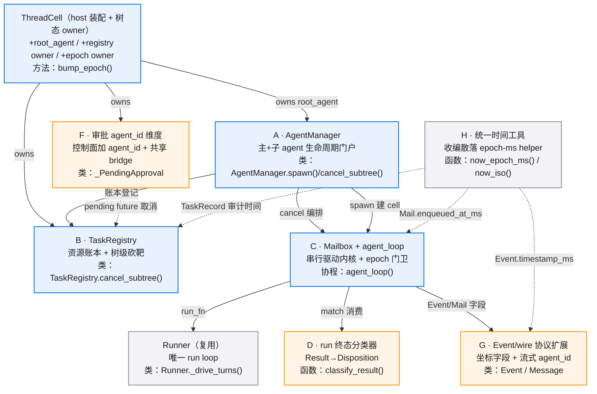

## E2E 测试链路

从测试数据准备、用户动作、系统处理到断言的验证路径。

```mermaid
flowchart LR
  classDef setup fill:#E8F1FE,stroke:#0071E3,color:#1D1D1F,stroke-width:1.5px
  classDef action fill:#FFF4E5,stroke:#FF9500,color:#1D1D1F,stroke-width:1.5px
  classDef assert fill:#F2F2F7,stroke:#8E8E93,color:#1D1D1F,stroke-width:1.5px

  Seed["准备测试数据<br/>建 ThreadCell + 主 AgentCell A"]:::setup
  UserMsg["用户发消息<br/>Mail(user_message) 入 A mailbox"]:::action
  RunA["A run<br/>agent_loop 取消息 → Runner.run()"]:::action
  Spawn["spawn B<br/>AgentManager.spawn() 登记 TaskRecord + 建 AgentCell B"]:::action
  ReplyA["A 立即回「已派出 B」<br/>tool_result 返回 {child_id, dispatched}"]:::action
  Idle["A idle<br/>用户继续聊 A（不阻塞）"]:::action
  RunB["B run<br/>B agent_loop → Runner.run() 完成任务"]:::action
  ChildResult["child_result<br/>Mail(child_result, epoch) 入 A mailbox"]:::action
  RunA2["A 新 run 汇总<br/>A agent_loop 取 child_result → Runner.run()"]:::action
  Assert["断言<br/>A 汇总报告用户<br/>流式帧带 agent_id"]:::assert

  Seed --> UserMsg --> RunA --> Spawn --> ReplyA --> Idle --> RunB --> ChildResult --> RunA2 --> Assert
```

打断侧链 E2E：

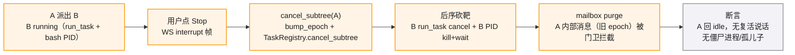

## 模块 A · AgentManager

### 组件依赖

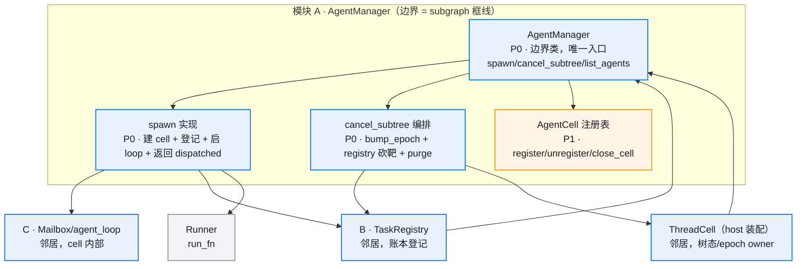

## 模块 B · TaskRegistry

### 组件依赖

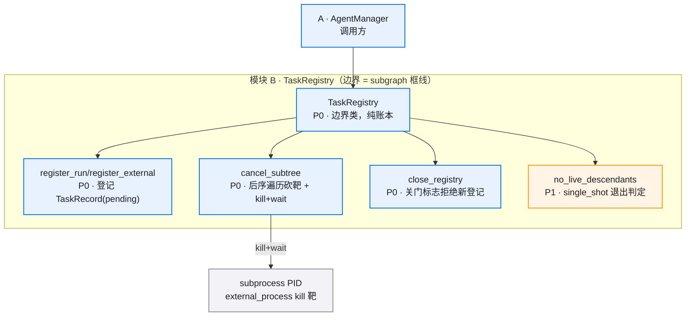

### cancel_subtree 后序流程

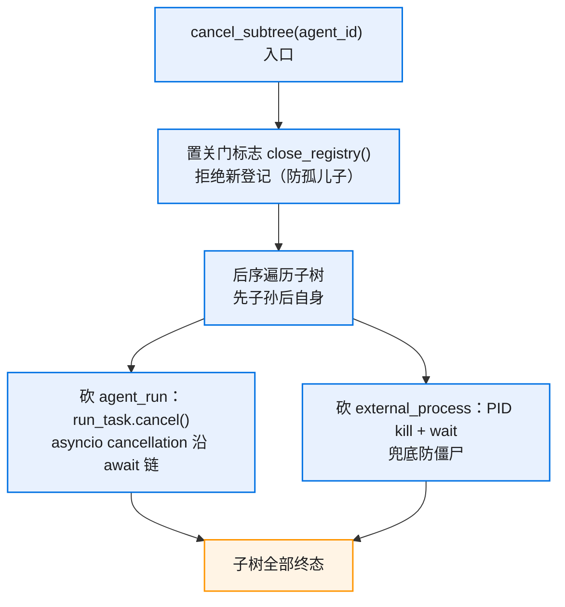

## 模块 C · Mailbox + agent_loop

### 组件依赖

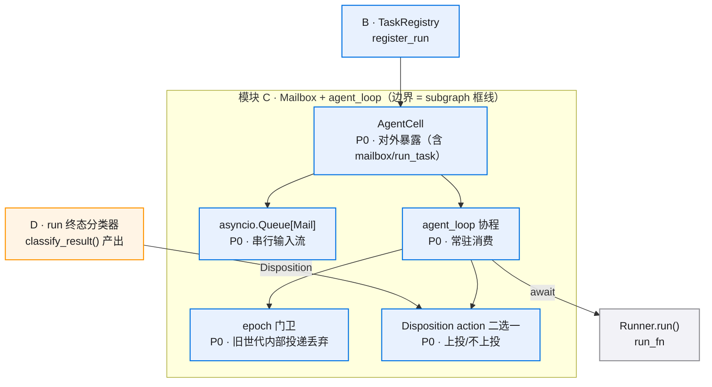

### agent_loop 核心流程

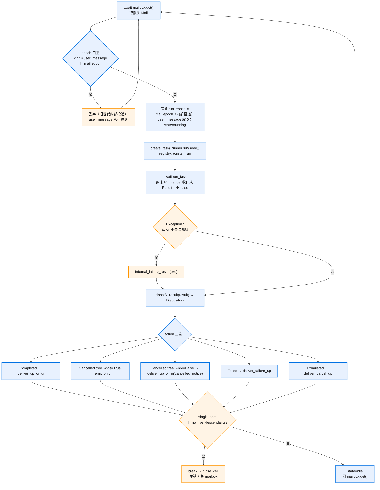

## 模块 D · run 终态分类器

### reason 映射与分发

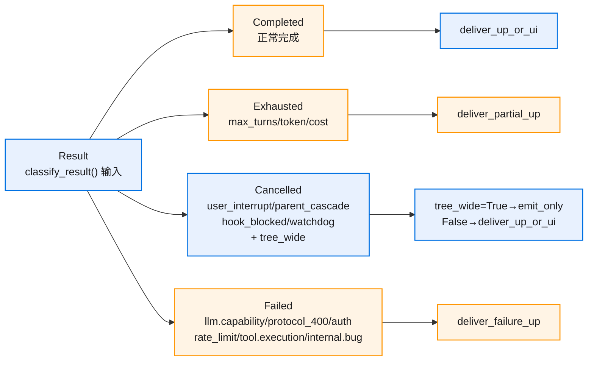

## 模块 F · 审批 agent_id 维度

### 控制面绕 mailbox 时序

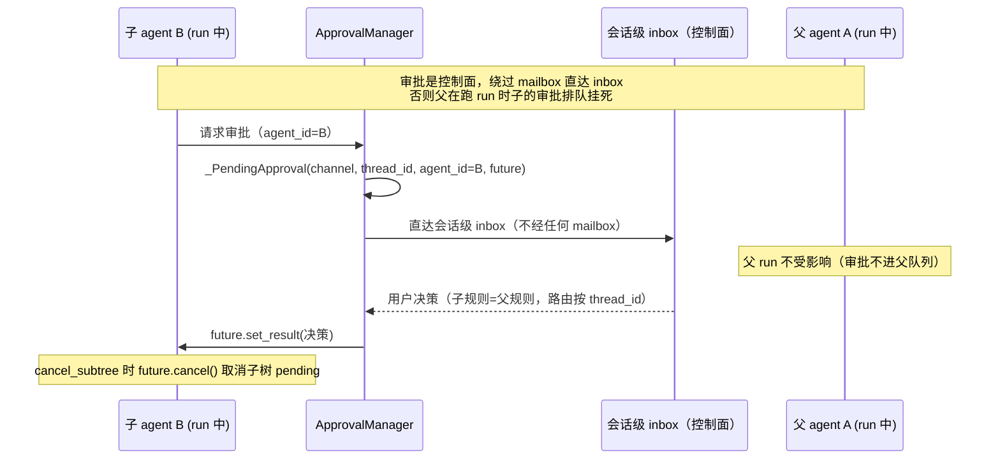

## 模块 G · Event/wire 协议扩展

### 双侧真源同步

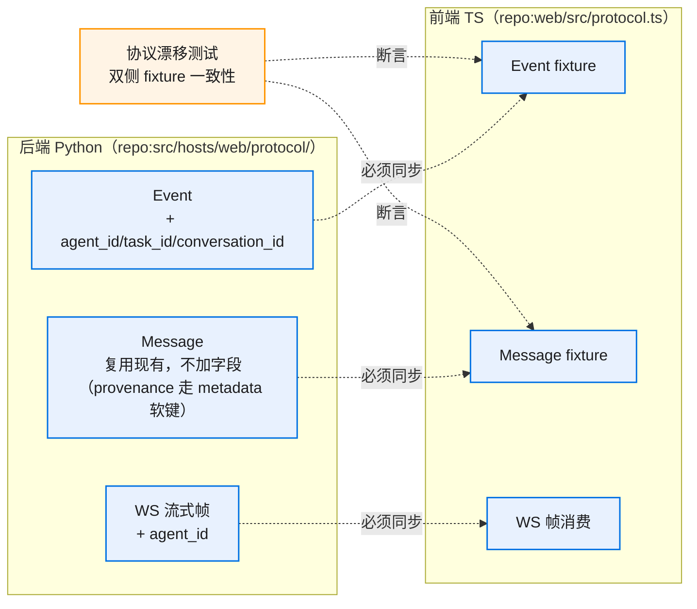

## 跨模块状态与数据

### AgentCell 状态流转

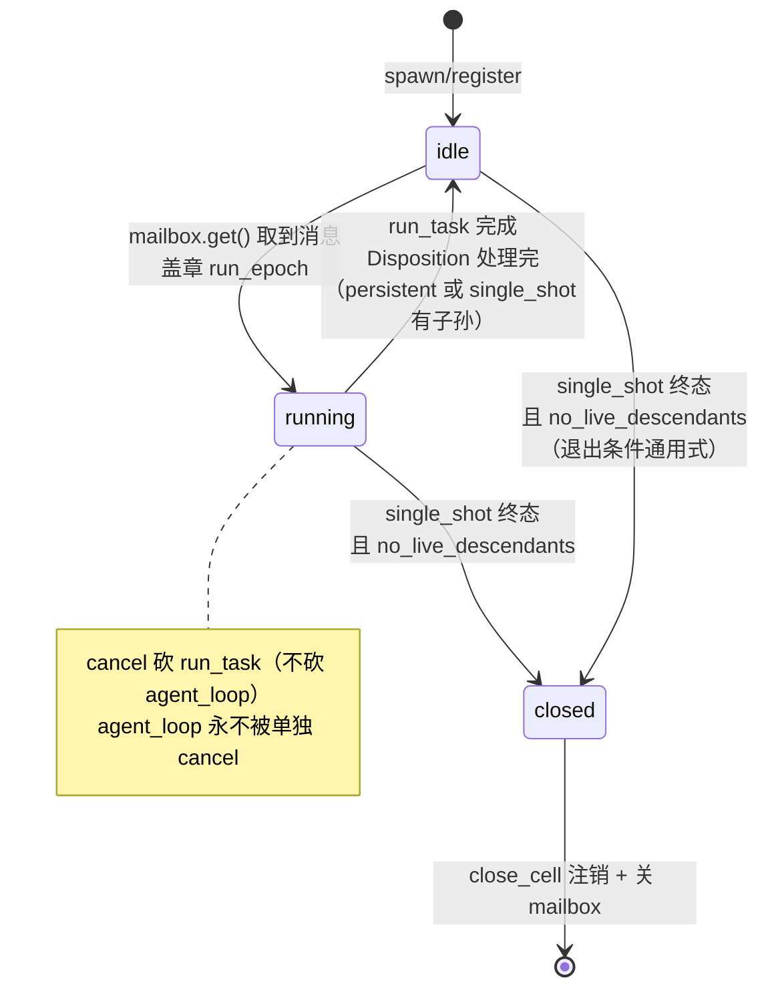

### epoch 世代流转

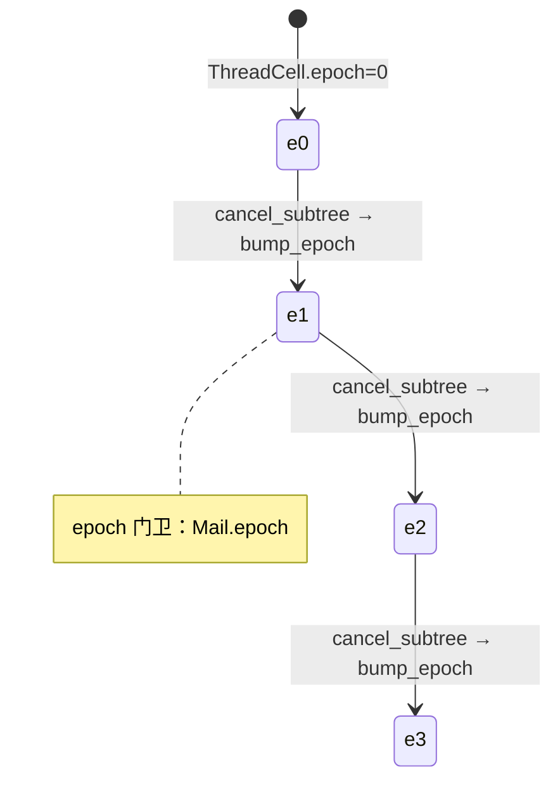

### 打断链时序

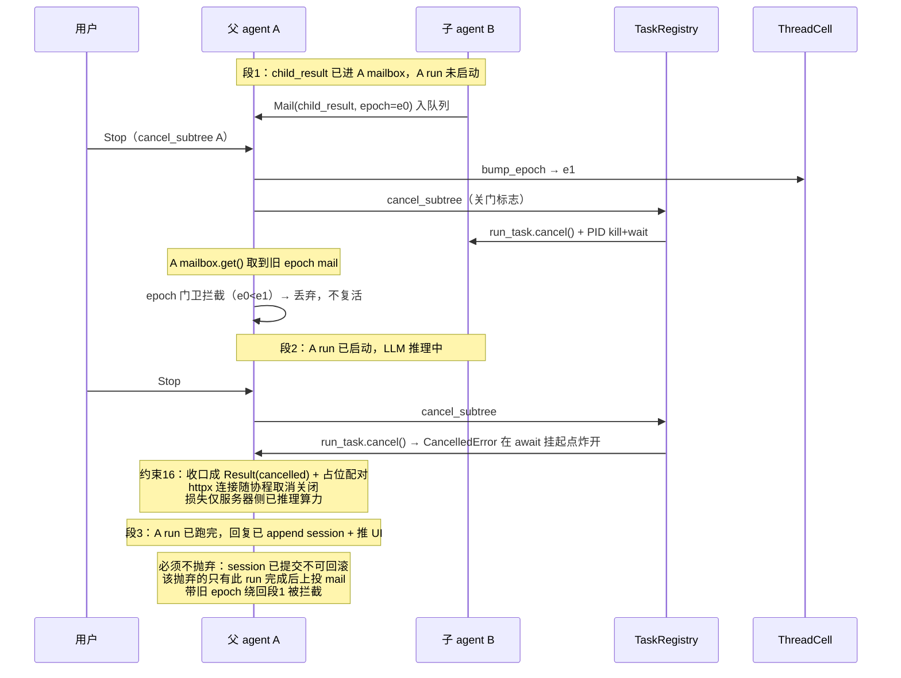

### 数据关系

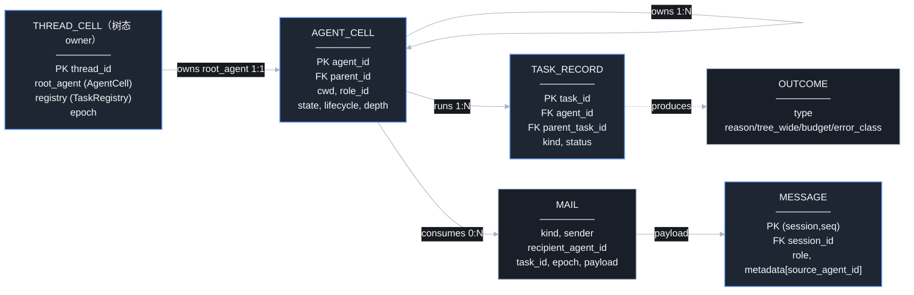
