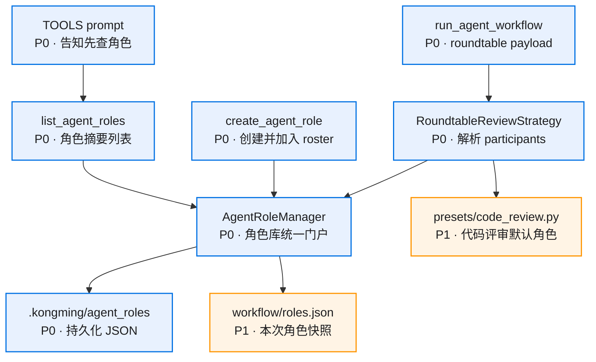

# 模块拆分

## 组件图



## `AgentRolePreset`

位置：`src/application/agent_roles/agent_role_manager.py`

职责：
- 定义最小角色结构。
- 提供 LLM 可见摘要。
- 作为 roundtable participant 的通用来源。

接口：

```python
@dataclass(frozen=True)
class AgentRolePreset:
    role_id: str
    title: str
    role: str

    def summary(self) -> dict[str, str]: ...
```

## `AgentRoleManager`

位置：`src/application/agent_roles/agent_role_manager.py`

职责：
- 从 `.kongming/agent_roles/*.json` 读取角色。
- 保存 `create_agent_role` 创建的新角色。
- 对 role id 做安全归一化。
- 返回 `id/title/role` 列表。
- 按 `session_id` 维护当前编排的 roster，并在 list/create 回执中返回。
- 解析 `participants.select` 中的 role id，输出 workflow 可消费的角色列表。
- 写入 `<workflow_dir>/roles.json` 角色快照。
- 作为角色库模块对外门户，供 tool 和 workflow strategy 调用。

公共方法：

```python
@dataclass(frozen=True)
class AgentRoleListResult:
    roles: list[dict[str, str]]
    current_roundtable_agents: list[dict[str, str]]
    empty_message: str | None = None


@dataclass(frozen=True)
class AgentRoleCreateResult:
    saved: bool
    status: Literal["created", "existing"]
    role: dict[str, str]
    path: str
    current_roundtable_agents: list[dict[str, str]]


class AgentRoleManager:
    def list_roles(self) -> tuple[AgentRolePreset, ...]: ...
    def list_role_summaries(self, *, session_id: str | None = None) -> AgentRoleListResult: ...
    def get_role(self, role_id: str) -> AgentRolePreset | None: ...
    def create_role(self, *, session_id: str, role_id: str, title: str, role: str) -> AgentRoleCreateResult: ...
    def resolve_participants(self, role_ids: Sequence[str]) -> tuple[AgentRolePreset, ...]: ...
    def write_workflow_snapshot(self, workflow_dir: Path, roles: Sequence[AgentRolePreset]) -> Path: ...
```

方法合同：

| 方法 | 调用方 | 输入 | 输出 | 行为 |
|------|--------|------|------|------|
| `list_roles` | manager 内部、测试、strategy | 无 | `tuple[AgentRolePreset, ...]` | 读取内置 preset 和 `.kongming/agent_roles/*.json`，跳过损坏文件，按 `role_id` 排序 |
| `list_role_summaries` | `list_agent_roles` tool | `session_id` 可空 | `AgentRoleListResult` | 返回 `roles` 和该 session 的 `current_roundtable_agents`；空库时给 `empty_message` 提示创建角色 |
| `get_role` | manager 内部、strategy | `role_id` | `AgentRolePreset | None` | 只按规范化后的 role id 查找，不创建缺失角色 |
| `create_role` | `create_agent_role` tool | `session_id/role_id/title/role` | `AgentRoleCreateResult` | 校验三字段，保存 JSON，已有角色返回 `existing`，并把角色加入该 session roster |
| `resolve_participants` | `RoundtableReviewStrategy` | `role_ids` | `tuple[AgentRolePreset, ...]` | 校验非空、去重保序、逐个解析；未知 role id 返回参数错误 |
| `write_workflow_snapshot` | `RoundtableReviewStrategy` | `workflow_dir/roles` | `Path` | 写 `<workflow_dir>/roles.json`，内容只包含本次执行使用的 `id/title/role` |

Session roster 规则：

- key 使用 `ToolContext.session_id`。
- value 是该 session 已通过 `create_role` 加入当前编排的 role summary 列表。
- `list_role_summaries(session_id=...)` 和 `create_role(session_id=...)` 都返回同一份 session roster。
- roster 只作为 LLM 规划回执，workflow 执行真源是 `participants.select` 经 `resolve_participants` 解析出的角色列表。
- roster 第一版放在 `AgentRoleManager` 进程内存中，随 runtime 生命周期释放。

## `AgentRoleTool`

位置：`src/tools/agent_role_tool.py`

工具：
- `list_agent_roles`
- `create_agent_role`

职责边界：
- 接收 LLM tool 参数并做基础校验。
- 从 `ToolContext` 读取 `session_id`，调用 `AgentRoleManager`。
- 原样返回 manager 生成的 `id/title/role` 摘要和 `current_roundtable_agents`。
- 不直接启动子 agent。
- 不维护角色状态。

`create_agent_role` 参数只保留三项：

```json
{
  "id": "risk_skeptic",
  "title": "风险质询者",
  "role": "专门寻找方案的失败路径、隐藏成本和不可逆风险"
}
```

返回给 LLM：

```json
{
  "saved": true,
  "role": {"id": "risk_skeptic", "title": "风险质询者", "role": "..."},
  "current_roundtable_agents": [
    {"id": "risk_skeptic", "title": "风险质询者", "role": "..."}
  ]
}
```

## `CodeReviewPreset`

位置：`src/application/agent_workflows/strategies/roundtable_review/presets/code_review.py`

职责：
- 承接当前 `default_reviewer_specs()` 的五个代码评审角色。
- 让 `contracts.py` 保持通用 participant parser。
- 提供内置代码评审角色定义，主 agent 仍通过 `participants.select` 显式选择这些角色 ID。

## `Roundtable participants`

位置：`src/application/agent_workflows/strategies/roundtable_review/contracts.py`

新增 participant 子对象：

```json
{
  "participants": {
    "select": ["architecture_reviewer", "risk_skeptic"]
  }
}
```

participant 必需字段：

| 字段 | 语义 |
|------|------|
| `participants.select` | 已保存角色 ID 列表，按顺序生成子 agent |

解析规则：
1. 有 `participants.select` 时，只按该列表解析角色。
2. 没有 `participants.select` 时返回参数错误。
3. 出现 `reviewers`、`participants.create` 或其他 participant 字段时返回参数错误。
4. 完整 roundtable payload 仍包含 `topic`、`input_source` / `module_path`、`limits` 等既有执行上下文。
