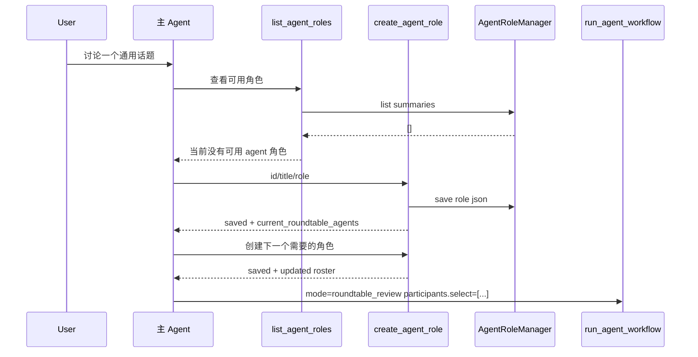
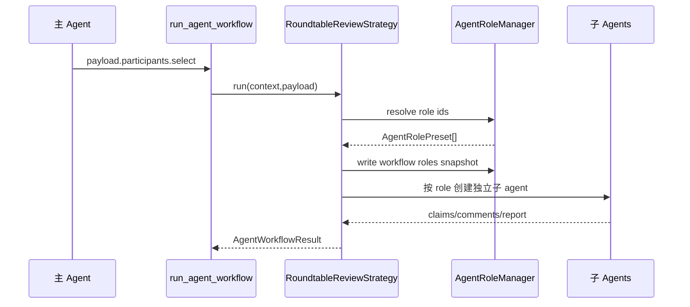

# 核心流程

## 空角色库到创建角色



## Roundtable 使用角色



## 主 Agent 提示规则

TOOLS prompt 增加：

```text
发起 roundtable / 多子 agent 讨论前，先调用 list_agent_roles 查看可用角色。
如果没有合适的 agent 角色，调用 create_agent_role 创建。
create_agent_role 只需要 id、title、role 三个字段。
每次 create_agent_role 返回 current_roundtable_agents，后续 run_agent_workflow 的 participants.select 使用这些 id。
```

## 装配流程

CLI/runtime 装配必须创建同一个 `AgentRoleManager` 实例，并注入给 tool 和 workflow：

```python
role_manager = AgentRoleManager(
    role_dir=get_kongming_home() / "agent_roles",
    builtin_presets=(code_review_roles(),),
)

register_agent_role_tool(registry, role_manager)

workflow_manager = AgentWorkflowManager(
    subagents=subagent_manager,
    role_manager=role_manager,
    config=workflow_config,
    workspace_root=workspace_root,
)
```

装配规则：

- `AgentRoleTool` 只持有 manager 引用。
- `RoundtableReviewStrategy` 通过 `AgentWorkflowManager.role_manager` 调用 manager。
- tool 创建的角色必须能在同一轮 `run_agent_workflow` 中被 strategy 解析。
- 测试用 fake manager 注入，不在 tool 或 strategy 内部临时创建 manager。

## 创建工具回执

`create_agent_role` 的文本结果必须包含：
- `agent role saved: <id>`
- `path: <role-json-path>`
- 当前 roundtable 已加入子 agent 列表

结构化 `data` 必须包含：
- `saved`
- `role`
- `path`
- `current_roundtable_agents`

## 运行失败处理

| 场景 | 行为 |
|------|------|
| role id 已存在 | 返回 existing，加入 roster |
| role id 非法 | 工具参数校验失败 |
| 角色库文件损坏 | list 跳过损坏文件并返回可读角色 |
| participants.select 不存在 | roundtable 参数失败，提示缺失 role id |
| workflow 运行中角色文件被修改 | 使用启动时解析出的角色快照 |
