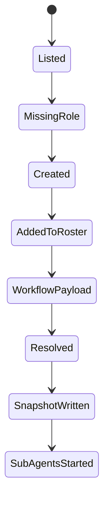

# 数据模型与状态

## `AgentRolePreset`

```python
@dataclass(frozen=True)
class AgentRolePreset:
    role_id: str
    title: str
    role: str
```

字段语义：

| 字段 | 语义 |
|------|------|
| `role_id` | 稳定 ID，用于 payload 引用和文件名 |
| `title` | 给用户和 LLM 展示的短名称 |
| `role` | 职责、立场、关注点的合并描述 |

## Manager Result Types

`AgentRoleManager` 对 tool 和 workflow strategy 返回稳定结构，避免 tool 层拼装业务数据。

```python
@dataclass(frozen=True)
class AgentRoleListResult:
    roles: list[dict[str, str]]
    current_roundtable_agents: list[dict[str, str]]
    empty_message: str | None = None


@dataclass(frozen=True)
class AgentRoleCreateResult:
    saved: bool
    status: Literal["created", "existing"]
    role: dict[str, str]
    path: str
    current_roundtable_agents: list[dict[str, str]]
```

字段边界：

| 结构 | 字段 | 语义 |
|------|------|------|
| `AgentRoleListResult` | `roles` | 当前可选择的全部角色摘要，元素只含 `id/title/role` |
| `AgentRoleListResult` | `current_roundtable_agents` | 当前 session 已加入本次编排的角色摘要 |
| `AgentRoleListResult` | `empty_message` | 角色库为空时给 LLM 的创建提示 |
| `AgentRoleCreateResult` | `saved` | 本次调用后角色文件存在且可读取 |
| `AgentRoleCreateResult` | `status` | `created` 表示新建，`existing` 表示已存在并复用 |
| `AgentRoleCreateResult` | `role` | 本次创建或复用的角色摘要 |
| `AgentRoleCreateResult` | `path` | 角色 JSON 的相对路径 |
| `AgentRoleCreateResult` | `current_roundtable_agents` | 写入 roster 后的当前 session 角色摘要 |

## 存储文件

路径：

```text
.kongming/agent_roles/<role_id>.json
```

内容：

```json
{
  "id": "risk_skeptic",
  "title": "风险质询者",
  "role": "专门寻找方案的失败路径、隐藏成本和不可逆风险"
}
```

## Tool Result Data

Tool result 由 `AgentRoleManager` 生成，`AgentRoleTool` 只做 LLM tool 适配。

`list_agent_roles`：

```json
{
  "roles": [
    {"id": "risk_skeptic", "title": "风险质询者", "role": "..."}
  ],
  "current_roundtable_agents": []
}
```

空角色库时：

```json
{
  "roles": [],
  "current_roundtable_agents": [],
  "empty_message": "No agent roles are available. Call create_agent_role with id, title, and role."
}
```

`create_agent_role`：

```json
{
  "saved": true,
  "status": "created",
  "role": {"id": "risk_skeptic", "title": "风险质询者", "role": "..."},
  "path": ".kongming/agent_roles/risk_skeptic.json",
  "current_roundtable_agents": [
    {"id": "risk_skeptic", "title": "风险质询者", "role": "..."}
  ]
}
```

## Manager Error Semantics

| 场景 | 抛出错误 | Tool 表现 |
|------|----------|-----------|
| `role_id` 为空或含路径分隔符 | `ValueError("invalid role id")` | tool 参数失败 |
| `title` 为空 | `ValueError("title is required")` | tool 参数失败 |
| `role` 为空 | `ValueError("role is required")` | tool 参数失败 |
| `role` 超过长度限制 | `ValueError("role is too long")` | tool 参数失败 |
| `resolve_participants([])` | `ValueError("participants.select is required")` | workflow 参数失败 |
| `resolve_participants(["missing"])` | `ValueError("unknown role id: missing")` | workflow 参数失败 |
| 角色 JSON 损坏 | 记录 warning，跳过文件 | list 继续返回可读角色 |

长度限制第一版：

| 字段 | 最大长度 |
|------|----------|
| `id` | 64 |
| `title` | 80 |
| `role` | 1200 |

## Roundtable Payload

`participants` 子对象只允许 `select`。完整 roundtable payload 仍携带 topic 和输入上下文：

```json
{
  "topic": "评审 agent role preset 方案",
  "input_source": {
    "root_dir": ".",
    "paths": ["docs/agent-workflow/agent-role-presets-v0.1"]
  },
  "participants": {
    "select": ["risk_skeptic", "ops_owner"]
  },
  "limits": {
    "discussion_rounds": 2,
    "max_concurrency": 2
  }
}
```

## Workflow Snapshot

每次 workflow 通过 `AgentRoleManager.write_workflow_snapshot()` 写入：

```text
<workflow_dir>/roles.json
```

内容：

```json
{
  "source": "agent_role_manager",
  "roles": [
    {"id": "risk_skeptic", "title": "风险质询者", "role": "..."}
  ]
}
```

## Session Roster State

roster 是 `AgentRoleManager` 内存态：

```python
dict[str, list[dict[str, str]]]
```

规则：

| 规则 | 说明 |
|------|------|
| key | `ToolContext.session_id` |
| value | 当前 session 通过 `create_role` 加入的 role summary 列表 |
| 去重 | 同一 session 内同一 `id` 只出现一次，重复创建移动到已存在结果 |
| 生命周期 | 跟随当前 runtime 进程，第一版不写 session store |
| 执行真源 | workflow 只信任 `participants.select` 解析结果 |

## 状态流转



## 字段边界

| 字段 | 状态 | 行为 |
|------|------|------|
| `participants.select` | 必需入口 | 解析已保存角色 ID，生成 roundtable 子 agent |
| `reviewers` | 移除 | 出现时返回参数错误 |
| `participants.create` | 移除 | 创建角色必须先走 `create_agent_role` 工具 |
| `participants.preset` | 移除 | 预设角色先进入角色库，再由 `participants.select` 引用 |
| `default_reviewer_specs()` | 迁移 | 移到 `presets/code_review.py`，作为内置角色定义来源 |
