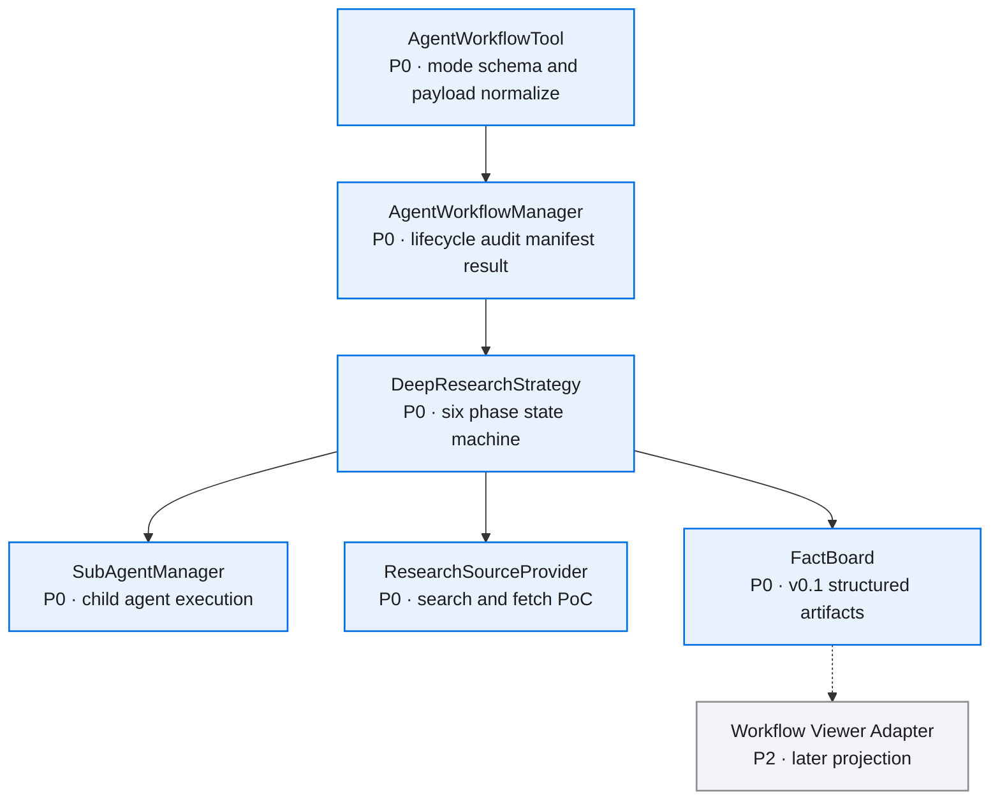
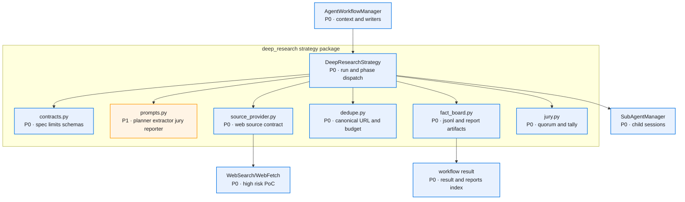
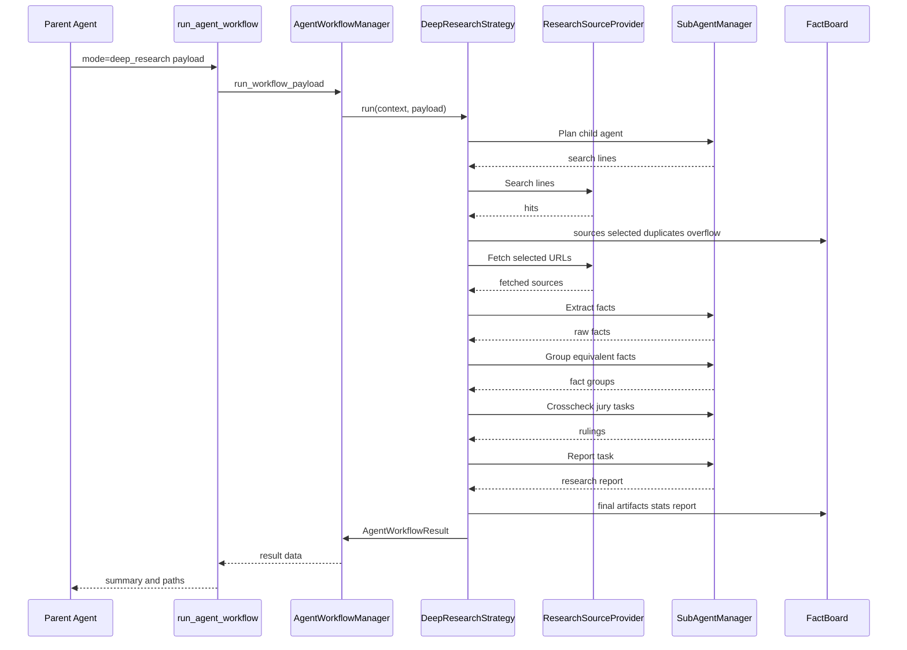
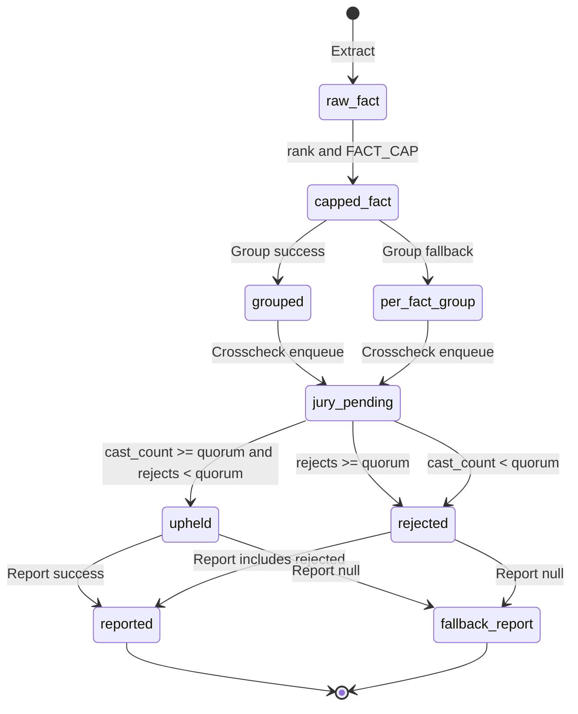
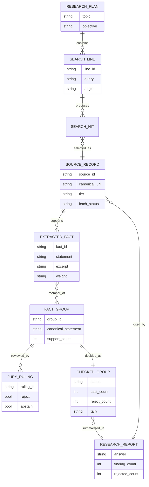

# Deep Research v0.1 · 图集

> 本 spec 的唯一图源：所有 mermaid 图集中于此，按模块分节。02/03/04 是文字事实源，本文件是只读视图；增减模块、组件、阶段或实体时同步更新对应节。
>
> **查看与缩放**：GitHub 渲染 mermaid 自带缩放/平移控件；VS Code 建议安装 Mermaid Chart（官方）或 Markdown Preview Enhanced 插件以支持缩放。

## 目录

- [总览](#总览)
- [策略组件](#策略组件)
- [六阶段时序](#六阶段时序)
- [事实状态流转](#事实状态流转)
- [Artifact ER](#artifact-er)

图例：🔵 P0 核心/阻塞 · 🟠 P1 主要/必须 · ⚪ P2 辅助/可选

## 总览

## 策略组件

## 六阶段时序

## 事实状态流转

## Artifact ER

