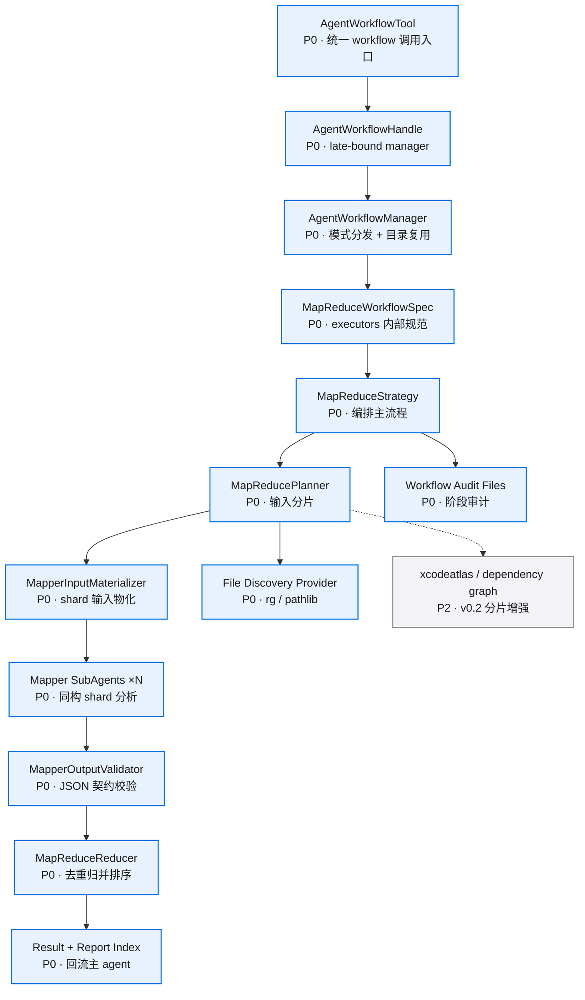

# 模块拆分

## 总体依赖



## `AgentWorkflowTool`

建议位置：`src/tools/agent_workflow_tool.py`

职责：
- 在现有 `AgentWorkflowTool` 内新增统一 `run_agent_workflow(mode="map_reduce")` 入口。
- 解析 `objective`、`input_source`、`shard_strategy`、`output_contract`。
- 校验 mode、contract、limits。
- 通过 late-bound `AgentWorkflowHandle` 将规范化后的 JSON payload 交给 `AgentWorkflowManager`。

边界：
- `tools/` 层只消费 `core.contracts` 和 tool 基类，不直接 import `executors/`。
- `tools/` 层不构造 `MapReduceWorkflowSpec` dataclass，避免 tool -> executors import。
- strategy 创建和执行由 `AgentWorkflowManager` 或 strategy registry 完成。

tool input schema 字段与 `MapReduceWorkflowSpec` 对齐，但以 `dict[str, object]` 传入 manager。`MapReduceWorkflowSpec` dataclass 在 executors 内构造。

运行时结构建议：

```python
@dataclass(frozen=True)
class MapReduceWorkflowSpec:
    # workflow 模式，固定为 map_reduce。
    mode: Literal["map_reduce"]
    # 主 agent 给出的高层分析目标。
    objective: str
    # 输入来源，描述要分析的仓库、目录、文件集合或索引查询。
    input_source: MapReduceInputSource
    # 分片策略，描述如何把输入拆成 mapper shard。
    shard_strategy: ShardStrategy
    # mapper 输出契约，第一版内置 code_findings。
    output_contract: Literal["code_findings"]
    # mapper 运行配置，包含 prompt、工具、权限和模型参数。
    mapper: MapperSpec
    # reducer 运行配置，包含去重、排序和失败处理策略。
    reducer: ReducerSpec
    # 资源限制，包含并发、shard 数、单 shard 文件数和 token 预算。
    limits: MapReduceLimits
    # 额外审计标签，用于把本次 workflow 关联到 task 或用户目标。
    audit_tags: tuple[str, ...]
```

## `MapReduceStrategy`

建议位置：`src/executors/agent_runtime/strategies/map_reduce/strategy.py`

职责：
- 持有 `MapReduceWorkflowSpec`。
- 调用 planner 生成 shard plan。
- 调用 input materializer 准备 mapper 可读输入。
- 将每个 shard 转成 `SubAgentTask`。
- 并发运行 mapper 子 agent。
- 调用 validator 校验每个 mapper 输出。
- 调用 reducer 生成最终结果。
- 调用公共 workflow writer 写 workflow audit、根目录 `result.json`、`reports/index.json`。
- 调用 map_reduce artifact writer 写 `map_reduce/reducer/result.json`。

边界：
- 只处理编排顺序和状态。
- mapper 的实际 turn loop 仍由 `core.Runner` 执行。
- reducer 的确定性合并逻辑放在 reducer 模块。
- 不承载 planner、input materializer、validator、reducer 具体实现。

策略包目录：

```text
src/executors/agent_runtime/strategies/map_reduce/
├── __init__.py
├── strategy.py
├── contracts.py
├── planner.py
├── input_materializer.py
├── mapper.py
├── validator.py
├── reducer.py
└── artifacts.py
```

兼容约束：
- `src/executors/agent_runtime/strategies/map_reduce_contracts.py` 先保留。
- `strategies/map_reduce/contracts.py` 从旧 contract 文件 re-export，避免当前 `tests/unit/test_map_reduce_contracts.py` 和旧 import 失效。
- 本 task 不移动 `parallel` 具体执行逻辑。

## `MapReducePlanner`

建议位置：`src/executors/agent_runtime/strategies/map_reduce/planner.py`

职责：
- 解析 `input_source`。
- 读取文件列表、目录树、依赖图或索引查询结果。
- 按 `shard_strategy` 生成稳定 `MapShard`。
- 估算每个 shard 的文件数、行数、token 成本。
- 对过大的 shard 做二次切分。

核心输出：

```python
@dataclass(frozen=True)
class MapShard:
    # shard 在 workflow 内的稳定 ID。
    shard_id: str
    # shard 展示名称，用于报告和审计。
    shard_name: str
    # shard 顺序，用于稳定排序和复跑。
    display_order: int
    # shard 包含的文件路径列表。
    files: tuple[str, ...]
    # shard 关联的模块名或目录名。
    module_hint: str | None
    # shard 分配原因，v0.1 使用 path_group、directory_group、file_count_group。
    shard_reason: str
    # 估算 token 数，用于限流和拆分。
    estimated_tokens: int
  # mapper prompt 中注入的 shard 专属上下文。
  context: str
```

## `MapperInputMaterializer`

建议位置：`src/executors/agent_runtime/strategies/map_reduce/input_materializer.py`

职责：
- 为每个 shard 创建 `agents/<task_run_id>/work/input/`。
- 将 shard 文件复制或摘录到 mapper workdir。
- 写 `input_manifest.json`，记录物化路径、原始路径、摘要和截断信息。
- 保证 mapper 使用现有 `scoped_workdir` 权限即可读取 shard 输入并写输出。

第一版使用物化输入方案。只读输入根 + 可写 workdir 的授权模式进入后续权限 task。

## `MapperPromptBuilder`

建议位置：`src/executors/agent_runtime/strategies/map_reduce/mapper.py`

职责：
- 把 `objective`、`output_contract`、`MapShard` 拼成 mapper prompt。
- 明确要求 mapper 只输出 JSON。
- 注入每个字段的中文说明和示例。
- 把 shard 文件范围、只读约束、证据要求写入 prompt。

核心要求：
- mapper 必须列出实际检查的文件。
- mapper 必须给每条 finding 提供文件、行号、证据和建议。
- mapper 输出失败时必须进入 `errors`。

## `MapperOutputValidator`

建议位置：`src/executors/agent_runtime/strategies/map_reduce/validator.py`

职责：
- 从子 agent 最终内容中提取 JSON。
- 校验 `MapperOutputEnvelope` 顶层字段。
- 校验 `output_contract` 对应的数据结构。
- 把格式错误、字段缺失、类型错误转成 `MapperValidationError`。
- 为 reducer 提供统一的成功/失败输入。

## `MapReduceReducer`

建议位置：`src/executors/agent_runtime/strategies/map_reduce/reducer.py`

职责：
- 合并所有 valid mapper output。
- 按 `dedupe_key`、文件路径、行号、标题相似度去重。
- 按 severity、confidence、文件影响面排序。
- 汇总覆盖率、失败 shard、补跑建议。
- 生成 `ReducerOutput`。

第一版 reducer 采用确定性代码。后续可加 reducer agent，负责自然语言层面的取舍和综合判断。

## `CodeIndexProvider`

建议位置：`src/executors/agent_runtime/strategies/map_reduce/planner.py`

职责：
- 给 planner 提供大工程文件发现能力。
- 第一版可用 `rg --files` 和 path glob。
- 后续接入 xcodeatlas 的 module map、dependency graph、symbol index。

## 依赖护栏

| 边界 | 允许 | 约束 |
|------|------|------|
| tool -> AgentWorkflowManager | 通过 late-bound handle 传 `map_reduce` JSON payload | tool 只做解析和基础校验，不 import executors |
| AgentWorkflowManager -> strategy | strategy registry 分发 `map_reduce` | manager 负责目录、audit 生命周期和结果收口 |
| strategy -> SubAgentManager | 复用 subagent run | strategy 持有 map_reduce 状态机 |
| planner -> code index | 读取文件列表和依赖信息 | planner 只读源码 |
| materializer -> mapper workdir | 复制或摘录 shard 输入 | mapper 继续使用 scoped_workdir |
| mapper -> tools | 默认 read/list/write_file + scoped workdir | mapper 输出必须回到结构化契约 |
| reducer -> mapper output | 读取 validator 通过的结构 | reducer 记录失败 shard |
