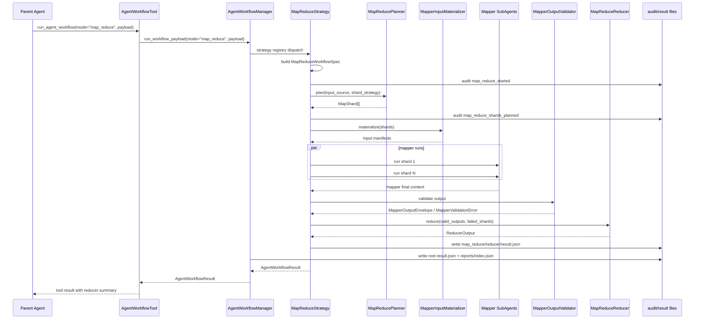
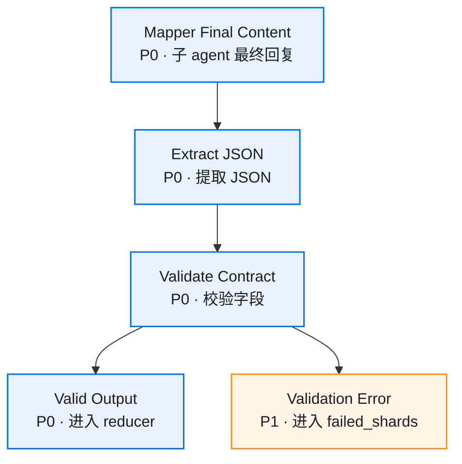
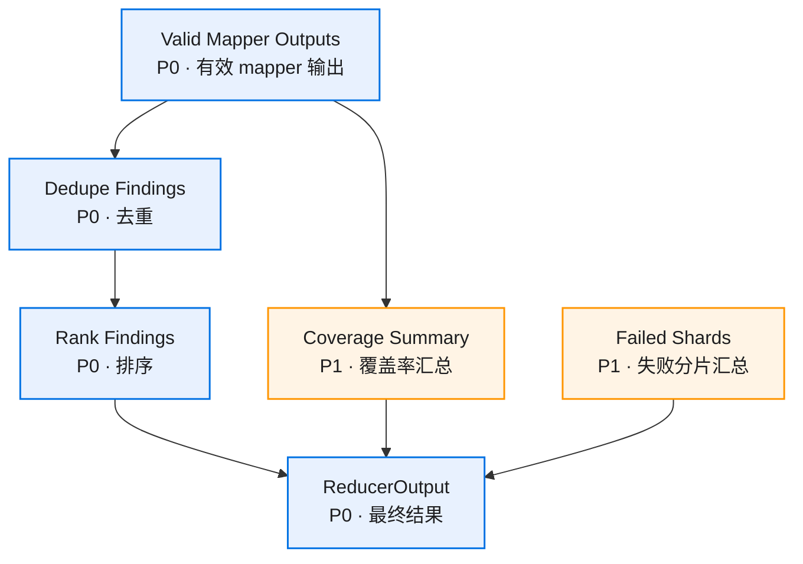

# 核心流程

## 主链路

## 分片流程

```mermaid
flowchart LR
  classDef p0 fill:#E8F1FE,stroke:#0071E3,color:#1D1D1F,stroke-width:1.5px
  classDef p1 fill:#FFF4E5,stroke:#FF9500,color:#1D1D1F,stroke-width:1.5px
  classDef p2 fill:#F2F2F7,stroke:#8E8E93,color:#1D1D1F,stroke-width:1.5px

  IN["InputSource<br/>P0 · 文件来源"]:::p0
  DISC["Discover Files<br/>P0 · 发现文件"]:::p0
  GROUP["Group Strategy<br/>P0 · 按目录/模块/依赖分组"]:::p0
  SPLIT["Split Oversize<br/>P1 · 超限 shard 二次切分"]:::p1
  PLAN["ShardPlan<br/>P0 · 稳定分片计划"]:::p0
  MAT["Input Manifest<br/>P0 · 物化输入映射"]:::p0
  AUD["Audit<br/>P1 · 写分片审计"]:::p1

  IN --> DISC --> GROUP --> SPLIT --> PLAN --> MAT --> AUD
```

## mapper 输出校验流程

## reducer 流程

## 审计事件顺序

1. `map_reduce_started`
2. `map_reduce_shards_planned`
3. `map_reduce_inputs_materialized`
4. `map_mapper_started` × N
5. `map_mapper_completed` / `map_mapper_failed` × N
6. `map_mapper_output_validated` / `map_mapper_output_rejected` × N
7. `map_reduce_reducer_started`
8. `map_reduce_reducer_completed`
9. `map_reduce_completed`

每条事件都带 `workflow_id`、`run_id`、`mode`、`output_contract`，shard 级事件额外带 `shard_id`、`task_run_id`、`report_path`。
