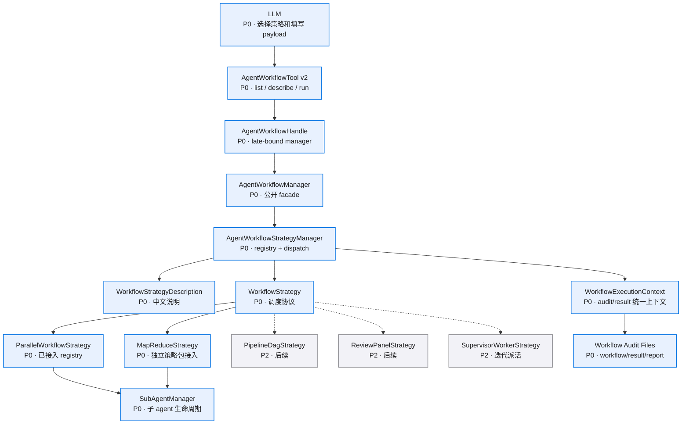

# 模块拆分

## 总体依赖



## `AgentWorkflowManager` facade

现有位置：`src/executors/agent_runtime/workflow/manager.py`

职责：
- 继续作为 `AgentWorkflowHandle.bind()` 的绑定对象。
- 持有 `AgentWorkflowStrategyManager`。
- 对 tool 暴露 `list_workflow_strategies()`、`describe_workflow_strategy()`、`run_workflow()`。
- 保留 `run_parallel()`、`run_parallel_specs()` 和旧 `run_workflow_specs()` 兼容路径。
- 统一 workflow 生命周期入口，内部创建或委托创建 `WorkflowExecutionContext`。
- 新增通用 payload 入口，支持 `map_reduce` 传入完整 JSON payload。

接口草案：

```python
class AgentWorkflowManager:
    def list_workflow_strategies(self) -> tuple[WorkflowStrategyCatalogEntry, ...]: ...
    def describe_workflow_strategy(self, mode: str) -> WorkflowStrategyDescription: ...
    async def run_workflow(self, request: WorkflowRunRequest) -> AgentWorkflowResult: ...
    async def run_workflow_payload(self, *, mode: str, parent_session_id: str, payload: Mapping[str, object]) -> AgentWorkflowResult: ...
```

边界：
- facade 承接已有公开调用路径和 CLI 装配。
- strategy manager 管理 registry 和 dispatch。
- strategy 管理具体调度。

## `AgentWorkflowStrategyManager`

建议位置：`src/executors/agent_runtime/strategies/manager.py`

职责：
- 注册 `WorkflowStrategy`。
- 注册 planned strategy description。
- 返回中文 catalog。
- 按 `mode` 返回详细 description。
- 校验未知模式并返回可用策略列表。
- 校验 planned 策略运行请求并返回模型可读错误。
- 创建 `WorkflowExecutionContext`。
- 调用目标 strategy 的 `run()`。

接口草案：

```python
class AgentWorkflowStrategyManager:
    def register(self, strategy: WorkflowStrategy) -> None: ...
    def register_planned(self, description: WorkflowStrategyDescription) -> None: ...
    def list_strategies(self) -> tuple[WorkflowStrategyCatalogEntry, ...]: ...
    def describe_strategy(self, mode: str) -> WorkflowStrategyDescription: ...
    async def run_strategy(self, request: WorkflowRunRequest) -> AgentWorkflowResult: ...
```

边界：
- strategy manager 管理注册、context 创建和分发。
- strategy 管理具体调度。
- facade 管理公开方法和旧路径兼容。
- tool 只做参数解析和 handle 调用。

## `WorkflowStrategy`

建议位置：`src/executors/agent_runtime/strategies/base.py`

职责：
- 声明 `mode`。
- 提供 catalog 和详细中文 description。
- 校验 strategy 自身 payload。
- 生成调度计划、调用 `SubAgentManager`、定义结果归并规则。
- 复用 `WorkflowExecutionContext` 写 strategy 级事件和最终结果。
- 让 `SubAgentManager` 承接子 agent 创建、session、权限、工具白名单和运行生命周期。

接口草案：

```python
class WorkflowStrategy(Protocol):
    mode: str

    def catalog_entry(self) -> WorkflowStrategyCatalogEntry: ...
    def describe(self) -> WorkflowStrategyDescription: ...
    async def run(self, context: WorkflowExecutionContext, payload: Mapping[str, object]) -> AgentWorkflowResult: ...
```

## `WorkflowStrategyDescription`

建议位置：`src/executors/agent_runtime/strategies/description.py`

职责：
- 给 LLM 展示中文策略说明。
- 保持字段名和 schema 稳定。
- 给出示例 payload。
- 明确适用场景、输入、输出、限制和风险。

字段示例：

```python
@dataclass(frozen=True)
class WorkflowStrategyDescription:
    mode: str
    title: str
    summary: str
    when_to_use: tuple[str, ...]
    inputs: tuple[WorkflowStrategyInputField, ...]
    outputs: tuple[str, ...]
    warnings: tuple[str, ...]
    examples: tuple[dict[str, object], ...]
```

## `ParallelWorkflowStrategy`

建议位置：`src/executors/agent_runtime/strategies/parallel.py`

职责：
- 包装现有 `run_parallel_specs()` 行为。
- 保持 `run_parallel_subagents` tool 兼容。
- 成为第一种注册策略。

当前边界：
- 已通过 `AgentWorkflowStrategyManager` 注册和分发。
- 具体执行仍复用 `AgentWorkflowManager.run_parallel_specs()`、`run_parallel()`、`_run_one()`。
- 本轮 `map_reduce` 集成不移动 parallel 代码，避免改动已有稳定链路。
- 后续 `parallel-strategy-package-refactor-v0.1` 再拆成 `strategies/parallel/strategy.py`、`payload.py`、`executor.py`。

## `MapReduceStrategy`

建议位置：`src/executors/agent_runtime/strategies/map_reduce/strategy.py`

职责：
- 注册为 `mode="map_reduce"` 的 runnable strategy。
- 在 executors 内解析 `MapReduceWorkflowSpec`。
- 调用 planner、input materializer、mapper prompt builder、validator、reducer 和 artifact writer。
- 通过 `SubAgentManager` 执行 mapper 子 agent。
- 返回 `AgentWorkflowResult`，并写 `map_reduce/` 细节产物。

目录结构：

```text
src/executors/agent_runtime/strategies/map_reduce/
├── __init__.py
├── strategy.py
├── contracts.py
├── planner.py
├── input_materializer.py
├── mapper.py
├── validator.py
├── reducer.py
└── artifacts.py
```

兼容策略：
- 旧 `strategies/map_reduce_contracts.py` 先保留，避免现有测试和 import 改动扩大。
- `strategies/map_reduce/contracts.py` 先 re-export 旧 contract，再在后续清理任务中迁移 imports。
- `parallel.py` 保持不动。

## `AgentWorkflowTool v2`

建议位置：`src/tools/agent_workflow_tool.py`

工具能力：
- `list_agent_workflow_strategies`
- `describe_agent_workflow_strategy`
- `run_agent_workflow`
- 兼容已有 `run_parallel_subagents`

tool 层保持：
- 不 import executor dataclass。
- 不创建 strategy。
- 只通过 `AgentWorkflowHandle` 调 manager。

## `WorkflowExecutionContext`

建议位置：`src/executors/agent_runtime/workflow/context.py`

职责：
- workflow id、parent session、workflow dir。
- audit writer。
- started/finished 生命周期。
- report index / result 写入 helper。
- timeout / cancellation / concurrency 预算字段。

## 策略目录建议

| mode | 中文名 | 状态 | 执行归属 |
|------|--------|------|----------|
| `parallel` | 并行子任务 | 已实现，待迁移 | `ParallelWorkflowStrategy` |
| `map_reduce` | Map-Reduce 分片分析 | 当前 planned，integration 后 available | `strategies/map_reduce/strategy.py` |
| `pipeline_dag` | Pipeline / DAG 依赖图 | planned，`runnable=false` | `PipelineDagStrategy` |
| `review_panel` | 多视角评审团 | planned，`runnable=false` | `ReviewPanelStrategy` |
| `supervisor_worker` | Supervisor-Worker 迭代派活 | planned，`runnable=false` | `SupervisorWorkerStrategy` |
