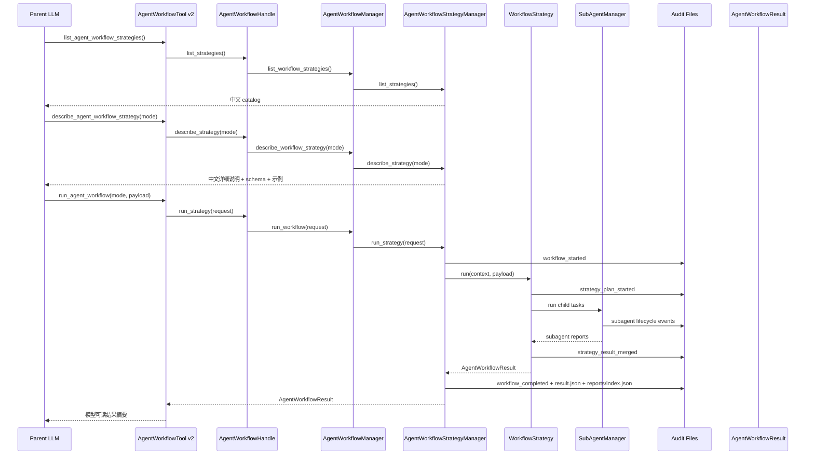
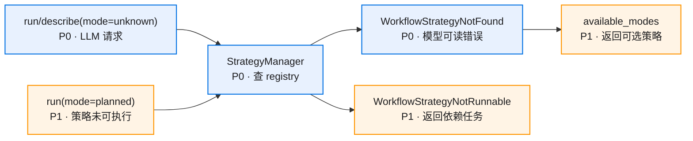

# 核心流程

## LLM 选择并运行策略

## `parallel` 迁移流程

1. `ParallelWorkflowStrategy.describe()` 返回中文说明：适合独立任务 fan-out / fan-in。
2. `AgentWorkflowStrategyManager.register(ParallelWorkflowStrategy(...))`。
3. `run_parallel_subagents` 继续可用，内部调用 `run_agent_workflow(mode="parallel")`。
4. `AgentWorkflowManager.run_workflow_specs(mode="parallel")` 通过 manager 分发。
5. 现有 audit、result、reports/index 输出保持。

## `map_reduce` 接入流程

1. 当前 catalog 保持 `status="planned"`、`runnable=false`；`map-reduce-strategy-integration-v0.1` 完成后注册为 `status="available"`、`runnable=true`。
2. LLM 提交 objective、input_source、shard_strategy、output_contract。
3. tool 通过 `AgentWorkflowManager.run_workflow_payload(mode="map_reduce", payload=...)` 传入完整 payload。
4. `AgentWorkflowStrategyManager` 分发到 `strategies/map_reduce/strategy.py::MapReduceStrategy`。
5. `MapReduceStrategy` 在 executors 内构造 `MapReduceWorkflowSpec`。
6. strategy 调 planner、input materializer、`SubAgentManager` mapper 任务、validator、reducer。
7. manager 写统一 workflow 产物，strategy 写 `map_reduce/` 细节产物。
8. 本阶段保持 `parallel` 当前执行链路，parallel 拆包放入后续任务。

## 策略错误流程

错误消息应包含：
- unknown mode。
- 已注册 mode 列表。
- 可直接运行的 mode 列表。
- planned 策略的 `depends_on`。
- 建议先调用 `list_agent_workflow_strategies` 或 `describe_agent_workflow_strategy`。

## tool 兼容路径

旧路径：

`run_parallel_subagents(tasks)` -> `AgentWorkflowManager.run_workflow_specs(mode="parallel")`

新路径：

`run_parallel_subagents(tasks)` -> `run_agent_workflow(mode="parallel", payload={"tasks": tasks})` -> `AgentWorkflowManager` facade -> strategy manager -> `ParallelWorkflowStrategy`

兼容策略：
- 保留旧 tool 名。
- 新增统一 tool。
- 旧 tool 和新 tool 共享同一个 runtime strategy。
