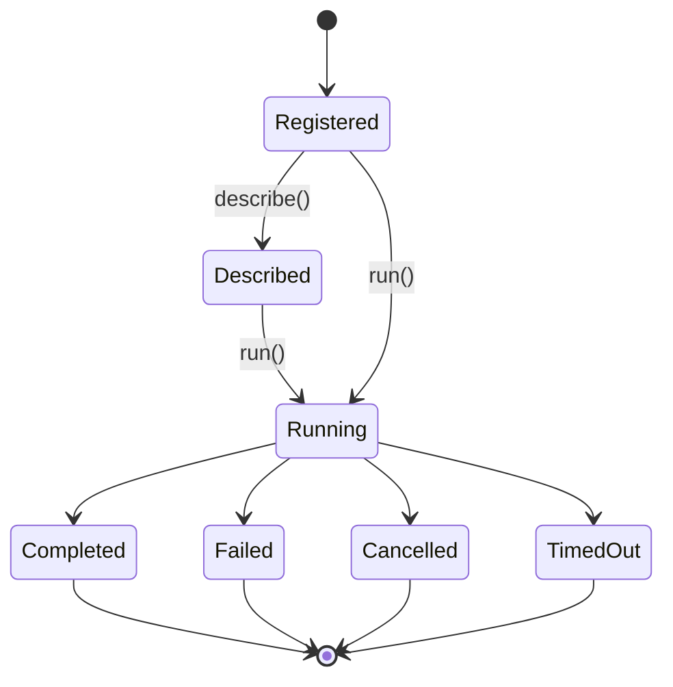

# 数据模型与状态

## `WorkflowStrategyCatalogEntry`

给 LLM 快速选型的最小条目。

```python
@dataclass(frozen=True)
class WorkflowStrategyCatalogEntry:
    # 稳定策略 ID，例如 parallel、map_reduce。
    mode: str
    # 中文策略名。
    title: str
    # 中文一句话摘要。
    summary: str
    # 当前状态：available、planned、experimental。
    status: str
    # 是否可以直接 run。
    runnable: bool
```

## `WorkflowStrategyDescription`

给 LLM 详细理解策略的中文说明。

```python
@dataclass(frozen=True)
class WorkflowStrategyDescription:
    # 稳定策略 ID。
    mode: str
    # 中文策略名。
    title: str
    # 当前状态：available、planned、experimental。
    status: str
    # 是否可以直接 run。
    runnable: bool
    # 中文策略摘要。
    summary: str
    # 适合使用该策略的场景。
    when_to_use: tuple[str, ...]
    # 不适合该策略的场景或风险提示。
    warnings: tuple[str, ...]
    # 输入字段说明，字段名保持英文，说明使用中文。
    inputs: tuple[WorkflowStrategyInputField, ...]
    # 输出说明。
    outputs: tuple[str, ...]
    # 示例 payload。
    examples: tuple[dict[str, object], ...]
    # 依赖任务或依赖能力。
    depends_on: tuple[str, ...]
```

## `WorkflowStrategyInputField`

```python
@dataclass(frozen=True)
class WorkflowStrategyInputField:
    # JSON 字段名。
    name: str
    # 是否必填。
    required: bool
    # 字段类型描述。
    type_label: str
    # 中文说明。
    description: str
    # 示例值。
    example: object | None
```

## `WorkflowRunRequest`

```python
@dataclass(frozen=True)
class WorkflowRunRequest:
    # 目标策略。
    mode: str
    # 父 session id。
    parent_session_id: str
    # 策略 payload，由对应 strategy 校验。
    payload: Mapping[str, object]
    # 调用来源，例如 tool、cli-smoke、internal-test。
    source: str
```

## `WorkflowStrategyNotFound`

```python
@dataclass(frozen=True)
class WorkflowStrategyNotFound(ValueError):
    # 请求的策略 ID。
    mode: str
    # 已注册策略，包括 planned 条目。
    available_modes: tuple[str, ...]
    # 可以直接运行的策略。
    runnable_modes: tuple[str, ...]
    # 当前操作：list、describe、run。
    operation: str
```

## `WorkflowStrategyNotRunnable`

```python
@dataclass(frozen=True)
class WorkflowStrategyNotRunnable(ValueError):
    # 请求的策略 ID。
    mode: str
    # 当前状态，例如 planned。
    status: str
    # 依赖任务或依赖能力。
    depends_on: tuple[str, ...]
    # 可以直接运行的策略。
    runnable_modes: tuple[str, ...]
```

## `WorkflowExecutionContext`

```python
@dataclass(frozen=True)
class WorkflowExecutionContext:
    workflow_id: str
    parent_session_id: str
    mode: str
    workflow_dir: Path
    started_at: str
    audit_writer: AgentWorkflowAuditWriter
    max_concurrency: int | None
    workflow_timeout_seconds: int | None
```

## 策略状态



## 中文描述规范

协议字段保持英文：
- `mode`
- `payload`
- `tasks`
- `objective`
- `input_source`
- `output_contract`

LLM 可见文本使用中文：
- `title`
- `summary`
- `when_to_use`
- `warnings`
- `description`
- `examples` 中的注释性文本

## 示例：`map_reduce` 当前 description

```json
{
  "mode": "map_reduce",
  "title": "Map-Reduce 分片分析",
  "status": "planned",
  "runnable": false,
  "summary": "把大规模、同构、可归并的代码分析任务拆成多个 mapper 子任务，再由 reducer 去重、排序和汇总。",
  "when_to_use": [
    "需要分析大量文件，单个 agent 上下文放不下",
    "每个分片可以独立分析",
    "输出可以用同一个结构化契约归并"
  ],
  "warnings": [
    "当前阶段用于策略选型说明，runtime 执行进入 map-reduce-strategy-integration-v0.1",
    "跨分片实时协商需求强的任务适合 supervisor-worker",
    "v0.1 reducer 只做确定性归并"
  ],
  "depends_on": [
    "map-reduce-strategy-integration-v0.1"
  ]
}
```

## 产物目录

```text
<session.file_store_path>/<parent_session_id>/agent-workflows/<workflow_id>/
  workflow.json
  audit.jsonl
  result.json
  reports/
    index.json
    <task_run_id>.json
  agents/
    <task_run_id>/
      subagent.json
      result.json
      work/
```

不同 strategy 可以写自己的子目录：

```text
map_reduce/
  plan.json
  shards.json
  validation.jsonl
  reducer/
    result.json
```
