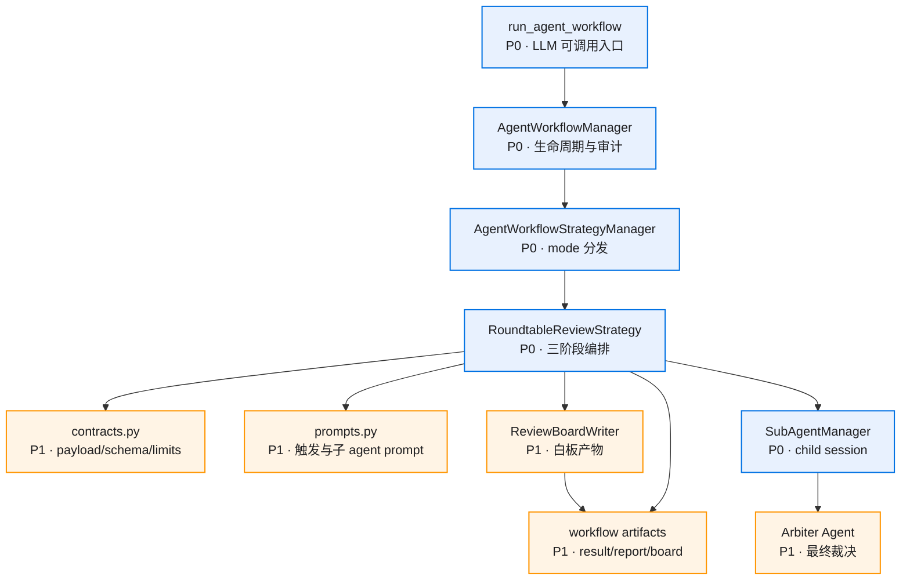

# 模块设计、接口和数据结构

## 架构原则

`roundtable_review` 是 `application.agent_workflows.strategies` 下的独立策略包。公共 workflow 生命周期继续由 `AgentWorkflowManager` 负责；策略包内部负责 payload contract、输入收集、prompt 构造、阶段调度、ReviewBoard 写入和结果归并。

## 组件图



## 模块明细

### Strategy Entry

位置：`src/application/agent_workflows/strategies/roundtable_review/strategy.py`

职责：
- 提供 `mode = "roundtable_review"`。
- 实现 `catalog_entry()`、`describe()`、`run(context, payload)`。
- 控制阶段：prepare board -> independent -> rebuttal rounds -> arbiter -> result。
- 所有子 agent 派发都通过 `AgentWorkflowManager.run_subagent_task()`。

公开边界：
```python
class RoundtableReviewStrategy:
    mode = "roundtable_review"

    def describe(self) -> WorkflowStrategyDescription: ...
    async def run(
        self,
        context: WorkflowExecutionContext,
        payload: Mapping[str, object],
    ) -> AgentWorkflowResult: ...
```

### Contracts

位置：`contracts.py`

职责：
- 定义 `RoundtableReviewSpec`、`ReviewerSpec`、`ReviewBoardClaim`、`ReviewBoardComment`、`RoundtableReviewLimits`。
- 校验 mode、topic、input_source、participants.select、limits。
- 通过 `AgentRoleManager` 解析 participant role id。

code review preset 内置角色：

| role id | 关注点 |
|---------|--------|
| `architecture_reviewer` | 模块边界、职责划分、依赖方向、扩展性 |
| `code_quality_reviewer` | 命名、抽象层次、复杂度、可读性 |
| `test_reviewer` | 可测试性、边界条件、回归风险 |
| `performance_reviewer` | 热路径、IO、缓存、并发、资源占用 |
| `safety_stability_reviewer` | 权限、异常处理、数据一致性、失败恢复 |

### ReviewBoard

位置：`board.py`

职责：
- 创建 `review_board/`。
- 写入 context、sources、claims、rebuttals、consensus、final_report。
- 给每个子 agent 物化同一份输入快照。
- 在 Windows 下使用短 task id 和短物化路径，控制 MAX_PATH 风险。

### Prompt Contracts

位置：`prompts.py`

职责：
- 主 agent workflow 触发提示词说明。
- 独立评审 prompt。
- 交叉质询 prompt。
- arbiter prompt。

### Budget Controller

位置：`strategy.py` + `contracts.py`

职责：
- 统一解释 `total_child_token_budget`。
- 控制 `discussion_rounds` 和 `max_discussion_rounds`。
- 控制 `max_concurrency`、`agent_timeout_seconds`、`max_files`、`max_bytes_per_file`。
- 预算不足时停止后续 rebuttal 或 arbiter，写 fallback report。

### Arbiter

位置：`strategy.py` 中的最后阶段子 agent。

职责：
- 读取 ReviewBoard。
- 合并共识、分歧和高优先级风险。
- 输出最终 6 节报告。

## 与现有 workflow 的解耦

| 现有模块 | 交互方式 | 边界 |
----------|----------|------|
| `AgentWorkflowManager` | 注册 strategy，创建 context，运行子 agent，写通用 result/report | 不理解 claims、rebuttals、participant 角色 |
| `AgentWorkflowStrategyManager` | 按 mode 分发 | 只知道 strategy 协议 |
| `run_agent_workflow` tool | schema + payload 归一化 + result 展示 | 不执行评审流程 |
| `SubAgentManager` | 运行 child session | 不理解 roundtable 阶段 |
| `map_reduce` | 同级 strategy 包 | 不共享内部 helper |

## Payload 接口

```json
{
  "mode": "roundtable_review",
  "payload": {
    "topic": "Session 模块设计是否合理",
    "objective": "检查 Session 模块边界、状态归属、测试风险和扩展性",
    "input_source": {
      "root_dir": ".",
      "paths": ["src/sessions", "docs/modules/会话/README.md"],
      "include": ["tests/unit/test_session*.py"],
      "exclude": [".venv/**", "__pycache__/**"],
      "max_files": 80,
      "max_bytes_per_file": 80000
    },
    "limits": {
      "total_child_token_budget": 50000,
      "discussion_rounds": 2,
      "max_discussion_rounds": 6,
      "max_concurrency": 5,
      "agent_timeout_seconds": 600
    }
  }
}
```
