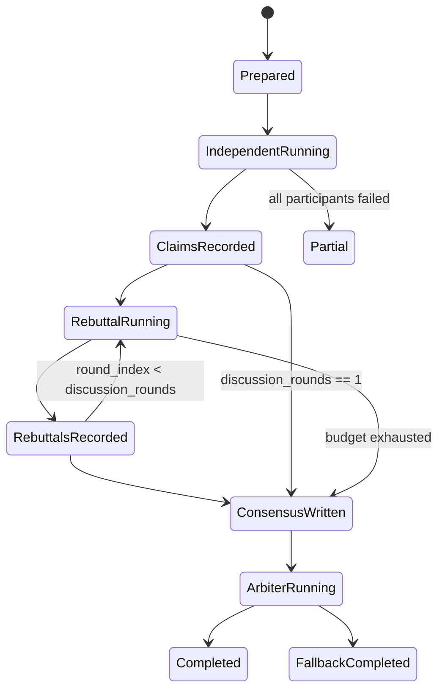

# 数据模型与状态

## ReviewBoard 目录

```text
review_board/
  context.md
  sources.md
  claims.jsonl
  rebuttals.jsonl
  consensus.md
  final_report.md
```

## context.md

记录本次评审目标和运行边界：

> 迁移说明：`reviewers` 字段由 [agent-role-presets-v0.1](../agent-role-presets-v0.1/) 的 `participants.select` 取代。上下文快照仍可以记录最终解析出的角色 ID，字段名使用 `participants.select`。

```yaml
workflow_id: wf-...
mode: roundtable_review
topic: Session 模块设计是否合理
objective: 检查模块边界、状态归属和扩展性
discussion_rounds: 2
max_discussion_rounds: 6
total_child_token_budget: 50000
participants:
  select:
    - architecture_reviewer
    - code_quality_reviewer
    - test_reviewer
    - performance_reviewer
    - safety_stability_reviewer
```

## sources.md

记录输入来源、文件路径、截断状态、快照摘要：

```markdown
- src/sessions/manager.py -> input/source/src/sessions/manager.py (23400 bytes)
- docs/modules/会话/README.md -> input/source/docs/modules/会话/README.md (9100 bytes)
```

## claims.jsonl

每行一个 claim：

```json
{
  "claim_id": "C-001",
  "agent": "architecture_reviewer",
  "severity": "P1",
  "claim": "模块边界混合了调度逻辑和持久化逻辑",
  "evidence": [
    {
      "type": "code",
      "path": "input/source/src/sessions/session_manager.py",
      "lines": "120-180"
    }
  ],
  "risk": "后续增加多 workspace 时会放大耦合",
  "suggestion": "拆出 SessionRepository 和 SessionCoordinator",
  "confidence": 0.82,
  "round_index": 1
}
```

## rebuttals.jsonl

每行一个质询评论：

```json
{
  "comment_id": "R-001",
  "agent": "test_reviewer",
  "round_index": 2,
  "type": "supplement",
  "target_claim_id": "C-001",
  "comment": "C-001 成立，测试影响主要集中在 session recovery 路径",
  "evidence": [
    {
      "type": "code",
      "path": "input/source/tests/unit/test_session_recovery.py",
      "lines": "33-72"
    }
  ],
  "severity_adjustment": "P2",
  "confidence": 0.74
}
```

## consensus.md

确定性草稿，由策略根据 claims 和 rebuttals 汇总：
- 共识候选：support 数大于或等于 refute 数。
- 主要分歧：refute 数大于 support 数。
- 等级调整建议：来自 supplement 的 `severity_adjustment`。

## final_report.md

Arbiter 输出最终报告：

```markdown
# Roundtable Review Final Report

## 1. 共识问题
## 2. 主要分歧
## 3. 高优先级风险
## 4. 建议修改方案
## 5. 需要人工确认的问题
## 6. 可直接交给开发 Agent 的任务清单
```

## 状态流转



## 预算状态

| 字段 | 语义 |
------|------|
| `total_child_token_budget` | 全部子 agent 输入快照预算和输出估算预算总额 |
| `estimated_input_tokens` | 所有子 agent 输入快照累计估算 |
| `estimated_output_tokens` | 子 agent 输出累计估算 |
| `remaining_budget` | 剩余预算 |
| `budget_exhausted_at` | 停止阶段 |

第一版估算公式可用 `ceil(chars / 4)`。后续 provider 暴露真实 usage 后替换估算器。
