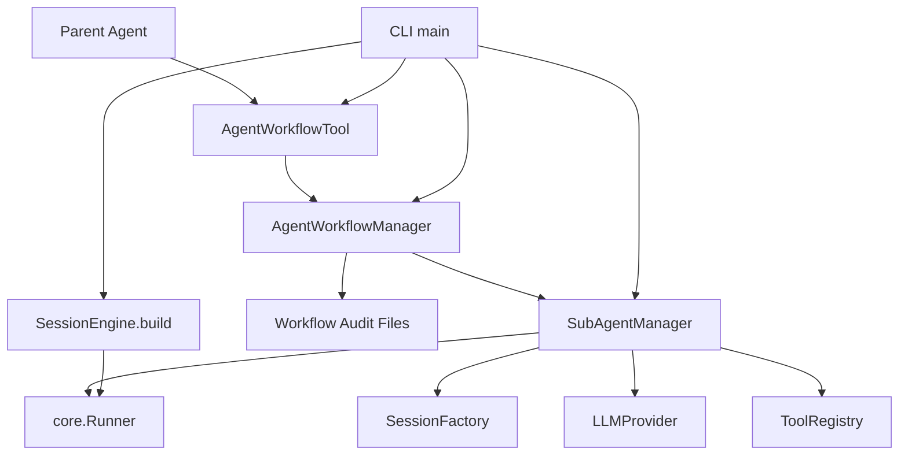

# 模块拆分

## 总体依赖



依赖方向集中在 `executors.agent_runtime` 和 `tools` 两个模块边界内。`Runner` 仍然是唯一 turn 推进逻辑，CLI 仍然只做装配。

## `SubAgentManager`

位置：`src/executors/agent_runtime/subagent_manager.py`

职责：
- 为每个 `SubAgentTask` 创建独立 session id。
- 构造子 agent 专用 `AgentSpec`。
- 构造只含任务和最小 context 的 dispatch prompt。
- 按 `task.tool_names` 解析子 agent 可见工具白名单。
- 调用共享 `Runner.run()` 执行子 agent。
- 把 `Result` 收敛为 `SubAgentRun`。

公共边界：

```python
class SubAgentManager:
    async def run_task(
        self,
        *,
        workflow_id: str,
        parent_session_id: str,
        task: SubAgentTask,
    ) -> SubAgentRun:
        ...
```

隐藏细节：
- 子 session id 的 slug 规则。
- 子 `AgentSpec` 的指令文本。
- dispatch prompt 拼装。
- `Result` 到 `SubAgentRun` 的转换。
- enabled tools 的具体解析。

依赖说明：
- `SubAgentManager` 可以持有 `SessionEngine`，因为它位于 `executors.agent_runtime` 装配域内。
- 外部模块只通过 manager 方法派任务，不直接触碰 runtime 内部字段。

## `AgentWorkflowManager`

位置：`src/executors/agent_runtime/workflow/manager.py`

职责：
- 提供 workflow 模式入口。
- 生成 workflow id 和审计目录。
- 为每个任务注入独立工作目录。
- 写入 `workflow.json`、`audit.jsonl`、`result.json` 和 agent 结果文件。
- 当前实现 `parallel` 并发调度。
- 返回 `AgentWorkflowResult` 给 tool 或宿主层。

公共边界：

```python
class AgentWorkflowManager:
    async def run_workflow_specs(
        self,
        *,
        mode: str,
        parent_session_id: str,
        task_specs: list[dict[str, object]],
    ) -> AgentWorkflowResult:
        ...

    async def run_parallel(
        self,
        *,
        parent_session_id: str,
        tasks: list[SubAgentTask],
    ) -> AgentWorkflowResult:
        ...
```

隐藏细节：
- audit 目录布局。
- task spec 到 `SubAgentTask` 的转换。
- `asyncio.gather` 并发方式。
- audit JSON 写入格式。
- workflow 完成状态计算。

扩展点：
- `run_workflow_specs()` 是模式分发边界。
- 下一轮把 `parallel` 抽成 `WorkflowStrategy`，DAG / supervisor-worker / review panel 作为并列 strategy。

## `AgentWorkflowTool`

位置：`src/tools/agent_workflow_tool.py`

职责：
- 向主 agent 暴露 `run_parallel_subagents`。
- 校验 tool 入参。
- 限制任务数上限。
- 将 `ToolContext.session_id` 作为父 session id。
- 把 `AgentWorkflowResult` 格式化成模型可读文本和结构化数据。

公共边界：

```python
class AgentWorkflowTool(BaseBuiltinTool):
    name = "run_parallel_subagents"

    async def _run(
        self,
        args: dict[str, Any],
        ctx: ToolContext,
    ) -> tuple[str, dict[str, Any] | None]:
        ...
```

装配方式：
- tool 构造时只拿 `AgentWorkflowHandle`。
- CLI 在 `SessionEngine.build()` 后创建真实 manager，再调用 `handle.bind(manager)`。
- 这个 handle 是装配期延迟绑定点，避免 tool 层在 registry 创建时依赖尚未创建的 runtime。

## CLI 装配

位置：`src/cli/main.py`

装配顺序：
1. 加载 config、instructions、skills、registry、approval。
2. 注册 `AgentWorkflowTool`，此时 handle 尚未绑定。
3. 调 `SessionEngine.build()` 生成 runtime。
4. 创建 `SubAgentManager(runtime)`。
5. 创建 `AgentWorkflowManager(subagents, config, workspace_root)`。
6. `agent_workflow_handle.bind(agent_workflow_manager)`。
7. 正常 REPL、`--smoke` 或 `--subagent-smoke` 进入统一运行路径。

边界判断：
- CLI 没有复制 provider、approval、runner 或 session 装配。
- CLI 只新增 manager 组装和 smoke 分支。
- 真正的执行仍由 `Runner` 推进。

## 依赖护栏

| 边界 | 允许 | 约束 |
|------|------|------|
| `tools -> agent_runtime` | 通过 `AgentWorkflowHandle.manager` 调公共方法 | tool 不访问 runner / session factory / llm provider |
| `agent_workflow -> subagent` | `AgentWorkflowManager` 调 `SubAgentManager.run_task()` | workflow 不构造子 `AgentSpec` |
| `subagent -> runner` | `SubAgentManager` 调 `Runner.run()` | 子 agent 不复制 turn loop |
| `cli -> managers` | CLI 完成 manager 装配 | CLI 不实现编排逻辑 |
| `core -> others` | 无 | core 保持零 sibling 依赖 |

## 后续拆分触发条件

- workflow 模式超过 1 个时，新增 `WorkflowStrategy` 协议和 `ParallelWorkflowStrategy`。
- audit 存储支持 sqlite / remote 时，新增 `WorkflowAuditStore`。
- 子 agent 生命周期支持 wait / followup / close / resume 时，新增 `SubAgentRegistry`。
- 子 agent 需要跨渠道展示时，新增 host 层 view model，仍然从 `AgentWorkflowResult` 和 audit 文件投影。
