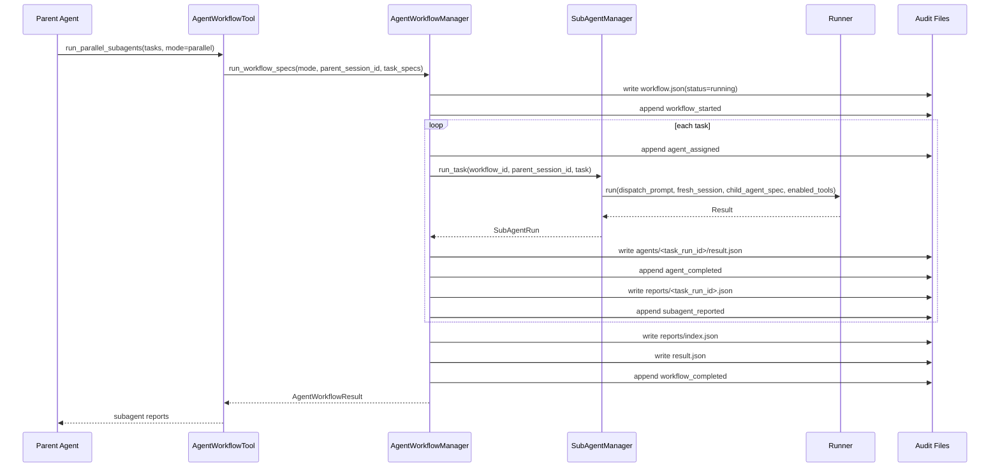
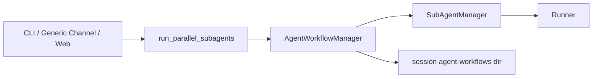

# 核心流程

## 主 agent 创建并行 workflow



## 任务派发

1. tool 层校验 `tasks` 是非空列表。
2. tool 层限制第一版最多 8 个任务。
3. `AgentWorkflowManager` 将公开 task spec 转成 `SubAgentTask`。
4. workflow 为每个任务分配 `agents/<task_run_id>/` 工作目录。`task_run_id` 使用 `display_order + slug(task_id)`，避免清洗后路径碰撞。
5. `SubAgentManager` 构造 dispatch prompt，只包含任务名、任务 ID、任务文本、必要上下文和工作目录。
6. 子 agent 使用新 session 执行，不读取父 session 完整历史。
7. 子 agent 完成后生成 `reports/<task_run_id>.json` 详情报告，并写入 `subagent_reported` 审计事件。
8. workflow 完成后生成 `reports/index.json` 投影索引和 `result.json` 汇总。

## 并发执行

当前 `parallel` 模式使用 `asyncio.gather()` 并发运行所有子任务。每个子任务共享父 runtime 的 LLM provider、approval、tool registry 和 runner 实例，运行时输入保持独立 session 与独立 prompt。

失败策略：
- 单个子任务返回 error 或抛出异常时，`SubAgentRun.status` 收敛为 `failed`，`error_message` 记录失败原因。
- 失败子任务也会写 `agents/<task_run_id>/result.json`、`reports/<task_run_id>.json`、`subagent_reported` 和最终 `result.json`。
- workflow 等待全部子任务结束后计算 `completed`。
- `result.completed` 为所有子任务 `status == "completed"` 的合取。
- v0.1 暂不做失败重试。

## 审计写入

审计目录：

```text
<session.file_store_path>/<parent_session_id>/agent-workflows/<workflow_id>/
  workflow.json
  audit.jsonl
  result.json
  reports/
    index.json
    <task_run_id>.json
  agents/
    <task_run_id>/
      result.json
      result.txt or other files created by enabled tools
```

审计事件顺序：
1. `workflow_started`
2. `agent_assigned` x N
3. `agent_completed` 或 `agent_failed` x N
4. `subagent_reported` x N
5. `workflow_completed`

每条事件包含 `ts`、`action`、`payload`。`subagent_reported` 记录 `report_path`、`content_digest`、`reported_at`、`status` 等字段，子 agent 完整回答进入 `reports/<task_run_id>.json`。

## 主 agent 回流

`AgentWorkflowTool` 使用 `reports` 投影格式化 tool result。父 `Runner` 会把该 tool result append 到父 session，主 agent 下一次 LLM 调用可以看到每个子 agent 的任务名、状态、摘要、report 路径和工作目录。

子 agent 的完整消息流继续保存在子 session。当前版本回流结构化报告和摘要，mailbox / wait / followup 属于后续协作型 agent tree。

## CLI smoke

`--subagent-smoke` 直接调用 `AgentWorkflowManager.run_parallel()`，绕过交互式主 agent，让 CLI 能用真实模型做最小验证：

- 子任务 1：计算 `7 + 5`。
- 子任务 2：调用 `write_file` 在自己的工作目录写入 `result.txt`。
- smoke 校验 workflow 成功、计算回答包含 `12`、文件存在且内容精确匹配。

## 通用渠道接入

通用渠道接入时保持相同执行边界：



渠道层负责触发和展示，workflow manager 负责状态和审计。这样 CLI、通用渠道和 Web 可共享同一编排内核。
