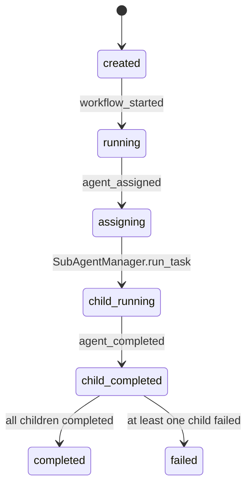

# 数据模型与状态

## Python contract 草案

字段旁保留中文注释，后续如果把这些结构迁移到共享协议文件，可以直接沿用字段语义。

```python
from dataclasses import dataclass, field
from pathlib import Path
from typing import Literal, TypedDict

WorkflowMode = Literal["parallel"]


@dataclass(frozen=True)
class SubAgentTask:
    # 子任务 ID，在一个 workflow 内唯一，用于生成子 session 和审计路径。
    task_id: str
    # 给模型和审计展示的人类可读任务名。
    task_name: str
    # 只发给该子 agent 的任务文本，禁止塞入完整父会话。
    prompt: str
    # 该子任务必需的最小上下文片段，默认空字符串。
    context: str = ""
    # 该子 agent 可见的工具白名单；空 tuple 表示无工具。
    tool_names: tuple[str, ...] = ()
    # 编排层注入的运行元信息，例如 working_dir。
    metadata: dict[str, object] = field(default_factory=dict)


@dataclass(frozen=True)
class SubAgentRun:
    # 原始子任务定义，保留 task_id、task_name、工具白名单和工作目录元信息。
    task: SubAgentTask
    # 子 agent 独立 session id。
    session_id: str
    # 子 agent 本次 Runner.run() 生成的 run id。
    run_id: str
    # 子 agent 运行状态，沿用 Result.status。
    status: str
    # 子 agent 最终回答正文；失败时可为空。
    content: str
    # 子 agent 错误信息；成功时为 None。
    error_message: str | None
    # 子 agent 实际消耗的 turn 数。
    turn_count: int


@dataclass(frozen=True)
class SubAgentReportDetail:
    # 子任务 ID，在 workflow 内唯一。
    task_id: str
    # 子任务名称，用于审计和展示。
    task_name: str
    # 子 agent 独立 session id。
    session_id: str
    # 子 agent 本次 run id。
    run_id: str
    # 子任务状态，当前版本只收敛 completed / failed。
    status: str
    # 子 agent 汇报摘要，给主 agent 和 Web 列表消费。
    summary: str
    # 子 agent 完整汇报内容，来自最终 assistant 内容或错误说明。
    content: str
    # 错误信息，成功时为 None。
    error_message: str | None
    # 子 agent 工作目录。
    working_dir: str | None
    # 子 agent 汇报内容摘要哈希，用于审计比对。
    content_digest: str
    # 子 agent 完成后生成 report 的时间，UTC ISO8601。
    reported_at: str


@dataclass(frozen=True)
class SubAgentReportProjection:
    # Web 和主 agent tool result 消费的稳定排序。
    display_order: int
    # 子任务 ID，在 workflow 内唯一。
    task_id: str
    # 子任务名称，用于卡片标题和主 agent 汇总。
    task_name: str
    # 子任务状态，当前版本只收敛 completed / failed。
    status: str
    # 子 agent 汇报摘要。
    summary: str
    # 错误信息，成功时为 None。
    error_message: str | None
    # 子 agent report 详情文件路径。
    report_path: str
    # 子 agent 工作目录。
    working_dir: str | None
    # 子 agent 独立 session id。
    session_id: str
    # 子 agent 本次 run id。
    run_id: str
    # report 生成时间，UTC ISO8601。
    reported_at: str


@dataclass(frozen=True)
class AgentWorkflowResult:
    # workflow 唯一 ID，格式建议为 wf-<utc timestamp>-<short uuid>。
    workflow_id: str
    # 编排模式，第一版只支持 parallel。
    mode: WorkflowMode
    # 发起该 workflow 的父 session id。
    parent_session_id: str
    # workflow 审计目录绝对路径。
    workflow_dir: Path
    # workflow 开始时间，UTC ISO8601 字符串。
    started_at: str
    # workflow 结束时间，UTC ISO8601 字符串。
    finished_at: str
    # 所有子 agent 运行结果，顺序对应派发任务顺序。
    runs: tuple[SubAgentRun, ...]
    # 所有子 agent 汇报投影，顺序对应派发任务顺序。
    reports: tuple[SubAgentReportProjection, ...]
    # report index 文件路径。
    report_index_path: Path


class AgentWorkflowTaskSpec(TypedDict, total=False):
    # 给模型和审计展示的人类可读任务名。
    task_name: str
    # 只发给该子 agent 的任务文本。
    prompt: str
    # 该子任务需要的最小上下文。
    context: str
    # 子 agent 可见工具白名单。
    tool_names: list[str]
```

## Tool schema

```python
input_schema = {
    # JSON Schema 根对象。
    "type": "object",
    "properties": {
        "tasks": {
            # 子 agent 任务列表，第一版最多 8 个。
            "type": "array",
            "items": {
                "type": "object",
                "properties": {
                    # 子任务名称，用于审计和模型展示。
                    "task_name": {"type": "string"},
                    # 子任务 prompt，只包含该任务需要完成的内容。
                    "prompt": {"type": "string"},
                    # 可选必要上下文，禁止传完整父会话。
                    "context": {"type": "string"},
                    "tool_names": {
                        # 可选工具白名单，子 agent 只能看到列出的工具。
                        "type": "array",
                        "items": {"type": "string"},
                    },
                },
                "required": ["task_name", "prompt"],
            },
        },
        "mode": {
            # 编排模式，第一版固定为 parallel。
            "type": "string",
            "enum": ["parallel"],
        },
    },
    "required": ["tasks"],
}
```

## 审计文件

### `workflow.json`

```jsonc
{
  "workflow_id": "wf-20260605T164159-68bfdd5a", // workflow 唯一 ID
  "mode": "parallel", // 编排模式
  "parent_session_id": "parent-session", // 父 session id
  "started_at": "2026-06-05T16:41:59.000000+00:00", // 开始时间
  "finished_at": "2026-06-05T16:42:03.000000+00:00", // 结束时间，运行中为 null
  "status": "completed", // workflow 状态
  "assigned_agents": [
    {
      "task_id": "agent-1", // 子任务 ID
      "task_name": "simple calculation", // 子任务名称
      "tool_names": [], // 子 agent 工具白名单
      "working_dir": "/abs/path/.kongming/sessions/.../agents/agent-1" // 子 agent 工作目录
    }
  ]
}
```

### `audit.jsonl`

```jsonc
{"ts":"2026-06-05T16:41:59.000000+00:00","action":"workflow_started","payload":{"workflow_id":"wf-...","mode":"parallel","parent_session_id":"parent-session","task_count":2}}
{"ts":"2026-06-05T16:41:59.000000+00:00","action":"agent_assigned","payload":{"task_id":"agent-1","task_name":"simple calculation","tool_names":[],"working_dir":"/abs/path/.../agents/agent-1"}}
{"ts":"2026-06-05T16:42:02.000000+00:00","action":"agent_completed","payload":{"task_id":"agent-1","status":"completed","content":"12","elapsed_ms":1200}}
{"ts":"2026-06-05T16:42:02.000000+00:00","action":"subagent_reported","payload":{"workflow_id":"wf-...","task_id":"agent-1","status":"completed","report_path":"/abs/path/.../reports/agent-1.json","content_digest":"sha256:...","reported_at":"2026-06-05T16:42:02.000000+00:00","error_message":null}}
{"ts":"2026-06-05T16:42:03.000000+00:00","action":"workflow_completed","payload":{"workflow_id":"wf-...","completed":true,"finished_at":"2026-06-05T16:42:03.000000+00:00","run_count":2}}
```

字段语义：
- `ts`：审计事件写入时间，UTC ISO8601。
- `action`：审计动作枚举。
- `payload`：动作对应的最小结构化事实。

### `result.json`

```jsonc
{
  "workflow_id": "wf-20260605T164159-68bfdd5a", // workflow 唯一 ID
  "mode": "parallel", // 编排模式
  "parent_session_id": "parent-session", // 父 session id
  "workflow_dir": "/abs/path/.kongming/sessions/parent-session/agent-workflows/wf-...", // 审计目录
  "started_at": "2026-06-05T16:41:59.000000+00:00", // 开始时间
  "finished_at": "2026-06-05T16:42:03.000000+00:00", // 结束时间
  "completed": true, // 是否所有子任务成功完成
  "report_index_path": "/abs/path/.../reports/index.json", // report 投影索引
  "reports": [
    {
      "display_order": 1, // 展示顺序
      "task_id": "agent-1", // 子任务 ID
      "task_name": "simple calculation", // 子任务名称
      "status": "completed", // 子任务状态
      "summary": "12", // 子 agent 汇报摘要
      "error_message": null, // 错误信息
      "report_path": "/abs/path/.../reports/agent-1.json", // 子 agent 详情报告
      "working_dir": "/abs/path/.../agents/agent-1", // 子 agent 工作目录
      "session_id": "subagent-parent-session-wf-agent-1", // 子 agent session id
      "run_id": "subagent-parent-session-wf-agent-1-1", // 子 agent run id
      "reported_at": "2026-06-05T16:42:02.000000+00:00" // report 生成时间
    }
  ],
  "runs": [
    {
      "task_id": "agent-1", // 子任务 ID
      "task_name": "simple calculation", // 子任务名称
      "session_id": "subagent-parent-session-wf-agent-1", // 子 agent session id
      "run_id": "subagent-parent-session-wf-agent-1-1", // 子 agent run id
      "status": "completed", // 子 agent 状态
      "content": "12", // 子 agent 最终回答
      "error_message": null, // 子 agent 错误
      "turn_count": 1, // 子 agent turn 数
      "working_dir": "/abs/path/.../agents/agent-1" // 子 agent 工作目录
    }
  ]
}
```

### `reports/index.json`

```jsonc
{
  "workflow_id": "wf-20260605T164159-68bfdd5a", // workflow 唯一 ID
  "parent_session_id": "parent-session", // 父 session id
  "mode": "parallel", // 编排模式
  "status": "completed", // workflow 状态
  "reports_dir": "/abs/path/.../reports", // report 目录
  "reports": [
    {
      "display_order": 1, // 展示顺序
      "task_id": "agent-1", // 子任务 ID
      "task_name": "simple calculation", // 子任务名称
      "status": "completed", // 子任务状态
      "summary": "12", // 列表摘要
      "error_message": null, // 错误信息
      "report_path": "/abs/path/.../reports/agent-1.json", // 详情报告路径
      "working_dir": "/abs/path/.../agents/agent-1", // 子 agent 工作目录
      "session_id": "subagent-parent-session-wf-agent-1", // 子 agent session id
      "run_id": "subagent-parent-session-wf-agent-1-1", // 子 agent run id
      "reported_at": "2026-06-05T16:42:02.000000+00:00" // report 生成时间
    }
  ]
}
```

### `reports/<task_run_id>.json`

```jsonc
{
  "task_id": "agent-1", // 子任务 ID
  "task_name": "simple calculation", // 子任务名称
  "session_id": "subagent-parent-session-wf-agent-1", // 子 agent session id
  "run_id": "subagent-parent-session-wf-agent-1-1", // 子 agent run id
  "status": "completed", // 子任务状态
  "summary": "12", // 摘要
  "content": "12", // 完整汇报内容
  "error_message": null, // 错误信息
  "working_dir": "/abs/path/.../agents/agent-1", // 子 agent 工作目录
  "content_digest": "sha256:...", // 内容摘要
  "reported_at": "2026-06-05T16:42:02.000000+00:00" // report 生成时间
}
```

## 状态机



## 存储所有权

| 数据 | 所有者 | 位置 | 生命周期 |
|------|--------|------|----------|
| 子 session 历史 | Session backend | `<session root>/<subagent-session-id>/` | 跟 session backend 一致 |
| workflow manifest | `AgentWorkflowManager` | `<parent session>/agent-workflows/<workflow_id>/workflow.json` | workflow 永久审计 |
| audit log | `AgentWorkflowManager` | `<parent session>/agent-workflows/<workflow_id>/audit.jsonl` | append-only |
| report detail | `AgentWorkflowManager` | `<parent session>/agent-workflows/<workflow_id>/reports/<task_run_id>.json` | 子 agent 汇报审计详情 |
| report index | `AgentWorkflowManager` | `<parent session>/agent-workflows/<workflow_id>/reports/index.json` | Web 和主 agent 投影索引 |
| workflow result | `AgentWorkflowManager` | `<parent session>/agent-workflows/<workflow_id>/result.json` | 完成后写入 |
| 子 agent 工作产物 | 子 agent 工具调用 | `<workflow>/agents/<task_run_id>/` | 跟 workflow 审计目录同生命周期 |

## 路径约束

- `workspace_root` 由 CLI 当前 cwd 传入。
- `session.file_store_path` 相对路径按 workspace root 解析。
- 解析后的 session root 必须位于 workspace root 内。
- 每个子 agent 工作目录由 workflow manager 创建，子 agent prompt 明确要求文件写入该目录。
- 后续新增 `AuditRootResolver` 时，sqlite backend 和 remote backend 可通过同一接口得到审计目录。
