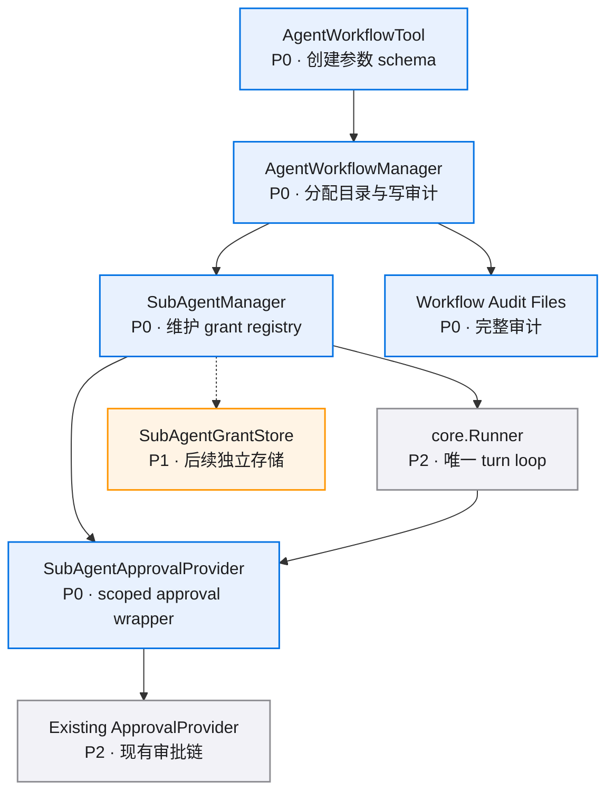

# 模块拆分

> 维护说明（2026-07-13）：本文件中的 `SubAgentApprovalProvider` 模块和 wrapper 依赖图属于旧方案。当前审批组合权威方案见 `repo:docs/spec/safety-approval-single-entry-v0.1/`；子 Agent 模块只负责派生 scope/evidence，最终判定由 `SafetyGatedApproval` 完成。

## 总体依赖



## `AgentWorkflowTool`

位置：`src/tools/agent_workflow_tool.py`

职责：
- 暴露 `run_parallel_subagents` schema。
- 为每个 task 解析 `tool_names`、`skill_names`、`permission`。
- 限制权限模式为第一版支持的 `scoped_workdir`。
- 把 task spec 交给 `AgentWorkflowManager`。

输入结构建议：

```python
class AgentWorkflowTaskSpec(TypedDict, total=False):
    # 子任务名称，给审计、展示和子 agent 指令使用。
    task_name: str
    # 子任务 prompt，只包含分派给该子 agent 的任务。
    prompt: str
    # 必要上下文，由主 agent 裁剪后提供。
    context: str
    # 主 agent 允许子 agent 可见的工具名白名单。
    tool_names: list[str]
    # 主 agent 允许子 agent 可见的 skill 名白名单。
    skill_names: list[str]
    # 子 agent 权限选项，第一版只支持 scoped_workdir。
    permission: SubAgentPermissionSpec
```

## `AgentWorkflowManager`

位置：`src/executors/agent_runtime/workflow/manager.py`

职责：
- 生成 `workflow_id`。
- 为每个 task 生成 `task_run_id`。
- 创建 `agents/<task_run_id>/`。
- 创建 `agents/<task_run_id>/work/` 作为子 agent `working_dir`。
- 创建 workflow 审计写入器。
- 把 `working_dir`、`task_run_id`、审计写入器交给 `SubAgentManager`。
- 统一落盘 workflow 审计事件和 `subagent.json`。

边界：
- 只分配路径和提供写入入口。
- 不组装 `SubAgentGrant` 内容。
- 不执行工具审批判断。
- 不直接访问现有审批 manager 内部状态。

## `SubAgentManager`

位置：`src/executors/agent_runtime/subagent_manager.py`

职责：
- 创建子 session id。
- 构造 `SubAgentGrant`。
- 在内部 registry 维护 `subagent_id -> SubAgentGrant`。
- 组装 `SubAgentCreationRecord` 完整内容。
- 通过 workflow 审计写入器写 `agents/<task_run_id>/subagent.json`、`subagent_created`、`subagent_grant_bound`。
- 为每次子 agent run 构造 `SubAgentApprovalProvider`。
- 调用 `Runner.run(... approval=subagent_approval_provider)`。

公共边界建议：

```python
class SubAgentManager:
    async def run_task(
        self,
        *,
        workflow_id: str,
        parent_session_id: str,
        task: SubAgentTask,
    ) -> SubAgentRun:
        ...
```

内部新增：

```python
class SubAgentManager:
    def _create_grant(
        self,
        *,
        workflow_id: str,
        parent_session_id: str,
        child_session_id: str,
        task: SubAgentTask,
    ) -> SubAgentGrant:
        ...
```

## `SubAgentApprovalProvider`

建议位置：`src/executors/agent_runtime/subagent_permissions.py`

职责：
- 实现 `ApprovalProvider.decide()`。
- 判断工具是否在 grant 白名单内。
- 对文件类工具解析路径并校验是否位于 `working_dir`。
- 命中工作目录内允许时返回 `ApprovalDecision(outcome="approved")`，并写 `subagent_approval_decided`。
- 越界或未授权时返回 `ApprovalDecision(outcome="rejected")`，并写 `subagent_approval_decided`。
- 对未来需要用户审批的请求，把子 agent metadata 注入后转交既有 `ApprovalProvider`。
- 写审批审计事件。

```python
class SubAgentApprovalProvider:
    # 子 agent 的授权单。
    grant: SubAgentGrant
    # 既有审批链，当前第一版只保留扩展点。
    upstream: ApprovalProvider
    # workflow 审计写入器。
    audit: SubAgentApprovalAuditWriter

    async def decide(self, request: ApprovalRequest) -> ApprovalDecision:
        ...
```

## `SubAgentApprovalAuditWriter`

建议位置：`src/executors/agent_runtime/subagent_permissions.py`

职责：
- 将 `subagent_approval_decided` 写入 workflow `audit.jsonl`。
- 记录完整 request 坐标和参数摘要。
- 每次子 agent 触发审批都写审计，approved 和 rejected 都落盘。
- 捕获 `not_registered` 时结合 lifecycle hook 中的原始 ToolCall 参数写审计。

边界：
- 只写 workflow 审计文件。
- 不写 child session JSONL。
- 不写 Web event。
- 不参与权限判断。

## 依赖护栏

| 边界 | 允许 | 约束 |
|------|------|------|
| `tools -> agent_runtime` | 通过 `AgentWorkflowManager.run_workflow_specs()` 传 task spec | tool 不读 grant registry |
| `AgentWorkflowManager -> SubAgentManager` | 传 `SubAgentTask.metadata` 和 workflow 审计写入器 | workflow 不组装 grant，不执行审批判断 |
| `SubAgentManager -> Runner` | 传 scoped approval provider | 子 agent 不复制 run loop |
| `SubAgentApprovalProvider -> upstream approval` | 未来高风险升级时调用 | 第一版越界直接拒绝 |
| `core -> agent_runtime` | 无 | core 保持协议真源 |

## 后续拆分触发条件

- 权限模式超过 `scoped_workdir` 时，抽 `SubAgentPermissionPolicy`。
- grant 需要跨进程恢复时，抽 `SubAgentGrantStore` 持久化实现。
- Web 需要展示审批卡片时，新增 view model projector。
- 主 agent 运行中审批需要 wait / followup 时，接入 agent target registry。
