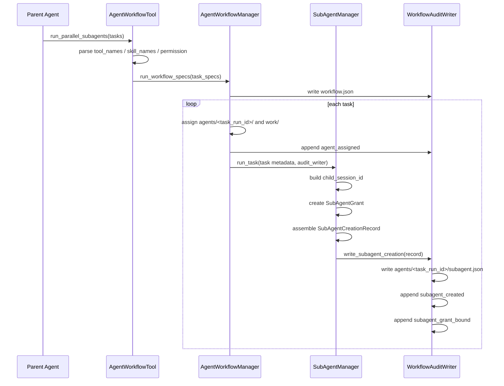
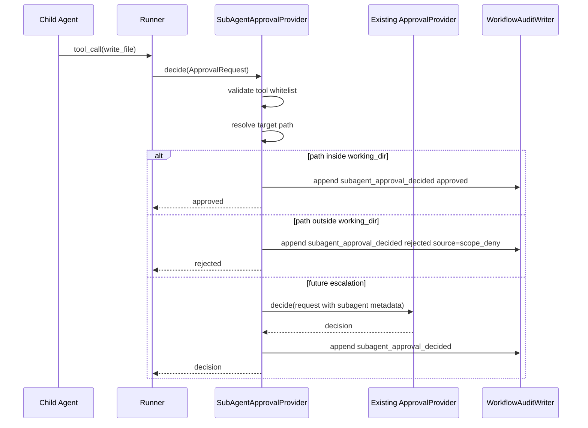
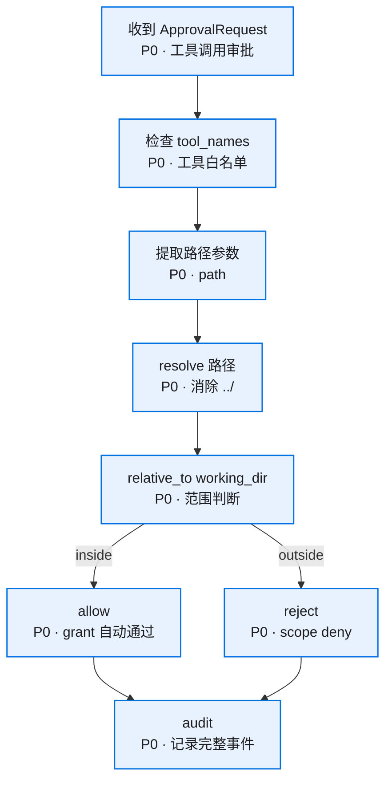

# 核心流程

## 创建子 agent 与绑定 grant



## 子 agent 工具审批



## 路径判断流程



## 文件工具 path extractor

第一版只支持内置文件工具，目标路径字段固定为 `path`。相对路径以子 agent `working_dir` 为基准补全，再执行 `resolve()` 和 `relative_to(working_dir)`。

| 工具 | 路径字段 | 相对路径基准 | 缺字段处理 | 允许条件 |
|------|----------|--------------|------------|----------|
| `read_file` | `path` | 子 agent `working_dir` | rejected，原因 `missing_path` | resolve 后位于 `working_dir` 内，且工具在 `tool_names` 内 |
| `write_file` | `path` | 子 agent `working_dir` | rejected，原因 `missing_path` | resolve 后位于 `working_dir` 内，且工具在 `tool_names` 内 |
| `list_dir` | `path` | 子 agent `working_dir` | rejected，原因 `missing_path` | resolve 后位于 `working_dir` 内，且工具在 `tool_names` 内 |

未来新增文件类工具时必须先在本表补 extractor，再进入实现。

## 审计目录布局

```text
<parent session>/agent-workflows/<workflow_id>/
  workflow.json
  audit.jsonl
  result.json
  reports/
    index.json
    <task_run_id>.json
  agents/
    <task_run_id>/
      subagent.json
      result.json
      work/
        result.txt
```

## 日志位置决策

权限相关日志按三层固定：

| 层级 | 路径 | 写入方 | 内容 |
|------|------|--------|------|
| workflow 审计日志 | `<workflow_dir>/audit.jsonl` | `WorkflowAuditWriter` | 子 agent 创建、授权绑定、每次审批、越界拒绝、汇报 |
| 子 agent 创建快照 | `<workflow_dir>/agents/<task_run_id>/subagent.json` | `WorkflowAuditWriter` | task、prompt、context、tool_names、skill_names、permission、grant、working_dir、session_id |
| 子 agent 会话日志 | `.kongming/sessions/<child_session_id>/<child_session_id>.jsonl` | `Session` backend | 子 agent 原始 user / assistant / tool 消息 |

`audit.jsonl` 是权限和 Web 渲染事实源。child session JSONL 用于回放模型对话。每次子 agent 触发工具审批，无论 approved 还是 rejected，都写入 `subagent_approval_decided`；拒绝原因通过 `decision_source` 区分。

## 审计事件顺序

1. `workflow_started`
2. `agent_assigned`
3. `subagent_created`
4. `subagent_grant_bound`
5. `subagent_approval_decided`
6. `agent_completed` 或 `agent_failed`
7. `subagent_reported`
8. `workflow_completed`

## 主 agent 回流

tool result 继续返回 `reports/index.json` 和每个 report 投影。权限审计留在 workflow 目录内，后续 Web 渲染可以从 `audit.jsonl` 和 `subagent.json` 聚合出“谁创建、给了什么权限、子 agent 使用了什么权限、哪些请求被拒绝”。
