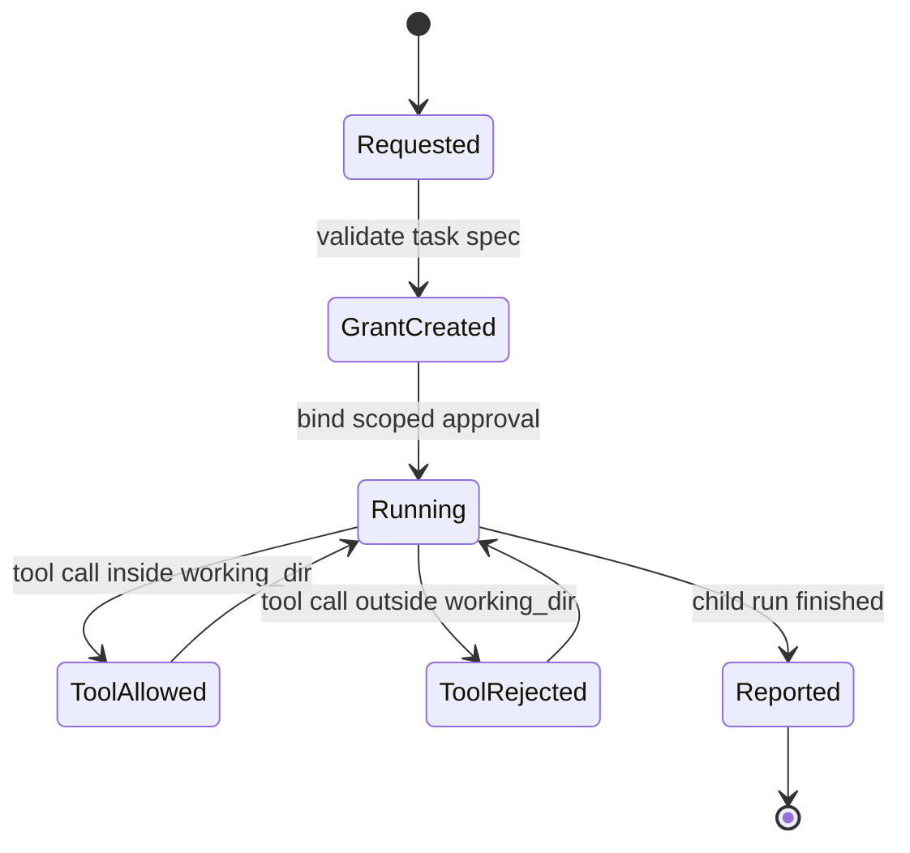

# 数据模型与状态

## `SubAgentPermissionSpec`

主 agent 创建子 agent 时传入的权限选项。第一版只接受 `mode="scoped_workdir"`。

```python
@dataclass(frozen=True)
class SubAgentPermissionSpec:
    # 权限模式，第一版只支持 scoped_workdir。
    mode: Literal["scoped_workdir"]
```

JSONC 示例：

```jsonc
{
  "mode": "scoped_workdir" // 权限模式，第一版只允许 scoped_workdir
}
```

## `SubAgentGrant`

系统创建并固化的子 agent 授权单。它是运行时判断的事实源。

```python
@dataclass(frozen=True)
class SubAgentGrant:
    # 授权单唯一 ID，用于审计串联。
    grant_id: str
    # workflow 唯一 ID。
    workflow_id: str
    # 父 session id。
    parent_session_id: str
    # 子 agent session id。
    child_session_id: str
    # 子 agent 在 workflow 内的稳定 ID。
    subagent_id: str
    # 子任务原始 ID。
    task_id: str
    # 子任务名称，用于展示和审计。
    task_name: str
    # 子任务运行目录，包含 subagent.json 和 work/。
    task_run_dir: str
    # 子 agent 工作目录，只允许在此目录内操作。
    working_dir: str
    # workflow 根目录，用于审计定位。
    workflow_dir: str
    # 子 agent 可见工具白名单。
    allowed_tools: tuple[str, ...]
    # 子 agent 可见 skill 白名单。
    allowed_skills: tuple[str, ...]
    # 创建来源，通常是 run_parallel_subagents。
    created_by_tool: str
    # 创建该子 agent 的父 tool call id。
    created_by_call_id: str | None
    # 创建时间，UTC ISO8601。
    created_at: str
    # 原始 task prompt 的 sha256 摘要，避免审计索引过大。
    prompt_digest: str
    # 原始 context 的 sha256 摘要，避免审计索引过大。
    context_digest: str
```

JSONC 示例：

```jsonc
{
  "grant_id": "grant-wf-001-review", // 授权单唯一 ID
  "workflow_id": "wf-20260606T061859-931321fd", // workflow 唯一 ID
  "parent_session_id": "cli-29b3666ee0d4", // 父 session id
  "child_session_id": "subagent-cli-xxx-001-review", // 子 agent session id
  "subagent_id": "subagent-cli-xxx-001-review", // 子 agent 稳定 ID
  "task_id": "review", // 子任务原始 ID
  "task_name": "review docs", // 子任务名称
  "task_run_dir": "/abs/.kongming/.../agents/001-review", // 子任务运行目录
  "working_dir": "/abs/.kongming/.../agents/001-review/work", // 子 agent 工作目录
  "workflow_dir": "/abs/.kongming/.../wf-xxx", // workflow 根目录
  "allowed_tools": ["read_file", "write_file"], // 子 agent 可见工具白名单
  "allowed_skills": [], // 子 agent 可见 skill 白名单
  "created_by_tool": "run_parallel_subagents", // 创建来源工具
  "created_by_call_id": "call-xxx", // 父 tool call id
  "created_at": "2026-06-06T06:19:01.000000+00:00", // 创建时间
  "prompt_digest": "sha256:...", // prompt 摘要
  "context_digest": "sha256:..." // context 摘要
}
```

## `SubAgentCreationRecord`

写入 `agents/<task_run_id>/subagent.json` 的完整创建记录。这个文件用于后续排查和 Web 展示。

```python
@dataclass(frozen=True)
class SubAgentCreationRecord:
    # 记录类型，固定为 subagent_creation。
    record_type: Literal["subagent_creation"]
    # schema 版本，便于后续迁移。
    schema_version: str
    # 子 agent 授权单。
    grant: SubAgentGrant
    # 子任务完整 prompt。
    prompt: str
    # 子任务完整 context。
    context: str
    # 子任务派发时的工具白名单。
    tool_names: tuple[str, ...]
    # 子任务派发时的 skill 白名单。
    skill_names: tuple[str, ...]
    # 子任务权限 spec 原始值。
    permission: SubAgentPermissionSpec
    # 子 agent 会话日志路径，用于原始对话回放。
    child_session_log_path: str
    # workflow 审计日志路径，用于权限事实和 Web 渲染。
    workflow_audit_log_path: str
```

JSONC 示例：

```jsonc
{
  "record_type": "subagent_creation", // 记录类型
  "schema_version": "0.1", // schema 版本
  "grant": {
    "grant_id": "grant-wf-001-review", // 授权单唯一 ID
    "workflow_id": "wf-20260606T061859-931321fd", // workflow 唯一 ID
    "parent_session_id": "cli-29b3666ee0d4", // 父 session id
    "child_session_id": "subagent-cli-xxx-001-review", // 子 agent session id
    "subagent_id": "subagent-cli-xxx-001-review", // 子 agent 稳定 ID
    "task_id": "review", // 子任务原始 ID
    "task_name": "review docs", // 子任务名称
    "task_run_dir": "/abs/.kongming/.../agents/001-review", // 子任务运行目录
    "working_dir": "/abs/.kongming/.../agents/001-review/work", // 子 agent 工作目录
    "workflow_dir": "/abs/.kongming/.../wf-xxx", // workflow 根目录
    "allowed_tools": ["read_file"], // 子 agent 可见工具白名单
    "allowed_skills": [], // 子 agent 可见 skill 白名单
    "created_by_tool": "run_parallel_subagents", // 创建来源工具
    "created_by_call_id": "call-xxx", // 父 tool call id
    "created_at": "2026-06-06T06:19:01.000000+00:00", // 创建时间
    "prompt_digest": "sha256:...", // prompt 摘要
    "context_digest": "sha256:..." // context 摘要
  },
  "prompt": "审查这组文档", // 子任务完整 prompt
  "context": "必要上下文", // 子任务完整 context
  "tool_names": ["read_file"], // 子任务派发时的工具白名单
  "skill_names": [], // 子任务派发时的 skill 白名单
  "permission": {
    "mode": "scoped_workdir" // 权限模式
  },
  "child_session_log_path": ".kongming/sessions/subagent-cli-xxx/subagent-cli-xxx.jsonl", // 子 agent 会话日志路径
  "workflow_audit_log_path": ".kongming/sessions/cli-xxx/agent-workflows/wf-xxx/audit.jsonl" // workflow 审计日志路径
}
```

## `SubAgentApprovalAuditPayload`

写入 `audit.jsonl` 的审批事件 payload。

```python
@dataclass(frozen=True)
class SubAgentApprovalAuditPayload:
    # 审计事件类型，固定为 subagent_approval_decided。
    action: Literal["subagent_approval_decided"]
    # workflow 唯一 ID。
    workflow_id: str
    # 子 agent 稳定 ID。
    subagent_id: str
    # 授权单唯一 ID。
    grant_id: str
    # 父 session id。
    parent_session_id: str
    # 子 agent session id。
    child_session_id: str
    # 当前 run id。
    run_id: str
    # 当前 turn 序号。
    turn: int
    # 工具调用 id。
    call_id: str
    # 工具名称。
    tool_name: str
    # 工具参数完整对象，第一版审计完整保存。
    tool_arguments: dict[str, object]
    # 工具参数 sha256 摘要，用于快速比对。
    tool_arguments_digest: str
    # 工具调用中解析出的目标路径。
    target_path: str | None
    # resolve 后的绝对目标路径。
    resolved_target_path: str | None
    # 子 agent 工作目录。
    working_dir: str
    # 审批结果，approved 或 rejected。
    decision: Literal["approved", "rejected"]
    # 决策来源，grant_allow、scope_deny、tool_deny、not_registered、missing_path 或 invalid_path。
    decision_source: Literal["grant_allow", "scope_deny", "tool_deny", "not_registered", "missing_path", "invalid_path"]
    # 命中的权限规则。
    matched_permission: str
    # 人类可读原因。
    reason: str
    # 事件时间，UTC ISO8601。
    decided_at: str
```

JSONC 示例：

```jsonc
{
  "action": "subagent_approval_decided", // 审计事件类型
  "workflow_id": "wf-xxx", // workflow 唯一 ID
  "subagent_id": "subagent-cli-xxx-001-review", // 子 agent 稳定 ID
  "grant_id": "grant-wf-001-review", // 授权单唯一 ID
  "parent_session_id": "cli-xxx", // 父 session id
  "child_session_id": "subagent-cli-xxx-001-review", // 子 agent session id
  "run_id": "run-subagent-cli-xxx-1", // 当前 run id
  "turn": 1, // 当前 turn 序号
  "call_id": "call-1", // 工具调用 id
  "tool_name": "write_file", // 工具名称
  "tool_arguments": {"path": "/abs/.../result.txt", "content": "ok"}, // 工具参数完整对象
  "tool_arguments_digest": "sha256:...", // 工具参数摘要
  "target_path": "/abs/.../result.txt", // 工具调用中的目标路径
  "resolved_target_path": "/abs/.../result.txt", // resolve 后的目标路径
  "working_dir": "/abs/.../agents/001-review/work", // 子 agent 工作目录
  "decision": "approved", // 审批结果
  "decision_source": "grant_allow", // 决策来源
  "matched_permission": "write_file:working_dir", // 命中的权限规则
  "reason": "target path is inside subagent working_dir", // 人类可读原因
  "decided_at": "2026-06-06T06:19:02.000000+00:00" // 事件时间
}
```

## `AgentWorkflowTaskSpec` schema 增量

```jsonc
{
  "task_name": "write report", // 子任务名称
  "prompt": "在工作目录内写 result.txt", // 子任务 prompt
  "context": "必要上下文", // 主 agent 裁剪后的必要上下文
  "tool_names": ["write_file"], // 子 agent 可见工具白名单
  "skill_names": [], // 子 agent 可见 skill 白名单
  "permission": {
    "mode": "scoped_workdir" // 权限模式
  }
}
```

## 状态机



## 持久化位置

| 数据 | 写入方 | 路径 | 用途 |
|------|--------|------|------|
| `SubAgentCreationRecord` | `WorkflowAuditWriter` | `agents/<task_run_id>/subagent.json` | 完整创建与授权记录 |
| `SubAgentApprovalAuditPayload` | `SubAgentApprovalProvider` | `audit.jsonl` | 审批和拒绝审计 |
| `SubAgentGrant` registry | `SubAgentManager` | 进程内内存 | 运行时权限判断 |
| 子 agent 产物 | 子 agent 工具调用 | `agents/<task_run_id>/work/` | 子 agent 自己的工作目录 |
| 子 agent 会话消息 | `Session` backend | `.kongming/sessions/<child_session_id>/<child_session_id>.jsonl` | 原始对话回放 |

## 日志归属

| 日志类型 | 事实源 | 字段要求 |
|----------|--------|----------|
| 权限审计 | `<workflow_dir>/audit.jsonl` | 每条审批事件必须包含 `workflow_id`、`subagent_id`、`grant_id`、`tool_name`、`decision`、`decision_source`、`working_dir` |
| 创建快照 | `<workflow_dir>/agents/<task_run_id>/subagent.json` | 必须保存完整 task、prompt、context、tool_names、skill_names、permission、grant 和日志路径 |
| 对话回放 | `.kongming/sessions/<child_session_id>/<child_session_id>.jsonl` | 保留 Runner 原始消息，不作为权限审计事实源 |

## 路径安全规则

```python
def is_inside_working_dir(target: Path, working_dir: Path) -> bool:
    # 子 agent 目标路径 resolve 后的绝对路径。
    resolved_target = target.resolve()
    # 子 agent 工作目录 resolve 后的绝对路径。
    resolved_working_dir = working_dir.resolve()
    try:
        # 只有目标路径能相对到 working_dir 时才允许。
        resolved_target.relative_to(resolved_working_dir)
        return True
    except ValueError:
        # 任何越界路径都拒绝。
        return False
```
