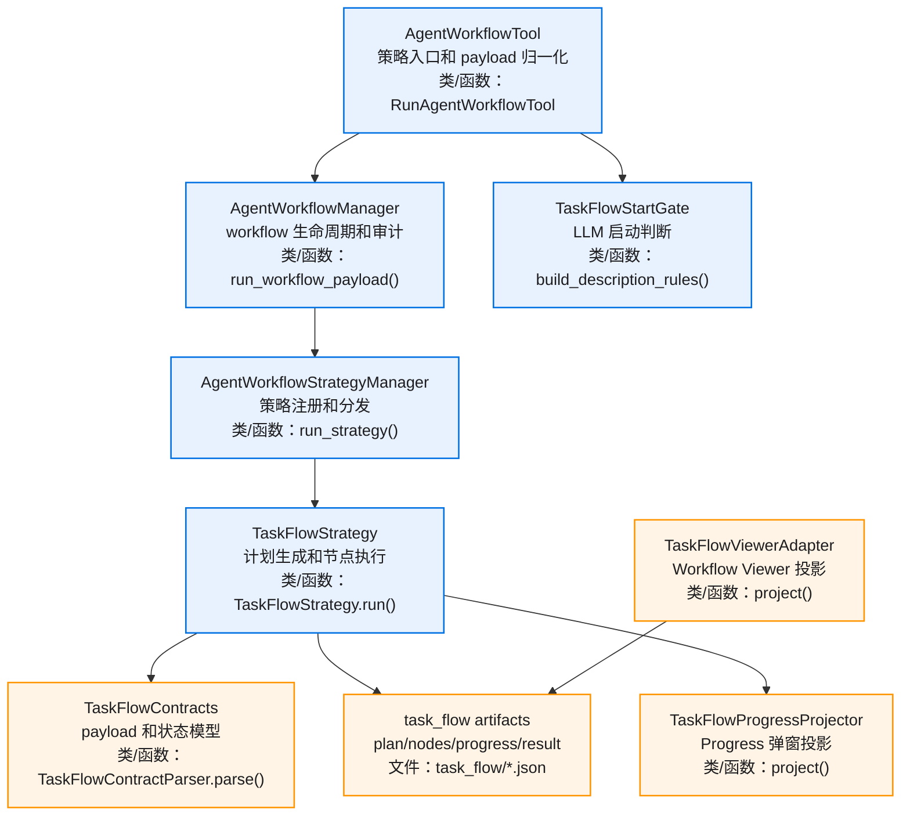
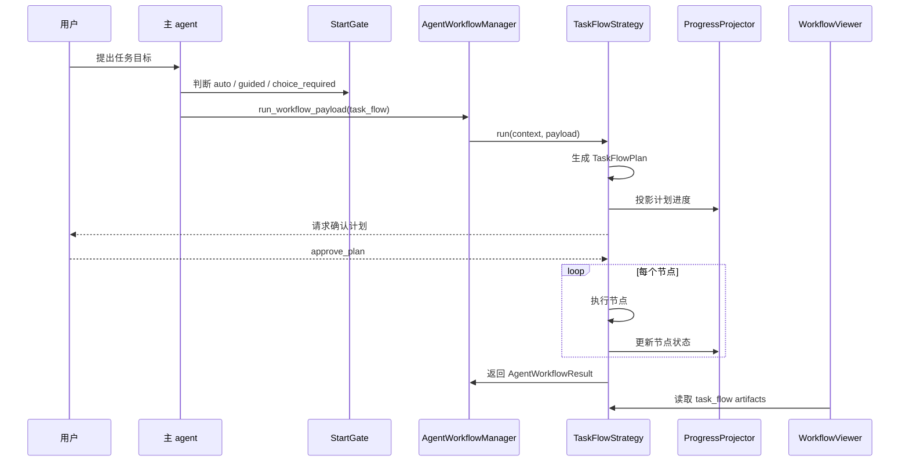
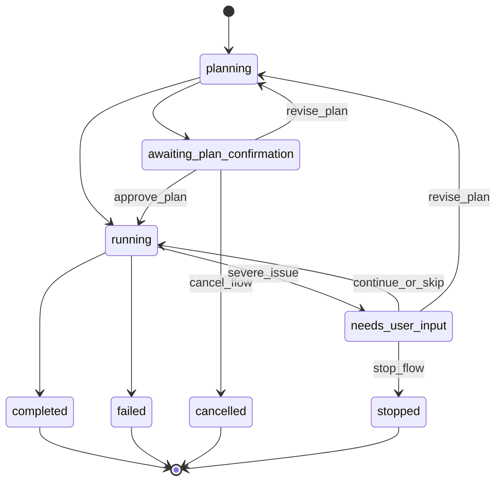
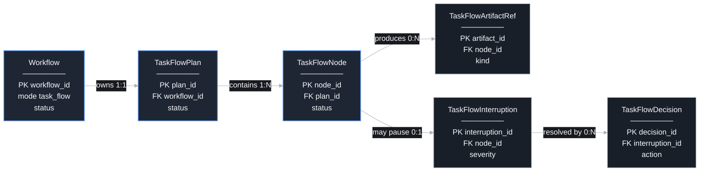

# Task Flow v0.1 图集

> Mermaid 图在 GitHub 和支持 Mermaid 的 Markdown 预览器中查看。单图保持小规模，细节按模块拆分。

## 目录

- [总览](#总览)
- [E2E 测试链路](#e2e-测试链路)
- [执行流程](#执行流程)
- [状态机](#状态机)
- [数据关系](#数据关系)

## 总览

## E2E 测试链路

```mermaid
flowchart LR
  FIX["准备 task_flow fixture"]:::p0
  RUN["调用 run_agent_workflow<br/>mode=task_flow"]:::p0
  PLAN["写 plan.json<br/>progress.json"]:::p0
  EXEC["执行节点<br/>写 nodes.jsonl"]:::p0
  API["Workflow Viewer API<br/>读取投影"]:::p1
  UI["前端显示任务流<br/>Progress 7/8"]:::p1
  ASSERT["断言节点状态<br/>产物和暂停状态"]:::p0

  FIX --> RUN --> PLAN --> EXEC --> API --> UI --> ASSERT

  classDef p0 fill:#E8F1FE,stroke:#0071E3,color:#1D1D1F,stroke-width:1.5px
  classDef p1 fill:#FFF4E5,stroke:#FF9500,color:#1D1D1F,stroke-width:1.5px
  classDef p2 fill:#F2F2F7,stroke:#8E8E93,color:#1D1D1F,stroke-width:1.5px
```

## 执行流程

## 状态机

## 数据关系

