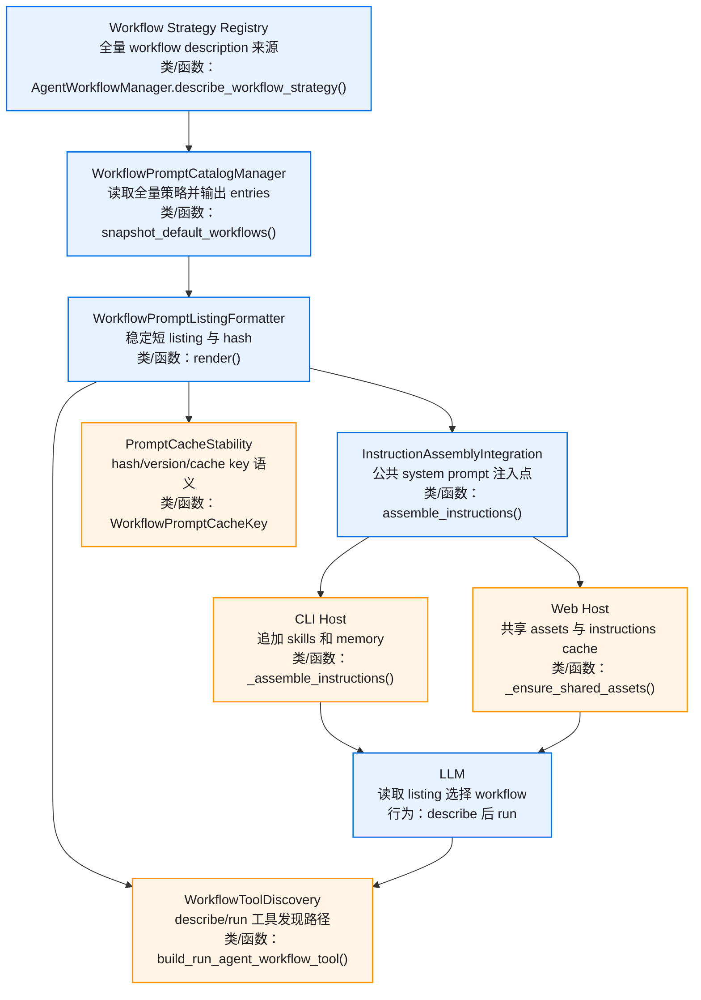
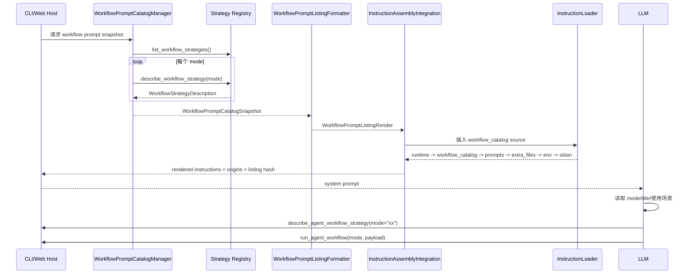
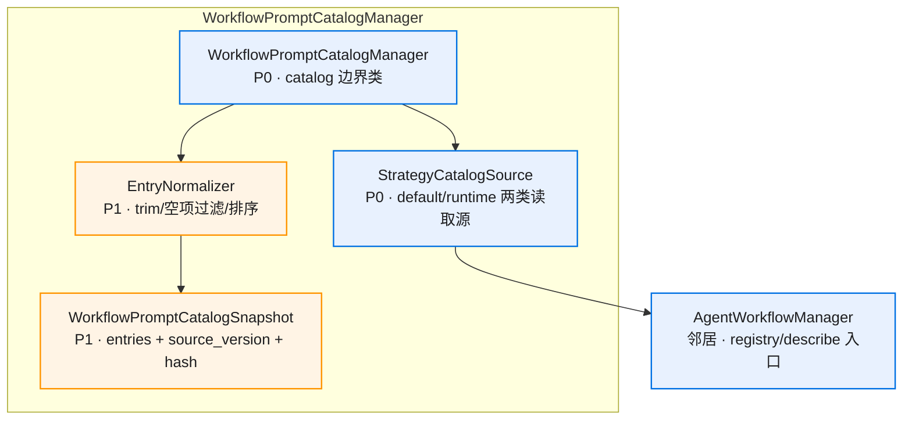
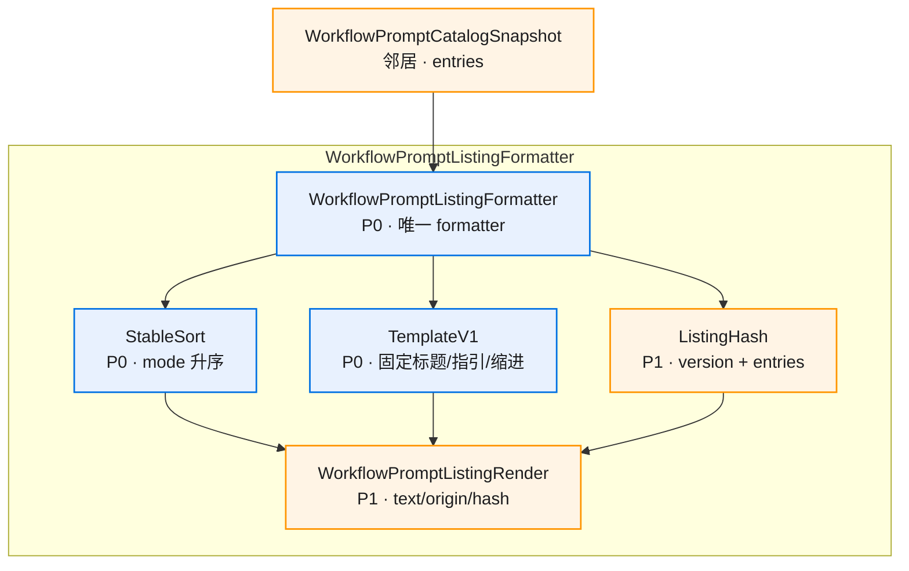
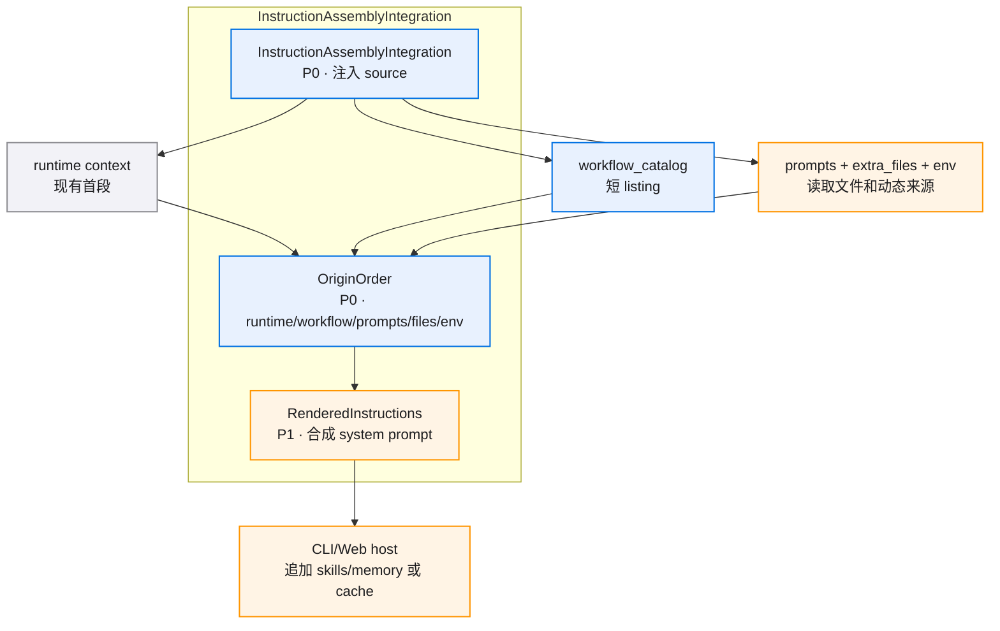
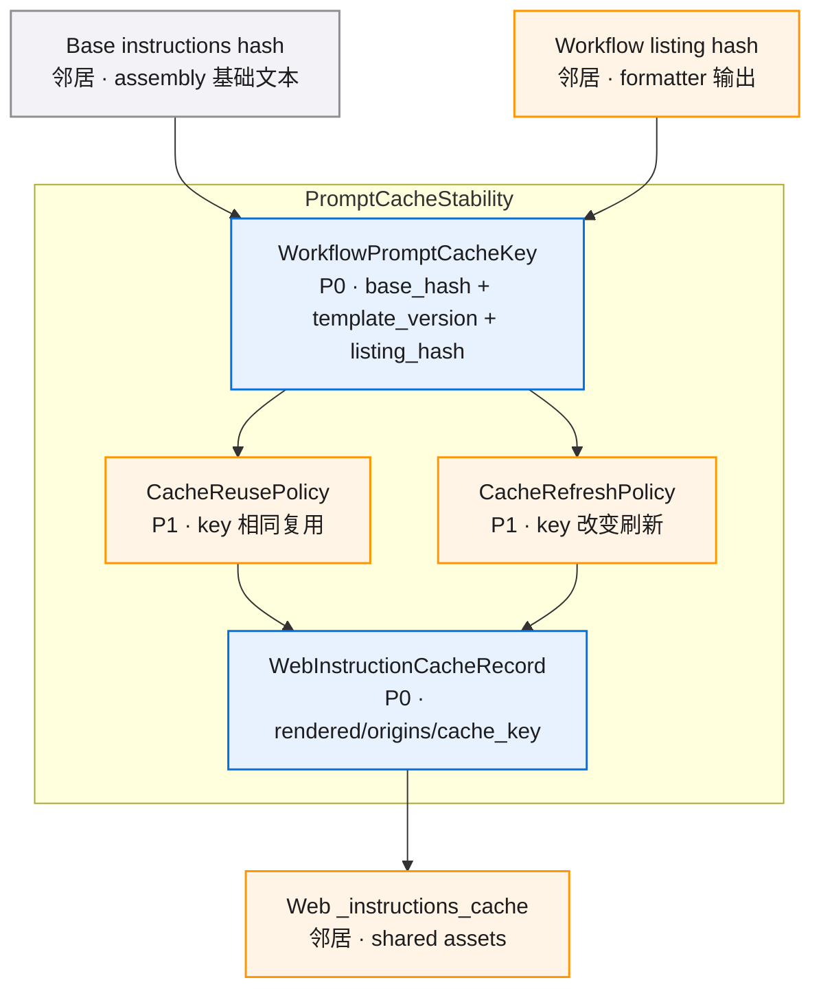

# Workflow Prompt Catalog v0.1 · 图集

> 本 spec 的唯一图源：所有 mermaid 图集中于此，按模块分节。02/04 是文字事实源，本文件是只读视图，增减模块或实体时同步更新对应节。
>
> 查看与缩放：GitHub 渲染 mermaid 自带缩放/平移控件；VS Code 建议安装 Mermaid Chart（官方）或 Markdown Preview Enhanced 插件以支持缩放。

## 目录

- [总览](./diagrams.md#总览)
- [E2E 测试链路](./diagrams.md#e2e-测试链路)
- [核心注入顺序图](./diagrams.md#核心注入顺序图)
- [WorkflowPromptCatalogManager](./diagrams.md#workflowpromptcatalogmanager)
- [WorkflowPromptListingFormatter](./diagrams.md#workflowpromptlistingformatter)
- [InstructionAssemblyIntegration](./diagrams.md#instructionassemblyintegration)
- [PromptCacheStability](./diagrams.md#promptcachestability)
- [数据关系图](./diagrams.md#数据关系图)

## 总览

## E2E 测试链路

```mermaid
flowchart LR
  classDef p0 fill:#E8F1FE,stroke:#0071E3,color:#1D1D1F,stroke-width:1.5px
  classDef p1 fill:#FFF4E5,stroke:#FF9500,color:#1D1D1F,stroke-width:1.5px
  classDef p2 fill:#F2F2F7,stroke:#8E8E93,color:#1D1D1F,stroke-width:1.5px

  FIX["准备 fake strategy registry<br/>parallel + task_flow + fake_new"]:::p0
  SNAP["生成 catalog snapshot<br/>断言全量 mode"]:::p0
  RENDER["渲染 listing<br/>断言字段裁剪和 hash"]:::p0
  ASSEMBLE["组装 instructions<br/>断言 workflow_catalog 顺序"]:::p0
  HOSTS["CLI/Web 双 host 装配<br/>断言 listing 文本一致"]:::p1
  CACHE["Web cache 变更测试<br/>断言 hash/version 刷新"]:::p1
  TOOLS["describe/run 工具合同<br/>断言 schema 按需披露"]:::p0

  FIX --> SNAP --> RENDER --> ASSEMBLE --> HOSTS --> CACHE --> TOOLS
```

## 核心注入顺序图

## WorkflowPromptCatalogManager

## WorkflowPromptListingFormatter

## InstructionAssemblyIntegration

## PromptCacheStability

## 数据关系图

