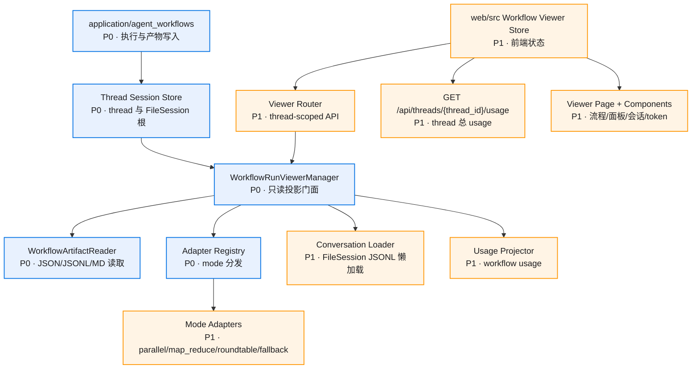

# 02 Module Breakdown

## 架构原则

Workflow Run Viewer 采用三层边界：

1. `application/agent_workflows` 是 workflow 执行与审计写入层，继续产生 `workflow.json`、`audit.jsonl`、`result.json`、`reports/*` 和 mode 专属目录。
2. `src/hosts/web` 是 viewer 只读投影层，新增 manager、router、adapter registry 和 DTO。
3. `web/src` 是交互渲染层，新增页面、store 和 components。

## 模块总览

| 模块 | 建议位置 | 职责 | 输入 | 输出 | 风险 |
|------|----------|------|------|------|------|
| WorkflowRunViewerManager | `src/hosts/web/workflow_viewer/manager.py` | 只读入口，校验 thread/workflow 路径，调用 adapters 组装 DTO | thread_id、workflow_id、分页参数 | WorkflowListDTO、WorkflowDetailDTO、ConversationDTO | 高 |
| Viewer Router | `src/hosts/web/routers/agent_workflows.py` | 暴露 thread-scoped API，转发 manager | HTTP 请求 | JSON DTO | 中 |
| WorkflowArtifactReader | `src/hosts/web/workflow_viewer/artifact_reader.py` | 读取 JSON、JSONL、Markdown、相对路径裁剪和缺失文件诊断 | workflow_dir | 原始 artifact payload | 高 |
| Adapter Registry | `src/hosts/web/workflow_viewer/adapters/registry.py` | mode -> adapter 分发，提供 fallback | mode、artifact bundle | PanelProjection | 中 |
| Base Adapter | `src/hosts/web/workflow_viewer/adapters/base.py` | 定义公共投影接口和默认 reports/timeline 解析 | artifact bundle | 公共 panels/artifacts | 中 |
| Parallel Adapter | `src/hosts/web/workflow_viewer/adapters/parallel.py` | 投影 parallel fan-out/fan-in 流程和 reports | 公共产物 | task panels | 低 |
| MapReduce Adapter | `src/hosts/web/workflow_viewer/adapters/map_reduce.py` | 投影 `map_reduce/*`：shards、mappers、reducer、validation | 公共产物 + `map_reduce/` | map-reduce panels | 中 |
| Roundtable Adapter | `src/hosts/web/workflow_viewer/adapters/roundtable_review.py` | 投影 `review_board/*`：claims、rebuttals、consensus、final report | 公共产物 + `review_board/` | review board panels | 中 |
| Unknown Adapter | `src/hosts/web/workflow_viewer/adapters/unknown.py` | 未知 mode 的公共文件展示和 artifact browser | 公共产物 | fallback panels | 低 |
| Conversation Loader | `src/hosts/web/workflow_viewer/conversation_loader.py` | 从 `subagent.json.child_session_log_path` 或同 session store 内的 `session_id` fallback 读取 FileSession JSONL | task_run_id、cursor | ConversationDTO | 高 |
| Usage Projector | `src/hosts/web/workflow_viewer/usage_projector.py` | 汇总 workflow 内 usage，保留 OpenAI/Claude 字段差异 | result/reports/subagent/audit | WorkflowUsageDTO | 高 |
| Viewer Store | `web/src/stores/workflowViewerStore.ts` | 缓存列表、详情、conversation、loading/error | API DTO | UI state | 中 |
| Viewer Page | `web/src/pages/WorkflowRunViewerPage.tsx` | 跟随 thread 展示 viewer 主页面 | route/thread state | 页面 | 中 |
| Viewer Components | `web/src/features/workflow-viewer/*` | 流程图、panels、reports、conversation drawer、usage cards | store state | UI | 中 |

## 后端接口建议

```text
GET /api/threads/{thread_id}/agent-workflows
GET /api/threads/{thread_id}/agent-workflows/{workflow_id}
GET /api/threads/{thread_id}/agent-workflows/{workflow_id}/subagents/{task_run_id}/conversation?cursor=&limit=
GET /api/threads/{thread_id}/agent-workflows/{workflow_id}/artifacts/{artifact_id}
```

这些接口归属 thread workflow viewer。已有 `/api/workflow` 继续服务 dev-pipeline dashboard。

## DTO 草案

```python
@dataclass(frozen=True)
class WorkflowListItemDTO:
    workflow_id: str
    thread_id: str
    mode: str
    status: str
    created_at: str | None
    completed_at: str | None
    title: str
    report_count: int
    has_mode_panel: bool
    usage: "WorkflowUsageDTO"

@dataclass(frozen=True)
class WorkflowDetailDTO:
    item: WorkflowListItemDTO
    timeline: tuple["WorkflowTimelineEventDTO", ...]
    flow_nodes: tuple["WorkflowFlowNodeDTO", ...]
    flow_edges: tuple["WorkflowFlowEdgeDTO", ...]
    reports: tuple["SubAgentReportSummaryDTO", ...]
    panels: tuple["WorkflowPanelDTO", ...]
    artifacts: tuple["WorkflowArtifactRefDTO", ...]
    usage: "WorkflowUsageDTO"
    diagnostics: tuple["WorkflowDiagnosticDTO", ...]

@dataclass(frozen=True)
class WorkflowPanelDTO:
    panel_id: str
    mode: str
    kind: Literal["summary", "table", "markdown", "json", "timeline", "review_board", "map_reduce"]
    title: str
    payload: dict[str, Any]
```

## Adapter registry

```python
class WorkflowViewerAdapter(Protocol):
    mode: str

    def project(self, bundle: WorkflowArtifactBundle) -> WorkflowModeProjection:
        ...
```

注册策略：

| mode | Adapter | Panel |
|------|---------|-------|
| `parallel` | `ParallelWorkflowViewerAdapter` | fan-out tasks、reports、audit timeline |
| `map_reduce` | `MapReduceWorkflowViewerAdapter` | shards、mapper index、reducer result、validation |
| `roundtable_review` | `RoundtableReviewWorkflowViewerAdapter` | review board、claims、rebuttals、consensus、final report |
| 其他 | `UnknownWorkflowViewerAdapter` | public artifacts、reports、audit timeline |

公共 DTO 始终存在。per-mode panels/artifacts 随 adapter 增加。未知 mode 展示公共产物和原始 artifact 列表，保证新 workflow mode 在 viewer 中可观察。

## 完整子 agent 对话边界

`reports/index.json` 和 `reports/*.json` 只提供摘要。完整 conversation 由 `agents/<task_run_id>/subagent.json` 中的 `child_session_log_path` 或 `session_id` fallback 定位，Conversation Loader 读取对应 FileSession JSONL。详情 API 返回 report 摘要和 conversation 可用性；conversation API 懒加载完整消息。

## 前端组件

| 组件 | 职责 |
|------|------|
| `WorkflowRunViewerPage` | 从当前 thread 加载列表和当前 workflow |
| `WorkflowListPane` | 展示 workflow 列表、mode、status、usage 摘要 |
| `WorkflowFlowDiagram` | 基于 DTO flow_nodes/flow_edges 渲染公共流程图 |
| `WorkflowModePanels` | 按 panel kind 渲染 mode 专属信息 |
| `SubAgentReportsPanel` | 展示报告摘要，提供打开完整会话入口 |
| `SubAgentConversationDrawer` | 懒加载 FileSession JSONL conversation |
| `WorkflowUsagePanel` | 展示 workflow 内 usage，旁路展示 thread 总 usage |
| `ArtifactViewer` | 展示 markdown/json/table 类 artifact |

## 依赖图


