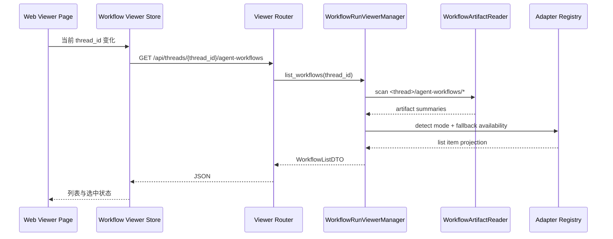
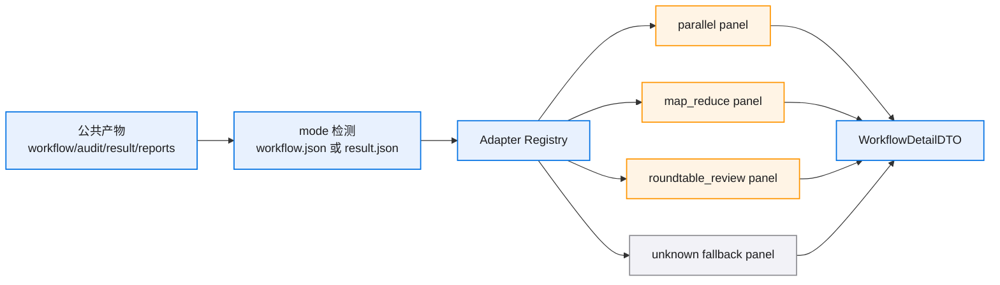
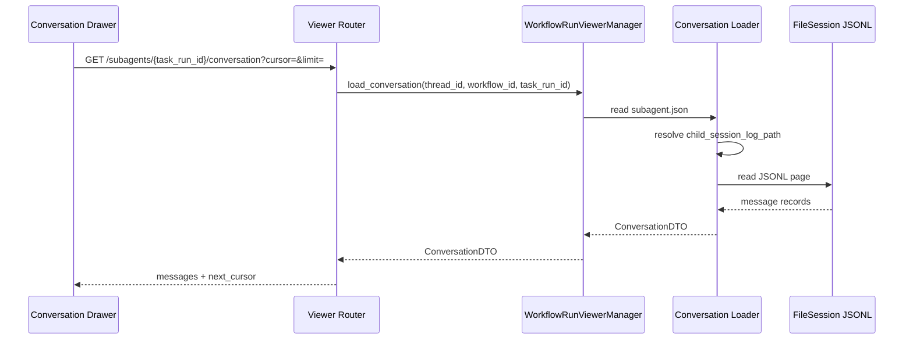
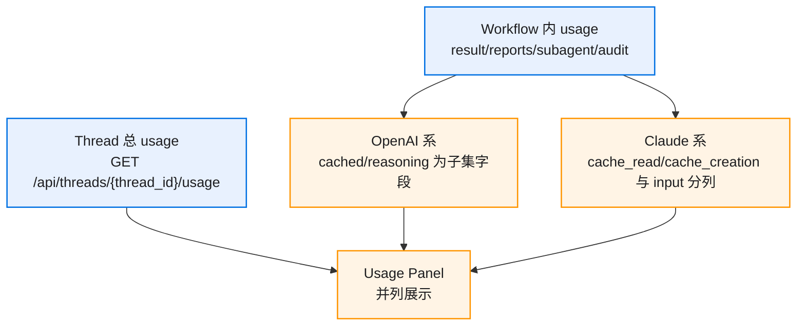

# 03 Core Workflows

## Workflow 列表加载

列表接口只读公共文件的轻量字段。它读取 `workflow.json`、`result.json`、`reports/index.json` 的摘要字段，避免拉取完整 report 和 conversation。

## Workflow 详情加载

1. 前端选中 workflow。
2. Store 请求 `GET /api/threads/{thread_id}/agent-workflows/{workflow_id}`。
3. Manager 校验 workflow_dir 位于该 thread 的 `agent-workflows/` 目录内。
4. ArtifactReader 读取公共产物：
   - `workflow.json`
   - `audit.jsonl`
   - `result.json`
   - `reports/index.json`
   - `reports/*.json`
5. Adapter Registry 根据 mode 分发：
   - `parallel` 生成 fan-out/fan-in flow、task report panels。
   - `map_reduce` 读取 `map_reduce/*`，生成 shard、mapper、reducer panels。
   - `roundtable_review` 读取 `review_board/*`，生成 review board panels。
   - 未知 mode 生成公共 artifacts 和 raw JSON panels。
6. Usage Projector 汇总 workflow 内 usage。
7. API 返回 detail DTO。

## 子 agent 完整 conversation 懒加载

报告摘要与完整 conversation 使用两个链路。

摘要链路读取 `reports/index.json` 和 `reports/*.json`，返回任务名、状态、摘要、usage、report_path、conversation availability。

完整链路读取：

1. `agents/<task_run_id>/subagent.json`
2. `subagent.json.child_session_log_path`
3. `subagent.json.session_id`
4. FileSession JSONL

Conversation Loader 负责把 FileSession JSONL 解析成前端消息 DTO。`usage` 字段保留在消息 metadata 中，便于后续单轮 token 展示。

路径解析顺序：

1. 读取 `child_session_log_path`，解析为绝对路径。
2. 路径落在 `session.file_store_path` 根目录内且文件存在时，直接读取。
3. 路径缺失、越界或复制 fixture 后失效时，使用 `session_id` fallback：`<session.file_store_path>/<session_id>/<session_id>.jsonl`。
4. 两种路径都不可读时，返回 `conversation_available=false` 和 diagnostics，详情页仍展示报告摘要。

这个顺序让 E2E fixture 可以复制到新的 thread workflow 目录，只需同步复制 child session 目录到同一个 session store 根目录，避免改写历史 `subagent.json` 里的绝对路径。

## Roundtable Review 展示流程

`roundtable_review` adapter 读取：

- `review_board/context.md`
- `review_board/sources.md`
- `review_board/claims.jsonl`
- `review_board/rebuttals.jsonl`
- `review_board/consensus.md`
- `review_board/final_report.md`
- `result.json` 中的 `roundtable_review.child_agent_usages` 和 `child_agent_usage_totals`

展示顺序：

1. Overview：topic、participants、status、final report 链接。
2. Review Board：claims 与 rebuttals 按 round/role 聚合。
3. Consensus：共识与分歧。
4. Final Report：Markdown。
5. Sub Agents：每个 reviewer/arbiter 的摘要、usage、完整 conversation 入口。

## Map Reduce 展示流程

`map_reduce` adapter 读取：

- `map_reduce/shards.json`
- `map_reduce/mappers/index.json`
- `map_reduce/reducer/result.json`
- `map_reduce/validation.jsonl` 或 adapter 可发现的 validation artifacts
- `reports/index.json` 和 `reports/*.json`

展示顺序：

1. Plan：objective、shard_strategy、shard 数。
2. Shards：shard_id、文件数、状态、mapper report。
3. Mapper Results：每个 mapper 的摘要、校验状态、失败原因。
4. Reducer Result：最终归并结果。
5. Coverage：成功/失败 shard、覆盖率和诊断。

## Token 展示流程

thread 总 usage 与 workflow 内 usage 两条链路并列：

前端渲染建议：

- thread 总 usage 放在页面顶部，复用现有 usage DTO 字段含义。
- workflow 内 usage 放在 workflow 详情中，按 workflow total、子 agent total、每个子 agent 分组。
- OpenAI 系展示 `input_tokens`、`cached_input_tokens`、`output_tokens`、`reasoning_output_tokens`，说明 cached 是 input 子集，reasoning 是 output 子集。
- Claude 系展示 `input_tokens`、`cache_read_input_tokens`、`cache_creation_input_tokens`、`output_tokens`，cache read / cache creation 与 input 分列。
