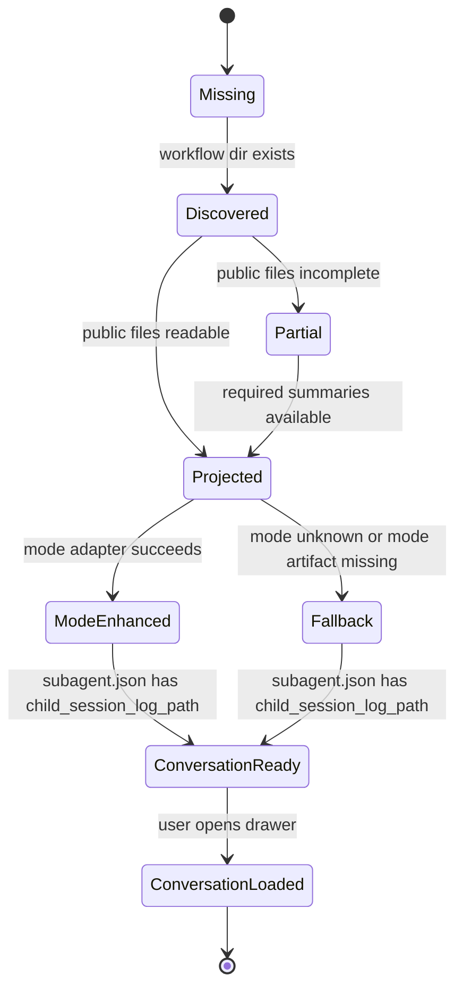

# 04 Data And State

## 文件真源

Workflow Run Viewer 读取以下 thread-scoped 目录：

```text
<session.file_store_path>/<thread_id>/agent-workflows/<workflow_id>/
  workflow.json
  audit.jsonl
  result.json
  reports/
    index.json
    <task_run_id>.json
  agents/
    <task_run_id>/
      subagent.json
      result.json
      work/
  review_board/
    context.md
    sources.md
    claims.jsonl
    rebuttals.jsonl
    consensus.md
    final_report.md
  map_reduce/
    shards.json
    mappers/
      index.json
    reducer/
      result.json
```

公共产物始终来自 workflow 根目录。mode 专属产物由 adapter 按存在性读取。

## 核心实体

```python
@dataclass(frozen=True)
class WorkflowArtifactBundle:
    thread_id: str
    workflow_id: str
    workflow_dir: Path
    workflow_json: dict[str, Any] | None
    audit_events: tuple[dict[str, Any], ...]
    result_json: dict[str, Any] | None
    report_index: dict[str, Any] | None
    reports: tuple[dict[str, Any], ...]
    subagent_records: tuple[SubAgentRecordRef, ...]
    mode_artifacts: dict[str, Any]
    diagnostics: tuple[WorkflowDiagnosticDTO, ...]

@dataclass(frozen=True)
class SubAgentRecordRef:
    task_run_id: str
    subagent_json_path: Path
    child_session_id: str | None
    child_session_log_path_raw: str | None
    child_session_log_path_resolved: Path | None
    report_path: Path | None
    usage: dict[str, int]
```

## 状态模型



| 状态 | 含义 | UI 行为 |
|------|------|---------|
| Missing | workflow 目录缺失 | 显示 404 |
| Discovered | 找到目录 | 列表可显示基础 ID |
| Partial | 公共文件缺失或损坏 | 显示诊断和可用 artifacts |
| Projected | 公共 DTO 成功 | 可展示流程和 reports |
| ModeEnhanced | mode adapter 成功 | 展示专属 panel |
| Fallback | 未知 mode 或专属产物缺失 | 展示公共 panel 和 raw artifacts |
| ConversationReady | 有 child session log path | 子 agent 行显示打开会话 |
| ConversationLoaded | JSONL 已分页读取 | Drawer 显示消息 |

## Usage 口径

### Thread 总 usage

thread 总 usage 继续复用现有 `GET /api/threads/{thread_id}/usage`。Viewer 页面只消费该 endpoint 的 DTO，不在 workflow viewer manager 中重新派生 thread 总量。

### Workflow 内 usage

workflow 内 usage 来源按优先级聚合：

1. `result.json` 中的 mode 汇总字段，例如 `roundtable_review.child_agent_usage_totals`。
2. `reports/index.json` 和 `reports/*.json` 中的 report usage。
3. `agents/<task_run_id>/subagent.json` 中回写的 usage。
4. `audit.jsonl` 中可识别的子 agent usage 事件。

聚合规则：

- 保留原始字段名，按 provider family 分组。
- 数值字段可求和；缺失字段按 absent 处理，展示层再转为 0 或空态。
- 同一个 task 的 usage 多来源出现时，采用优先级最高的来源，并在 diagnostics 中记录来源。
- 子 agent usage 与 workflow total 同时返回，UI 支持钻取。

### OpenAI 系字段

OpenAI 系常见字段：

```json
{
  "input_tokens": 1000,
  "cached_input_tokens": 300,
  "output_tokens": 500,
  "reasoning_output_tokens": 120
}
```

语义：

- `cached_input_tokens` 是 `input_tokens` 的子集字段。
- `reasoning_output_tokens` 是 `output_tokens` 的子集字段。
- UI 展示总输入、缓存命中、总输出、推理输出，避免把子集字段再次加到总量。

### Claude 系字段

Claude 系常见字段：

```json
{
  "input_tokens": 1000,
  "cache_read_input_tokens": 300,
  "cache_creation_input_tokens": 200,
  "output_tokens": 500
}
```

语义：

- `input_tokens` 表示本轮纯新增输入。
- `cache_read_input_tokens` 表示 prompt cache 命中。
- `cache_creation_input_tokens` 表示新写入 cache。
- context usage 可以展示为 `input_tokens + cache_read_input_tokens + cache_creation_input_tokens`。

## Conversation DTO

```python
@dataclass(frozen=True)
class ConversationDTO:
    thread_id: str
    workflow_id: str
    task_run_id: str
    child_session_id: str | None
    source_path: str
    messages: tuple[ConversationMessageDTO, ...]
    next_cursor: str | None
    diagnostics: tuple[WorkflowDiagnosticDTO, ...]

@dataclass(frozen=True)
class ConversationMessageDTO:
    record_index: int
    role: str
    content: str
    created_at: str | None
    message_type: str | None
    tool_calls: tuple[dict[str, Any], ...]
    usage: dict[str, Any] | None
    raw: dict[str, Any]
```

`source_path` 返回相对路径。完整绝对路径只在服务端内部使用。

## Artifact DTO

```python
@dataclass(frozen=True)
class WorkflowArtifactRefDTO:
    artifact_id: str
    path: str
    kind: Literal["json", "jsonl", "markdown", "text", "directory"]
    title: str
    size_bytes: int | None
    available: bool
    missing_reason: str | None
```

artifact content 独立接口按需读取，避免详情 DTO 过大。

## 安全边界

- 所有 API 先解析 thread 根目录，再拼接 workflow 路径。
- `workflow_id` 和 `task_run_id` 使用安全字符校验。
- `child_session_log_path` 允许绝对路径和相对路径两种历史形态，解析后必须落在允许的 session store 根目录内。
- `child_session_log_path` 失效时使用 `session_id` 定位 `<session.file_store_path>/<session_id>/<session_id>.jsonl`，该 fallback 同样受 session store 根目录约束。
- artifact_id 由服务端生成，前端通过 artifact_id 请求内容。
- JSONL 读取设置行数和字节上限。
