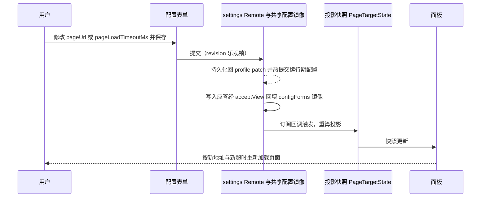

# 聚合 Token 分析视图 v0.1 · 技术设计

> spec: docs/spec/aggregated-token-analysis-view-v0.1/spec.md
> spec 基线: 102 行，sha256 `cbd522a21904bb7b46de2c71e7c06ad6879d13511464733b90fb556102e0bccc`；含 2026-10-19 用户确认的配置保存修复与原文错误展示要求
> spec 确认依据: 用户 2026-10-18 拍板原话"不需要登录，不要乱加功能，要遵循剃刀法则。所有数值和地址全部走配置，并且在插件详情页显示，不要再代码写死魔法数。其他同意，没问题就走tech"——提议 A、B、D 升格 C3、C4、C6，提议 C 按扩大后的表述升格 C5，C1、C2 判据确认，命名与英文标识 `aggregated-token-analysis` 确认，四项兄弟插件默认按剃刀法则删去（见 spec 确认记录）
> 设计状态: 已确认（用户 2026-10-18 回复拍板，见[确认记录](#pending)）
> 设计版本: 2026-10-18 定稿（当日草案确认，无结构改动）
> 既有设计/规范: [kmh-infra 技术设计](../kmh-infra-plugin-v0.1/tech-design.md)（现行、已验收的服务插件形态，本设计的主要出处）；[MadeMe 服务插件](../mademe-plugin-v0.1/spec.md)；[新增 Kongming 自有包](../../kmh/adding-a-plugin-package.md)；[客户端 UI/UX 规范](../../../.agents/skills/dsh-client-ui-ux/SKILL.md)（C6 的权威来源）
> 本轮范围: feat01–feat03 全部三个 feat 的完整设计

## 本轮设计差异

这是第三个"服务插件"，不从零设计。MadeMe 与 kmh-infra 已经跑通并验收的四件套原样沿用：**一个包同时是插件与分发单元**（`dsh.bundle.patch` 声明组合包 patch）、**宿主半 + 浏览器半双入口**（`package.json` 的 `exports` 双路径加 `dsh.client` 元数据）、**侧栏入口与中心面板各注册一次**、**配置项收在插件详情页**（settings 体系，revision 乐观锁，volatile 热提交）。kmh-mademe 今天已把 MCP 装配从插件内移走，现在正是"纯展示 + 配置"形态；它的宿主半只剩 `Config` 导出与空 `apply`（[`packages/kmh-mademe/src/index.ts`](../../../packages/kmh-mademe/src/index.ts)），本插件的宿主半与之同型。面板与配置表单则以 kmh-infra 为准，因为 MadeMe 的面板还把 8 秒超时写死在代码里、样式用字面量（[`MadeMePanel.tsx`](../../../packages/kmh-mademe/src/client/MadeMePanel.tsx) 第 32 行与内联 style），不满足本 spec 的 C5、C6；kmh-infra 已把超时改成配置投影、样式走主题变量。

相对 kmh-infra，本插件**只减不加**，差异如下：

| 差异 | kmh-infra | 本插件 | 原因 |
|---|---|---|---|
| 助手工具接入（MCP、暗号、措辞引导） | 有 | 无 | C1：只展示；用户确认不接入助手 |
| 配置项 | 八个 | 两个：页面地址、页面加载超时 | 剃刀法则；C5 要求"所有数值和地址"走配置，本插件一共就这两个 |
| 面板工具栏、"在系统浏览器打开"、"刷新" | 有 | 无 | spec 确认记录：按剃刀法则删去 |
| "测试连接"与探测超时 | 有 | 无 | 同上 |
| 刷新后记住选中（localStorage 标记） | 有 | 无 | 同上；因此浏览器半不再需要 `layout` 服务 |
| 宿主 schema 是否打进浏览器半产物 | 是（经 `config.ts` 被一并打包） | 否：地址规范化拆成独立纯函数文件，浏览器半只引它 | 让 C5 的机器门禁真实有效，见下文 |

**一个影响 C5 门禁设计的实测发现。** kmh-infra 的冒烟测试用"浏览器半产物里搜不到 `8000`"来证明超时没有写死（[`infra-smoke.test.mjs`](../../../packages/kmh-infra/test/infra-smoke.test.mjs) 第 59–65 行）。本轮核对其产物 `lib/client.js`：第 1902 行是 `var panelLoadTimeoutMs = timeoutField("面板加载超时（毫秒）", 8e3)`——宿主 schema 连同默认值被整个打进了浏览器半（因为浏览器半从 `config.ts` 引 `normalizeHttpUrl`，esbuild 不会把同文件里顶层的 `Schema.*()` 调用摇掉），而 esbuild 把数字 `8000` 打印成 `8e3`，正则 `/8000/` 自然匹配不到。那条断言是**假通过**：它没有证明任何事。本设计用两步让门禁成真：一是让浏览器半根本不引宿主 schema（独立的 `normalize-url.ts`），二是断言产物里不含 `schemastery`、不含 `8000` 与 `8e3` 两种写法、不含默认地址——三条都成立才算过（[D06](#feature-config-plan)）。kmh-infra 自己的那条假通过不在本任务修，列在[待确认](#pending)里由你决定是否另开。

差异之外的模块划分、注册顺序、构建方式、测试组织全部沿用 kmh-infra，对应关系见[附录](#appendix-trace)。

## 侧边栏出现"Token 分析"入口（feat01）

回指 spec feat01 场景1–3，以及 C4（停用即一起消失）。

<a id="feature-entry-plan"></a>

### 方案与理由

浏览器半向现有侧栏的 `sidebar.panellist` 槽注册一行，向中心 `main` 槽注册一个 keyed 面板，两个槽共用同一个面板 id——这是 kmh-infra 已验证的注册方式（[`packages/kmh-infra/src/client/index.ts`](../../../packages/kmh-infra/src/client/index.ts)）。侧栏的按钮、标签、悬停提示、选中态样式都由侧栏 shell 拥有，插件只提供图标字形与名字文案，因此**不改动侧栏的任何现有行为**。

面板 id 用 `brandString<MainPanelId>("token-analysis")` 构造：它是 ui-layout 的品牌化字符串类型，侧栏条目与中心面板必须引用同一个值才能联动（点侧栏切主区、主区显示时侧栏条目高亮）。

**名字**：侧栏标签中文"Token 分析"、英文"Token Analysis"（spec 确认记录）；收起态悬停提示就是同一个标签，由侧栏 shell 显示。

**图标**选 `IconDataOutlineRegular`。本轮把 ui-primitives 图标库 188 个图标按语义过了一遍（[`src/icons/index.tsx`](../../../third_party/dsh/packages/client/ui-primitives/src/icons/index.tsx)）：库里没有图表类图标，与"token 用量与分布"最贴近的是 `IconData`（数据）；Outline 线性变体与 Infra 的 `IconGaugeOutlineRegular` 及侧栏其余条目风格一致。备选 `IconInspectOutlineRegular`（审视/分析语义）。按 UI 规范不自造图标；换图标只改一处导入。

**位置** `order: 12`：MadeMe 是 10、Infra 是 11，取 12 落在 Infra 紧后面（feat01 场景1"排在 MadeMe、Infra 之后"）。顺序是界面排序，不是插件行为的功能性数值，与 Infra 的 `order: 11` 同一口径不作配置项（kmh-infra 技术设计"不暴露为配置的数字"段，验收已按此通过）。

**服务注入**：浏览器半声明 `["slots", "locale", "configForms", "remote", "remote.settings"]`。`configForms` 提供读取与共享镜像，公开 `remote.settings` 提供保留宿主错误原文的配置写入接口；`remote` 与 `remote.settings` 两项声明分别满足服务和命名空间的访问门禁。面板选中状态保持由现有侧栏管理。包清单的 `dsh.client.inject` 仍提供 locale、ui-layout、ui-settings、ui-sidebar 四个前置客户端包。

### 职责、数据流与失败处理

| 模块 | 职责 | 允许依赖 |
|---|---|---|
| `src/client/index.ts` | 注册词典、侧栏条目、中心面板、两处配置表单；把配置投影成面板快照 | 只依赖 DSH 公开的 client 服务 `slots`、`locale`、`configForms`，以及 `@deepseek-ai/dsh-brand`、`@deepseek-ai/dsh-client-store` |
| `src/client/TokenAnalysisIcon.tsx` | 按侧栏请求的边长渲染图标 | ui-primitives |
| `src/client/locales.ts` | 中英文案（面板名与全部界面文案，zh/en 同键） | 无 |

侧栏条目与面板注册在插件加载时各执行一次，退出时由 Cordis 的 effect 统一回收：**停用插件即条目消失**（C4）。面板正在主区显示时被注销，主区回到会话——这是 ui-layout 对失效面板的既有处理，Infra 同场景已验收通过（[kmh-infra 验收](../kmh-infra-plugin-v0.1/verify-tech.md)），本插件由 [T3](#case-sidebar-entry) 再次核对。宿主半 `apply` 为空函数，启动时没有任何可失败的步骤。

### 测试场景与预期

<a id="case-sidebar-entry"></a>

#### 侧栏出现"Token 分析"入口，停用即消失

- 依据：[feat01 场景1–3](spec.md)，C4；设计 [侧边栏出现"Token 分析"入口](#feature-entry-plan)（D02）
- 前提与触发：插件已启用，打开 KMH Web；收起侧栏悬停图标；点击入口使主区切到面板；在插件页停用该插件；再重新启用
- 预期结果：展开态显示图标与名字"Token 分析"，排在 Infra 之后；收起态悬停显示"Token 分析"；点击后主区显示面板且入口高亮；停用后入口消失，若此时面板正在显示则主区回到会话；重新启用后入口回来
- 禁止结果：条目样式与现有侧栏不一致；停用后入口残留；停用时主区停在一块空白面板上；侧栏其余条目的行为被改变
- 验证方式与证据：真实浏览器操作 KMH Web（`pnpm web` 后访问 `http://127.0.0.1:60000`），观察侧栏与主区并截图；计划在实现后执行
- 局限：截图只能证明当前主题下的观感；停用入口依赖 DSH 插件页提供，若不可用改为修改 profile patch 后重启核对

## 点击内嵌打开聚合 Token 分析页（feat02）

回指 spec feat02 场景1–5，以及 C1（只展示）、C2（地址来自配置）、C3（打不开不拖垮 Web）、C5（超时来自配置）。

<a id="feature-panel-plan"></a>

### 方案与理由

面板就是一个内嵌网页视口（`iframe`），上面没有工具栏。配置未就绪时在中心显示共享的加载状态点；地址与超时都就绪后挂载 `iframe`；超过配置的加载超时仍未收到加载完成事件时，在视口上方显示一行提示：标题"页面可能无法打开"、可能原因"x-token 未运行或地址无效"、以及正在尝试的地址（feat02 场景3 要求提示里带地址，因为没有了"在系统浏览器打开"按钮，用户得知道该去核对哪个地址）。`iframe` 的 `sandbox` 取值与 `referrerPolicy="no-referrer"` 原样沿用 kmh-infra（[`InfraPanel.tsx`](../../../packages/kmh-infra/src/client/InfraPanel.tsx) 第 105–115 行）。

**只展示、不加工**（C1）落在"没有代码"上：面板组件里没有任何读取、解析或改写页面内容的逻辑——`iframe` 加 sandbox 与跨站限制也让这件事在浏览器层面做不到。x-token 把页面从用量分布升级成成本与异常分析，本插件看到的仍是同一个地址上的一张网页（feat02 场景5）。

**地址与超时都来自配置**（C2、C5）：面板读的是注册侧从 `configForms` 投影出来的快照，不是常量；改地址或改 `pageLoadTimeoutMs` 保存后，面板按新值重新加载，不需要重启。

**已知的浏览器行为**（spec feat02 场景2，不是缺陷）：切回会话再回来会重新加载内嵌页面，页面内状态不保留。这是 WebKit/Safari 系浏览器搬移 `iframe` 必然重载的实测结论（MadeMe task-embed-panel dev-report T2），Chrome 保留。没有刷新按钮后 `iframe` 的 `key` 只取地址：地址一变即换一个全新的 `iframe`。

### 职责、数据流与失败处理

面板组件只做渲染与本地的超时计时，不自己读配置——配置值由注册侧投影成快照注入，避免组件直接依赖 settings 服务。

| 模块 | 职责 | 允许依赖 |
|---|---|---|
| `src/client/TokenAnalysisPanel.tsx` | 渲染视口、加载态与超时提示；按快照里的超时值计时 | ui-primitives（`StateDot`）、ui-slots 类型、`styles.ts` |
| `src/client/styles.ts` | 以 `token-analysis-` 前缀注入面板与表单样式，颜色与间距取 `--dsw-*` 主题变量 | 无 |

配置到界面的路径：



失败处理与 C3 的落实：地址为空或配置尚未就绪时，面板区显示中心加载状态点，不空白、不报错；超过配置的超时仍未加载完成时显示提示并带上地址；被 `X-Frame-Options` 或 CSP 拒绝内嵌时表现与不可达一致（浏览器不向页面暴露区别，只能是超时提示）。这些失败全部发生在 `iframe` 之内或面板组件的局部状态里：插件没有宿主半运行逻辑，面板只在被选中时挂载，所以 x-token 没起、地址错、拒绝内嵌三种情况都不可能影响 Web 启动、会话或其他插件——C3 不靠额外防护，靠"没有可失败的全局路径"，由 [T7](#case-fault-isolation) 用真实构造核对。

### 关键新增/变化数据结构与配置（按需）

面板侧的投影快照：

```typescript
// 仅为设计示意；正式实现位置为 src/client/TokenAnalysisPanel.tsx 的导出类型。
interface PageTargetState {
  /** 配置读取状态；ready 表示地址与超时都可用。 */
  status: "loading" | "ready" | "unavailable";
  /** 规范化后的页面地址；未就绪时为 undefined。 */
  url: string | undefined;
  /** 当前生效的加载超时（毫秒），来自配置。 */
  loadTimeoutMs: number | undefined;
}
```

三个字段与 kmh-infra 的 `DashTargetState` 同名同义（[`InfraPanel.tsx`](../../../packages/kmh-infra/src/client/InfraPanel.tsx) 第 19–26 行），只是改了名字对应"页面"而非"面板"。投影规则：`status === "ready"` 当且仅当 settings 快照就绪、`pageUrl` 是非空字符串、`pageLoadTimeoutMs` 是正的有限数；否则沿用 settings 的状态。

### 测试场景与预期

<a id="case-panel-load"></a>

#### 页面按配置地址加载，超时提示按配置值出现并带地址

- 依据：[feat02 场景1、场景3、场景4](spec.md)，C2、C5；设计 D03
- 前提与触发：x-token 在 `http://localhost:60010/_svc/x-token/` 运行；插件已启用；点击侧栏"Token 分析"入口。随后把页面地址改成本机一个未监听端口并保存，再次点开；再把 `pageLoadTimeoutMs` 改成明显不同于默认的值（如 2000），重复不可达观察；最后改回默认地址
- 预期结果：可达时面板显示 x-token 页面，没有工具栏；不可达时按**当前配置的**超时才出现"页面可能无法打开"提示，提示里有可能原因与正在尝试的那个地址；改回地址后页面正常加载
- 禁止结果：超时与配置无关（固定 8 秒）；改地址后仍按旧地址加载；不可达时不出现任何提示；提示里没有地址
- 验证方式与证据：真实浏览器操作；不可达用未监听端口模拟；改超时值后观察提示出现时间点相对配置值一致，记录两次不同超时值的观察；计划在实现后执行
- 局限：人眼计时精度有限，只验证"随配置变化"这一事实，不做毫秒级断言

<a id="case-content-agnostic"></a>

#### 换一张页面也能原样显示：KMH 侧不含任何页面内容逻辑

- 依据：[feat02 场景1、场景5](spec.md)，C1；设计 D03
- 前提与触发：代码审查浏览器半全部源码；再把页面地址临时改成另一个本机网页（如 x-dash 的 `http://127.0.0.1:60010`）并保存，点开入口
- 预期结果：源码里不存在读取 `iframe` 内容、解析 token 数据或按内容分支的逻辑；改地址后面板原样显示另一张网页，不需要重新构建或重启；由此可推：x-token 升级页面内容后 KMH 不需要改动
- 禁止结果：浏览器半出现任何与 x-token 页面结构、字段或数值相关的代码；换地址后面板报错或显示异常
- 验证方式与证据：代码审查（按文件逐个核对）+ 真实浏览器换地址观察；计划在实现后执行
- 局限：审查证明的是"当前实现不含内容逻辑"，不能约束未来有人加进去；C1 写进包 README 作为维护边界

<a id="case-fault-isolation"></a>

#### 页面打不开不拖垮 KMH Web

- 依据：[feat02 场景3 第二条 THEN](spec.md)，C3；设计 D03
- 前提与触发：停掉 x-token（或把地址改成未监听端口）后，从头启动 `pnpm web`；打开 KMH Web，正常发起一轮会话，点开 MadeMe 与 Infra 入口，最后点开"Token 分析"
- 预期结果：Web 正常启动、页面可用；会话正常对话；MadeMe 与 Infra 面板照常；"Token 分析"只在自己的面板里显示超时提示；启动与运行日志里没有本插件的加载错误
- 禁止结果：Web 启动失败或变慢到不可用；会话或其他插件受影响；出现全局报错弹窗
- 验证方式与证据：观察 Web 启动日志、会话可用性与插件运行日志（[运行记录](../../kmh/runtime-records.md)）；计划在实现后执行
- 局限：只验证本插件不引入全局失败路径；x-token 自身的故障表现不在本插件范围

## 在插件详情中填写配置（feat03）

回指 spec feat03 场景1–3，以及 C2、C4（停用后配置保留）、C5（全部数值与地址走配置、详情页显示、不写死）、C6（界面按规范）。

<a id="feature-config-plan"></a>

### 方案与理由

**两个配置项**，全部 `.volatile()`，全部用原生 `Schema.string()` / `Schema.number()`——**不用 transform 节点**（MadeMe 实测：transform 的序列化产物会被 settings 的 client 链路丢弃，配置页看不到该命名空间）。数值字段用原生 `Schema.number()` 直接暴露：kmh-infra 当初把这列为风险，验收已证实原生数值字段在插件详情页可见可改、保存 2500 后刷新读回 2500（[kmh-infra 验收](../kmh-infra-plugin-v0.1/verify-tech.md) D01 一行），本插件不再把它当待定项。

| 配置项 | 类型 | 默认值 | 单位 | 用途与使用者 | 默认值依据 |
|---|---|---|---|---|---|
| `pageUrl` | string | `http://localhost:60010/_svc/x-token/` | — | 内嵌打开的页面地址（feat02 场景1、场景4） | 用户原话（spec C2） |
| `pageLoadTimeoutMs` | number | `8000` | 毫秒 | 超过这个时间仍未加载完成就显示"可能无法打开"（feat02 场景3） | 沿用 Infra 已验证的 8 秒，用户"其他同意" |

字段名刻意不带 "token"：本仓库里 `token`/`tokenEnvVar` 已经是"暗号"的意思（kmh-infra），`pageUrl` 读起来不会被误解成"暗号的地址"。

**默认值只有一个出处**（C5 判据"在代码里只作为配置项的默认值出现一次"）：`src/config.ts`。运行时一律读配置——面板经投影快照、表单经 `configForms`，没有第三条读取路径。

**地址规范化拆成独立文件** `src/normalize-url.ts`：纯函数 `normalizeHttpUrl`，逻辑与 kmh-infra 的同名函数一致（无 scheme 补 `https`；只收 http/https；拒绝内嵌凭据、空主机、非法主机名、超长输入），宿主半与浏览器半共用这同一份。拆开的原因是浏览器半只需要这个函数，不需要 schema：让 `config.ts`（带 schemastery 与默认值）不进浏览器半产物，产物更小，C5 的门禁才有东西可断（见 D06）。kmh-mademe 与 kmh-infra 各自有一份 `normalizeHttpUrl`，本插件是第三份——这是两个兄弟已有的重复，本任务按剃刀法则不抽共享包、不改兄弟，只把这笔债记在[待确认](#pending)里。

**不作为配置项的数字，及理由**（C5 说的是"插件用到的数值和地址"，下列不是插件行为的功能性数值，口径与 kmh-infra 技术设计一致，其验收已按此通过）：侧栏 `order: 12` 是界面排序；地址长度上限 2048 与主机名合法字符模式是输入校验的安全边界，不是用户可调的策略；`Schema.number()` 的 `min(1)` 与 `max(Number.MAX_SAFE_INTEGER)` 是 schemastery 的取值护栏。它们都以具名常量出现并在注释里写明理由。

<a id="feature-gate-plan"></a>

**C5 的机器门禁**（D06）——AGENTS.md 要求"机器可验证规则纳入实际检查"，本条就是：

1. 冒烟测试读取构建产物 `lib/client.js`，断言它**不含** `schemastery`（证明宿主 schema 没被打进来）、**不含** `8000` 与 `8e3` 两种写法、**不含** `60010` 与 `_svc/x-token`（证明默认地址没被打进来）；同时断言它**含** `pageUrl` 与 `pageLoadTimeoutMs`（证明面板与表单确实按这两个键读配置）。
2. 冒烟测试再读取 `src/` 下全部源码，断言 `8000`、`60010`、`_svc/x-token` 三个字面量只出现在 `src/config.ts`。
3. 两条都通过才算 C5 的机器部分通过；人工部分是详情页能看到并改这两项（[T6](#case-config-page)）。

**界面按规定的客户端 UI 规范实现**（C6，D07）：表单用 ui-primitives 的 `SettingsForm` 作壳、两个 `SettingsValueField` 作字段（地址一个、数值一个），数值字段的非法草稿在字段旁原位提示并阻塞保存；面板的加载态用 `StateDot`，颜色、圆角与间距取 `--dsw-*` 主题变量而非字面量，功能样式字重不超过 500，浅色与深色两种主题都要可读。不引入 `Switch`、`Button` 等本插件用不到的件。

### 职责、数据流与失败处理

| 模块 | 职责 | 说明 |
|---|---|---|
| `src/config.ts` | 两个 volatile 字段的 schema；默认值的唯一出处 | 只被宿主半引用 |
| `src/normalize-url.ts` | `normalizeHttpUrl` 纯函数 | 宿主半与浏览器半共用；浏览器半只引这一个文件，不得引 `config.ts` 或 `index.ts`（R1；由 D06 第 1 条机器断言） |
| `src/index.ts` | 宿主半入口：导出 `Config`、`normalizeHttpUrl`、插件名 `name`、空 `apply` | 与 kmh-mademe 宿主半同型 |
| `src/client/config-controller.ts` | 把共享配置表单桥接成页面暂存表单 | 字段规格两种：地址字段走 `normalizeHttpUrl` 校验与规范化；数值字段在现成 `settingsNumberField` 之上要求不小于 1 的整数，与 schema 的 `min(1)` 对齐，先在表单层拦住非法值 |
| `src/client/config-write.ts` | 用公开 settings Remote 保存并同步共享镜像 | 转发表单 revision；宿主拒绝时恢复读取并抛出写入原文错误；传输异常直接传回控制器 |
| `src/client/ConfigForm.tsx` | 渲染配置表单 | 同时挂在插件详情页（`plugins.bundle.config`，key 为包名）与组件行详情（`plugins.row.config`，key 为 `包名#行id`）两处，共用一个 controller |

配置的权威存储是当前 profile 的 Cordis patch 文件（[`profiles/kmh-web/cordis.patch.yml`](../../../profiles/kmh-web/cordis.patch.yml)，经 settings 体系写入本插件实例条目的 `config`）。运行期读取路径只有一条：`configForms` 的投影快照。地址非法在表单层拦截（原位提示"需为合法的 http(s) 地址"，不保存，原地址继续有效——feat03 场景2）；数值非法同理（"需为不小于 1 的整数"）；保存由 `config-write.ts` 调用公开 settings Remote，控制器保存错误原文并交给现有 SettingsForm 展示，失败保留草稿，成功后清除错误。

**停用后配置保留**（C4、feat03 场景3）：settings 把值持久化在 profile patch 的实例条目上，与实例是否启用无关；停用只是实例不加载，条目与 `config` 仍在，重新启用后读回。Infra 同场景已验收通过，本插件由 [T6](#case-config-page) 再核对。

### 测试场景与预期

<a id="case-config-defaults"></a>

#### 配置默认值、类型与地址规范化

- 依据：[feat03 场景1、场景2](spec.md)，C2、C5；设计 D01
- 前提与触发：以空输入解析配置 schema；再以若干合法与非法地址调用 `normalizeHttpUrl`
- 预期结果：`pageUrl` 读出 `http://localhost:60010/_svc/x-token/`，`pageLoadTimeoutMs` 读出 `8000` 且是数字而非字符串；默认地址经 `normalizeHttpUrl` 原样返回（协议与末尾斜杠都保留）；无 scheme 的 `localhost:60010/_svc/x-token/` 补成 `https://…`；空串、超过 2048 字符、`ftp://`、带 `user:pw@` 的地址、空主机都返回 undefined
- 禁止结果：数值字段读出字符串；非法地址被放行；默认地址被规范化改写
- 验证方式与证据：包内单测 `test/token-analysis-config.test.mjs`（node:test），断言实际解析输出；计划随实现执行
- 局限：只覆盖 schema 与纯函数层；详情页的可见可改由 T6 覆盖

<a id="case-build-artifacts"></a>

#### 构建产物与分发声明完整，且 C5 门禁成立

- 依据：[feat03 场景1](spec.md)，C5；[feat01 场景1](spec.md)；设计 D05、D06
- 前提与触发：执行 `pnpm --filter @kmh/aggregated-token-analysis build` 后，读取包声明、宿主半产物、浏览器半产物与源码
- 预期结果：`exports` 双入口指向实际存在的产物；`dsh.client.platform` 为 `web` 且 `inject` 列出四个客户端包；组合包 patch 声明指向包内文件且模块名为 `@kmh/aggregated-token-analysis`；宿主半可导入，`name` 为 `aggregated-token-analysis`，`apply` 与 `normalizeHttpUrl` 为函数；浏览器半产物是 `__ModuleLoader__` 工厂，`inject` 恰为 `["slots","locale","configForms"]`，含 `sidebar.panellist`、`pageUrl`、`pageLoadTimeoutMs`；**不含** `schemastery`、`8000`、`8e3`、`60010`、`_svc/x-token`、`:active`；源码里 `8000`、`60010`、`_svc/x-token` 只出现在 `src/config.ts`
- 禁止结果：声明指向不存在的产物；浏览器半声明了 `layout` 或漏声明三者之一；浏览器半产物含上述任一禁止字面量（意味着 schema 或默认值被打了进去，或有人把数值写死）；默认值出现在 `config.ts` 之外的源码
- 验证方式与证据：包内冒烟测试 `test/token-analysis-smoke.test.mjs`（node:test）；计划随实现执行
- 局限：产物形态正确不等于运行时可用，运行时由浏览器场景覆盖；字面量断言防的是"同一数值被复写"，若有人把默认值改成另一个数再写死，需改断言同步——因此源码级断言只认 `config.ts` 一个出处而不认具体数值的写法

<a id="case-config-page"></a>

#### 配置项在详情页可见可改、非法地址被拦、停用后配置保留

- 依据：[feat03 场景1–3](spec.md)，C4、C5；设计 D01、D04
- 前提与触发：打开插件详情页；把 `pageLoadTimeoutMs` 改成 2500 保存并刷新；把地址填成 `not a url` 保存；在插件页停用后再启用
- 预期结果：详情页直接显示两个字段与默认值，不需要改配置文件；2500 保存后刷新读回 2500，并能在 profile patch 里看到该覆盖条目；非法地址在字段旁原位提示且不落盘，再点开入口仍按原地址加载；停用后入口消失，重新启用后两个字段仍是停用前的值
- 禁止结果：字段不可见；保存后读回旧值或默认值；非法地址被写进 patch；重新启用后配置被重置
- 验证方式与证据：真实浏览器操作 + 读取 profile patch 文件核对；计划在实现后执行
- 局限：需要 DSH 插件页提供停用入口，不可用时改为改 patch 重启核对

<a id="case-ui-conformance"></a>

#### 界面按规定的客户端 UI 规范实现

- 依据：[feat03 场景1](spec.md)，C6；设计 D07
- 前提与触发：打开插件详情页与面板（含超时提示态），逐项对照[客户端 UI/UX 规范](../../../.agents/skills/dsh-client-ui-ux/SKILL.md)：组件来源、图标来源、颜色与间距取值、字重、反馈位置、加载状态，切换浅色与深色各看一次
- 预期结果：表单复用 `SettingsForm`/`SettingsValueField`；图标来自现有图标库；颜色、圆角、间距取自 `--dsw-*` 变量而非字面量；功能样式字重不超过 500；字段校验留在原位、面板加载态居中；两种主题下文字都可读
- 禁止结果：自造平行组件；规范外图标；字面量颜色；600 及以上字重做强调；提示让相邻元素位移
- 验证方式与证据：人工对照规范逐项核对，双主题截图；计划在实现后执行
- 局限：规范自述不是完整检查清单，本用例覆盖可机械核对的条目；"是否该有更合适的设计"属设计评审

## 包构成与登记（跨 feat）

<a id="feature-dist-plan"></a>

交付形态与两个兄弟完全一致：**一个包就是一个插件，整体交付、整体启停**。包的构成：

| 文件 | 作用 |
|---|---|
| `package.json` | 名 `@kmh/aggregated-token-analysis`；双入口 `exports`（宿主半 `lib/src/index.js`、浏览器半 `lib/client.js`）；`dsh.client` 声明 web 平台与四个注入包；`dsh.bundle.patch` 指向组合包 patch；对等依赖与 `link:` 开发依赖照抄 kmh-infra |
| `cordis.patch.yml` | 一行 `insert`，id 与模块名都是 `aggregated-token-analysis` / `@kmh/aggregated-token-analysis`；settings 的配置命名空间即这个行 id |
| `build.mjs` | 照抄 kmh-infra，只改 banner 里的模块 id；esbuild 打包浏览器半为 `__ModuleLoader__` 工厂并编译宿主半 |
| `tsconfig.json`、`tsconfig.host.json`、`tsconfig.browser.json` | 照抄；浏览器 tsconfig 的 `include` 把 `src/config.ts` 换成 `src/normalize-url.ts` |
| `.gitignore` | 照抄 |
| `src/`、`test/`、`README.md` | 源码（上文三张模块表）、两个测试文件、使用者文档（配置、失败处理、C1 维护边界、"换机器要改什么"——只有 `pageUrl`） |

接入到 KMH 自己的 Web 与仓库检查，需要同步登记的位置（漏一项就有检查或运行失败，依据同 kmh-infra 技术设计 D06）：

| 位置 | 登记内容 |
|---|---|
| 根 `package.json` | `build:kmh`、`typecheck:kmh`、`lint`、`format:check` 各加 `--filter @kmh/aggregated-token-analysis`；`lint` 里加 `node --check packages/aggregated-token-analysis/build.mjs`；`test` 里加 `packages/aggregated-token-analysis/test/*.test.mjs` |
| `tests/runtime/web-plugin-hmr.test.mjs` 第 60 行 | 把 `aggregated-token-analysis` 加进符号链接的固定包名单，否则 `prepareProfiles` 对悬空链接 `realpathSync` 失败而让该测试变红 |
| `profiles/kmh-web/package.json` | `dependencies` 登记插件包，`dsh.profile.bundles` 选择插件 bundle，由 bundle patch 执行唯一一次实例插入 |
| `profiles/kmh-web/cordis.patch.yml` | 顶层 `id: aggregated-token-analysis` 补丁持久化配置覆盖，复用 bundle 插入的实例 |
| `docs/kmh/plugin-index.md` | 自有包表新增一行指向包 README |
| `docs/spec/README.md` | 更新本 spec 一行的状态 |

**实施注意**：新增 workspace 包会改动 `pnpm-lock.yaml`；本检出的锁文件已有未提交改动，而 `pnpm test` 在锁文件与 `node_modules` 不一致时会先要求清空重装——开发期间包内测试直接用 `node --test packages/aggregated-token-analysis/test/*.test.mjs` 跑，根命令留到提交前统一跑一次。

## 确认与交接

<a id="pending"></a>

### 确认记录

用户 2026-10-18 回复拍板原话："a 这是单独插件，功能就是打开对应域名，不要搞复杂，打开超时时间要走配置，不要碰网页内部逻辑，插件就是一个打开对应网页的壳明白吗"。据此，原待确认四项的处理：

1. **浏览器半不打包宿主 schema**：选 A，`normalizeHttpUrl` 拆进独立 `src/normalize-url.ts`，浏览器半只引它；[D06](#feature-gate-plan) 的产物级与源码级断言按设计落实。
2. **`normalizeHttpUrl` 的第三份拷贝**：再复制一份，不抽共享包、不动两个兄弟；三处同改的债维持记录，下次动到兄弟或出现第四个插件时再抽。
3. **非功能性数字的口径**：确认走配置的只有 `pageUrl` 与 `pageLoadTimeoutMs` 两个；侧栏顺序、地址长度上限、主机名模式以具名常量存在，不进配置。
4. **kmh-infra 的假断言**：用户未另行表态，不在本任务修，维持原状。
5. **命名修订（同日稍后）**：插件英文标识与包名定为 `aggregated-token-analysis` / `@kmh/aggregated-token-analysis`（去掉 kmh- 前缀），目录名 `packages/aggregated-token-analysis/`；[D05](#feature-dist-plan) 的包构成与登记表、各 checklist 的路径随之更新。中文名、英文名、侧栏标签与面板 id `token-analysis` 不变。

"不要碰网页内部逻辑"是 C1 的重申：插件是打开对应网页的壳，设计与实现里不出现读取、解析或改写页面内容的代码（[D03](#feature-panel-plan)、[用例 T5](#case-content-agnostic)）。

### 交接条件

已满足：feat01–feat03 的关键设计（D01–D07）与测试安排（T1–T8）无阻塞项，待确认项已全部拍板。可交 x-req 拆任务。

## 附录：追溯与验证依据

<a id="appendix-trace"></a>

| 稳定 ID | 中文名称与唯一主定义位置 | spec 场景/已确认约束来源 | 适用 feat 与各自验证结果定位 | 验证方式、证据位置与状态 |
|---|---|---|---|---|
| D01 | [配置项、默认值唯一出处与地址规范化](#feature-config-plan) | feat03 场景1–2；C2、C5 | feat03（主）、feat02 场景1/4 引用 | [T1](#case-config-defaults)、[T6](#case-config-page)；待实现验证 |
| D02 | [侧栏入口与面板注册（无选中态记忆，inject 三服务）](#feature-entry-plan) | feat01 场景1–3；C4 | feat01（主） | [T3](#case-sidebar-entry)、[T2](#case-build-artifacts) 的 inject 断言；待实现验证 |
| D03 | [页面视口、投影快照与超时提示（无工具栏）](#feature-panel-plan) | feat02 场景1–5；C1、C2、C3、C5 | feat02（主） | [T4](#case-panel-load)、[T5](#case-content-agnostic)、[T7](#case-fault-isolation)；待实现验证 |
| D04 | [配置表单与控制器（两个字段）](#feature-config-plan) | feat03 场景1–3；C4、C5 | feat03（主） | [T6](#case-config-page)；待实现验证 |
| D05 | [包构成与登记](#feature-dist-plan) | feat01 场景1；feat03 场景3 | 跨 feat | [T2](#case-build-artifacts)；根命令与浏览器加载在实现报告中记录；待实现验证 |
| D06 | [C5 的机器门禁（产物与源码两级断言）](#feature-gate-plan) | C5 | feat03（主）、feat02 引用 | [T2](#case-build-artifacts)；待实现验证 |
| D07 | [界面规范落实（组件、图标、主题变量、双主题）](#feature-config-plan) | feat03 场景1；C6 | feat03（主）、feat01/feat02 引用 | [T8](#case-ui-conformance)；待实现验证 |
| 用例 T1 | [配置默认值、类型与地址规范化](#case-config-defaults) | feat03 场景1–2；C2、C5 | feat03：默认值与规范化断言 | 包内单测，未执行 |
| 用例 T2 | [构建产物与分发声明完整，且 C5 门禁成立](#case-build-artifacts) | feat03 场景1；feat01 场景1；C5 | feat03：产物与源码字面量断言；feat01：inject 与槽名断言 | 包内冒烟测试，未执行 |
| 用例 T3 | [侧栏出现"Token 分析"入口，停用即消失](#case-sidebar-entry) | feat01 场景1–3；C4 | feat01：可见、悬停、选中、停用/启用 | 浏览器人工观察，未执行 |
| 用例 T4 | [页面按配置地址加载，超时提示按配置值出现并带地址](#case-panel-load) | feat02 场景1、3、4；C2、C5 | feat02：加载、超时随配置、提示含地址 | 浏览器人工观察，未执行 |
| 用例 T5 | [换一张页面也能原样显示：KMH 侧不含任何页面内容逻辑](#case-content-agnostic) | feat02 场景1、5；C1 | feat02：源码审查 + 换地址观察 | 代码审查 + 浏览器，未执行 |
| 用例 T6 | [配置项在详情页可见可改、非法地址被拦、停用后配置保留](#case-config-page) | feat03 场景1–3；C4、C5 | feat03：字段可见、读回、拦截、保留 | 浏览器 + patch 文件核对，未执行 |
| 用例 T7 | [页面打不开不拖垮 KMH Web](#case-fault-isolation) | feat02 场景3；C3 | feat02：Web、会话、其他插件照常 | 启动日志 + 浏览器，未执行 |
| 用例 T8 | [界面按规定的客户端 UI 规范实现](#case-ui-conformance) | feat03 场景1；C6 | feat03：组件、图标、变量、字重、双主题 | 人工对照规范 + 双主题截图，未执行 |

### 规范落实索引

| 规则/来源 | 适用性与原因 | 功能/设计落实位置 | 检查、测试或审查依据 | 结果/执行状态 |
|---|---|---|---|---|
| R1 模块边界 | 适用。宿主半与浏览器半职责分开；浏览器半只经 DSH 公开 client 服务取数据，只引 `normalize-url.ts`，不得引 `config.ts`/`index.ts` | [D02](#feature-entry-plan)、[D03](#feature-panel-plan)、[D04](#feature-config-plan) 的模块表 | [T2](#case-build-artifacts) 的"产物不含 schemastery"断言机器化了这条边界；另审查导入 | 待实现验证 |
| R2 协议优先 | 适用（配置边界）。配置 schema 是唯一权威定义；地址规范化是两端共用的同一个纯函数，表单层不另写校验 | [D01](#feature-config-plan) | [T1](#case-config-defaults) 覆盖有效/无效输入；审查 `normalize-url.ts` 被两半同时引用 | 待实现验证 |
| R3 跨语言协议 | 不适用。本插件只有 TS，与 x-token 之间只是一个 URL，没有数据协议 | — | — | — |
| R4 数据唯一来源 | 适用。配置值的权威存储是 profile 的 Cordis patch，运行期唯一读取路径是 `configForms` 投影；默认值唯一出处 `config.ts` | [D01](#feature-config-plan)、[D03](#feature-panel-plan) | 审查是否存在第二条读取路径；[T2](#case-build-artifacts) 源码级断言；[T4](#case-panel-load)/[T6](#case-config-page) 覆盖生效性 | 待实现验证 |
| R5 概念命名 | 适用。"页面"一词贯穿配置键、快照字段、文案（`pageUrl`、`pageLoadTimeoutMs`、`PageTargetState`）；刻意避开本仓库已表示"暗号"的 `token` 作键名 | [D01](#feature-config-plan) | 审查配置项、文案与内部标识一致 | 待实现验证 |
| R6 具名配置 | 适用，本需求的核心约束（C5）。两个值全部具名、带单位与默认值；不进配置的数字逐条给了理由并以具名常量出现 | [D01](#feature-config-plan)、[D06](#feature-gate-plan) | [T1](#case-config-defaults)、[T2](#case-build-artifacts)、[T6](#case-config-page) | 待实现验证 |
| R7 数据流与状态 | 适用。配置改动到界面生效的链路见 D03 时序图；没有异步宿主逻辑、没有并发写入路径（settings 的 revision 乐观锁处理并发保存） | [D03](#feature-panel-plan) | [T4](#case-panel-load) 覆盖热生效；[T6](#case-config-page) 覆盖保存与读回 | 待实现验证 |
| [客户端 UI/UX 规范](../../../.agents/skills/dsh-client-ui-ux/SKILL.md)（C6） | 适用。新增界面复用现成组件与图标库、取主题变量、按规范归属反馈与加载状态，双主题验证 | [D07](#feature-config-plan) | 审查组件来源、`--dsw-*` 取值、类名前缀、字重；[T8](#case-ui-conformance) | 待实现验证 |
| [AGENTS.md](../../../AGENTS.md) 项目规则：源码顶部中文说明、函数注释写输入/输出/失败；TS 严格类型与包名导入；机器可验证规则纳入实际检查；文档记录前提/失败处理/归属 | 适用 | 全部源码文件；[D06](#feature-gate-plan)；包 README 与 plugin-index 登记（[D05](#feature-dist-plan)） | `pnpm lint`、`pnpm typecheck:kmh`；T2 即"机器可验证规则"的落实；README 审查 | 待实现验证 |
