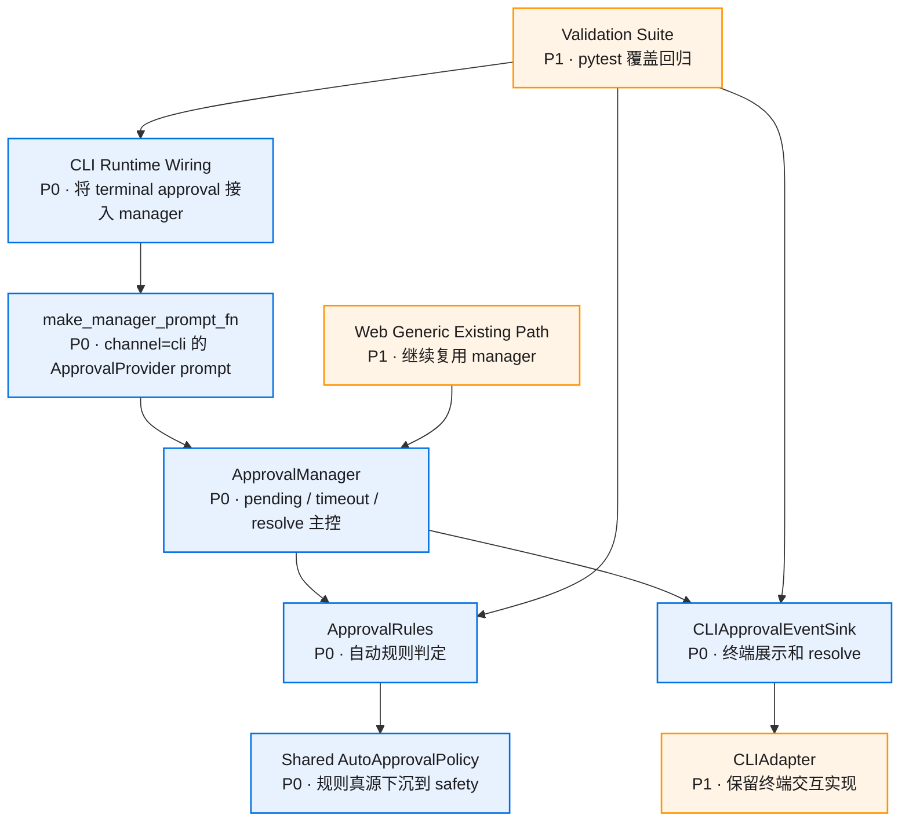

# 模块设计

## 总览



## 组件 1：Shared Auto Approval Policy

**职责**：把当前 `src/hosts/web/approvals/auto/policy.py` 中可复用的规则判定能力下沉到共享层，让 Web 和 CLI 都从同一份 policy 获取自动审批结果。

**建议位置**：

- `src/safety/auto_approval/policy.py`
- `src/safety/auto_approval/config_store.py`
- `src/safety/auto_approval/models.py`

**保留边界**：

- Web WS toggle handler 继续留在 `src/hosts/web/approvals/auto/`。
- Web handler 只负责读取/写入规则配置和发状态帧。
- CLI 只消费 policy，不引用 Web handler。

**风险等级**：中。迁移路径需要保持 Web imports 稳定，可以先通过 re-export 过渡，但开发期接口尚未稳定时优先直接改引用。

## 组件 2：ApprovalRules CLI Channel

**职责**：让 `ApprovalRules.classify(channel="cli", ...)` 调用共享 policy。

**输入**：

```python
rules.classify(
    channel="cli",
    thread_id=session_id,
    cwd=cwd,
    tool_name=tool_name,
    tool_input=tool_input,
)
```

**输出**：

- `is_immediate=True, immediate_outcome="approved"`：自动允许。
- `is_immediate=False, matched_rule=<rule>`：危险规则命中，进入强制人审。
- `is_immediate=False`：未命中自动结果，进入用户审批。

**关键规则**：

- 危险规则优先级最高，CLI v0.1 保持强制人审语义。
- CLI 不写入 session grant；`ApprovalRules.add_session_grant(channel="cli")` 当前为 no-op。Web/generic_chat 继续承接本会话同意语义。
- policy 异常时返回 ask，保持用户审批兜底。

**风险等级**：中。现有 `ApprovalRules` 文档和测试明确当前只服务 `generic_chat`，改动需要同步测试用例。

## 组件 3：CLIApprovalEventSink

**职责**：实现 `safety.approval_manager.ApprovalEventSink`，在 CLI 中展示 pending 审批，并把用户输入转换为 `manager.resolve()`。

**建议位置**：

- `src/hosts/cli/approval_manager_sink.py`

**接口形态**：

```python
class CLIApprovalEventSink:
    def __init__(self, manager: ApprovalManager, action_prompt: PromptActionFn) -> None: ...

    async def emit_approval_required(self, *, pending: _PendingApproval) -> None: ...

    async def emit_approval_removed(self, *, request_id: str, reason: str) -> None: ...
```

**用户输入映射**：

| 输入 | resolve payload |
|------|-----------------|
| `y` / `yes` | `{"allow": True}` |
| empty / `n` / EOF / Ctrl-C | `{"allow": False}` |

**实现建议**：

- `action_prompt` 复用 `cli.approval.build_cli_action_prompt()`。
- sink 将 `_PendingApproval` 投影为 `ApprovalRequest`，调用 action prompt 得到 `ApprovalAction`。
- sink 将 `ACCEPT_ONCE` 映射为 `{"allow": True}`，将 `REJECT` 映射为 `{"allow": False}`。历史 action 输入按一次允许降级处理，不传 `rememberScope`。

**风险等级**：中。终端 stdin 需要继续使用 `asyncio.to_thread`，避免阻塞事件循环。

## 组件 4：CLI Runtime Wiring

**职责**：在 CLI 装配阶段创建共享 policy、ApprovalRules、ApprovalManager、CLIApprovalEventSink，并把 `build_default_approval()` 的 prompt_fn 换成 manager prompt。

**当前入口**：

- `src/hosts/cli/main.py`

**目标装配**：

```python
session_id = _resolve_cli_session_id(...)
action_prompt = build_cli_action_prompt()
manager = get_or_create_approval_manager(
    rules=ApprovalRules(policy=shared_policy),
)
manager.register_event_sink(CLIApprovalEventSink(manager, action_prompt))
prompt_fn = make_manager_prompt_fn(
    manager,
    session_id,
    channel="cli",
    default_cwd=str(Path.cwd()),
)
approval = build_default_approval(cfg.approval.mode, prompt_fn=prompt_fn)
```

**注意点**：

- 当前 CLI 默认 `session_id` 在 `SessionEngine.build()` 后才生成；本 task 需要提前解析一次，并把同一个值传给 `make_manager_prompt_fn()` 与 `SessionBridge`。
- `make_manager_prompt_fn` 当前默认 channel 为 `generic_chat`，CLI 调用必须显式传 `channel="cli"`。
- `default_cwd` 用 `Path.cwd()`。
- `ApprovalManager` 是进程单例；首次构造后会忽略新的 `rules/event_sinks` 入参，CLI sink 必须走幂等 `register_event_sink()`，测试中使用 `reset_for_testing()`。

**风险等级**：低到中。主要风险是 CLI 当前装配顺序里 prompt_fn 创建早于 bridge，可能需要轻量调整 session id 生成位置。

## 组件 5：Validation Suite

**职责**：用 pytest 覆盖规则、sink、装配和端到端行为。

**建议测试文件**：

- `tests/unit/safety/test_approval_rules_cli.py`
- `tests/unit/cli/test_cli_approval_event_sink.py`
- `tests/e2e/test_cli_approval_manager.py`
- 复跑现有 `tests/unit/safety/test_approval_rules.py`
- 复跑现有 Web generic approval tests

**风险等级**：低。主要工作是稳定模拟 stdin 和 manager pending。

## 复用清单

| 现有能力 | 复用方式 |
|----------|----------|
| `ApprovalManager.request/resolve` | CLI 直接接入 |
| `make_manager_prompt_fn` | 显式传 `channel="cli"` |
| `InteractiveApproval` action-aware prompt | 保持不变 |
| `cli.approval.build_cli_action_prompt` | CLI manager 两选项终端 prompt |
| `ApprovalRules` | 扩展 channel 判断 |
| `AutoApprovalPolicy` | 下沉为共享 policy |

## 当前结论

模块拆分已落地。当前 CLI prompt 边界是 manager-only 两选项；如需扩展本会话同意，应另开协议和 UX 任务。
