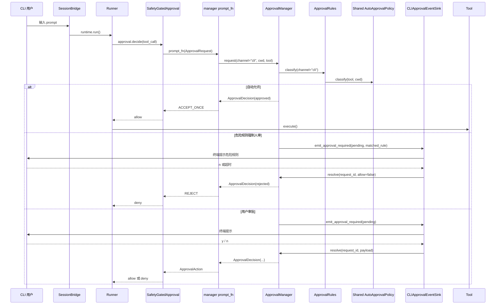
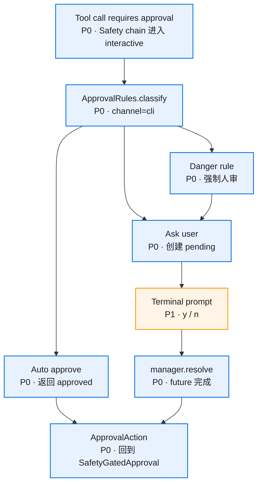
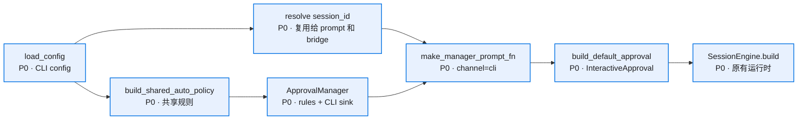

# 核心流程

## CLI 审批主链路

## 决策流程

## 装配流程

## 超时与中断

- `ApprovalManager` 继续持有 timeout task。
- CLI sink 只负责展示和 resolve。
- 用户 Ctrl-C 或 EOF 映射为 reject。
- 外层 run cancel 继续由 Runner 的 cancel 分支收口。

## 失败策略

- policy 读取失败：返回 ask。
- CLI sink 输出失败：返回 reject 或等待 manager timeout。
- manager resolve 重复：返回 False，主链路保持稳定。
- CLI 不写入 session grant；Web/generic_chat 的本会话同意由 manager 规则层处理。
