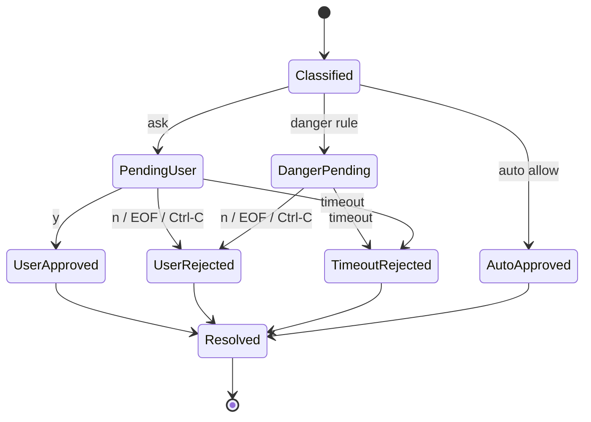

# 数据模型与状态

## 核心数据模型

### ApprovalRequest

来源：`core.contracts.ApprovalRequest`。

CLI 接入时关键字段：

| 字段 | 说明 |
|------|------|
| `run_id` | 当前 Runner run id |
| `session_id` | CLI session id |
| `turn` | 当前 turn |
| `call_id` | tool call id |
| `tool_name` | 工具名 |
| `arguments` | 工具参数 |
| `metadata.cwd` | cwd 优先取值；缺省时由 prompt_fn default_cwd 补齐 |

### _PendingApproval

来源：`safety.approval_manager._PendingApproval`。

CLI 使用字段：

| 字段 | CLI 用法 |
|------|----------|
| `request_id` | `manager.resolve()` 路由 key |
| `channel` | 固定为 `cli` |
| `thread_id` | 使用 CLI session id |
| `cwd` | 规则判定和展示 |
| `tool_name` | 展示和规则判定 |
| `tool_input` | 展示摘要和规则判定 |
| `matched_rule` | 展示规则命中信息 |
| `auto_approve_at_ms` | 自动允许倒计时 |
| `auto_reject_at_ms` | 预留字段；CLI v0.1 不使用该倒计时 |
| `timeout_ms` | 用户审批超时 |

### ApprovalDecision

CLI sink 最终通过 manager 输出：

```python
ApprovalDecision(
    outcome="approved" | "rejected",
    metadata={
        "source": "user" | "rule_auto_allow" | "manager_timeout",
        "matched_rule": "...",
    },
)
```

### ApprovalAction

`make_manager_prompt_fn` 将 `ApprovalDecision` 映射回：

| ApprovalDecision | ApprovalAction |
|------------------|----------------|
| approved | ACCEPT_ONCE |
| rejected | REJECT |

## 状态流转



## Channel 语义

| channel | 规则策略 | 用户界面 | 备注 |
|---------|----------|----------|------|
| `generic_chat` | shared policy | Web inbox | 已接入 |
| `cli` | shared policy | terminal prompt | 本 spec 范围 |
| `claude_code` | 后续迁移 | Web inbox / bridge | 本 spec 排除 |
| `cron` | 后续迁移 | trust / audit | 本 spec 排除 |
| `evolution` | 后续迁移 | internal | 本 spec 排除 |

## 数据持久化

本 spec 首版不新增持久化模型。

- CLI 不写入 session grant；`ApprovalRules.add_session_grant(channel="cli")` 当前为 no-op。
- CLI manager prompt 对下游 `SafetyGatedApproval` 只返回 `ACCEPT_ONCE` 或 `REJECT`，避免写入 `GrantStore` 后绕过 manager guard。
- 自动审批规则配置沿用现有 config store 语义。
- persistent grant 留给后续 rules schema spec。

## 审计预留

CLI 接入 manager 后，审批审计可以统一挂在 manager 层：

- `approval.requested`
- `approval.auto_approved`
- `approval.danger_rule_pending`
- `approval.user_decided`
- `approval.timeout`

审计落盘格式留给独立 audit spec。本 spec 只保证事件上下文里有 channel、session/thread、cwd、tool、matched_rule。
