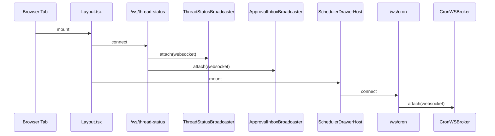
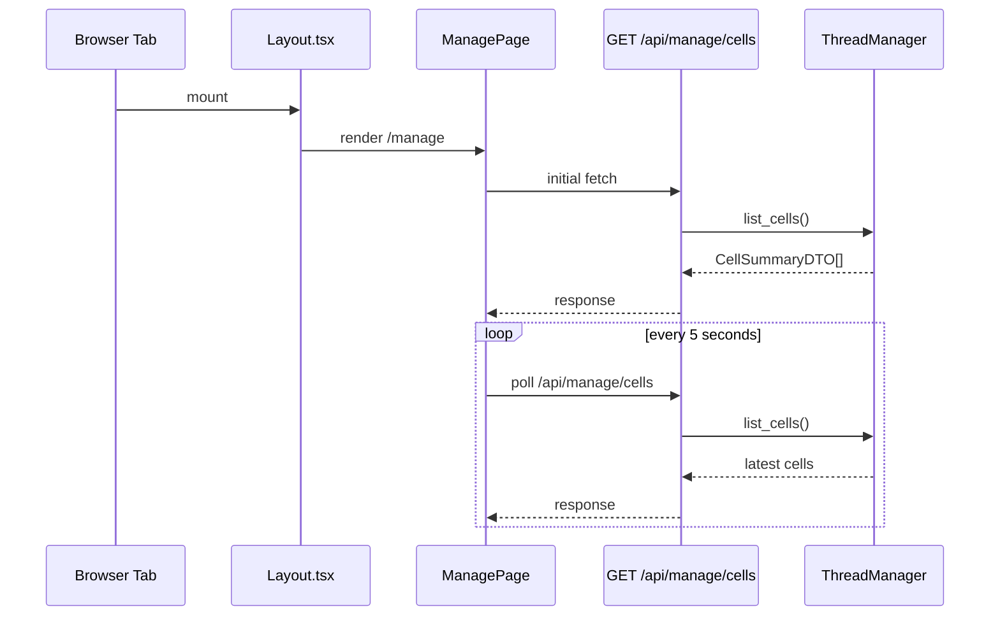
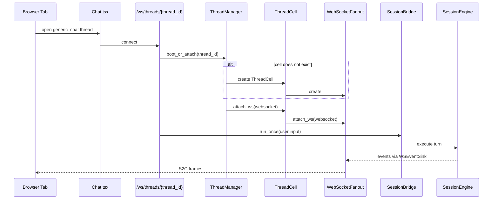
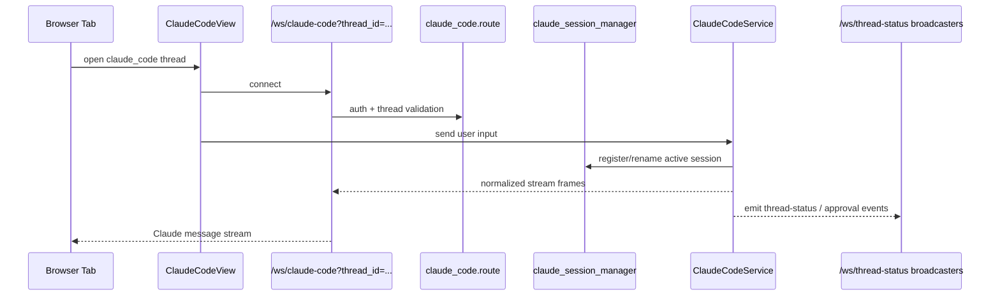
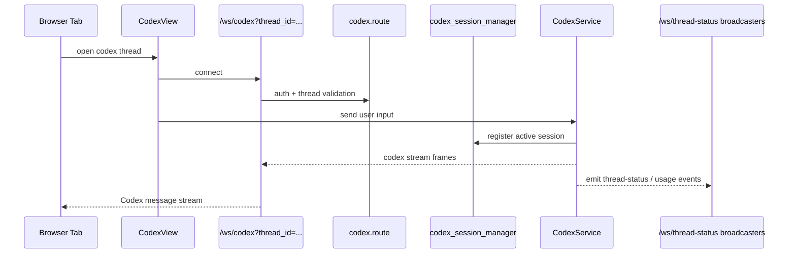
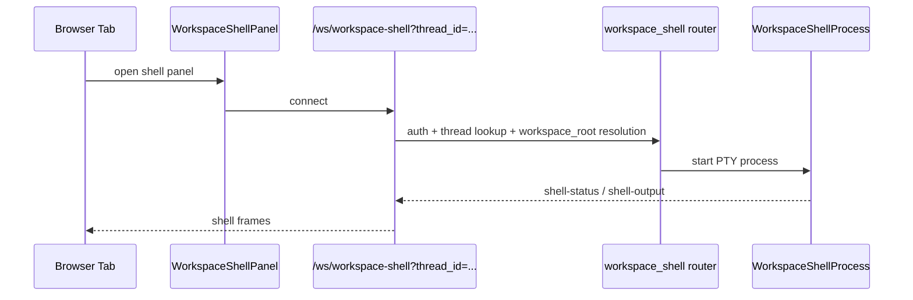
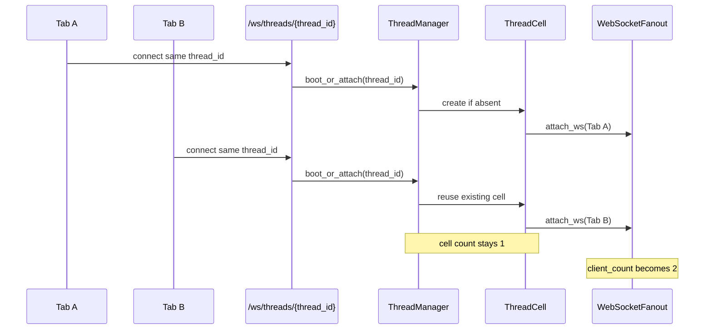

# 核心链路

本文件只画“当前链接链路”和“状态页首版如何消费它们”。

## 0. 固定全局链接

已登录用户打开任意 Web 页面后，Layout 会固定挂两条全局链接：

- `/ws/thread-status`
- `/ws/cron`

结论：

- 1 个 tab 至少占 2 条 server 侧全局 WS
- 2 个 tab 至少占 4 条 server 侧全局 WS

## 1. Manage 页面链路

`/manage` 当前没有专用 WS。它复用上面的两条固定全局 WS，再加 `GET /api/manage/cells` 轮询。

状态页 v0.1 建议：

- 保持这个模型
- 新增 `GET /api/manage/runtime-status`
- 不新增 `/ws/manage-status`

## 2. generic_chat 链路

generic_chat thread 会在固定全局 WS 之外，再建立一条 `/ws/threads/{thread_id}`。

结论：

- 1 条激活的 generic_chat thread 通常对应 1 个 cell
- 1 个 tab 对应这条 thread 的 1 条聊天 WS
- 同一 thread 的多个 tab 共享 1 个 cell，聊天 WS 条数累加到 fanout

## 3. claude_code 链路

claude_code thread 会在固定全局 WS 之外，再建立一条 `/ws/claude-code?thread_id=...`。

结论：

- `claude_code` 路径的聊天连接不进入 `ThreadCell`
- 活跃 provider session 由 `claude_session_manager` 统计
- 状态页要同时显示 `chat_ws` 和 `claude_active_sessions`

## 4. codex 链路

codex thread 会在固定全局 WS 之外，再建立一条 `/ws/codex?thread_id=...`。

结论：

- `codex` 路径同样不复用 `ThreadCell`
- 状态页要把 `codex_active_sessions` 作为独立指标看待

## 5. workspace-shell 链路

workspace-shell 只在聊天页里打开对应面板后才建立。

当前限制：

- server 侧还没有全局 registry 记录活跃 `workspace-shell` 连接数
- v0.1 状态页可以先把它标记为“未纳入统一计数”
- 如果要纳入，需要先补一个 registry 模块

## 6. 同一 thread 两个 tab 链路

这是最容易混淆的一条链路。

统一语义：

- `cells_total`：按 `thread_id` 去重
- `chat_ws_connections_total`：按活跃 websocket 数累加
- 因此“一个激活 thread/session 对话是一个 cell”在 generic_chat 路径成立
- “两个 tab 打开同一 thread”是 1 个 cell + 2 条聊天 WS

## 7. 链路总表

| 场景 | 固定全局 WS | 页面专属 WS | cell 变化 | provider session 变化 |
|------|-------------|-------------|-----------|------------------------|
| 任意页面打开 1 个 tab | `/ws/thread-status` + `/ws/cron` | 无 | 无 | 无 |
| `/manage` | 同上 | 无 | 无 | 无 |
| `generic_chat` | 同上 | `/ws/threads/{thread_id}` | +1 或复用 | 无 |
| `claude_code` | 同上 | `/ws/claude-code?thread_id=...` | 无 | Claude active session +1 或复用 |
| `codex` | 同上 | `/ws/codex?thread_id=...` | 无 | Codex active session +1 或复用 |
| 打开 shell 面板 | 同上 | `/ws/workspace-shell?thread_id=...` | 无 | 无 |
