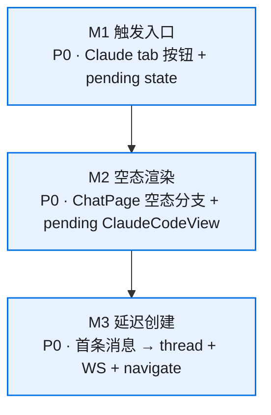

# 模块拆分

## 模块总览

| 模块 | 职责 | 依赖 | 状态 | 备注 |
|------|------|------|------|------|
| M1 触发入口 | Claude tab 按钮 + pending state 写入 | 无 | 可进入 x-req | 改 2 文件 |
| M2 空态渲染 | ChatPage + ClaudeCodeView pending mode | M1 | 可进入 x-req | 改 2 文件 |
| M3 延迟创建 | 首条消息 → thread + WS + navigate | M2 | 可进入 x-req | 改 1 文件 |



## 模块详情

### M1：触发入口

**职责**：在 Claude tab 的 project 节点下加"新建会话"按钮；点击后写 pending state + 导航到 `/chat`

**包含范围**：
- `ClaudeProjectsTree.tsx` 的 `ProjectNode` 内加按钮 UI
- `LeftSidebar.tsx` 接收 `onNewSession` callback 并执行 store 写入 + navigate
- `stores/threads.ts` 加 `pendingNewClaudeSession` state + setter

**不包含范围**：
- 通用 tab 的 NewThreadDialog
- session 自动命名逻辑

**依赖**：无

**复用/新建**：
- 复用已有 `ClaudeProjectsTree`（加 callback prop）
- 复用已有 `LeftSidebar`（加处理函数）
- 扩展已有 `useThreadsStore`（加字段）

**数据结构/接口**：

```typescript
// stores/threads.ts 扩展
interface ThreadsState {
  // ... 已有字段 ...
  pendingNewClaudeSession: PendingNewClaudeSession | null;
  setPendingNewClaudeSession: (pending: PendingNewClaudeSession | null) => void;
}

interface PendingNewClaudeSession {
  cwd: string;           // 项目绝对路径
  projectName: string;   // 显示名（用作 thread name 默认值）
}
```

```typescript
// ClaudeProjectsTree.tsx 扩展 props
interface ClaudeProjectsTreeProps {
  onSessionClick: (...) => void;  // 已有
  onNewSession: (project: ClaudeProjectSummaryDTO) => void;  // 新增
}
```

**风险等级**：低
**task 建议**：合入统一 task `claude-session-lazy-create`

---

### M2：空态渲染

**职责**：ChatPage 在 `threadId` 为空但有 `pendingNewClaudeSession` 时，渲染 pending 模式的 ClaudeCodeView

**包含范围**：
- `pages/Chat.tsx` 增加 pending 分支判断
- `ClaudeCodeView.tsx` 支持 `threadId?: string`（undefined = pending mode）
  - pending mode：空消息列表 + 可用 Composer + 空态提示文案
  - 不连 WS、不加载历史

**不包含范围**：
- workspace tabs（files/git/shell）在 pending 状态下的行为（保持 disabled）

**依赖**：M1（读 `pendingNewClaudeSession`）

**复用/新建**：
- 复用已有 `ClaudeCodeView`（改 props 为 optional threadId）
- 复用已有 `MessageViewport`（空列表 + emptyText）
- 复用已有 `Composer`（enabled 时发消息触发 M3）

**数据结构/接口**：

```typescript
// ClaudeCodeView props 变更
interface Props {
  threadId?: string;           // 从 required 改为 optional
  thread?: ThreadMetadataDTO;
  pendingCwd?: string;         // pending mode 时传入
  onFirstMessage?: (text: string) => void;  // pending mode 时的消息回调
}
```

**风险等级**：低
**风险说明**：ClaudeCodeView 已有 useEffect 依赖 threadId，需要确保 undefined 时不触发副作用（WS 连接、历史加载）

**task 建议**：合入统一 task

---

### M3：延迟创建

**职责**：用户在 pending mode 发送首条消息时，完成 thread 创建 → WS 连接 → 消息发送 → URL 更新 → store 刷新 的完整链路

**包含范围**：
- thread 创建：`POST /api/threads`（name=项目名, backend_kind=claude_code, cwd=项目路径）
- WS 连接：复用 `useClaudeCodeWS(threadId)` 的已有逻辑
- 消息发送：WS 就绪后发 `{ type: "claude-command", command: text }`
- URL 替换：`navigate(/chat/{id}, { replace: true })`
- store 更新：`fetchThreads()` 刷新列表 + 清除 `pendingNewClaudeSession`

**不包含范围**：
- 后端 API 改动
- WS 连接超时重试

**依赖**：M2（提供 onFirstMessage 回调）

**复用/新建**：
- 复用已有 `createThread` store action
- 复用已有 `useClaudeCodeWS` hook
- 复用已有 `fetchThreads` store action

**核心流程**（伪代码）：

```typescript
async function handleFirstMessage(text: string) {
  // 1. 创建 thread
  const thread = await createThread(
    pending.projectName,     // name
    "",                      // preset_id（claude_code 不需要）
    "claude_code",           // backend_kind
    pending.cwd,             // cwd
  );
  // 2. 清除 pending state
  setPendingNewClaudeSession(null);
  // 3. 导航到新 thread（replace 不留历史）
  navigate(`/chat/${thread.id}`, { replace: true });
  // 4. 刷新 threads 列表
  await fetchThreads();
  // 5. 消息发送由 ClaudeCodeView re-render 后自动
  //    通过 useClaudeCodeWS(thread.id) 连接 WS 并发送
  //    —— 需要一个 "首条消息缓冲" 机制
}
```

**首条消息缓冲设计**：

thread 创建后 navigate 触发 ChatPage re-render → `threadId` 有值 → `ClaudeCodeView` mount with real threadId → `useClaudeCodeWS` 连接。但 WS 连接是异步的，用户的第一条消息需要排队等 WS open。

方案：`ClaudeCodeView` 接受 `initialMessage?: string` prop。mount 时如果有 `initialMessage` + WS state 变为 open，自动发送并清空。

```typescript
// ClaudeCodeView 内
useEffect(() => {
  if (initialMessage && socket && state === "open") {
    onSend(initialMessage);
    // 清空 initialMessage（通过 store 或 ref）
  }
}, [initialMessage, socket, state]);
```

**风险等级**：中
**风险说明**：WS 连接是异步的，首条消息必须等 WS open 后才能发。如果 WS 连接失败，需要 toast 报错且不丢用户输入。用 `initialMessage` 缓冲机制解决。

**task 建议**：合入统一 task
