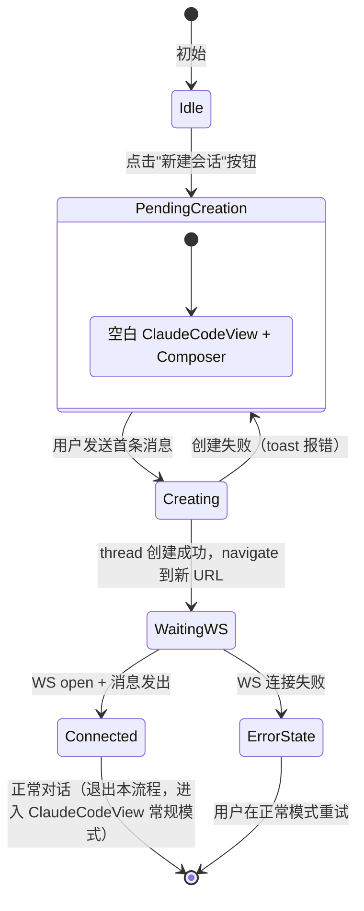

# 数据模型与状态

## 核心实体

### 新增：PendingNewClaudeSession

```typescript
interface PendingNewClaudeSession {
  cwd: string;           // 项目绝对路径，来自 ClaudeProjectSummaryDTO.cwd
  projectName: string;   // 用作 thread name 默认值，来自 ClaudeProjectSummaryDTO.display_name
}
```

这是一个纯前端瞬态对象，不持久化、不发后端。生命周期：点按钮时创建 → thread 创建成功后清除。

### 已有：ThreadMetadataDTO（无改动）

```typescript
interface ThreadMetadataDTO {
  id: string;                  // "thread-{12 hex}"
  name: string;
  preset_id: string;           // claude_code 时为 ""
  backend_kind: BackendKind;   // "claude_code"
  claude_thread_id: string;    // 新创建时为 ""，WS 连接后由后端自动绑定
  cwd: string;                 // 项目路径
  // ... 其余字段不变
}
```

### 新增：initialMessage 缓冲

```typescript
// ThreadsStore 扩展
interface ThreadsState {
  // ... 已有 ...
  pendingNewClaudeSession: PendingNewClaudeSession | null;
  setPendingNewClaudeSession: (p: PendingNewClaudeSession | null) => void;
  initialMessage: string | null;     // 首条消息缓冲
  setInitialMessage: (msg: string | null) => void;
}
```

## 状态流转



| 状态 | store.pendingNewClaudeSession | store.initialMessage | URL | ClaudeCodeView mode |
|------|-----|-----|-----|-----|
| Idle | null | null | /chat 或 /chat/{id} | normal |
| PendingCreation | {cwd, projectName} | null | /chat | pending |
| Creating | {cwd, projectName} | null | /chat | pending (disabled) |
| WaitingWS | null | "用户输入" | /chat/{new_id} | normal + initialMessage |
| Connected | null | null | /chat/{new_id} | normal |

## 持久化方案

| 数据 | 存储方式 | 位置 | 备注 |
|------|---------|------|------|
| pendingNewClaudeSession | Zustand 内存 | 前端 | 刷新即丢（符合预期） |
| initialMessage | Zustand 内存 | 前端 | WS open 后立刻消费并清除 |
| thread 元数据 | JSON 文件 | 后端 `.kongming/threads/` | 已有机制，无改动 |

## 共享数据结构

无新增跨模块共享类型。`PendingNewClaudeSession` 仅在 `ThreadsStore` 和 `ChatPage` 之间流转。
