# 模块拆分

## 模块总览

| # | 模块 | 职责 | 依赖 | 状态 |
|---|---|---|---|---|
| 1 | Entrypoint | 进程入口、stdin 主循环、首条 `claude_sidecar_ready` 输出 | 无 | 方案确认 |
| 2 | Command Parser | 5 类 SidecarRequest JSONL 解析 + 字段校验 + protocolVersion 校验 | Entrypoint | 方案确认 |
| 3 | SDK Bridge | `ClaudeSDKClient` 实例封装、`include_partial_messages=True` 强制开、多 run 复用 | Command Parser | 方案确认 |
| 4 | Message Translator | SDK Message 流 → 15 类 SidecarEvent 翻译，含状态身份跟踪与去重 | SDK Bridge | 方案确认 |
| 5 | Approval Bridge | SDK `can_use_tool` 异步回调 ↔ stdin `resolve_approval` 命令对接 | SDK Bridge, Command Parser | 方案确认 |
| 6 | Output Writer | JSONL 序列化、`protocolVersion: '1'` 注入、stdout 写、行 flush 保证 | 被 1/4/5 共用 | 方案确认 |
| 7 | Lifecycle Manager | `interrupt` / `reconnect` / `shutdown` 命令处理 + 终态事件输出 | SDK Bridge | 方案确认 |

## 数据流（运行时）

> 图源：[`assets/data-flow.mmd`](./assets/data-flow.mmd)

## 模块详情

### 模块 1：Entrypoint

**职责**：sidecar 进程的入口点，负责进程启动、依赖检查、stdin 读循环、stderr 调试日志启动。

**包含范围**：

- `python -m claude_sidecar` 入口（`__main__.py`）
- 启动后立即向 stdout 输出 `{"protocolVersion":"1","type":"claude_sidecar_ready","ts":"..."}`
- stdin 读循环：每读一行 JSON 交给 Command Parser
- 接收 EOF / SIGTERM 后调 Lifecycle Manager 的 shutdown 路径
- 进程级未捕获异常兜底：转 `claude_transport_error(recoverable=false)` 后退出

**不包含范围**：

- 命令字段解析（属于 Command Parser）
- SDK 调用（属于 SDK Bridge）

**依赖**：

- 标准库（`asyncio` / `sys` / `json`）
- Output Writer（用来写 ready 事件和兜底 transport_error）

**风险与讨论点**：

- 是用 asyncio 主循环还是同步 stdin 读？SDK 是 async API，全程 asyncio 最一致
- stdin 何时算"半关闭"——XSpace driver 关 stdin pipe 时应该等同于 shutdown 吗？建议是：等同于 `shutdown(reason="stdin_closed")`
- `claude_sidecar_ready` 必须在任何 import-time 慢操作之后才发——避免「先发 ready 但实际还在 import 卡住」

**task 建议**：

- 建议 task 名：`claude-sidecar-skeleton`（跟 Command Parser / Output Writer 一起做）
- 是否进入 x-req：是
- 原因：边界清晰、纯协议层无 SDK 集成、是其他模块的依赖前置

---

### 模块 2：Command Parser

**职责**：把 stdin 上每行 JSON 解析为 5 类 `SidecarRequest` 之一，做字段校验和 `protocolVersion` 校验。

**包含范围**：

- 5 类请求解析：`start` / `resolve_approval` / `interrupt` / `reconnect` / `shutdown`
- `protocolVersion: '1'` 必填校验（不匹配时输出 `claude_transport_error(recoverable=false)` 并 shutdown）
- `start` 必填字段校验（workspaceId / threadId / runId / cwd / prompt）
- 缺字段或非法 JSON 时：输出 `claude_transport_error(recoverable=false)`，run 未建立时 `runId` 留空
- 把解析后的强类型对象交给下游（SDK Bridge / Lifecycle Manager）

**不包含范围**：

- 命令的实际处理逻辑（分发给其他模块）
- approval 状态匹配（属于 Approval Bridge）

**依赖**：

- Entrypoint（接收 stdin 行）
- Output Writer（写错误事件）

**风险与讨论点**：

- 强类型用 dataclass / TypedDict / Pydantic？项目其他地方用 Pydantic，跟保持一致
- 非法 JSON 是单条丢弃还是终止 sidecar？建议：**run 已建立**时单条丢弃 + transport_error，**未建立 run** 时终止 sidecar
- `metadata` 字段是 `Record<string, unknown>`，sidecar 透传不解释

**task 建议**：

- 建议 task 名：合并到 `claude-sidecar-skeleton`
- 是否进入 x-req：是
- 原因：与 Entrypoint 高度耦合，一起做更顺

---

### 模块 3：SDK Bridge

**职责**：封装 `claude_agent_sdk.ClaudeSDKClient`（或 `query()`）的生命周期，把 sidecar 内部状态语义跟 SDK 调用边界对齐。

**包含范围**：

- 收 `start` 请求时建立 `ClaudeSDKClient` 实例（如果还没建立）
- 强制开启 `ClaudeAgentOptions.include_partial_messages = True`（硬约束，[E9 决议](../../plugins/client/XSpace/docs/claude-code-runtime/discussion-kongming-sidecar-contract.md)）
- 同一进程内多次 `start` **复用同一个 `ClaudeSDKClient`**，每次 `start` 调 `client.query(prompt=...)`（[第 4 轮决议](../../plugins/client/XSpace/docs/claude-code-runtime/discussion-kongming-sidecar-contract.md)）
- 把 SDK 配置参数从 `start` payload 透传：`model` / `permissionMode` / `allowedTools` / `disallowedTools` / `cwd`
- `contextPackPath` 用 `SystemPromptFile{type:'file', path:...}` 注入；`continuePointSnapshot` 拼到 `system_prompt.append`
- `resume` 字段透传到 `ClaudeAgentOptions.resume`
- 暴露 SDK message 流给 Message Translator
- `client.disconnect()` 在 shutdown 时调

**不包含范围**：

- SDK Message 翻译（属于 Message Translator）
- `can_use_tool` 回调实现（属于 Approval Bridge）—— 但 SDK Bridge 负责把 Approval Bridge 的回调挂到 `ClaudeAgentOptions.can_use_tool`
- 错误分类（属于 Lifecycle Manager / Translator）

**依赖**：

- `claude_agent_sdk` 0.1.72（pyproject 锁定版本）
- Approval Bridge 的 `can_use_tool` 实现（注入到 SDK options）

**风险与讨论点**：

- SDK 0.1.72 → 0.1.x 升级时哪些字段会破？建议每次升级前跑一次 smoke 套件
- `ClaudeSDKClient` vs `query()`：smoke 验证过 `query()` 能用，但 `can_use_tool` 必须用 `ClaudeSDKClient`（streaming mode）。**第一阶段统一用 `ClaudeSDKClient`**
- SDK 启动失败（`CLINotFoundError` / `CLIConnectionError`）的兜底——映射成 `claude_transport_error(recoverable=false)` 还是 `claude_run_failed`？建议：**run 未建立时是 transport_error，run 已建立时是 run_failed**

**task 建议**：

- 建议 task 名：`claude-sidecar-sdk-bridge`
- 是否进入 x-req：是
- 原因：SDK 接入面清晰，依赖只 skeleton，可与 translator 并行开发

---

### 模块 4：Message Translator

**职责**：把 SDK 流出来的 Python Message 对象（`AssistantMessage` / `UserMessage` / `SystemMessage` / `ResultMessage` / `StreamEvent`）翻译成 15 类 SidecarEvent，并维护协议级状态身份和去重逻辑。

**包含范围**：

- 类型分发：按 SDK message 类型 + content block 类型走不同翻译路径
- 状态身份提取与跟踪：
  - `responseId` ← `AssistantMessage.message_id`（不取 `StreamEvent.uuid`）
  - `toolCallId` ← `ToolUseBlock.id`
  - `requestId` ← can_use_tool 回调的 `ctx.tool_use_id`
  - `runtimeSessionId` ← `SystemMessage(subtype='init').data['session_id']`
- 过滤规则：
  - `SystemMessage` 仅消费 `subtype='init'` 用于回填 runtimeSessionId，其他丢弃（[E10 决议](../../plugins/client/XSpace/docs/claude-code-runtime/discussion-kongming-sidecar-contract.md)）
- 去重规则：
  - deny 后 SDK 自动产生的 `ToolResultBlock`（`tool_use_id` 与刚发出的 `claude_approval_denied.requestId` 一致）必须丢弃（[E8 决议](../../plugins/client/XSpace/docs/claude-code-runtime/discussion-kongming-sidecar-contract.md)）
- 终态判断：
  - `ResultMessage` → 区分 `claude_run_finished` / `claude_run_failed` / `claude_run_interrupted`（按 `is_error` / `stop_reason='interrupted'` / 默认 finished）
  - `claude_run_finished` 携带可选 `usage` / `durationMs` / `durationApiMs`（[N2a 决议](../../plugins/client/XSpace/docs/claude-code-runtime/discussion-kongming-sidecar-contract.md)）

**不包含范围**：

- 实际 SDK 调用（属于 SDK Bridge）
- approval 回路逻辑（属于 Approval Bridge）
- stdout 序列化（属于 Output Writer）

**依赖**：

- SDK Bridge（消费 message 流）
- Output Writer（写 SidecarEvent）

**风险与讨论点**：

- 内部状态怎么持久化跨多 run？建议：用一个 `SessionState` 对象贯穿 thread 生命周期，记录 last_response_id / pending_deny_request_ids / 等
- 一个 `AssistantMessage` 含多种 content block 时按什么顺序拆？smoke 实测发现 SDK 通常一条 message 只含一类 block，但要防御性处理多 block 情况
- `ResultMessage.errors` 字符串如何分类成 user-friendly `run_failed.message`？[Q7 未解，开发时再细化]

**task 建议**：

- 建议 task 名：`claude-sidecar-translator`
- 是否进入 x-req：是
- 原因：是核心工作量、规则密集、可单独单元测试（mock SDK message 即可）

---

### 模块 5：Approval Bridge

**职责**：把 SDK 的同步 Python 回调 `can_use_tool` 跟 sidecar 异步事件流（输出 `claude_approval_requested` + 等 stdin `resolve_approval`）对接起来。

**包含范围**：

- 实现 `can_use_tool(tool_name, input, ctx) → PermissionResult` 函数
- 在 `can_use_tool` 触发时：
  1. 生成 `requestId`（取自 `ctx.tool_use_id`）
  2. 输出 `claude_approval_requested` 事件
  3. 创建一个 asyncio Future，等待对应 `requestId` 的 `resolve_approval` 命令到达
  4. 收到命令后：
     - `approved=true` → 返回 `PermissionResultAllow(updated_input=command.updatedInput or input)`，输出 `claude_approval_resolved`
     - `approved=false` → 返回 `PermissionResultDeny(message=..., interrupt=False)`，输出 `claude_approval_denied`
  5. v0.1.8 用户主动中断走独立 `interrupt` 命令路径，不在 `resolve_approval` 加 `forceInterrupt` 字段
- 维护 `requestId → Future` 映射，让 Command Parser 把 `resolve_approval` 命令路由进来

**不包含范围**：

- approval UI（XSpace 那侧）
- deny 后的 ToolResult 去重（属于 Message Translator）
- `rememberEntry` 持久化（暂不实现，透传给 SDK 但不在 sidecar 持久化）

**依赖**：

- SDK Bridge（注入到 `ClaudeAgentOptions.can_use_tool`）
- Command Parser（接收 `resolve_approval` 命令）
- Output Writer（输出 approval 三种事件）

**风险与讨论点**：

- 用户长时间不响应时是否应该超时？claudecodeui 用 55 秒，第一阶段不做超时（XSpace 那侧自己管 UI 超时），sidecar 端单纯等
- 超时机制如果加，谁先 timeout 谁负责发什么事件？这个跟 v0.1.8 中断功能一起设计

**task 建议**：

- 建议 task 名：`claude-sidecar-approval`
- 是否进入 x-req：是
- 原因：需要 SDK Bridge 提供 callback 注入点，可与 lifecycle 并行

---

### 模块 6：Output Writer

**职责**：所有往 stdout 写事件都走这个模块，统一处理 `protocolVersion` 注入、JSON 序列化、行刷新、stderr/stdout 隔离。

**包含范围**：

- `write_event(event_dict)` 接口：自动注入 `protocolVersion: '1'`，序列化为 JSON，加换行，flush
- 并发安全（async lock，避免多协程写交错）
- 事件级日志（写到 stderr 或 sidecar 自己的日志文件，跟 stdout 完全隔离，避免污染 XSpace 流）
- ts 字段自动填（ISO8601 UTC）

**不包含范围**：

- 事件结构构造（属于 Translator / Approval Bridge / Lifecycle）

**依赖**：

- 标准库 `json` / `sys`
- 被 1 / 4 / 5 / 7 模块共用

**风险与讨论点**：

- 多协程并发写 stdout 必须 lock，否则交错的 JSON 会让 XSpace JSONL 解析失败
- stderr 是不是要默认也输出 JSON？建议：stderr 是人读的调试日志（freeform 文本），stdout 才是 JSONL

**task 建议**：

- 建议 task 名：合并到 `claude-sidecar-skeleton`
- 是否进入 x-req：是
- 原因：跟 Entrypoint / Command Parser 一起做最干净

---

### 模块 7：Lifecycle Manager

**职责**：处理三个跟生命周期相关的命令：`interrupt` / `reconnect` / `shutdown`，并产生对应的终态事件。

**包含范围**：

- `interrupt`：调 `client.interrupt()` → 等 SDK 终止 → 输出 `claude_run_interrupted`（注意：**不是** `claude_run_failed`）
- `reconnect`：6 步流程（详见 [03-core-workflows.md#reconnect 流程](./03-core-workflows.md#5-reconnect-流程)）
- `shutdown`：`client.disconnect()` → 干净退出进程
- 终态事件路由：`ResultMessage.subtype` 跟 stop_reason 决定走哪个终态
- 进程级未捕获异常兜底：转 `claude_transport_error(recoverable=false)` 然后 shutdown

**不包含范围**：

- 命令解析（属于 Command Parser）
- SDK 实际调用（属于 SDK Bridge）

**依赖**：

- SDK Bridge
- Output Writer
- Message Translator（终态分类逻辑共享）

**风险与讨论点**：

- `reconnect` 时 SDK 找不到 `runtimeSessionId` 怎么处理：契约 §6.4 已明确 → 发 `claude_transport_error(recoverable=false)`
- `interrupt` 时 SDK 抛 `InterruptError` 还是发 `ResultMessage(stop_reason='interrupted')`？smoke 时没专门测，开发时确认；不论哪种 sidecar 都映射成 `claude_run_interrupted`
- `shutdown(reason)` 的 reason 字段透传到日志，不进入产品事件

**task 建议**：

- 建议 task 名：`claude-sidecar-lifecycle`
- 是否进入 x-req：是
- 原因：边界清晰，依赖 SDK Bridge 已建立后即可开发，可与 approval 并行
