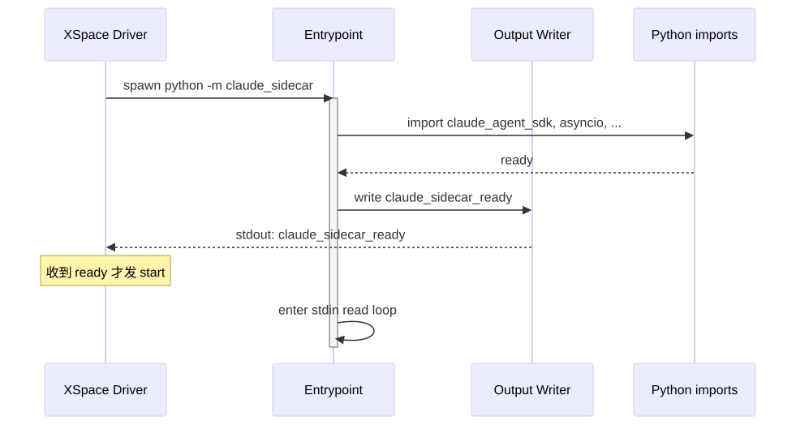
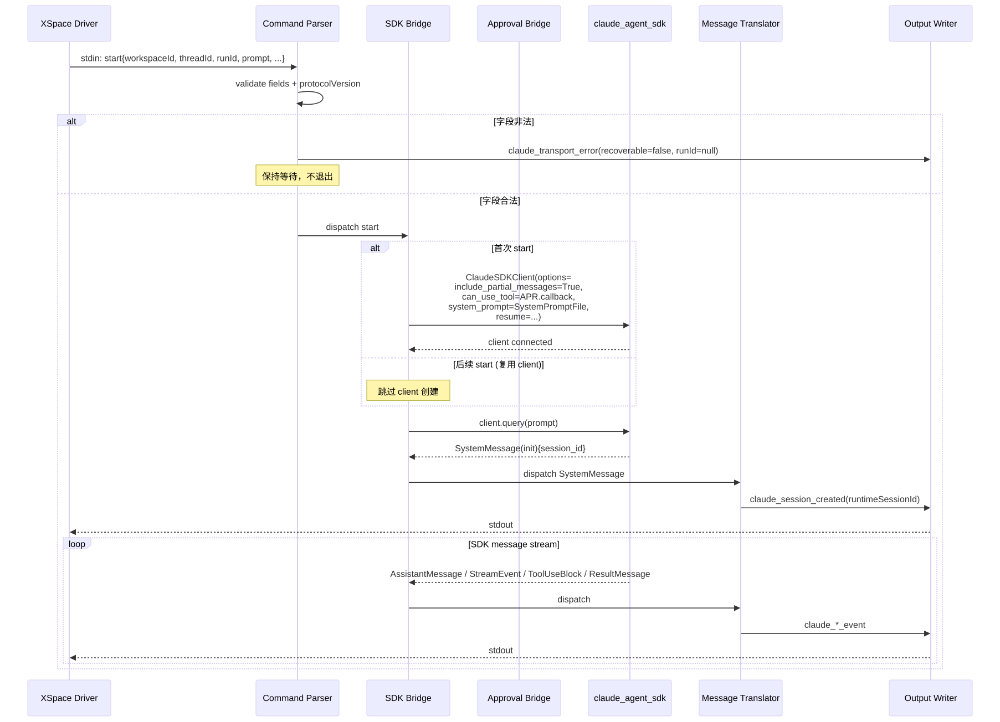
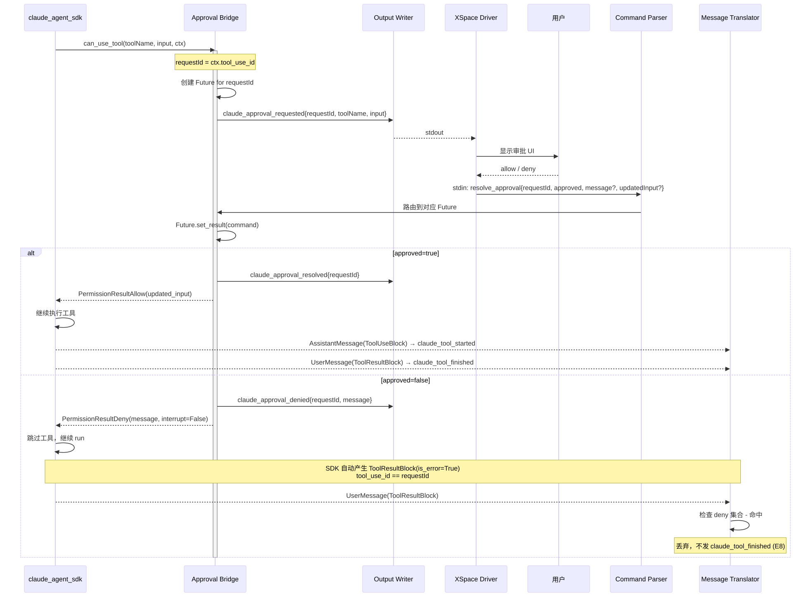
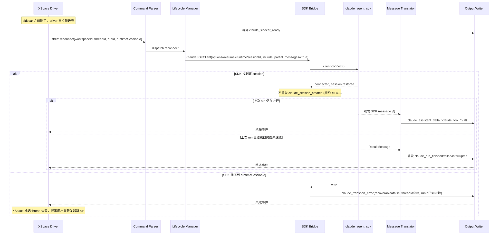
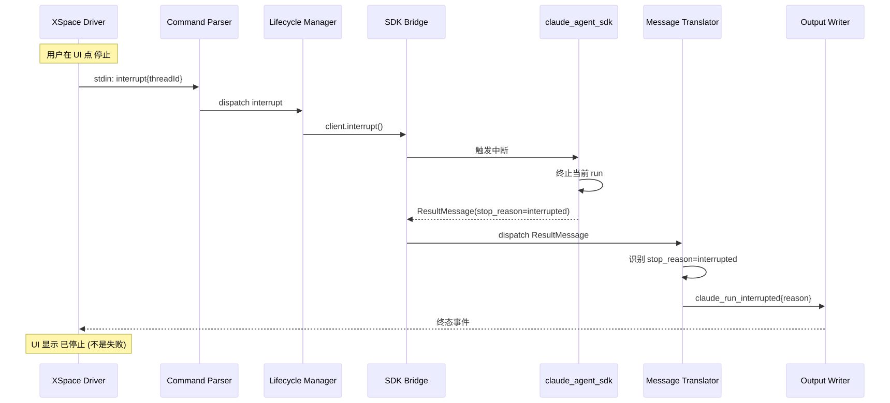
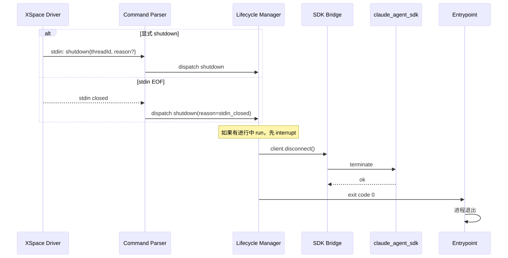

# 核心流程

本文档列出 sidecar 必须支持的 7 个核心流程，每个流程给出时序图和关键约束。所有图源 `.mmd` 在 [`assets/`](./assets/) 目录下，修改后跑 `bash assets/render.sh` 重新生成 SVG。

## 1. 启动流程

进程启动到能接受 `start` 命令的过程：

> 图源：[`assets/flow-startup.mmd`](./assets/flow-startup.mmd)

**关键约束**：

- `claude_sidecar_ready` 必须在所有 import-time 慢操作完成后才发
- XSpace driver 必须等到收到 ready 才发 `start`，否则可能丢命令
- 如果 sidecar 进程被 kill 或 import 失败，driver 不会收到 ready，超时后报"sidecar 启动失败"

---

## 2. start 命令处理流程

> 图源：[`assets/flow-start.mmd`](./assets/flow-start.mmd)

**关键约束**：

- `start` payload 缺必填字段时输出 `claude_transport_error(recoverable=false)` 并保持等待，不退出
- `ClaudeSDKClient` 实例只在第一次 `start` 创建，后续 `start` 复用同一实例（[第 4 轮决议](../../plugins/client/XSpace/docs/claude-code-runtime/discussion-kongming-sidecar-contract.md)）
- `include_partial_messages=True` 必须在创建 client 时就设置，不能后改
- `contextPackPath` 用 `SystemPromptFile{type:'file', path:...}` 注入，不读文件正文

---

## 3. Message 翻译流程

> 图源：[`assets/flow-translate.mmd`](./assets/flow-translate.mmd)

**翻译规则速查表**：

| SDK Message 类型 + content | SidecarEvent | 关键字段映射 |
|---|---|---|
| `SystemMessage(subtype='init')` | `claude_session_created` | `runtimeSessionId ← data['session_id']` |
| `SystemMessage(subtype='hook_*' / 'task_*')` | **丢弃** | — |
| `AssistantMessage(content=[TextBlock])` | `claude_assistant_final` | `responseId ← message_id`, `content ← TextBlock.text` |
| `AssistantMessage(content=[ThinkingBlock])` | `claude_assistant_thinking_final` | `responseId ← message_id`, `content ← ThinkingBlock.thinking` |
| `AssistantMessage(content=[ToolUseBlock])` | `claude_tool_started` | `toolCallId ← ToolUseBlock.id`, `toolName ← ToolUseBlock.name`, `input ← ToolUseBlock.input` |
| `UserMessage(content=[ToolResultBlock])` | `claude_tool_finished`（**或丢弃**） | `toolCallId ← tool_use_id`, `content ← ToolResultBlock.content`, `isError ← is_error` **丢弃条件**：tool_use_id 与刚发出的 `claude_approval_denied.requestId` 一致 |
| `StreamEvent(event_type='content_block_delta', delta=text_delta)` | `claude_assistant_delta` | `responseId ← parent message_id`, `delta ← delta.text` |
| `StreamEvent(event_type='content_block_delta', delta=thinking_delta)` | `claude_assistant_thinking_delta` | 同上 |
| `ResultMessage(is_error=False, stop_reason!='interrupted')` | `claude_run_finished` | 可选 `usage / durationMs / durationApiMs ← ResultMessage.usage / duration_ms / duration_api_ms` |
| `ResultMessage(is_error=True)` | `claude_run_failed` | `message ← ResultMessage.errors[0]` 或汇总文本 |
| `ResultMessage(stop_reason='interrupted')` | `claude_run_interrupted` | `reason ← ResultMessage.subtype 或自定义` |

---

## 4. Approval 回路

> 图源：[`assets/flow-approval.mmd`](./assets/flow-approval.mmd)

**关键约束**：

- `can_use_tool` 是 SDK 的同步阻塞回调；sidecar 用 asyncio Future 把它桥接成异步等待
- `requestId` 取自 `ctx.tool_use_id`，与后续 `ToolUseBlock.id` 一致
- deny 时构造 `PermissionResultDeny(message=command.message, interrupt=False)`——`interrupt=False` 是硬约束（[第 4 轮决议](../../plugins/client/XSpace/docs/claude-code-runtime/discussion-kongming-sidecar-contract.md)）
- deny 后 SDK 自动产生的 `ToolResultBlock`（`tool_use_id == requestId`）必须丢弃，不发 `claude_tool_finished`（[E8 决议](../../plugins/client/XSpace/docs/claude-code-runtime/discussion-kongming-sidecar-contract.md)）
- 第一阶段不做超时；XSpace 那侧自管 UI 超时

---

## 5. Reconnect 流程

> 图源：[`assets/flow-reconnect.mmd`](./assets/flow-reconnect.mmd)

**关键约束**（来自 [契约 §6.4](../../plugins/client/XSpace/docs/claude-code-runtime/05-kongming-sidecar-contract.md)）：

- 用 `runtimeSessionId` 调 SDK `ClaudeAgentOptions.resume`
- **不重发** `claude_session_created`
- 上次 run 仍在进行 → 直接续发后续事件（`claude_assistant_delta` / `claude_tool_started` / 等）
- 上次 run 已结束但终态未送达 → 立即补发对应终态（`claude_run_finished` / `claude_run_failed` / `claude_run_interrupted`）
- SDK 找不到该 `runtimeSessionId` → `claude_transport_error(recoverable=false, threadId=必填, runId=已知时填)`

---

## 6. Interrupt 流程

> 图源：[`assets/flow-interrupt.mmd`](./assets/flow-interrupt.mmd)

**关键约束**：

- `interrupt` 命令收到后立即调 `client.interrupt()`
- SDK 终止当前 run 后会发出 `ResultMessage`，sidecar 把它映射成 `claude_run_interrupted`（**不是** `claude_run_failed`）
- `claude_run_interrupted` 是用户主动停止的语义；UI 显示"已停止"而非"失败"
- v0.1.8 「中断当前所有工作」走这个命令，不在 `resolve_approval` 加 `forceInterrupt`

---

## 7. Shutdown 流程

> 图源：[`assets/flow-shutdown.mmd`](./assets/flow-shutdown.mmd)

**关键约束**：

- `shutdown` 是干净退出，不发 `claude_run_*` 终态（如果当前有 run，先走 interrupt 再 shutdown）
- `client.disconnect()` 释放 Claude CLI 子进程资源
- 进程退出码：`0`（正常）/ `1`（异常）
- stdin EOF 等同于 `shutdown(reason="stdin_closed")`
