# Task Map

## 任务依赖图

> 图源：[`assets/task-deps.mmd`](./assets/task-deps.mmd)

颜色按 phase 分组：

- 🟦 P0：基础骨架（必须最先做）
- 🟧 P1：SDK 接入（P0 完成后可并行）
- 🟪 P2：交互能力（P1 完成后可并行）
- 🟪 P3：横切能力（最后做）

## 任务清单

| # | 模块 | 建议 task 名 | 是否创建 task | 前置依赖 | Phase | 当前状态 |
|---|---|---|---|---|---|---|
| 1 | Entrypoint + Command Parser + Output Writer | `claude-sidecar-skeleton` | 是 | 无 | P0 | 可进入 x-req |
| 2 | SDK Bridge | `claude-sidecar-sdk-bridge` | 是 | `claude-sidecar-skeleton` | P1 | 可进入 x-req |
| 3 | Message Translator | `claude-sidecar-translator` | 是 | `claude-sidecar-skeleton` （SDK Bridge 可并行）| P1 | 可进入 x-req |
| 4 | Approval Bridge | `claude-sidecar-approval` | 是 | `claude-sidecar-sdk-bridge` `claude-sidecar-translator` | P2 | 可进入 x-req |
| 5 | Lifecycle Manager | `claude-sidecar-lifecycle` | 是 | `claude-sidecar-sdk-bridge` | P2 | 可进入 x-req |
| 6 | 横切错误处理 | `claude-sidecar-error-handling` | 是 | `claude-sidecar-translator` `claude-sidecar-sdk-bridge` | P3 | 可进入 x-req |
| 7 | 测试套件 | `claude-sidecar-test-suite` | 是 | 主体功能完成 | P3 | 可进入 x-req |

## 推荐拆分顺序

按 phase 推进：

### P0：先做（必须）

1. **`claude-sidecar-skeleton`** —— Entrypoint + Command Parser + Output Writer + `pyproject.toml` 加 `claude_agent_sdk==0.1.72` 依赖

   产出：`src/claude_sidecar/` 骨架，能被 `python -m claude_sidecar` 启动，输出 `claude_sidecar_ready`，能解析 5 类请求（暂时只回 `claude_transport_error`），不调 SDK。

   验收标准：

   - `python -m claude_sidecar` 启动后立即输出 `claude_sidecar_ready`
   - stdin 给一行 `start` JSON，stdout 输出 `claude_transport_error(message="not_implemented")`
   - 字段缺失或 protocolVersion 错时正确返回错误事件
   - 单元测试覆盖 5 类请求的解析

### P1：并行（P0 完成后）

2. **`claude-sidecar-sdk-bridge`** —— `ClaudeSDKClient` 封装 + 多 run 复用 + `include_partial_messages=True` 强制

   产出：能在 `start` 命令处理时建立或复用 SDK 客户端，向 SDK 发 prompt，把 SDK message 流交给 translator（暂用 stub）。

   验收标准：

   - 收到 `start` 后能创建 client + 调 `query`
   - 第二次 `start` 复用同一 client，不断开重连
   - SDK 选项映射正确（model / cwd / system_prompt / resume / etc）

3. **`claude-sidecar-translator`** —— SDK Message → SidecarEvent 翻译 + 状态身份跟踪 + 去重逻辑

   产出：完整的翻译层，能把 SDK 5 类消息（AssistantMessage / UserMessage / SystemMessage / ResultMessage / StreamEvent）映射成 12 类 sidecar 事件。

   验收标准：

   - 单元测试用 mock SDK message 覆盖所有翻译路径（包括 deny 去重 / SystemMessage 过滤）
   - `responseId` 取自 message_id 而不是 StreamEvent.uuid
   - `ResultMessage` 三类终态正确分类（finished / failed / interrupted）

### P2：并行（P1 完成后）

4. **`claude-sidecar-approval`** —— `can_use_tool` 异步回调 ↔ `resolve_approval` 命令对接

   产出：approval 回路可用，包括 deny 后 ToolResult 去重。

5. **`claude-sidecar-lifecycle`** —— `interrupt` / `reconnect` / `shutdown` 命令处理

   产出：3 类生命周期命令的完整流程，含 reconnect 6 步流程的所有分支。

### P3：横切收尾

6. **`claude-sidecar-error-handling`** —— 横切错误时机（什么情况发 transport_error vs run_failed）+ 进程级未捕获异常兜底

7. **`claude-sidecar-test-suite`** —— 完整测试套件（见下文）

## 测试策略

### 单元测试（必有）

- **Command Parser**：5 类请求的字段校验、protocolVersion 校验、非法 JSON 处理
- **Output Writer**：JSONL 序列化、ts 注入、并发安全（多协程写）
- **Message Translator**：用 mock SDK message 对象覆盖所有翻译路径，特别注意 deny 去重和 SystemMessage 过滤
- **Approval Bridge**：用 mock SDK can_use_tool 调用，验证 Future 等待机制和事件输出
- **Lifecycle Manager**：interrupt / reconnect / shutdown 三类命令的状态转换

依赖：纯 Python `pytest` + `unittest.mock`，不依赖真 SDK。

### 集成测试（mock SDK）

- 写一个 `mock_claude_sdk.py`，模拟 `ClaudeSDKClient` 的 message 流（按 smoke-report.md 里观察到的真实序列）
- 跑端到端：sidecar 进程接收 `start` → 翻译 → 输出 → 验证 stdout 上的 SidecarEvent 序列符合预期

### Smoke 测试（真 SDK，频率受控）

- 复用 `dev-pipeline/tasks/claude-sidecar-v0.1/smoke-report.md` 里那 5 个脚本（基础 / 工具 / thinking / can_use_tool / resume）
- 改造成 pytest fixtures，但**默认跳过**（`@pytest.mark.smoke`，需手动 `pytest -m smoke` 才跑）
- 在 sidecar 主流程改动后手动跑一次，CI 不跑（避免持续烧 API 配额）
- SDK 版本升级时必跑

### 联调测试（mock XSpace driver）

- 写一个 Python 脚本扮演 XSpace driver，按真实顺序往 sidecar stdin 喷请求，从 stdout 读事件
- 至少覆盖：完整一次对话 / 拒绝审批后继续 / interrupt / reconnect 后续接 / sidecar 异常退出
- 这个 mock driver 同时是 sidecar 联调的"参考实现"，方便后期检查问题在 sidecar 还是 XSpace 那侧

依赖：脚本 + sidecar 进程，不需要真 XSpace。

## 哪些 task 现在就能进入 x-req

**全部 7 个**都可以立即进入 x-req：

- 边界都已经在本方案 `02-module-breakdown.md` 写清楚
- 输入输出稳定（契约层已敲死）
- 依赖关系明确（见上面任务依赖图）
- SDK 行为已 smoke 实测（[smoke-report.md](../../dev-pipeline/tasks/claude-sidecar-v0.1/smoke-report.md)）

## 哪些 task 应该延后

无。所有 task 都属于 sidecar v0.1 范围内。

未来扩展方向（**不在 v0.1 范围**）：

- v0.1.8 中断功能完整化（用户主动停止当前所有工作的 UI 联动）
- v0.2：multi thread 共用单 sidecar 进程的隔离边界
- v0.2：MCP server 失败路径（Q8）
- 姊妹方案：`docs/codex-sidecar-v0.1/`
