# Claude Sidecar v0.1

> 状态：方案确认中
> 目标：在 kongming-agent 这边实现一个独立 Python 子进程（sidecar），把 XSpace 桌面应用的 stdin/stdout JSONL 协议请求翻译成 `claude_agent_sdk` 调用，并把 SDK 输出翻译成已收口的 15 类 `SidecarEvent` 喂给 XSpace。

## 进程视图（外部）

sidecar 在整个调用链中的位置：

> 图源：[`assets/architecture-process.mmd`](./assets/architecture-process.mmd) — 修改图后跑 `bash assets/render.sh` 重新生成 SVG。

**关键点**：sidecar 和 Claude CLI 是两个独立子进程；`claude_agent_sdk` 是 sidecar 进程内的 Python 库，它内部 spawn Claude CLI。XSpace driver 不直接接触 SDK 也不直接接触 CLI，只接 sidecar stdin/stdout。

## 系统目标

XSpace 通过 stdin/stdout JSONL 协议驱动 sidecar 进程，sidecar 内部用 `claude_agent_sdk` 控制 Claude Code。这层 sidecar 解决三件事：

1. **协议翻译**：SDK 的 Python Message 对象 ↔ 已收口的 SidecarEvent JSON wire 协议（含 `claude_` 前缀命名空间）
2. **进程隔离**：XSpace（Tauri Rust）不能在自己进程内跑 Python SDK，必须靠 sidecar 子进程
3. **实现陷阱吸收**：把 SDK 几个非显然的行为（`include_partial_messages` 必开 / `SystemMessage(hook_*)` 噪声 / deny 后自动 ToolResult 双发）封装在 sidecar 内部，XSpace 只看产品级稳定事件

## 范围边界

**包含**：

- 5 类 `SidecarRequest` 命令解析（`start` / `resolve_approval` / `interrupt` / `reconnect` / `shutdown`）
- 15 类 `SidecarEvent` 输出（含 `claude_sidecar_ready` / `claude_session_created` / `claude_transport_error`）
- `claude_agent_sdk` 客户端封装（多 run 复用同一 `ClaudeSDKClient` 实例）
- SDK Message → SidecarEvent 翻译层（含 deny 后 ToolResult 去重 / `SystemMessage(init)` 唯一通过 / `responseId` 取自 `message_id`）
- approval 回路（`can_use_tool` 异步回调 ↔ stdin `resolve_approval`）
- reconnect 流程（用 `runtimeSessionId` 调 SDK resume，续发或补终态）
- 错误产生时机（启动期 / SDK 业务失败 / 非法输入 三类）
- sidecar 进程级日志（stderr 或 `.kongming/sidecar/*.log`，跟产品事件流分离）

**不包含**：

- ThreadEvent 真相层（XSpace 自己持有）
- approval UI（XSpace 自己持有）
- multi thread 并发（一阶段一进程一 thread）
- 跟现有 kongming-agent CLI / Web 服务的合并入口（sidecar 是独立 `python -m claude_sidecar` 入口）
- generic_chat / codex backend（生成方案不覆盖，留给将来同结构姊妹方案）
- 自动测试 SDK 真实 API 调用（smoke 已做一次，回归测试用 mock SDK，不持续烧 API 配额）

## 关键集成决策（为什么这样划界）

| 现有基础设施 | 是否复用 | 理由 |
|---|---|---|
| `src/core/`（contracts / runner / session）| **不复用** | sidecar 不跑 turn loop / Tool / ApprovalProvider 那套抽象——SDK 内部已经是完整 agent 循环。core 的「零 sibling 依赖」继续守住，sidecar 不会反向依赖 core |
| `src/executors/llm/`（OpenAI / Anthropic provider）| **不复用** | 用的是 `anthropic-sdk-python` 走 messages API；sidecar 用 `claude_agent_sdk` 走 CLI subprocess，技术栈完全不同 |
| `src/cli/main.py` / `SessionEngine` / `SessionBridge` / `HostAdapter` | **不复用** | sidecar 是独立进程入口（`python -m claude_sidecar`），不走 host 层 / REPL / instructions 装配 |
| `src/safety/`（SafetyDecisionEngine / SafetyGatedApproval）| **不复用** | XSpace 自己做 approval UI 与策略决策。sidecar 这条路径不叠安全层，避免双重决策 |
| `src/observability/`（EventSink / JsonlTraceSink）| **不复用为产品事件出口** | sidecar 输出走 stdout JSONL（XSpace 那侧消费），不进 EventSink。可选：sidecar 内部如果需要调试日志，单独写 `.kongming/sidecar/<pid>.log`，跟 trace 体系分离 |
| `src/tools/`（ToolRegistry）| **不复用** | SDK 内部直接执行 tool（Read / Bash / 等），不经我们的 ToolRegistry |
| `src/context/`（Session / InstructionLoader / SkillLoader）| **不复用** | sidecar 不维护 session 记忆 —— SDK 自己管 session resume；instruction 通过 SDK 的 `system_prompt` / `SystemPromptFile` 注入 |
| `src/config_loader/paths.py::get_kongming_home()` | **轻度复用** | 用来定位 `.kongming/sidecar/` 目录放 sidecar 日志。不引入完整 Config 加载，sidecar 启动参数走环境变量 + start 命令 payload |
| `src/config_loader/loader.py`（完整 Config / yaml）| **不复用** | sidecar 是无状态的协议翻译层，不需要 yaml 配置。`KONGMING_*` env 系列只取与 sidecar 相关的几个 |

**总结**：sidecar 在 src/ 树里是**独立的 sibling**，只通过 `config_loader.paths.get_kongming_home()` 这一个轻量函数与现有基础设施有关。CLAUDE.md 第 2 / 6 条架构约束（core 零 sibling、跨层 import 白名单）继续生效，无需放宽。

## 内部模块依赖图

sidecar 进程内 7 个模块的依赖关系：

> 图源：[`assets/architecture-internal.mmd`](./assets/architecture-internal.mmd)

**四色分组**：
- 蓝色 = 输入侧（命令流入）
- 紫色 = SDK 接入侧（与 `claude_agent_sdk` 交互）
- 绿色 = 输出侧（事件流出）
- 橙色 = 生命周期控制（横切）

## 模块导航

| 模块 | 状态 | 文档 | 是否可进 task | 说明 |
|---|---|---|---|---|
| Entrypoint | 方案确认 | [02-module-breakdown.md#1](./02-module-breakdown.md#模块-1entrypoint) | 是 | 进程入口 + ready 输出 + 主循环 |
| Command Parser | 方案确认 | [02-module-breakdown.md#2](./02-module-breakdown.md#模块-2command-parser) | 是 | 5 类 SidecarRequest 解析 |
| SDK Bridge | 方案确认 | [02-module-breakdown.md#3](./02-module-breakdown.md#模块-3sdk-bridge) | 是 | `ClaudeSDKClient` 封装、多 run 复用、`include_partial_messages` 强制开 |
| Message Translator | 方案确认 | [02-module-breakdown.md#4](./02-module-breakdown.md#模块-4message-translator) | 是 | SDK Message → SidecarEvent 核心翻译层（最大模块）|
| Approval Bridge | 方案确认 | [02-module-breakdown.md#5](./02-module-breakdown.md#模块-5approval-bridge) | 是 | `can_use_tool` 异步回调 ↔ stdin `resolve_approval` 对接 |
| Output Writer | 方案确认 | [02-module-breakdown.md#6](./02-module-breakdown.md#模块-6output-writer) | 是 | JSONL 序列化 + `protocolVersion` 注入 + stdout 写 |
| Lifecycle Manager | 方案确认 | [02-module-breakdown.md#7](./02-module-breakdown.md#模块-7lifecycle-manager) | 是 | `interrupt` / `reconnect` / `shutdown` 命令处理 |

## 文档导航

- [目标与边界](./01-goals-and-boundaries.md)
- [模块拆分](./02-module-breakdown.md)
- [核心流程](./03-core-workflows.md)
- [Task 映射](./90-task-map.md)

## 上游约定

本方案是 [XSpace ↔ kongming-agent sidecar 契约](../../plugins/client/XSpace/docs/claude-code-runtime/05-kongming-sidecar-contract.md) 的实现侧方案。**契约层任何字段、状态机、命名空间都已敲死，不在本方案讨论范围**。

- 契约文档：`plugins/client/XSpace/docs/claude-code-runtime/05-kongming-sidecar-contract.md` + `04-data-and-state.md`
- 6 轮对齐讨论沉淀：`plugins/client/XSpace/docs/claude-code-runtime/discussion-kongming-sidecar-contract.md`
- SDK 实测背书：`dev-pipeline/tasks/claude-sidecar-v0.1/smoke-report.md`

## 当前建议

1. **7 个模块全部可进入 x-req**——边界都已清晰，输入输出稳定
2. **task 推荐拆分顺序**：先 `claude-sidecar-skeleton`（Entrypoint + Command Parser + Output Writer 一起做，纯协议层无 SDK），再 `claude-sidecar-sdk-bridge` + `claude-sidecar-translator` 并行，最后 `claude-sidecar-approval` + `claude-sidecar-lifecycle` 并行收尾
3. **测试策略**：单元测试 mock SDK，回归测试套件继承 smoke 的 5 个场景（用真 SDK 但跑频率受控，避免烧配额），联调阶段写 mock XSpace driver
4. **依赖管理**：`claude_agent_sdk` 加进 `pyproject.toml` 的 `dependencies`，**版本锁定到 0.1.72**（smoke 实测的版本）
