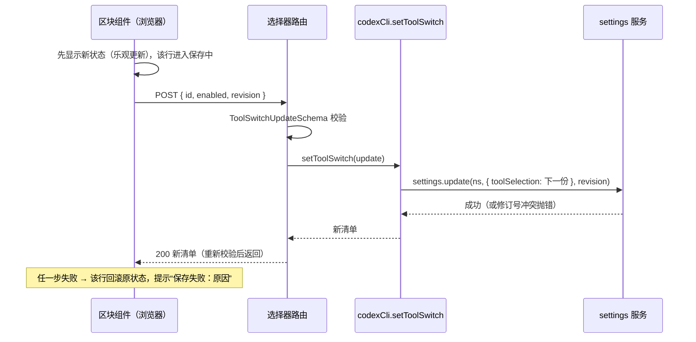

# CLI 工具开关选择器 · 技术设计

> spec: docs/spec/cli-tools-selector/spec.md
> spec 基线: git blob `556e41d78e55a15226c2a9d311ebdd762c54196b`（2026-10-14 定稿：C1–C7、已确认默认 R1–R5，无待确认项）
> spec 确认依据: C1/C2/C5 为用户 2026-10-14 原话；C3 承接 codex-cli-provider C1（2026-10-13）、C4 承接其 C4 与 AGENTS.md 禁改条款；R1 用户回复"同意"，R2–R5 随规格定稿接受；C6/C7 由用户"同意，走req、dev、verify"收入
> 设计状态: 已确认（2026-10-14，用户回复"同意，走req、dev、verify"；Q1 取 codex-cli 子路径导出契约）；v0.2 实现阶段修正 Q2（见下），待用户追认
> 设计版本: v0.2（2026-10-14；v0.1 为用户确认版本）
> 既有设计/规范: [codex-cli-provider/tech-design.md](../codex-cli-provider/tech-design.md)（已确认；其 D07 Selector 编辑默认开关的实现方式由本设计替代，执行归属结论不变）；[AGENTS.md](../../../AGENTS.md)；[包接入指南](../../kmh/adding-a-plugin-package.md)
> 本轮范围: feat01 查看清单、feat02 切换并保存、feat03 独立启停，全部为新增实现

## 本轮设计差异

大白话：新建一个独立插件包，负责"把 codex-cli 的开关画出来、转发切换"；codex-cli 只多一件事——用两个服务方法说清"我有哪些开关、怎么读写"；两边通过一份 zod 契约对话；界面用 DSH 插件页现成的"详情区块"公开槽挂进 codex-cli 的详情页。不改 DSH 任何文件。

现状代码依据（均已核对）：

| 事实 | 出处 |
|---|---|
| codex-cli 已能算出工具目录两列与当前选择（`toolPolicy.catalog()`） | `packages/codex-cli/src/tool-policy.ts` 的 `catalog()`，阶段 A 已改用公开 `tools.schemas()` |
| 工具选择的权威存储是 profile 配置 `config.toolSelection`，经公开 settings 服务读写（含修订号并发核对） | `tool-policy.ts` `importChoices()` 调 `ctx.settings.update(ns, { toolSelection }, revision)`；settings 服务 `revision: number`（`third_party/dsh/packages/settings/settings/src/index.ts:26`） |
| 联网搜索/技能等旧粗粒度开关存在 `codex-settings.json`，经 `codexCli.saveSelection()` 写入 | `packages/codex-cli/src/index.ts:131`、`src/capabilities.ts` |
| HTTP 路由公开机制：宿主连接通道 `ctx.connection.fetch.register({ path, methods, requestBody, fetch })` | `packages/codex-cli/src/web.ts:27-60`（`/api/codex-cli/*` 同机制） |
| 插件详情页有给"不拥有该插件的插件"用的公开贡献槽 `plugins.detail.section`，渲染时带页面主题（官方插件为 `{kind:'item', id}`） | `third_party/dsh/packages/client/ui-plugin-manager/src/client/slot-contract.ts:128` 与 `PluginManagerPage.tsx:553/597/692`；id 即 `plugins.item` 注册 id |
| codex-cli 详情卡注册 id 为 `codex-cli`，客户端注入面已有先例（`./client` 导出、`dsh.client.inject`、自建 build.mjs） | `packages/codex-cli/src/client/index.ts:37-47`、`package.json` |
| `codexCli` 服务已做 Context 类型增强，可被其他插件按名获取 | `packages/codex-cli/src/index.ts:58-60、613` |
| 仅普通新建会话生效由现有机制保证（会话创建时快照） | provider 设计 [D01 创建时保存原工具](../codex-cli-provider/tech-design.md#tools-create) |

本轮新增：包 `packages/cli-tools-selector`（host 路由 + client 区块）；codex-cli 新增两个服务方法与一个纯 zod 契约子路径导出；profile 与根脚本登记。不变：工具过滤执行点、会话快照、首次导入、既有详情卡内容（含原生技能开关原位不动）。

与 provider 旧 D07 的差异：旧方案经"共享配置入口/共享工具目录服务"（即被删除的 DSH cli-tools 扩展）编辑；本设计改为 codex-cli 自己暴露开关读写、选择器只消费。启停独立性、执行归属结论沿用 D07。

**v0.2 修正（实现阶段发现，待用户追认）**：v0.1 的 Q2 设想联网搜索写旧设置文件（`saveSelection`），但 `packages/codex-cli/src/index.ts:131-143` 在 profile 策略存在时拒绝经该路改动命令执行/文件修改/查看图片/联网搜索四项（抛 `CODEX_TOOLS_REQUIRE_PROFILE_CONFIG`），旧存储对这四项实际只读。因此 `native:web-search` 改为与另外三项同一机制：`toolSelection.native` 中的 `web_search` 行（插件已有 `supports_search_tool=false` 的 `-c` 覆盖，`isolation.ts:64`）。涉及 codex-cli 三处既有逻辑：`native-tools/catalog.ts` 把 `web_search` 从 fixed 改为 adjustable；`tool-policy.ts` 首次导入时按旧设置为该行播种；创建快照时 `webSearch` 优先取该行，配置里尚无该行时回落旧设置（保持既有配置行为不变）。结果：四个原生开关权威存储统一为 profile 配置，R4 的存储差异消失；`saveSelection` 不再参与开关写入。

## 独立插件与挂载点（feat01、feat03）

<a id="d01"></a>

### 方案与理由

新建 `packages/cli-tools-selector`（`@kmh/cli-tools-selector`），结构仿照 codex-cli 的打包方式：

- host 入口 `src/index.ts`：cordis 插件，注入 `connection`（挂 HTTP 路由），可选获取 `codexCli` 服务（拿不到时路由返回明确错误，不阻塞加载）。
- client 入口 `src/client/index.ts`：注入 `slots`、`locale`，向 `plugins.detail.section` 注册 id 为 `cli-tools-selector` 的区块组件。

选 `plugins.detail.section` 的理由：这是 DSH 插件页为"对别人的插件有话要说"的插件准备的公开槽（契约注释原话），渲染在官方插件自身内容之后，恰好是"codex-cli 详情页里的一个区块"；不需要 codex-cli 做任何配合。区块组件按传入的 `subject` 决定是否渲染：仅当 `subject.kind === 'item' && subject.id === 'codex-cli'` 时渲染，其余一律返回 null（覆盖 feat01 场景3、feat03 场景1 的界面消失）。

备选与否决：把清单做进 codex-cli 自己的详情卡（CodexCard）——违反 C2"独立插件"，且 codex-cli 需要为选择器扩展自己的路由；选择器自己占一个 `plugins.item` 卡片——用户明确要求开关出现在 codex-cli 详情页里，不是独立页面。

### 职责、数据流与失败处理

依赖方向单一：`@kmh/cli-tools-selector` → `@kmh/codex-cli`（服务类型与契约子路径），反向无任何依赖；两者都不依赖 DSH 内部路径（只用其公开包）。codex-cli 对选择器的存在完全无感知，卸载选择器只是少一个 `plugins.detail.section` 注册和一组路由（C1、feat03 场景1）。浏览器端组件用 `@deepseek-ai/dsh-client-ui-primitives` 的现成 Switch/Tag/Button 原语（codex-cli 详情卡同款）。

## 开关契约与数据归属（feat01、feat02）

<a id="d02"></a>

### 方案与理由

谁懂什么，就说清楚谁负责：

- **codex-cli 懂"我的开关是什么"**：新增两个服务方法（放 `packages/codex-cli/src/index.ts`，目录计算委托 `tool-policy.ts`）：
  - `toolSwitches(signal, refresh?)`：返回开关清单；
  - `setToolSwitch(update, signal)`：切换一个开关并返回新清单。
- **选择器只懂"画出来、转发"**：它不解释任何工具名、不知道哪些名字构成命令执行。

两端共用的数据结构（host 路由 ↔ 浏览器）用一份 zod 契约定义，权威位置放在 codex-cli：`packages/codex-cli/src/tool-switches.ts`（纯 zod 与类型，无 node 依赖，可进浏览器包），经 `package.json` 新增子路径导出 `@kmh/codex-cli/tool-switches`。理由：数据的主人发布自己的契约，选择器作为适配方消费，依赖方向与 C2 一致。备选：中立小包 `@kmh/cli-tools-contract`（两个 CLI 插件都不依赖对方）——第一版只有一个目标，先不加第三个包；zcode-cli 适配时再评估抽取（Q1 已确认取子路径方案）。

### 关键新增数据结构

```typescript
// 设计示意；权威实现位置 packages/codex-cli/src/tool-switches.ts，导出 @kmh/codex-cli/tool-switches。
import { z } from "zod";

/** 开关身份：KMH 工具为 `kmh:<工具名>`；原生能力为下列四个固定 id 之一。 */
export const ToolSwitchId = z.enum([
  "native:command-execution", // 命令执行：exec_command、write_stdin、shell_command
  "native:file-change",       // 文件修改：apply_patch
  "native:view-image",        // 查看图片：view_image
  "native:web-search",        // 联网搜索：web_search
]);
export const ToolSwitchSchema = z.object({
  /** KMH 工具行用工具名，与 toolSelection.harness 行的 name（含 kmh- 前缀）一致。 */
  name: z.string().min(1),
  /** 原生行的能力 id；KMH 行为 "kmh"。客户端按此 id 出本地化标签。 */
  key: z.string().min(1),
  description: z.string(),
  enabled: z.boolean(),
  /** 原生能力覆盖的 Codex 工具名，仅作说明展示；KMH 行为空数组。 */
  covers: z.array(z.string()),
});
export const ToolSwitchListSchema = z.object({
  target: z.literal("codex-cli"),
  /** settings 服务修订号（number），切换时原样带回做并发核对。 */
  revision: z.number().int(),
  kmh: z.array(ToolSwitchSchema),
  native: z.array(ToolSwitchSchema),
  /** 原生目录核实状态：ok=false 时前端按 feat01 场景2 降级并给重新读取入口。 */
  nativeStatus: z.discriminatedUnion("ok", [
    z.object({ ok: z.literal(true) }),
    z.object({ ok: z.literal(false), reason: z.string() }),
  ]),
});
export const ToolSwitchUpdateSchema = z.object({
  /** KMH 工具用其 name；原生能力用能力 id。 */
  id: z.string().min(1),
  enabled: z.boolean(),
  revision: z.number().int(),
});
```

数据归属与不变量：开关清单是**派生值**，不持久化——KMH 行由 `catalog()` 的 harness 行（公开 `tools.schemas()` 的名称/说明）与 `config.toolSelection` 的选择合并得出；原生三行映射 `toolSelection.native` 的行（command-execution 一并读写 exec_command/write_stdin/shell_command 三行，天然满足 config schema 的联动一致性校验）；`native:web-search` 对应 `web_search` 行（v0.2：配置里尚无该行时回落旧存储 `settings.selection.webSearch` 读取，首次切换即写入该行）。`revision` 是 settings 服务对 codex 条目的当前修订号，清单每次现读现返回。

## 读取链路（feat01）

<a id="d03"></a>

### 方案与理由

浏览器组件挂载时拉一次清单；"重新读取"重拉并带 `refresh`。选择器自己挂路由，不借 codex-cli 的 `/api/codex-cli/*`（边界：路由归属跟着功能走）。

### 职责、数据流与失败处理

`GET /api/cli-tools-selector/codex-cli/switches`（可带 `?refresh=1`）：

1. 选择器 host 取 `ctx.get('codexCli')`；为 undefined → `503 { error: "CODEX_CLI_UNAVAILABLE" }`（前端按 feat01 场景4 显示失败与重试）。
2. 调 `codexCli.toolSwitches(signal, refresh === true)`：内部走 `toolPolicy.catalog(signal, refresh)`（refresh 会清原生目录缓存重发现，即"重新读取"）；首次调用自然触发既有的一次性旧设置导入（feat02 场景4、R5）。
3. `catalog()` 的 harness 诊断或原生诊断 → 折算 `nativeStatus`；原生诊断文案原样带给前端（feat01 场景2）。
4. 返回值先过 `ToolSwitchListSchema.parse` 再响应（防御边界），带 `Cache-Control: no-store`（与 codex-cli 路由一致）。

取消：沿用请求的 AbortSignal；原生发现有既有 `probeTimeoutMs` 限时（`config.ts` 具名配置，不新增）。

## 写入链路（feat02）

<a id="d04"></a>

### 方案与理由

切换的落点是既有权威存储，不新增持久化：四个原生开关与 KMH 开关都写 profile 配置的 `toolSelection`（经公开 settings 服务，和 codex-cli 首次导入同一条路）。这样"只对新建会话生效"由既有快照机制自动成立（C3），选择器不需要也不允许碰会话。

### 职责、数据流与失败处理



`setToolSwitch` 的行映射（全部在 codex-cli 内，选择器无感知）：

| 开关 | 写入 |
|---|---|
| `kmh:<工具名>` | `toolSelection.harness` 中该行 upsert（无则追加 `{source:'harness', name, enabled}`；有则改 enabled） |
| `native:command-execution` | `toolSelection.native` 的 exec_command、write_stdin、shell_command 三行一起置为目标值 |
| `native:file-change` / `native:view-image` / `native:web-search` | 对应 apply_patch / view_image / web_search 行（无则追加） |

失败与并发：未知 id → 400；settings 修订号不匹配 → 409；其余错误 → 500 带 reason 文案。前端对非 2xx 一律回滚该行并提示（C6 的实现位）。同一行保存中不可再点；两行并发切换各自独立，后提交者若撞修订号得 409 后重读清单。响应返回**新清单**，前端以服务端为准刷新。

## API 一览

| 名称与功能用途 | 生产者 → 消费者 | 输入及约束 | 输出 | 错误行为与校验边界 | 权威来源 |
|---|---|---|---|---|---|
| 开关清单读取路由：详情页拉清单、重新读取 | 选择器 host → 浏览器区块 | `GET ?refresh=1`；无请求体 | `ToolSwitchListSchema` 校验后的清单，no-store | codexCli 缺失 503；内部错误 500 带 reason（feat01 场景2/4） | `packages/cli-tools-selector/src/web.ts` |
| 开关切换路由：保存一次切换 | 选择器 host → 浏览器区块 | POST `ToolSwitchUpdateSchema` | 新 `ToolSwitchList` | 校验失败 400；未知 id 400；修订号冲突 409；失败回滚见 D04（feat02 场景1/2） | 同上 |
| `codexCli.toolSwitches(signal, refresh?)`：codex-cli 自报开关 | codex-cli → 选择器 host | AbortSignal、是否重新发现 | `ToolSwitchList`（纯数据） | 原生诊断进 `nativeStatus`，不抛错；发现超时走既有 probeTimeoutMs | `packages/codex-cli/src/index.ts`（委托 tool-policy） |
| `codexCli.setToolSwitch(update, signal)`：切换一个开关 | codex-cli → 选择器 host | `ToolSwitchUpdate` | 新 `ToolSwitchList` | settings 写入失败/冲突原样抛出，由路由映射状态码 | 同上 |
| zod 契约：两端共用形状 | codex-cli 发布 → 双方消费 | — | — | — | `@kmh/codex-cli/tool-switches`（唯一权威，类型由 z.infer 推导） |

## 登记与接线（feat01–feat03 公用）

<a id="d05"></a>

按[包接入指南](../../kmh/adding-a-plugin-package.md)执行：`profiles/kmh-web/package.json` 增 `link:` 依赖并在 `dsh.profile.bundles` 之前由 `cordis.patch.yml` 增条目 `kmh-cli-tools-selector`；根 `package.json` 的 `build:kmh`、`typecheck:kmh`、`lint`、`format:check` 四处 filter 列表登记新包；[插件索引](../../kmh/plugin-index.md) 增行；新包 README 记录用途、路由与启停影响。kmh-mobile-assistant 不接入（无 Web 界面）。复用 codex-cli 的 `build.mjs` 打包模式（host tsc + client esbuild，`./client` 导出）。

## 测试场景与预期

#### 清单与当前配置一致（feat01 场景1）

- 依据：spec feat01 场景1、R1/R3；D02/D03。
- 前提与触发：沿用 `tool-policy.test.mjs` 的真实 profile harness（fixture_a/b 已注册），`editChoices` 改选择后调 `codexCli.toolSwitches()`。
- 预期结果：KMH 列含 fixture_a/b 且 enabled 与配置一致；原生列恰为四个能力、covers 正确、enabled 与各行一致；revision 为 settings 当前修订号。
- 禁止结果：清单与落盘配置不一致；出现第五个原生开关。
- 验证方式与证据：node:test 集成（真实 settings、真实目录计算）；断言写在 `packages/codex-cli/test/`。
- 局限：原生目录用真实 CLI 探测，版本不同行集合可能不同，断言只针对固定四个能力 id。

#### 原生读不到时降级并支持重新读取（feat01 场景2）

- 依据：spec feat01 场景2；D03。
- 前提与触发：harness 的 versionGate 打开时 `toolSwitches()`；释放版本门禁后带 `refresh=true` 再调。
- 预期结果：先得 `nativeStatus.ok=false` 与诊断文案（KMH 列正常）；refresh 后 `ok=true` 且四行就绪。
- 禁止结果：把失败当成空清单返回 ok=true。
- 验证方式与证据：同上 harness，复用版本门禁夹具。

#### 非 codex 详情页不渲染（feat01 场景3）

- 依据：spec feat01 场景3、C2；D01。
- 前提与触发：以 `{kind:'item', id:'other'}` 与 bundle 主题渲染区块组件。
- 预期结果：组件返回 null，无 DOM 输出。
- 禁止结果：其他插件页面出现"工具开关"区块。
- 验证方式与证据：client 组件级测试（构建产物 browser-types，模式沿用已删除 ToolRecords 测试的加载方式；若组件直测不便，抽纯判定函数 `matchesSubject` 测试 + 浏览器验收复核）。
- 局限：组件级测试不等价于整页渲染，最终以浏览器验收为准。

#### codex-cli 未就绪（feat01 场景4）

- 依据：spec feat01 场景4；D03。
- 前提与触发：选择器 host 在无 codexCli 服务的最小 cordis 应用里收到 GET。
- 预期结果：503 与 `CODEX_CLI_UNAVAILABLE`；前端显示失败与重试。
- 禁止结果：500 空泛报错或假清单。
- 验证方式与证据：选择器包 node:test，伪造 connection 注册表捕获 handler。

#### 切换写入正确的行并在新会话生效（feat02 场景1）

- 依据：spec feat02 场景1、C3；D04。
- 前提与触发：harness 内 `setToolSwitch` 关闭 `native:command-execution` 与 `kmh:fixture_a`，随后普通新建会话。
- 预期结果：settings 落盘中 exec_command/write_stdin/shell_command 三行 enabled=false（联动校验通过）；新会话的真实请求工具只剩 `kmh-fixture_b`；返回的新清单与落盘一致。
- 禁止结果：三行出现不一致；已有会话工具变化。
- 验证方式与证据：harness 集成，断言真实请求的工具名单（与现有 tool-policy 测试同一观察点）。
- 局限：`native:web-search` 走旧存储，仅断言 `saveSelection` 后读取回读一致，不接真实搜索。

#### 保存失败回滚（feat02 场景2，C6 落点）

- 依据：spec feat02 场景2、C6；D04。
- 前提与触发：路由层注入 setToolSwitch 抛错；组件层以失败 POST 模拟。
- 预期结果：路由 500/409 带原因；组件该行回到原状态并显示"保存失败：原因"。
- 禁止结果：界面停留在已切换状态。
- 验证方式与证据：选择器包路由测试 + 组件状态逻辑测试（乐观更新/回滚抽为纯函数）。

#### 引用的既有测试（不重复建设）

- [老会话保持原选择](../codex-cli-provider/tech-design.md#t3)（spec feat02 场景3）：`setToolSwitch` 与现有测试走同一条 `settings.update` 写入路，已通过的"saved changes keep existing conversations frozen"覆盖其语义；本轮新增用例仅验证行映射，不改写该主定义。
- [首次导入](spec feat02 场景4、R5)：`toolSwitches()` 内部即 `catalog()`，既有 "profile imports choices once" 覆盖。
- [选择器启停不影响 Codex](spec feat03)：既有 "original native id and tools survive a real KMH persistence restart"（无选择器目录下）已证执行不依赖选择器；本设计 codex-cli 零选择器依赖，静态审查 + 浏览器验收（禁用条目→区块消失；重新启用→显示当前配置）补界面侧证据。

浏览器验收（AGENTS 要求 Web 流程实测）：实现完成后 `pnpm web` 打开插件详情页，核对 feat01 场景1/2/4、feat02 场景1/2、feat03 场景1/2 的可见行为并截图/记录进开发报告；此前所有用例均为"待实现验证"。

## 确认记录与交接

- 2026-10-14 用户回复"同意，走req、dev、verify"：确认整体方案；Q1 契约放 codex-cli 子路径导出 `@kmh/codex-cli/tool-switches`（中立包留待第二个目标出现时评估）；spec 的 P1/P2 收入 C6/C7。
- Q2 原结论"第一版联网搜索沿用旧设置文件"在实现阶段被代码事实否定（`saveSelection` 对四项工具开关只读），已按 v0.2 修正为 `toolSelection` 的 `web_search` 行；该修正待用户追认，追认前实现按 v0.2 推进并在开发报告标注。
- 交接给 x-req：spec 基线 `556e41d78e55a15226c2a9d311ebdd762c54196b`，本设计 v0.1；适用约束 C1–C7；设计条目 D01–D05 与用例 T1–T6 映射见附录；无已知阻塞。
- 实现阶段若需改变契约位置、路由形状或数据归属，先更新本设计并重新确认。

## 附录：追溯与验证依据

| 稳定 ID | 中文名称与唯一主定义位置 | spec 场景/已确认约束来源 | 适用 feat 与各自验证结果定位 | 验证方式、证据位置与状态 |
|---|---|---|---|---|
| D01 | [独立插件与挂载点](#d01) | feat01 场景3、feat03；C1、C2 | feat01（不渲染判定）、feat03（区块消失） | slot 契约与渲染点代码核对（slot-contract.ts:128 等）；测试待实现 |
| D02 | [开关契约与数据归属](#d02) | feat01 场景1、feat02；C1、C5、R1 | feat01（清单形状）、feat02（行映射） | zod 契约单一权威；类型推导；测试待实现 |
| D03 | [读取链路](#d03) | feat01 场景1/2/4、feat02 场景4 | feat01（降级与重读） | 路由机制沿用 web.ts 证据；测试待实现 |
| D04 | [写入链路](#d04) | feat02 场景1/2/3；C3、C6、C7 | feat02（乐观更新/回滚/并发） | settings.update 修订号语义核对（settings index.ts:26）；测试待实现 |
| D05 | [登记与接线](#d05) | 全部 feat；C2 | 构建与 profile 接入 | 包接入指南条目；实现阶段核对四处 filter |
| 用例 T1 | [清单与当前配置一致](#清单与当前配置一致feat01-场景1) | feat01 场景1；D02、D03 | feat01 | 拟 node:test 集成；未执行 |
| 用例 T2 | [原生读不到时降级并支持重新读取](#原生读不到时降级并支持重新读取feat01-场景2) | feat01 场景2；D03 | feat01 | 拟 harness 集成；未执行 |
| 用例 T3 | [非 codex 详情页不渲染](#非-codex-详情页不渲染feat01-场景3) | feat01 场景3；D01 | feat01 | 拟组件级 + 浏览器复核；未执行 |
| 用例 T4 | [codex-cli 未就绪](#codex-cli-未就绪feat01-场景4) | feat01 场景4；D03 | feat01 | 拟路由测试；未执行 |
| 用例 T5 | [切换写入正确的行并在新会话生效](#切换写入正确的行并在新会话生效feat02-场景1) | feat02 场景1；C3、D04 | feat02 | 拟 harness 集成（真实请求工具断言）；未执行 |
| 用例 T6 | [保存失败回滚](#保存失败回滚feat02-场景2c6-落点) | feat02 场景2、C6；D04 | feat02 | 拟路由 + 组件逻辑测试；未执行 |

### 规范落实索引

| 规则/来源 | 适用性与原因 | 功能/设计落实位置 | 检查、测试或审查依据 | 结果/执行状态 |
|---|---|---|---|---|
| R1 模块边界 | 适用：选择器→codex-cli 单向；codex-cli 与 DSH 零选择器依赖 | D01、D05 | package.json 依赖审查 + import 检查（实现阶段）；无自动循环检查，列入测试计划 | 待实现验证 |
| R2 协议优先 | 适用：两端载荷以 zod 定义并运行时校验、类型推导 | D02（`@kmh/codex-cli/tool-switches`） | 路由两侧 parse 调用与 z.infer 引用审查；T1/T4/T6 | 待实现验证 |
| R3 跨语言协议 | 不适用：纯 TypeScript 单语言 | — | — | — |
| R4 数据唯一来源 | 适用：四个原生开关与 KMH 开关权威在 profile 配置 toolSelection、清单为派生值不落盘；旧设置文件只作 web_search 行缺失时的读取回落 | D02 | 实际读写路径核对（settings.update）；v0.2 消除存储差异 | 设计已核对 |
| R5 概念命名 | 适用：开关 id 复用既有概念（toolSelection 行 name、catalog 的 command-execution 组名） | D02 | 命名对照审查 | 设计已核对 |
| R6 具名配置 | 适用但无新增阈值：重读沿用 probeTimeoutMs | D03 | config.ts 既有具名配置引用 | 设计已核对 |
| R7 数据流与状态 | 适用：切换链路含乐观更新、并发修订号核对、失败回滚、取消 | D04 | 时序图 + T5/T6；重复/并发场景已列 | 待实现验证 |
| AGENTS 禁改 DSH | 适用 | 全部设计仅用公开扩展点 | `git -C third_party/dsh status` 为空 | 阶段 A 已保持；实现阶段复验 |
