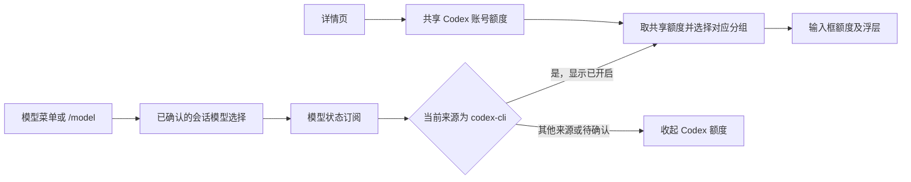

# Codex 额度展示与颜色提醒 · 技术设计

> spec：[功能规格](spec.md)，SHA-256 `4cafc757d3c9fe0a9c88e266894893117375d2df5c1fc50b07a233b33baa7fdd`。
> spec 确认依据：2026-10-20 本会话用户同意先做现有详情页和输入框额度，明确模型选择只影响输入框附近的展示；随后要求“进度条颜色改成红色就行，包括输入框那边的额度也改变颜色”，并授权“没问题就走tech”。本次规格将提醒收敛为严格低于阈值时变红。
> 设计状态：已确认；2026-10-20 用户同意并授权 req、dev、verify，同时追加 spec C1–C3。本文将读取频率和测试边界按该授权同步收紧。
> 设计版本：v0.3，2026-10-20；接口清单已按参考项目与当前实现补齐。
> 本轮范围：feat01–feat04；累计统计、热力图、每周额度去向、使用重置卡和 ZCode 额度读取属于后续范围。
> 既有规范：[根 AGENTS.md](../../../AGENTS.md)、[KMH 文档规范](../../../.agents/skills/kmh-doc/SKILL.md)、[KMH 文字规范](../../../.agents/skills/kmh-prose-standard/SKILL.md)、[客户端界面规范](../../../.agents/skills/dsh-client-ui-ux/SKILL.md)。现有运行行为参考 [Codex CLI 包说明](../../../packages/codex-cli/README.md)；会话绑定继续遵循 [provider 规格](../codex-cli-provider/spec.md)。

## 当前代码与本轮修改

本次把官方 CLI 返回的账号额度交给两个界面使用：详情页查看整个 Codex 账号，输入框查看当前 Codex 模型对应的额度。两个界面共用读取结果和颜色规则。设置保存继续使用宿主已有的配置编辑能力，额度读取独立于模型推理。

| 当前依据                                                                                                                                                                                   | 已核对的行为                                                                 | 本轮安排                                               |
| ------------------------------------------------------------------------------------------------------------------------------------------------------------------------------------------ | ---------------------------------------------------------------------------- | ------------------------------------------------------ |
| [web.ts](../../../packages/codex-cli/src/web.ts)、[DetailCard.tsx](../../../packages/codex-cli/src/client/DetailCard.tsx)                                                                  | 已有账号、版本、模型、原生技能与连接测试；HTTP 路由经过宿主连接鉴权          | 原位置追加额度卡和显示设置，沿用现有鉴权通道           |
| [connection.ts](../../../packages/codex-cli/src/connection.ts)                                                                                                                             | 负责官方 app-server 的启动、握手、请求时限与进程回收                         | 额度服务建立独立的短连接，复用进程管理                 |
| [protocol.ts](../../../packages/codex-cli/src/protocol.ts)                                                                                                                                 | 当前封装推理与登录相关协议，使用 Zod 校验                                    | 补入本次读取所需的官方方法及响应校验                   |
| [模型选择记录](../../../third_party/dsh/packages/api/session-controller/src/agent.ts)、[会话模型目录](../../../third_party/dsh/packages/client/ui-model-selection/src/client/directory.ts) | 成功选择写入 `model/selection`，目录订阅该记录的投影，提供当前选择与变化通知 | 输入框组件通过公开 `modelDirectories` 服务订阅同一状态 |
| [config.ts](../../../packages/codex-cli/src/config.ts)、[宿主配置表单](../../../third_party/dsh/packages/client/ui-settings/src/client/config-form-types.ts)                               | 插件配置由 Schemastery 声明；表单提供已接受值、修订号和原子修改              | 新增四个可热更新的显示配置，保存到当前插件配置条目     |
| [相邻插件的设置保存](../../../packages/aggregated-token-analysis/src/client/config-write.ts)                                                                                               | 公开 `remote.settings` 支持修订核对、返回值回填与失败保留                    | 沿用此接入方式，在本包实现额度表单的适配代码           |

本会话已完成官方 CLI `0.162.0-alpha.17.2` 的只读验证：`account/rateLimits/read` 成功返回每周窗口、Credits 字段与重置卡摘要。本账号这次提供 10080 分钟窗口，短周期验收使用独立测试数据。官方生成协议还定义了消费上限、重置卡详情和详情省略参数；本轮按这些协议设计，可选项随实际返回展示。

所有实现归属 `packages/codex-cli`，通过公开包入口导入 DSH 能力。当前已启用的插件可直接承载新界面。既有 `codex-settings.json` 继续保存原有选择，本次显示偏好由宿主设置持久化。

### 展示能力与接口接入清单

本节集中记录已接入的接口、参考字段和实现入口。参考项目为 `/Volumes/machub_app/proj/common/dsh-codex-subscription`，核对提交 `f73887098e75a8f1929b886a11b22470c1572dbd`。参考实现的额度数据统一来自 `GET https://chatgpt.com/backend-api/wham/usage`，由宿主携带 `Authorization: Bearer …`、`chatgpt-account-id` 和 `Accept: application/json` 读取，解析入口为 [`usage.js`](https://github.com/WSL043/dsh-codex-subscription/blob/f73887098e75a8f1929b886a11b22470c1572dbd/src/usage.js) 的 `createCodexUsageReader`、`parseCodexUsage`。

本插件通过官方 CLI app-server 的 JSON-RPC 取得同类展示数据，凭据和上游 HTTP 请求由 CLI 管理。浏览器使用下表的本地接口与公开服务，消费宿主裁剪后的结果。

| 展示能力 | 参考插件的完成度与源码 | 本插件接入方式 | 本插件实现入口 |
| --- | --- | --- | --- |
| 短周期、每周额度 | 剩余百分比、进度条、重置时间、独立额度分组；`usage.js`、`sidebar-quota.js` | `account/read` 确认账号，`account/rateLimits/read` 取得全部分组和窗口；详情页与输入框共享 `/api/codex-cli/quota` | [quota.ts](../../../packages/codex-cli/src/quota.ts)、[QuotaCard.tsx](../../../packages/codex-cli/src/client/QuotaCard.tsx) |
| Credits、重置卡 | 余额、消费上限、卡片数量和有效期；`usage.js` 的 `creditsOf`、`individualOf`、`resetCreditsOf` | 从同一次 `account/rateLimits/read` 提取 Credits、消费上限和重置卡；按实际返回展示，Credits 到期日的协议缺口见下表 | [protocol.ts](../../../packages/codex-cli/src/protocol.ts)、[quota-protocol.ts](../../../packages/codex-cli/src/quota-protocol.ts)、[QuotaCard.tsx](../../../packages/codex-cli/src/client/QuotaCard.tsx) |
| 输入框额度 | 百分比或进度条、悬浮详情、低额度提示；`sidebar-quota.js` 的 `selectModelQuotaWindows`、`selectModelQuota` 提供模型分组与最低剩余周期选择 | 订阅 `modelDirectories.directoryFor(sessionId).store`；确认来源为 `codex-cli` 时显示共享额度；默认百分比，短周期与每周阈值分别保存到宿主设置 | [ComposerQuota.tsx](../../../packages/codex-cli/src/client/ComposerQuota.tsx)、[quota-rules.ts](../../../packages/codex-cli/src/quota-rules.ts)、[QuotaDisplaySettings.tsx](../../../packages/codex-cli/src/client/QuotaDisplaySettings.tsx) |

#### 官方 CLI 方法与通知

一次额度更新在 CLI 握手完成后按下表顺序读取，所有区域共用返回值。方法名与消费字段由 [protocol.ts](../../../packages/codex-cli/src/protocol.ts) 校验。

| 方法 / 通知 | 请求参数 | 消费结果与用途 |
| --- | --- | --- |
| `account/read` | `{ "refreshToken": false }` | 读取 `account.type`；`chatgpt` 账号进入额度读取，`null` 对应待登录；账号身份仅供宿主核对 |
| `account/rateLimits/read` | `{ "excludeResetCreditDetails": false }` | 读取 `rateLimits`、`rateLimitsByLimitId`、`rateLimitResetCredits`；`accountId` 留在宿主内存中核对账号归属 |
| `account/updated` | CLI 主动通知 | 账号读取阶段由账号回执确认身份；额度读取阶段收到通知时清空旧快照、中止提交并保留冷却，处理细节见 [D02](#d02) |

#### 参考字段 → CLI 字段 → 展示字段

参考项目使用 snake_case HTTP 字段，官方 CLI 使用 camelCase。以下映射以参考项目解析代码和本插件实际消费协议为依据；未知值和确认的零值分别保留。

| 展示内容 | 参考 `wham/usage` 字段 | 官方 CLI 响应字段 | 本地 `QuotaView` 与展示语义 |
| --- | --- | --- | --- |
| 主额度及独立分组 | `rate_limit`、`additional_rate_limits[].{metered_feature,limit_name,rate_limit}`，另解析 `code_review_rate_limit` | 优先 `rateLimitsByLimitId`，兼容 `rateLimits`；组内 `limitId`、`limitName` | `groups[].{id,name,windows}`；模型精确匹配、Spark、Reserve 规则见 [D05](#d05) |
| 剩余百分比与周期 | `primary_window`、`secondary_window` 内的 `used_percent`、`limit_window_seconds` | `primary`、`secondary` 内的 `usedPercent`、`windowDurationMins` | `remainingPercent = 100 - usedPercent`；`windowMinutes` 为分钟，300 为短周期，10080 为每周；缺失窗口按实际返回处理 |
| 重置时间 | 窗口的 `reset_at`，或由 `reset_after_seconds` 换算 | 窗口的 `resetsAt`（Unix 秒） | `resetsAtMs = resetsAt * 1000`；用于绝对时间和倒计时，空值保持未知 |
| Credits 余额 | `credits.{has_credits,unlimited,balance}` | `rateLimits.credits.{hasCredits,unlimited,balance}` | `credits`；余额按十进制字符串传递，`"0"` 保持零，无限额单独展示 |
| Credits 到期日 | `credits.expires_at`；参考 `credit-expiry.js` 还提供特定赠送额度的日期估算 | 当前消费的 CLI 0.162 `CreditsSnapshot` 提供余额与状态字段 | 显示“到期时间暂未提供”；新增日期展示需先取得可核对的官方返回字段 |
| 消费上限 | `spend_control.individual_limit.{limit,used,remaining_percent,reset_at}` | `rateLimits.individualLimit.{limit,used,remainingPercent,resetsAt}` | `spend.{limit,used,remainingPercent,resetsAtMs}`；金额保持字符串，重置秒值转毫秒 |
| 重置卡数量与详情 | `rate_limit_reset_credits.available_count`、`credits[].{title,status,expires_at}` | `rateLimitResetCredits.availableCount`、`credits[].{id,title,description,status,expiresAt}` | `resets.{availableCount,cards}`；总数采用 `availableCount`，卡片有效期转毫秒，`cards: null` 表示详情待提供，`id` 用作列表键 |

#### 浏览器本地接口与公共服务

本地 HTTP 路由由 [web.ts](../../../packages/codex-cli/src/web.ts) 注册，浏览器由 [quota-store.ts](../../../packages/codex-cli/src/client/quota-store.ts) 合并读取。模型切换与颜色判断使用已有状态和共享纯规则。

| 接口 / 服务 | 输入 | 消费结果与职责 |
| --- | --- | --- |
| `GET /api/codex-cli/quota/context` | 无查询参数 | `settingsNamespace` 与四项已接受的 `preferences`；定位当前 Codex 插件配置条目，兼容只读配置展示 |
| `GET /api/codex-cli/quota` | 接受 `detail=summary\|full`、`force=0\|1`；当前共享客户端统一请求 `detail=full` | `QuotaView`，含周期、Credits、消费上限、重置卡、更新时间、账号代数、错误和 `nextRefreshAtMs`；两个显示位置共用同一快照 |
| `modelDirectories.directoryFor(sessionId).store` | `getSnapshot()` 首次读取，`subscribe()` 订阅；消费 `current.provider`、`current.model` | 模型菜单与 `/model` 的成功选择经 `model/selection` 投影更新，输入框随已确认来源和模型分组变化，见 [D04](#d04) |
| `configForms.get(namespace)`、`configForms.describe()` | 上述 context 返回的 namespace | 读取宿主配置镜像、条目修订号和写入权限，投影四个显示偏好；依赖 `remote`、`remote.settings`、`configForms` |
| `remote.settings.mutate(namespace, ops, revision)` | `ops` 只设置 `quotaDisplayMode`、`quotaAlertsEnabled`、`quotaShortThresholdPercent`、`quotaWeeklyThresholdPercent` | 宿主校验并持久化；成功结果由镜像 `acceptView` 接受，失败保留草稿与原文原因；默认值和范围见 [D06](#d06) |

两条本地 GET 沿用宿主鉴权与 `Cache-Control: no-store`，额度查询参数非法时返回 400。输入框和详情页共用读取限频、超时及颜色规则，见 [D02](#d02)、[D07](#d07)。本次范围为上述展示和显示设置，每周额度去向、订阅流程及重置卡使用动作按规格继续留在后续范围。本次文档核对只读取本地源码。

### 模块与数据归属

以下为计划位置。新增文件以代码样式列出；已有源码通过上表链接定位。

| 位置                                                  | 职责与允许依赖                                                                        |
| ----------------------------------------------------- | ------------------------------------------------------------------------------------- |
| `src/protocol.ts`                                     | 官方 `account/read`、`account/rateLimits/read` 的输入与原始响应校验；沿用现有协议模块 |
| `src/quota-protocol.ts`                               | 本插件两个只读 HTTP 端点的 Zod 定义和推导类型，供宿主与浏览器共用；保持浏览器可加载   |
| `src/quota.ts`                                        | 读取账号和额度，处理合并请求、分区错误、缓存、账号失效与进程回收；依赖官方连接和协议  |
| `src/quota-rules.ts`                                  | 额度分组选择、周期分类、有效期和红色判断等纯计算；依赖共享类型，时间由调用方传入      |
| `src/config.ts`                                       | 显示方式、提醒开关、两个阈值的权威配置定义与默认值                                    |
| `src/index.ts`、`src/web.ts`                          | 持有额度服务，挂载路由，转发账号操作的失效通知；沿用既有登录与模型运行职责            |
| `src/client/quota-store.ts`                           | 每个浏览器插件实例共享的额度状态、请求调度和配置镜像订阅                              |
| `src/client/QuotaCard.tsx`                            | 详情页周期额度、更新时间、刷新、Credits 与重置卡                                      |
| `src/client/ComposerQuota.tsx`                        | 根据当前会话模型控制显示，展示紧凑额度与详情浮层                                      |
| `src/client/QuotaDisplaySettings.tsx`                 | 共享配置表单上的显示方式、提醒开关和阈值草稿；保存成功后采用宿主确认值                |
| `src/client/quota.module.css`                          | 本功能 CSS Modules 样式，采用已有主题颜色、圆角、阴影和排版变量                                      |
| `src/client/index.ts`、`DetailCard.tsx`、`locales.ts` | 注册现有槽位、注入共享状态、接入额度卡与词典；连接状态小球沿用原槽位                  |

宿主依赖方向为 `web → quota → connection / protocol`。浏览器依赖方向为 `页面组件 → quota-store / quota-rules / 共享协议`。浏览器代码通过类型引用消费模型选择服务，通过运行时引用消费公开表单和界面组件。测试替身停在进程或 HTTP 边界，保留被验证的合并、订阅、解析和颜色计算机制。

## 在详情页查看周期额度（feat01）

对应 feat01 场景1–6。详情页固定展示 Codex 账号数据；模型来源判断集中在输入框组件。

### 通过官方 CLI 读取并共享结果

`CodexQuotaService` 由 `CodexCli` 持有。一次读取使用插件配置中的 `command`、`cwd` 和 `env`，复用 `connectCodex()`：握手后先通过 `account/read` 确认账号，再通过 `account/rateLimits/read` 取额度，最后在 `finally` 中按 `cleanupTimeoutMs` 回收连接。请求使用已有 `probeTimeoutMs`；额度读取完成后推理会话和原生会话绑定继续按原有生命周期运行。

凭据读取、刷新与网络请求由官方 CLI 完成。插件只接收账号状态和额度结果；浏览器只收到裁剪后的展示数据。真实账号标识仅在宿主内存中用于区分读取结果，HTTP 返回中使用本服务的 `accountEpoch` 代数。每次账号切换递增代数，旧代数的结果失去提交资格。

`account/read` 的账号为空时展示待登录状态；ChatGPT 账号进入额度读取；其他认证类型展示当前账号暂不支持该额度视图。现有详情卡片的本地凭据文件判定继续负责原有账号信息，额度区域采用本次原生读取确认的状态。

优先采用 `rateLimitsByLimitId` 的多分组视图；兼容只有 `rateLimits` 的旧形态。primary/secondary 的空值各自保留为空，实际周期由时长确定。300 分钟标为短周期，10080 分钟标为每周；其他时长按实际单位显示，周期时长缺失时标为待确认。主额度和附加信息分别校验，合法窗口继续展示，局部错误进入对应区域的状态。

### 请求、缓存与错误处理

详情页和输入框读取同一个服务。并发请求共享同一次官方读取；每次读取取得完整重置卡详情，两种界面共用该完整缓存。打开详情页、切换模型、切换会话和点击刷新均受同一宿主读取间隔限制。成功与失败都会占用本次读取时间窗，手动刷新同样受限；账号状态失效会清空旧数据，并保留已开始读取的冷却时间。

| 具名策略                        | 值与单位    | 使用位置与理由                                       |
| ------------------------------- | ----------- | ---------------------------------------------------- |
| `QUOTA_REFRESH_INTERVAL_MS`     | 300000 毫秒 | 有可见额度消费者时的常规更新间隔；低额度采用同一间隔 |
| `QUOTA_MIN_INTERVAL_MS`         | 300000 毫秒 | 所有真实额度读取的最短开始间隔，宿主统一限制 |
| `QUOTA_HTTP_TIMEOUT_MS` | 30000 毫秒 | 浏览器额度请求及设置绑定的总截止，覆盖响应正文与镜像等待 |
| `QUOTA_ERROR_BACKOFF_MS`        | 300000 毫秒 | 请求失败后的再次尝试间隔，兼顾官方返回的更长等待时间 |
| `QUOTA_STALE_AFTER_MS`          | 300000 毫秒 | 对应 feat04 场景5、6 的五分钟有效期                  |
| `QUOTA_DETAIL_CACHE_MS`         | 300000 毫秒 | 重置卡详情的复用时长；数量变化时提前失效             |

上述时间策略集中定义在 `quota-rules.ts` 或其同包常量中，由调用方引用。HTTP 查询的 `force` 请求检查当前数据，仍遵循宿主五分钟冷却与在途合并，返回下一次可读取时间。刷新失败保留原数据与各自的成功时间，错误文字单独更新。首次读取失败给出重试入口；CLI 方法缺失标为本版本暂不支持额度展示，原有聊天与连接测试继续按既有方式运行。

浏览器的额度 HTTP 请求从开始到正文解析共用 30 秒截止；额度 context 与配置镜像初始化合用另一个 30 秒截止。超时中止对应等待并设置稳定错误 `QUOTA_HTTP_TIMEOUT`，组件显示“额度读取超时”。已有成功数据与更新时间保留。实际在途状态决定加载文案，冷却内空快照显示“状态待更新”。连接重建监听在绑定开始时登记，首次绑定超时后仍可重试。

客户端只有详情页处于 page 视图，或 Codex 输入框且显示方式开启时，才登记额度读取需求。插件列表的 summary 卡片只渲染原简介。浏览器页面隐藏时暂停定时更新，恢复可见后检查有效期；最后一个消费者离开时拆除客户端定时器。某个组件取消等待只释放自身订阅，宿主共享请求由自身时限、账号变更或插件卸载中止。

通过本插件进行登录、退出及重新登录时，Web 路由在操作开始前清空额度、递增代数，操作完成后重新读取。CLI 在 `account/read` 回执前发出的初始账号通知由本次账号回执核对身份；相同账号保留缓存，账号变化时清空旧区域并推进代数，随后发起额度请求。进入额度读取阶段后的账号通知立即清空快照并中止该请求，较晚回执按代数丢弃，冷却继续保留。独立于本插件发生的账号变化在下一次成功读取时核对；获得不同账号标识后清除旧账号全部区域。客户端连接重建时同时递增本地请求代数，旧连接的回执由代数核对丢弃。

### 共享展示协议

正式定义计划放在 `quota-protocol.ts`。所有可空值的缺省含义均为“尚未提供或尚待确认”，确认的零值保持数字零。

| 对象           | 关键内容与约束                                                                                                                           |
| -------------- | ---------------------------------------------------------------------------------------------------------------------------------------- |
| `QuotaContext` | `settingsNamespace: string \| null`，在插件 apply 时从其上下文的 `ctx.fiber.entry.options.id` 取得；页面和输入框据此读取正确配置条目     |
| `QuotaView`    | `accountEpoch`、账号状态、`fetchedAtMs`、额度分组、Credits、消费上限、重置卡摘要，以及各区域错误；读取失败可同时携带原有效快照           |
| 额度分组       | 服务端分组标识和显示名、实际窗口列表；只对读取时认可的窗口生成展示值                                                                     |
| 额度窗口       | `usedPercent` 为 0–100 的有限数；`remainingPercent = 100 - usedPercent`；`windowMinutes` 为正整数或空；`resetsAtMs` 为有效毫秒时间戳或空 |
| 时间与局部状态 | 浏览器协议统一使用带 `Ms` 后缀的毫秒值；官方秒值在宿主映射一次，各附加区域保留自己的最后成功时间                                         |
| 错误           | 稳定的 `code`、面向用户的简短 `message`、受影响区域；原始 stderr、账号标识和认证信息保留在协议外                                         |

这里的 `remainingPercent` 是由官方百分比推导的传输值，缓存中随同一快照更新，磁盘上只保存用户设置。时间文本按当前界面语言和浏览器时区格式化，倒计时采用同一绝对重置时间。到达重置时间后，数值标为待更新并触发合并刷新；新的剩余值以读取结果为准。

| 端点                               | 输入与消费者                                                               | 输出与失败处理                                                                                                                  |
| ---------------------------------- | -------------------------------------------------------------------------- | ------------------------------------------------------------------------------------------------------------------------------- |
| `GET /api/codex-cli/quota/context` | 浏览器插件初始化和重新连接                                                 | `QuotaContext`；具体消费见[接口清单](#quota-interface-map) |
| `GET /api/codex-cli/quota`         | 接受 summary/full；当前共享客户端统一请求 full，force 表达刷新意图 | 经过 Zod 校验的 `QuotaView`；错误、鉴权和查询语义见[接口清单](#quota-interface-map) |

官方协议的权威来源是当前配置的 CLI 生成的 v2 schema。本会话已执行该二进制的 `app-server generate-ts --experimental`，核对 `GetAccountRateLimitsResponse`、`RateLimitSnapshot`、`RateLimitWindow`、`CreditsSnapshot`、`RateLimitResetCreditsSummary` 和 `RateLimitResetCredit`。实现阶段只加入消费字段的 Zod 校验，接受额外字段；以脱敏形态样本和官方生成定义核对类型、可空性与时间单位。CLI 升级时重新核对这些消费字段，原有全局最低运行版本保持既有约定。

### 测试场景与预期

#### 展示实际窗口并兼容只有每周额度的账号

依据 feat01 场景1、2。用插件服务集成测试提供双窗口、仅周窗口、其他时长、空时间与旧单分组响应，核对名称、剩余值、重置时间及未知状态。预期每个显示窗口均有来源；将缺失短周期补为满额属于失败结果。官方短周期账号的实际返回继续作为实现阶段的补充证据。

#### 首次失败可重试，刷新失败保留原更新时间

依据 feat01 场景3、4及本节合并策略。在真实额度服务前注入成功、超时和畸形响应，并同时发起详情页与输入框读取。预期一次同类在途读取、可重试、原快照和原成功时间保留；失败写成新鲜零值、每个组件独立拉起进程均判失败。通过受控延迟验证取消一个等待方后另一方仍能取得结果，进程在服务时限或卸载时完成回收。

#### 登录状态变化淘汰旧账号回执

依据 feat01 场景5、spec C2，并为 feat03 场景10验证输入框数据来源。用纯模拟状态通知表示账号甲已失效或切换到乙，延迟旧结果再释放。预期服务代数变化，两个界面移除甲的数据，乙成功后采用乙的快照；甲的较晚回执恢复原数值判失败。测试只注入状态，任何账号登出、注销方法调用均判失败。

#### 到达重置时间后重新确认额度

依据 feat01 场景6。向纯规则和组件传入受控时钟，推进到重置边界再释放新读取结果。预期展示待确认状态，随后采用新窗口；在刷新完成前推算为 100% 判失败。倒计时的界面更新和请求回收在浏览器补验。

## 查看 Credits 和重置卡（feat02）

对应 feat02 场景1–4，沿用上一节的读取服务和共享协议。

### 保留余额、未知值和局部失败的区别

额度卡内分区展示 Credits、消费上限和重置卡。Credits 的余额和消费上限按官方十进制字符串保留，格式化时采用字符串规则避免精度丢失；原生协议当前只提供余额、是否有额度和无限额状态，Credits 到期日保持暂未提供。重置卡的有效期来自其原生 `expiresAt`。

重置卡数量和列表分别处理：数量零是确认的零，列表空是已查询且为空，列表为 null 表示只知道数量。返回列表可能少于总数，因此总数始终采用服务端值。客户端接收卡片 id 作为列表键，以及名称、说明、状态和有效期等字段。当前共享读取统一请求完整详情，两端复用同一快照；账号变化清空旧区域。字段映射见[接口清单](#quota-interface-map)。

附加信息字段解析失败时，为该分区记录错误，其余合法额度继续提交。已读到的附加信息按该区域原时间保留。一次全量请求整体失败时，所有已有区域按同一刷新失败状态保留。Credits 与重置卡均属于查看功能，服务调用限于账号和额度读取。

### 测试场景与预期

#### Credits 的零余额、无限额和未知日期分别展示

依据 feat02 场景1、3。对十进制字符串、大金额、零、无限额、消费上限和空字段进行协议及渲染测试。预期数值语义保持，未知到期日期有明确状态；把未知值变为零、根据套餐推算到期日或用浮点转换损失余额精度均判失败。

#### 重置卡数量、详情和有效期分别保留

依据 feat02 场景2、3。提供数量为零、仅有数量、完整详情、受限列表和过期时间等输入；推进详情有效期并改变总数。预期总数取服务端值，已知详情按实际返回展示，数量变化触发详情重读；把列表长度当总数、把 null 详情当空列表、出现使用重置卡操作均判失败。

#### 附加信息失败时周期额度继续可见

依据 feat02 场景4。对 Credits、消费上限和卡片分区分别注入非法字段、读取缺口及延迟恢复。预期合法周期继续显示，失败区域保留原时间并可重试；一个区域错误导致整张卡清空判失败。共享的全量失败与请求回收由[刷新失败测试](#t02)验证。

## 输入框按当前模型来源展示（feat03）

对应 feat03 场景1–10。这里复用会话自身的模型状态，每个会话独立订阅，额度服务继续按账号提供全部分组。

### 订阅已有模型状态

在 `conversation.input.right` 注册 `codex-cli-quota` 条目。沿用官方模型选择器的服务注入方式，从公开 `modelDirectories.directoryFor(sessionId).store` 取得当前会话状态，通过 `getSnapshot()` 完成首次读取，通过 `subscribe()` 接收后续变化，React 层使用 `useSyncExternalStore()`。

模型菜单和 `/model` 已共享此目录。成功选择写入的 `model/selection` 会话记录经过模型投影推动 `store.current` 更新。`store.pending` 只表示尝试中的选择，输入框展示以已确认的 `current.provider`、`current.model` 为依据。注册使用公共服务和 `conversation.input.right` 槽位，目录消费者同时声明 `sessions`、`remote` 与 `remote.session` 上下文依赖；代码依赖通过 `@deepseek-ai/.../client` 公开入口声明。

显示条件为 `current.provider === "codex-cli"` 且成功保存的显示方式开启。连接刚重建或当前来源未知时，先收起数值；同一连接内刷新目录时保留已确认的当前选择。已确认 Codex 且额度读取失败时采用规格中的失败或登录状态。切换会话或确认的 provider/model 时，组件重新计算分组并清除旧浮层；较晚响应只有在当前连接代数及账号代数都匹配时才能更新共享快照。

图中箭头表达数据流；共享额度服务的读取与详情页、输入框的生命周期分别管理。以后 ZCode 可在同一个公共槽位登记自己的展示组件，并采用自己的 provider 条件与数据服务；本期保留这种插件接入方式。

### 选择额度分组与适应窄窗口

`quota-rules.ts` 集中处理分组选择：先匹配与模型标识对应的服务端分组标识或名称，普通 Codex 模型采用 `codex` 主分组。独立 Spark/Reserve 路由采用明确的命名适配规则，规则依据为参考插件 `f73887098e75a8f1929b886a11b22470c1572dbd` 的 [sidebar-quota.js](https://github.com/WSL043/dsh-codex-subscription/blob/f73887098e75a8f1929b886a11b22470c1572dbd/src/sidebar-quota.js)：精确匹配优先，Spark 对应独立 Spark 分组，Reserve 独立分组缺失时标为待确认。`normalModelSlug` 仅保留其官方定义的别名说明语义。

输入框的设置与待登录入口调用公开 `pluginNavigation.openBundle('@kmh/codex-cli')`。该包详情通过公开 `plugins.bundle.config` 复用原 `CodexCard` 及其账号操作；插件列表的原卡片继续保留，两个入口展示同一详情组件与额度状态。

同一 provider 内更换共享额度模型时复用原快照；更换独立分组时只采用对应分组，分组缺失时显示待确认并允许刷新。该选择函数由测试数据覆盖；新增分组规则需要来源与样本同时补充。

常规宽度显示短周期和每周两个标签。空间受限时，组件根据自身可用宽度只显示剩余百分比最低的周期与周期名。所有窗口仍在详情浮层中展示各自的数值、颜色与重置时间。复用公开 `useAnchoredPosition` 和 `useDismissOnOutsidePointer`，浮层挂到页面覆盖层，支持悬浮、点击、外部关闭、Escape 和焦点返回；窗口边缘与缩放场景在浏览器验收。

### 测试场景与预期

#### 首次打开和重新连接直接采用当前选择

依据 feat03 场景1及场景6的新会话默认模型。使用真实模型目录服务与可控会话投影，先设置当前选择再挂载组件，随后重连。预期模型已经确认为 Codex 时主动展示，未知时等待确认；必须再点击模型或发送消息才能出现额度判失败。

#### 切换来源和同名模型时额度归属同步变化

依据 feat03 场景2、3、4。通过现有选择入口在 Codex、ZCode 和其他来源之间切换，包含不同来源下的同名模型。预期只有确认后的 codex-cli 选择显示 Codex 额度，切回立即恢复；按模型名称或上一轮执行来源判断展示判失败。组件集成测试保留真实目录订阅，真实 Web 流程验证菜单和 `/model` 两个入口。

#### 同来源切换到独立额度分组

依据 feat03 场景5。构造主分组、精确匹配分组、Spark 和缺失独立分组，切换当前模型。预期采用正确组，共享组保持复用，独立组缺失显示待确认；拿主分组填补独立组判失败。分组规则先用受控样本验证，真实新分组另补账号证据。

#### 不同会话和较晚结果各自保留正确展示

依据 feat03 场景6、8。同时挂载甲乙会话，交替切换来源并延迟额度响应，随后释放旧结果、销毁一个会话。预期每个会话按自身选择展示，旧连接或旧账号响应被淘汰，被销毁会话释放订阅；另一个会话仍正常工作。共享额度结果可复用，输入框的来源选择保持会话隔离。

#### 切换失败时采用最终保留的模型

依据 feat03 场景7。让模型选择停留在 pending 并分别失败、成功。预期额度跟随确认状态；仅提交意图即展示目标来源额度、失败后遗留目标来源内容均判失败。使用真实目录控制器和可控选择回执观察当前值与渲染结果。

#### 来源未知、读取失败和待登录分别表达

依据 feat03 场景9、10。模型来源未知时额度位置收起，Codex 已确认但额度失败时给出重试，待登录时采用现有登录入口。原账号结果淘汰由[账号变化测试](#t03)主定义；本用例核对相应输入框状态与入口。

## 保存显示设置并同步颜色（feat04）

对应 feat04 场景1–9。颜色为纯派生结果，详情页和输入框共用同一判断函数。

### 保存到当前插件配置条目

在 `config.ts` 新增以下原生 Schemastery 字段并标为 `volatile`，沿用项目的宿主设置体系。默认值只在该配置定义中维护，浏览器读取经过宿主解析的值。

| 配置键                        | 默认值与范围                            | 消费位置                 |
| ----------------------------- | --------------------------------------- | ------------------------ |
| `quotaDisplayMode`            | `percent`；可选 `percent`、`bar`、`off` | 输入框显示方式           |
| `quotaAlertsEnabled`          | `true`                                  | 详情页与输入框的红色判断 |
| `quotaShortThresholdPercent`  | `20`；1–100 整数                        | 短周期颜色阈值           |
| `quotaWeeklyThresholdPercent` | `20`；1–100 整数                        | 每周颜色阈值             |

实施对齐（2026-10-20）：公开 `configForms` 在远程连接的 memory 模式提供只读限制，初始值为空。`QuotaContext` 因此同时投影宿主 Config 已接受的四项显示偏好，供该只读模式展示；默认值与范围继续归 Config 管理，额度缓存与偏好存储归属保持原设计。传输 schema 校验字段类型，宿主文档更新时重新读取此本机端点。正常 host 模式采用共享表单值并沿用原修订保存流程。该适配覆盖原 T14、T18 的只读部署预期。

页面表单和输入框通过 `QuotaContext.settingsNamespace` 定位公开 `configForms` 表单与 describe 镜像，从宿主条目投影并校验四个额度偏好键，同时保留宿主修订号和写入权限。完整 provider schema 的其他字段由其所属设置页处理。这里需要真实运行条目 ID：现有展示卡 ID 为 `codex-cli`，profile 中实例 ID 为 `kmh-codex-cli`，宿主内置的卡片 `form` 按展示 ID 查找，可能为空。因此本功能通过额度 context 明确取得实例 ID，再使用公开配置表单。

保存沿用 `remote.settings.mutate(namespace, ops, revision)`；客户端同时声明 `remote`、`remote.settings`、`configForms` 依赖。成功时将返回视图交给共享镜像，输入框和详情页从同一已接受值更新。失败时保留草稿与宿主原文错误，读取最新配置便于重试；生效值维持最后成功值。只读部署显示已有设置和宿主限制。已有工具、技能、登录和会话配置继续由各自入口管理，本次写入操作只含上述四个键。

本节沿用宿主既有 Schemastery 配置机制，写入由宿主完整配置 schema 校验。额度视图使用已有共享 `QuotaPreferences` 校验镜像中的四键投影，修订号和写入权限以宿主为准；自有 HTTP 边界采用前文的共享 Zod 协议，显示偏好由宿主配置持久化。

### 严格低于阈值时使用红色

`quota-rules.ts` 的 `isQuotaLow(window, settings, nowMs)` 使用原始剩余百分比比较。有效时间要求 `0 <= nowMs - fetchedAtMs <= QUOTA_STALE_AFTER_MS`；已知重置时间须晚于当前时间，缺少重置时间时采用本次成功读取的有效期。提醒开关开启且上述条件成立后，短周期和周窗口分别采用对应阈值；其它时长保留实际周期展示，阈值扩展作为后续适配。比较采用 `remainingPercent < thresholdPercent`，显示舍入只影响文字。

界面统一使用 `--dsw-alias-state-error-primary`。详情页低额度进度条的填充部分变红；输入框百分比模式中相应数值变红，进度条模式中相应填充变红。普通颜色沿用现有主题变量；提醒关闭、额度恢复到阈值及以上、数据过期或周期已重置待确认时恢复普通颜色。详情页颜色只依赖 Codex 账号数据与提醒设置；输入框另受当前模型来源及显示方式约束。

提醒的可见反馈就是颜色变化，状态随数据和设置重新计算。数值、周期和更新时间继续承担说明；辅助技术可从额度控件的可访问名称读取低额度状态。这里保留纯函数与渲染结果，无额外提醒历史或逐周期通知记录。

新区域复用现有 Button、Switch、Input、Menu、Tooltip 与表单布局，字号、间距和颜色采用现有 token，字体粗细最高 500。进度条覆盖浏览器原生填充样式，浅色和深色主题分别验证。现有连接状态小球仍表达连接状态，与额度颜色各自承担原语义。

### 测试场景与预期

#### 默认百分比及显示方式在重启后保留

依据 feat04 场景1、2。通过真实宿主配置表单加载默认值，依次保存百分比、进度条、关闭并重启隔离 profile。预期两端采用宿主成功保存值，关闭只收起输入框额度，详情页仍可查看并按提醒设置着色。写入其它字段或偏好只保存在浏览器进程内判失败。

#### 窄窗口与浮层保持可读可操作

依据 feat04 场景3和 feat03 场景6。真实浏览器覆盖普通宽度、窄窗口、缩放、视口边缘、双主题、键盘和点击。预期紧凑读数选剩余最低周期，浮层可查看所有窗口，能够关闭并保持视口内。额外窗口的颜色按各自阈值计算。DOM 静态截图只能证明布局，订阅切换与实际交互另由本组操作证据确认。

#### 两个阈值独立校验，保存失败保留草稿

依据 feat04 场景4、8。设置不同短周期与周阈值，再输入 0、101、小数、空草稿；分别注入宿主校验失败、传输失败和修订冲突。预期合法整数独立生效，非法草稿原位提示，失败保留草稿与旧生效值。对比保存前后配置 diff，四个键之外出现改动判失败。

#### 两个界面在 19%、20%、21% 使用相同颜色

依据 feat04 场景1、5、6、7、9。阈值设为 20%，在同一纯规则及真实渲染路径中依次输入 19%、20%、21%，并覆盖恰好五分钟、超过五分钟、未来更新时间和到达重置时刻。预期只有有效且严格低于阈值的窗口变红，提醒关闭时两端恢复普通颜色。输入框同时覆盖百分比与进度条。记录两种主题下实际计算的颜色和截图；额外出现 Toast、提示条或通知属于超出本次提醒形式。

#### 两个浏览器编辑设置时按宿主修订更新

依据 feat04 场景2、8。甲乙浏览器读取同一修订，甲保存后乙提交旧修订。预期乙收到冲突并保留草稿，甲已保存值继续作为详情页和输入框的生效值；乙采用新修订重试后两端更新。验证真实配置写入、共享镜像和重启读取，先变色后发现保存失败判失败。

## 实施检查与已知证据

新增包依赖按实际运行引用补入 `packages/codex-cli/package.json`，与当前工作区版本对齐：模型选择、共享状态和宿主表单通过对应公开包接入。浏览器打包的外部模块清单与类型检查范围一起更新，确认共享协议和规则可加载，Node 文件操作与宿主配置实现保持在宿主产物。已有 `tests/runtime/codex-cli.test.mjs` 的槽位验收需要同时保留连接状态小球并认可新增输入框额度槽位。

实现阶段计划复用包内构建、类型检查、测试与 lint 入口，补上上述额度、表单与浏览器用例。配置变更按根 AGENTS.md 运行根测试；脚本或构建入口有变更时运行相应 lint。所有新增进程/监听测试用 `mkdtemp` 分配独立 `CODEX_HOME` 和插件数据目录，通过 `listen(0)` 分配监听端口，并以独立子进程参数传递环境。并发用例通过可控 promise 明确重叠位置，时间规则注入实例时钟。取得资源后立即登记清理，teardown 等待连接、服务器和官方进程的完成信号。并发与时钟相关测试按 [CI 可靠性规范](../../../.agents/skills/kmh-ci-test-reliability/SKILL.md)实施。

当前证据为本会话源码调查、官方协议导出和只读账号探查；这些证据支持数据来源与扩展点选择。技术设计阶段只修改规格与本文，功能实现、颜色截图、配置保存和模型切换的实际 Web 验收均为后续待执行项。

## 待确认与交接

建议确认本草案的三个主要安排：官方 CLI 独立读取并共享账号快照；输入框订阅既有会话模型状态；显示方式和阈值保存到当前 Codex 插件配置，颜色使用同一纯函数。

用户已确认本设计并授权任务拆分、开发与验证；新增执行约束以 spec C1–C3 为准。Credits 到期日与独立额度分组的真实账号覆盖按各用例记录可用性，未知值和失败状态有明确展示路径。实现测试计划新增 `test/quota.test.mjs`、`test/quota-client.test.mjs` 和 `test/quota-browser-harness.mjs`；包清单、浏览器类型入口和打包入口随实际公开依赖更新。

### 密集刷新和失败重试保持五分钟读取下限

依据 spec C1、C2、C3 与 D02。在可控时钟和模拟连接上并发发起多页面读取、手动刷新、低额度刷新及失败重试。预期五分钟内最多一次额度读取；失败和账号失效保留冷却，五分钟边界后才允许下一次。模拟连接仅允许 `account/read` 与 `account/rateLimits/read`；账号登出、注销调用及真实账号反复请求均判失败。

## 附录：追溯与规范落实

本附录只登记主定义，后续任务按用例 ID 和功能场景回指。

| 设计 ID | 主定义                       | spec 来源                  |
| ------- | ---------------------------- | -------------------------- |
| D01     | [官方读取与账号归属](#d01)   | feat01 场景1、2、5         |
| D02     | [共享请求与恢复](#d02)       | feat01 场景3、4、6         |
| D03     | [Credits 和重置卡分区](#d03) | feat02 场景1–4             |
| D04     | [会话模型订阅](#d04)         | feat03 场景1–4、6–10       |
| D05     | [分组与紧凑展示](#d05)       | feat03 场景5；feat04 场景3 |
| D06     | [配置保存](#d06)             | feat04 场景1、2、4、8      |
| D07     | [颜色规则](#d07)             | feat04 场景1、5、6、7、9   |

| 用例 ID | 唯一主定义                   | 覆盖场景                                |
| ------- | ---------------------------- | --------------------------------------- |
| T01     | [实际额度窗口](#t01)         | feat01 场景1、2                         |
| T02     | [失败、重试与合并](#t02)     | feat01 场景3、4                         |
| T03     | [账号变化](#t03)             | feat01 场景5；feat03 场景10的旧账号淘汰 |
| T04     | [重置边界](#t04)             | feat01 场景6                            |
| T05     | [Credits 含义](#t05)         | feat02 场景1、3                         |
| T06     | [重置卡数量与详情](#t06)     | feat02 场景2、3                         |
| T07     | [附加信息失败](#t07)         | feat02 场景4                            |
| T08     | [初始化与重连](#t08)         | feat03 场景1、6的新会话默认选择         |
| T09     | [来源切换](#t09)             | feat03 场景2、3、4                      |
| T10     | [模型与额度分组](#t10)       | feat03 场景5                            |
| T11     | [会话与较晚回执](#t11)       | feat03 场景6、8                         |
| T12     | [选择失败](#t12)             | feat03 场景7                            |
| T13     | [来源、错误与登录状态](#t13) | feat03 场景9、10的输入框状态            |
| T14     | [默认值与保存](#t14)         | feat04 场景1、2                         |
| T15     | [窄窗口与浮层](#t15)         | feat04 场景3                            |
| T16     | [阈值和失败草稿](#t16)       | feat04 场景4、8                         |
| T17     | [严格阈值与双端颜色](#t17)   | feat04 场景1、5、6、7、9                |
| T18     | [修订冲突](#t18)             | feat04 场景2、8                         |
| T19     | [低频读取与测试边界](#t19) | C1、C2、C3；feat01 场景3、4；feat03 场景8 |

| 规范            | 适用性与落实                                                                                               | 验证依据与当前状态                                                |
| --------------- | ---------------------------------------------------------------------------------------------------------- | ----------------------------------------------------------------- |
| R1 模块边界     | 适用；职责和单向依赖见[模块归属](#当前代码与本轮修改)，跨包使用公开入口                                    | 已完成来源调查；实现阶段检查导入、浏览器产物与类型检查            |
| R2 协议优先     | 适用；官方读取和自有 HTTP 边界采用 Zod；宿主配置沿用 Schemastery 及其序列化表单 schema，见[配置保存](#d06) | 待实现校验、无效输入和唯一来源检查                                |
| R3 跨语言协议   | 适用到外部 Rust CLI 的消费边界；官方生成 schema 是同步依据，插件只维护其消费字段投影                       | 已导出并核对当前 CLI；后续按[共享协议](#共享展示协议)核对升级漂移 |
| R4 数据唯一来源 | 适用；额度归官方账号，偏好归插件配置；快照及派生颜色按[缓存](#d02)与[颜色规则](#d07)更新                   | T02、T03、T14、T17、T18，待实现验证                               |
| R5 概念命名     | 适用；区分账号额度、模型分组、会话选择和显示偏好，时间采用 Ms 后缀                                         | 共享协议、D04、D05；类型和数据含义审查待实现                      |
| R6 具名配置     | 适用；四项用户设置由 Config 定义，时间策略集中具名定义                                                     | T14、T16、T17，待实现验证                                         |
| R7 数据流与状态 | 适用；账号代数、连接代数、共享读取和修订核对覆盖异步完成与恢复                                             | T02、T03、T09、T11、T12、T18，待实现验证                          |
| KMH 维护归属    | 适用；本次在自有包和所属文档实施，通过公共扩展点接入                                                       | 交付时核对授权路径 diff 与子模块状态                              |
| 客户端界面规范  | 适用；共享原语、主题 token、字重、浮层关闭与视口适配                                                       | T15、T17；真实浏览器及双主题验收待执行                            |
| CI 可靠性规范   | 适用到新增时钟、子进程与异步回收测试                                                                       | 隔离目录、可控时钟和有界 teardown；T02、T03、T04、T11、T18待执行  |

## 统一界面实现

额度设置采用统一设置卡片材质与分隔行；输入框采用紧凑 Button，详情浮层使用公共定位、外部关闭机制和主题阴影。局部 CSS Modules 随客户端单文件产物加载，在插件 effect 释放时移除。局部设计、基线与验收见 [统一额度界面任务](tasks/task-quota-ui.md)。
