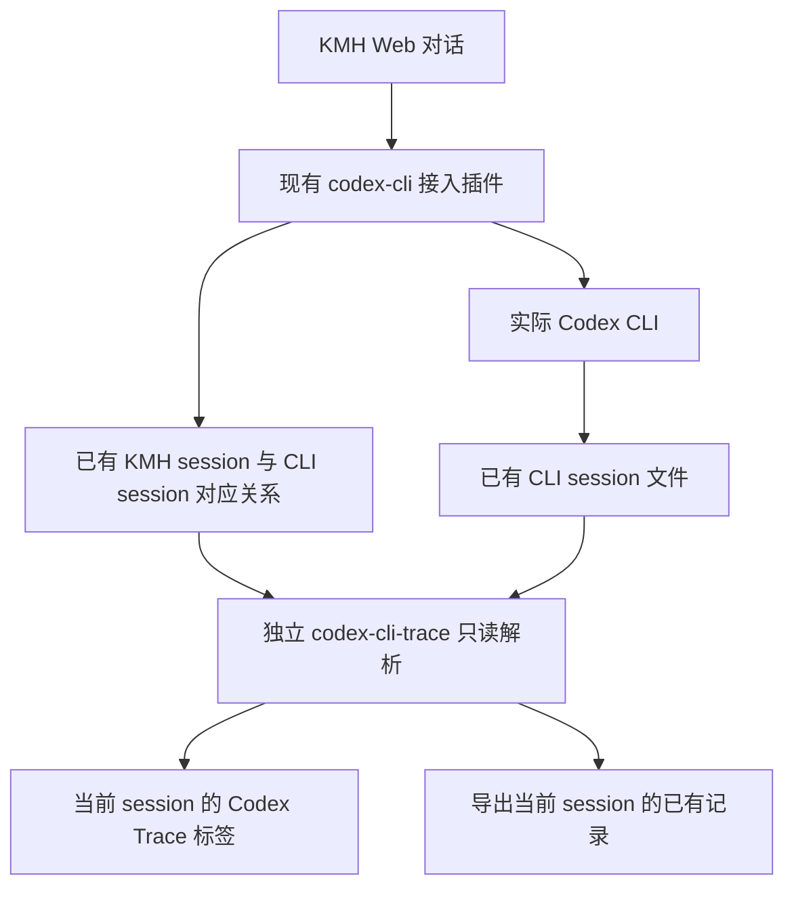

# Codex CLI Trace 技术设计

本方案新增一个 KMH 自有插件。它找到当前会话对应的 CLI 文件，把已经保存的过程展示出来；页面打开期间检查文件更新，用户可以下载当前会话的完整记录。

| 项目           | 基线与状态                                                                                                                                                                                                                                                                                                                                                                                    |
| -------------- | --------------------------------------------------------------------------------------------------------------------------------------------------------------------------------------------------------------------------------------------------------------------------------------------------------------------------------------------------------------------------------------------- |
| 功能依据       | [spec.md](spec.md)，11 个功能、56 个场景；已删除场景保留编号空缺                                                                                                                                                                                                                                                                                                                              |
| Spec 内容基线  | SHA-256 `dd4f42bde6efacfdbc32b2992834a6bfccd0c01e499db4a0d5fc78efa30fe01b`                                                                                                                                                                                                                                                                                                                    |
| 用户确认依据   | 2026-10-15 的流程图：执行链保存 CLI session，trace 读取后在 Web 展示；随后确认四项额外范围移出第一版，并要求“对齐信息就走 x-tech-design”；技术草案交付后回复“同意 /Volumes/machub_app/proj/kongming-os/packages 注意新增插件放这里”                                                                                                                                                           |
| 本轮范围       | spec 的 C1–C6、feat01–feat11；展示当前已有 CLI session，导出覆盖该 session 的已有记录                                                                                                                                                                                                                                                                                                         |
| 设计版本与状态 | `0.1-confirmed1`，2026-10-15 用户已确认，进入任务拆解                                                                                                                                                                                                                                                                                                                                         |
| 当前源码依据   | KMH `ee49ba08ec4d35dc6fdbcab0e180f54fff63e658`；DSH `be34e35b39ae32b6e7e6f202e82acc4266ef190e`，并以本次实际读取的工作区文件为准                                                                                                                                                                                                                                                              |
| 既有规范       | [根 AGENTS.md](../../../AGENTS.md)、[当前架构](../../architecture/kongming-runtime.md)、[数据目录](../../kmh/runtime-records.md)、[文档规范](../../../.agents/skills/kmh-doc/SKILL.md)、[文字规范](../../../.agents/skills/kmh-prose-standard/SKILL.md)、[UI 规范](../../../.agents/skills/dsh-client-ui-ux/SKILL.md)、[测试稳定性](../../../.agents/skills/kmh-ci-test-reliability/SKILL.md) |

## 现有能力与本轮新增

执行链沿用现有 codex-cli 插件。新增部分集中在 `packages/codex-cli-trace/`，依赖 KMH 已有的 Web 承载、浏览器认证和标签扩展能力。CLI 接入插件关闭后，trace 继续读取留在磁盘上的对应关系与历史文件。

箭头表示数据流。trace 的包依赖指向 DSH 的公开 Web、槽位、语言和界面组件包；执行插件与 trace 通过已有文件衔接。trace 的宿主入口与浏览器入口均独立装载。

### 已核对的复用入口

| 当前事实                                                | 源码与定位                                                                                                                                                                                              | 本轮使用方式                                                                 |
| ------------------------------------------------------- | ------------------------------------------------------------------------------------------------------------------------------------------------------------------------------------------------------- | ---------------------------------------------------------------------------- |
| CLI 关联文件以 KMH session ID 为键，保存原生 `threadId` | [session-store.ts](../../../packages/codex-cli/src/session-store.ts)，`bindingSchema`、`CodexSessionStore.file/get`                                                                                     | 只读当前键下的 `threadId`；其余工具策略、指纹、旧 thread ID 保持归原插件所有 |
| CLI 插件的 `dataDir` 与环境由部署配置提供               | [config.ts](../../../packages/codex-cli/src/config.ts)、[connection.ts](../../../packages/codex-cli/src/connection.ts)，`launch`                                                                        | trace 分别配置关联文件和 CLI 数据根目录；复用同一部署路径                    |
| 宿主可登记独立的已认证 Fetch 路由                       | [connection/rpc.ts](../../../third_party/dsh/packages/client/connection/src/rpc.ts)，`HostConnectionFetch`；[已有 KMH 用法](../../../packages/cli-tools-selector/src/web.ts)，`mountRoutes`             | 用 `ctx.connection.fetch.register` 登记只读路径，沿用认证与请求取消          |
| HTTP 桥支持逐块返回响应与背压                           | [http-bridge.ts](../../../third_party/dsh/packages/client/connection/src/http-bridge.ts)，`bridge`                                                                                                      | 导出使用流式响应，慢速下载按消费速度读取文件                                 |
| 当前会话标签由 `conversation.view` 扩展                 | [slots.ts](../../../third_party/dsh/packages/client/ui-conversation/src/client/contract/slots.ts)、[apply.ts](../../../third_party/dsh/packages/client/ui-conversation/src/client/apply.ts)，`viewTabs` | 登记 `id: codex-cli-trace`，通过槽位标准参数接收 `sessionId`                 |
| 轨迹标签已有注册与卸载示例                              | [ui-trajectory/index.ts](../../../third_party/dsh/packages/client/ui-trajectory/src/client/index.ts)，`apply`                                                                                           | 复用注册、语言字典与 effect 清理方式，读取自己的 CLI 数据                    |
| 当前上下文插件登记 `context` 标签，排序值为 20          | 当前安装的 `profiles/kmh-web/node_modules/dsh-context/lib/client.js` 的标签注册；清单见 [profile](../../../profiles/kmh-web/package.json)                                                               | trace 排序值为 30，排在上下文之后                                            |
| KMH 已有 Host/Client 的构建和发布结构                   | [cli-tools-selector/package.json](../../../packages/cli-tools-selector/package.json)、[build.mjs](../../../packages/cli-tools-selector/build.mjs)                                                       | 新插件沿用编译、浏览器模块装载、严格 TS 与包名导入方式                       |

### 当前真实文件证据

本次只读核对了用户指定的问候与翻译文件会话。关联文件中的 `threadId` 与 CLI 文件头 `session_meta.payload.id` 一致；CLI 文件共 61 行，包含 2 个回合、7 条逐响应用量、5 个工具调用及返回。该文件的 `cli_version` 为 `0.162.0-alpha.17.2`。

真实样本中同时存在工具的 `response_item` 原始参数/返回和 `event_msg.item_completed` 完成信息。后者提供 `DynamicToolCall`、状态、成功标志、`duration` 以及开始/完成时刻。用量同时存在逐响应 `token_usage_record` 和累计 `token_count`，两条记录描述的用量可能重叠。这决定了下文的合并与计数规则。

以上是数据可读取与字段形态的证据。正式插件的标签、刷新和下载测试在实现阶段执行；本轮没有启动模型任务或修改原生记录。

## 共用模块、数据与读取接口

### 目录和数据归属

新增包名为 `@kmh/codex-cli-trace`。下面列出职责边界，普通内部函数由实现阶段按这些边界组织。

| 计划位置                                                         | 职责与允许依赖                                                           |
| ---------------------------------------------------------------- | ------------------------------------------------------------------------ |
| `src/index.ts`、`src/config.ts`                                  | 接受部署配置，创建只读运行对象，在 connection 可用时登记路由，负责销毁   |
| `src/bindings.ts`                                                | 读取已有对应关系，取得当前 `threadId`；只依赖文件读取和输入校验          |
| `src/source.ts`                                                  | 在配置的 CLI 根目录内找到唯一对应文件，核对文件头，维护当前读取位置      |
| `src/rollout-schema.ts`                                          | 对外部 CLI 文件中已支持的记录作最小形态校验，容纳新增字段                |
| `src/projector.ts`                                               | 把记录整理成回合、响应、调用、摘要和用量；输入原始记录，输出可展示事实   |
| `src/reader.ts`                                                  | 协调增量读取、当前内存索引和变更失效；调用 source 与 projector           |
| `src/protocol.ts`、`src/paths.ts`                                | trace 自有前后端协议的唯一 Zod 定义及路径常量，导出推导类型              |
| `src/web.ts`、`src/export.ts`                                    | 校验请求，读取与返回记录；export 负责本次下载的截止范围和文件封装        |
| `src/client/index.ts`、`TraceView.tsx`、`state.ts`、`locales.ts` | 标签注册、当前会话读取、交互状态、展示与下载；通过公开 HTTP 路径访问宿主 |
| `test/`                                                          | 文件解析、接口、生命周期和浏览器交互的隔离测试                           |

调用方向为 `web → reader → bindings/source/projector`，`export → reader/source`；浏览器与宿主共同引用 protocol。浏览器构建只包含界面、协议和路径，文件系统模块留在 Host 构建。插件通过 DSH 包的公开入口导入服务和组件。

| 数据                          | 权威保存位置 / 写入方                           | trace 的使用和生命周期                                           |
| ----------------------------- | ----------------------------------------------- | ---------------------------------------------------------------- |
| KMH 与 CLI session 的对应关系 | 现有 `codex-bindings.json` / codex-cli 接入插件 | 每次检查对应文件变化，按当前 KMH 键读取；trace 仅消费 `threadId` |
| CLI 原始记录                  | 配置根目录中的 rollout JSONL / Codex CLI        | JSONL 表示一行一条记录；按字节范围读取，原文保持在源文件         |
| 回合、调用、汇总、搜索结果    | 从已读取 CLI 原文推导                           | 当前进程内索引，空闲后释放；可随时从源文件重建                   |
| 界面选中项、搜索和滚动位置    | 当前浏览器会话组件                              | 按 KMH session 隔离，切换会话时取消旧请求                        |
| 导出文件                      | 当前源文件截至本次导出的完整行 / 用户触发保存   | 用户下载的副本；校验与读取状态随本次请求释放                     |

本版使用一个已关联的原生 session。读取器忽略 `previousThreadIds`，文件位置缓存保存当前找到的位置；当前文件发生替换或截短时提示重新读取，重建当前索引。

### 文件输入和前后端协议

CLI 记录属于外部输入，`rollout-schema.ts` 只校验实际使用的字段，原始文本和未知类型保留原文入口。关联文件的完整定义仍归现有 `session-store.ts` 所有；trace 的 `bindings.ts` 只投影“当前键对应的非空 threadId”，其余字段透传后忽略。这一小范围磁盘读取适配有独立兼容用例，运行时依赖保持在文件层。

trace 自有接口在 `protocol.ts` 用 Zod 定义，请求进入 Host 与响应进入 Client 时各校验一次，TS 类型从同一 schema 推导。以下是字段设计，正式实现以该文件为唯一协议来源。

| 结构           | 必需字段与语义                                                                                                                              |
| -------------- | ------------------------------------------------------------------------------------------------------------------------------------------- |
| `TraceAddress` | `sessionId: string` 是 KMH ID；`nativeSessionId: string` 是 CLI ID，两者分别命名                                                            |
| `SourceRef`    | `line: integer >= 1`，`byteStart/byteEnd: integer >= 0`，区间为 `[start,end)`；可选 `ordinal` 为源记录提供的序号                            |
| `ReadState`    | `readToken` 是当前内存读取代的随机令牌；`readAt` 为 ISO 时间，`completeByteEnd` 是已读完整行末尾位置，`pendingTailBytes` 为尚未写完的字节数 |
| `TraceEntry`   | `entryId`，可空 `nativeTurnId`，`kind`、`name`、可空 `at/durationMs/status`，`sources: SourceRef[]`；参数和长返回通过详情读取               |
| `TraceTurn`    | `nativeTurnId`、输入摘录、源记录中的模型/推理等级、已知状态、用量与调用次数、来源；缺失字段保留空值与说明                                   |
| `Usage`        | 输入、缓存读取、缓存写入、输出、推理输出、总量分别为可空非负整数；`coverage` 区分完整、部分、未记录                                         |
| `ReadIssue`    | `kind` 区分缺失、截短、损坏、未知类型、来源不符、文件变化；包含说明及可定位的 source，覆盖缺口独立于任务成功/失败                           |
| `TraceError`   | 稳定错误代码与可读说明；配置路径、内部异常栈留在宿主诊断中                                                                                  |

`readToken` 只用于拒绝旧页面对当前读取状态的混用。它随索引失效而失效，内存中仅保留当前状态。

接口都通过现有 `connection.fetch` 挂载，沿用 KMH 浏览器认证、Host/Origin 校验与 `request.signal`。请求仅接受 session 标识及查看条件，文件路径由宿主已校验配置和对应关系决定。

| 路径与方法                          | 输入                                                                                 | 输出、校验与失败处理                                                                                     |
| ----------------------------------- | ------------------------------------------------------------------------------------ | -------------------------------------------------------------------------------------------------------- |
| `GET /api/codex-cli-trace/snapshot` | `sessionId`                                                                          | 读取新增内容，返回地址、来源说明、当前回合列表、汇总、ReadState 和 ReadIssue；无对应关系返回正常的空状态 |
| `GET /api/codex-cli-trace/timeline` | `sessionId`、`readToken`、`nativeTurnId`、分页 cursor/limit，可选类别、q、onlyErrors | 当前回合中匹配的条目页与下一页 cursor；按完整已读内容搜索，摘要仅用于显示                                |
| `GET /api/codex-cli-trace/entry`    | `sessionId`、`readToken`、`entryId`                                                  | 同一条目的完整已有参数、返回、用量、状态及来源原文；长内容保持已有全文，可由显示层折叠                   |
| `GET /api/codex-cli-trace/export`   | `sessionId`                                                                          | 当前已关联 CLI session 的 JSON 文件，浏览器在完整接收后交给用户保存；具体格式见导出节                    |

参数非法返回 400；认证行为沿用宿主；来源文件不可读返回 `SOURCE_UNREADABLE`；来源有歧义或不符返回 `SOURCE_AMBIGUOUS/SOURCE_MISMATCH`；读取令牌已过期返回 409 `READ_CHANGED`，Client 重新获取 snapshot 后恢复查看。响应采用 `Cache-Control: no-store`。读失败时保留已显示内容并标明最后成功时间。

### 配置和资源释放

部署配置沿用 Cordis 的 Schemastery 配置入口，trace 的 HTTP 和外部文件输入使用 Zod。这两类定义分别描述装载配置和业务数据，保持现有 Loader 兼容。

| 名称                                        | 单位与默认值                                                                  | 使用位置与理由                                                                      |
| ------------------------------------------- | ----------------------------------------------------------------------------- | ----------------------------------------------------------------------------------- |
| `bindingsFile`                              | 必填绝对路径；Web profile 填 `dshHomePath('codex-cli','codex-bindings.json')` | 只读对应关系；与既有 CLI `dataDir` 保持同一部署来源                                 |
| `codexHome`                                 | 绝对路径；默认非空 `CODEX_HOME`，其次 `homedir()/.codex`                      | source 查找根目录；CLI 若通过自己的 `env.CODEX_HOME` 覆盖，profile 同步显式配置此值 |
| `refreshIntervalMs`                         | 毫秒，默认 1000，正整数                                                       | 活跃页面串行检查文件更新；采用已确认默认值                                          |
| `TIMELINE_PAGE_SIZE/MAX_TIMELINE_PAGE_SIZE` | 条，默认 200/500                                                              | 浏览器分段加载条目，服务端校验请求页大小                                            |
| `READ_CHUNK_BYTES`                          | 字节，默认 65536                                                              | 文件按块读取，使用持续 UTF-8 解码器处理跨块字符                                     |
| `READER_IDLE_MS`                            | 毫秒，默认 60000                                                              | 最近一次请求结束且无活跃读取后释放当前索引；下次可从文件重建                        |

配置解析失败时，按现有插件加载方式报告配置错误。runtime 的路由、空闲清理、活动请求和文件句柄统一由插件 effect 持有，卸载先停止接收新工作，再取消并等待自己的读取，最后释放句柄与内存。前端卸载或切换会话时清除定时器、撤销下载对象 URL 并取消请求。

## 独立启停执行记录查看器（feat01）

对应 C1、C5、C6，feat01 场景1–4。新包由 `profiles/kmh-web` 单独挂载，Host 只要求 connection 可用；Client 注册标签所需的槽位与语言服务。包清单沿用已有插件的 Host/Client exports 和 `dsh.client.inject`。

本轮实现安排还需把新包加入根构建、类型检查、lint 和测试收集清单，以及 profile 依赖和 patch。新增条目在 KMH 自有目录内维护，现有执行插件的代码和持久化格式沿用。读取测试使用关闭执行插件后保留的文件，验证独立性。

这些接入安排具体落在根 `package.json`、`pnpm-lock.yaml`、`profiles/kmh-web/package.json` 与 `profiles/kmh-web/cordis.patch.yml`；使用说明分别归包内 `README.md`、`profiles/kmh-web/README.md`，插件索引登记在 `docs/kmh/plugin-index.md`。包内构建文件、严格 TS 配置、`src/` 与 `test/` 均归 `packages/codex-cli-trace/`。任务拆解对这些已确认目录列出具体文件名，普通内部文件的细分沿用本设计的职责边界。

| 用例                                          | 依据；前提与触发                                                                                                        | 预期与禁止结果                                                                                                 | 验证方式与局限                                                                        |
| --------------------------------------------- | ----------------------------------------------------------------------------------------------------------------------- | -------------------------------------------------------------------------------------------------------------- | ------------------------------------------------------------------------------------- |
| 用例 T01 独立启停         | C6；feat01 场景1、2、3；从 `packages/codex-cli-trace/` 装载插件，保留关联和 CLI 文件，单独加载/关闭 trace，执行插件关闭 | 历史可读、标签可移除，所有读取结束后资源归零；禁止启动 CLI、发送模型任务、改变源文件或把新增插件源码放到其他包 | Host 装载集成测试加浏览器装卸；记录文件内容前后哈希、活动读取和子进程观察，待实现验证 |
| 用例 T02 读取失败保留历史 | feat01 场景4；先读成功，再注入一次文件读取错误并重试                                                                    | 保留已展示内容、最后成功时间和可读原因，恢复后可读取；禁止清空有效历史或伪造成功                               | 可注入的文件适配器测试，避免依赖特定系统的 chmod 语义；浏览器验证错误位置，待实现验证 |

## 在当前会话内进入执行记录（feat02）

对应 C2、C5，feat02 场景1–5。Client 使用 `conversation.view`，标签名“Codex Trace”、排序 30，沿用现有标签栏。视图从槽位标准参数取得 `sessionId`，以该值发起所有查看和导出请求。

`bindings.ts` 先读取关联文件，定位当前 KMH 键下的 `threadId`。`source.ts` 在配置根目录的 `sessions/` 和 `archived_sessions/` 枚举符合该 ID 的 rollout 文件名，随后打开候选文件核对 `session_meta.payload.id`。路径经 realpath 限制在配置根目录内；来源不符、多个候选或关联缺失均返回可解释状态。读取定位以已保存 ID 为准。

宽窗口采用左侧时间线、右侧详情，窄窗口沿用同一数据状态切换详情与列表。CSS 复用现有 theme token 和共享滚动样式，字体粗细最高 500；查询失败使用原位提示，操作结果使用现有 Toast 宿主，文案提供中英字典。

| 用例                                              | 依据；前提与触发                                                                 | 预期与禁止结果                                                                   | 验证方式与局限                                                                                  |
| ------------------------------------------------- | -------------------------------------------------------------------------------- | -------------------------------------------------------------------------------- | ----------------------------------------------------------------------------------------------- |
| 用例 T03 标签、会话切换与窄窗 | feat02 场景1、2、5；A/B 各有不同记录，A 请求被延迟时切到 B，并在宽窄窗口打开详情 | 标签与现有标签同级，B 只呈现 B 的数据，窄窗可返回原位置；禁止 A 的迟到响应覆盖 B | 真实槽位装载与浏览器测试，用可控请求 barrier 制造迟到；深浅主题、键盘和视口人工观察，待实现验证 |
| 用例 T04 空关联与来源歧义     | feat02 场景3、4；缺少 threadId、候选不符、重复候选、越出根目录的链接分别触发读取 | 明确显示空状态或原因，原标签可用；禁止按标题/最近时间猜文件或展示其他 session    | 文件与路径集成测试加浏览器空态；只验证已有对应关系消费，待实现验证                              |

## 回看和切换历史回合（feat03）

对应 C2、C5，feat03 场景1、2、3、5。projector 优先使用记录中的显式 `turn_id`，分别从 `task_started`、`turn_context`、`task_complete` 建立回合。只有顺序能够唯一归属的记录才使用当前活动回合；无法确认的条目保留在该 session 的“归属待确认”提示与原文中，回合汇总采用已确认的记录。

页面首次打开选最新一个结束状态尚未保存的回合，其次选最近已完成回合。用户主动选择后，新增文件内容保持当前选择。正常历史回看只访问当前已关联文件中的回合。

| 用例                                            | 依据；前提与触发                                                                    | 预期与禁止结果                                                                             | 验证方式与局限                                                    |
| ----------------------------------------------- | ----------------------------------------------------------------------------------- | ------------------------------------------------------------------------------------------ | ----------------------------------------------------------------- |
| 用例 T05 两轮历史与默认选择 | feat03 场景1、2、3；装载问候/翻译两轮，再追加一个未结束回合，分别首次打开与主动切换 | 输入、输出、统计与回合一致，默认遵循上述顺序；禁止当前选择被更新强行切走                   | projector 测试与浏览器选择测试，真实样本数值见 spec，待实现验证   |
| 用例 T06 部分记录缺失       | feat03 场景5；文件保留可读回合并缺少一个结束或调用返回                              | 其余回合继续可查、缺失与覆盖范围明确；禁止把可确认缺口填成完成/零值或合并其他 CLI 历史补齐 | 裁剪后的临时 JSONL 测试；只判断可由现有记录证实的缺口，待实现验证 |

## 查看逐响应与当前回合的用量（feat04）

对应 C3，feat04 场景1–6。以 `token_usage_record.payload.response_id` 为响应标识，按显式 `turn_id` 归属；同一响应的多个工具共用该响应的一份用量。原生 session、回合、响应标识共同用于去重，重复条目保留来源引用。

逐响应使用 `usage`，回合使用同一回合最后一条有效 `turn_token_usage` 与逐响应和作核对。`thread_token_usage` 是 session 的累计值，汇总时取对应累计快照或唯一响应和，累计快照之间保持独立来源。`event_msg.token_count` 在缺少细粒度记录时作为明确标注来源的已有累计值，逐响应缺失照实标记。

缓存读取和缓存写入属于输入明细，推理属于输出明细。源数据的 `total_tokens` 按原值展示，输入/输出相加仅用于核对；缓存占比以缓存读取除以已知输入，输入为 0 时显示比例不可用。互相冲突的已保存数值分别保留来源与差异提示。

| 用例                                            | 依据；前提与触发                                                                        | 预期与禁止结果                                                                                         | 验证方式与局限                                                                                 |
| ----------------------------------------------- | --------------------------------------------------------------------------------------- | ------------------------------------------------------------------------------------------------------ | ---------------------------------------------------------------------------------------------- |
| 用例 T07 真实逐响应用量核对 | feat04 场景1、2、3；问候与翻译样本进入 projector                                        | 分别 2/5 次响应、115295/307513 token、缓存输入 56832/237568，输入/输出口径可查；禁止重复加入缓存和推理 | 真实本机样本只读检查；提交的测试用脱敏最小记录重建相同数值。数据形态已核对，插件断言待实现验证 |
| 用例 T08 累计与重复记录     | feat04 场景4、6；同一响应多工具，重复读取，并同时出现 token_count 与 token_usage_record | 响应和用量各计一次，工具独立计数；禁止累加累计快照或把工具数作为模型响应数                             | 解析与增量集成测试，待实现验证                                                                 |
| 用例 T09 部分用量与零       | feat04 场景5；缺失一个字段、仅有累计值、明确为 0、总数冲突分别触发                      | 已知值保留，空值与 0 分别显示，部分/冲突有说明；禁止把累计值均分成逐响应用量                           | schema/projector/界面测试，待实现验证                                                          |

## 沿时间线查看执行过程（feat05）

对应 C3，feat05 场景1–6。展示消息、模型用量条目、工具、技能、文件操作和 CLI 已保存的可见摘要。`entryId` 在当前文件内优先使用真实 item/call/response ID，缺少 ID 时使用源行位置。默认次序采用文件行序；相同时间的条目继续保持原始次序。

`event_msg.item_completed` 与 `response_item` 按明确的 item/call ID 合成一个展示条目，来源引用可有多条。消息和摘要以 `response_item` 为主要表示，完成事件补充已有时刻与状态；原始消息缺失时才采用对应完成事件的正文。没有可靠 ID 的补充完成事件保留原文入口，分别说明其身份。每次响应的用量是一类独立条目，消息与用量之间只有明确关联依据时才建立链接。

模型与推理等级从本回合的 `turn_context` 读取。执行状态从已有开始、完成、失败事件读取，UI 将任务结果与记录覆盖状态分别展示。摘要仅渲染原文件可见的 summary 文本，密文保留原文入口。未知记录显示类型和来源，原文可查。

| 用例                                            | 依据；前提与触发                                                | 预期与禁止结果                                                                             | 验证方式与局限                                         |
| ----------------------------------------------- | --------------------------------------------------------------- | ------------------------------------------------------------------------------------------ | ------------------------------------------------------ |
| 用例 T10 次序与多份表示     | feat05 场景1、3；同时间记录，call/output/completed 三种表示交错 | 稳定行序、明确 ID 合并、原文引用齐全；禁止按时间重新排序破坏先后，或把多份表示计为多个调用 | projector 与分页测试，待实现验证                       |
| 用例 T11 按回合还原模型     | feat05 场景2；样本问候 low、翻译 high，当前全局模型设置另有变化 | 展示各自保存的模型/等级及来源；禁止以当前全局设置覆盖历史                                  | projector 与浏览器切换，待实现验证                     |
| 用例 T12 失败后恢复与未完成 | feat05 场景4、5；读 4000 超限、改 2000 成功，另一调用仅有开始   | 失败原因、成功重试、最终结果分别可查，仅开始条目标明待确认；禁止用最终成功覆盖失败历史     | 调用投影与界面测试；不推断文件外的执行状态，待实现验证 |
| 用例 T13 摘要与未知记录     | feat05 场景6；可见摘要、密文字段及新增类型                      | 已保存可见摘要可展开，未知类型有原文入口和识别说明；禁止生成或解密不存在的摘要             | schema 和 UI 文本渲染测试，待实现验证                  |

## 审查工具参数、返回内容与技能使用（feat06）

对应 C3，feat06 场景1–6。用 `call_id` 关联 `function_call` 与 `function_call_output`，并以同一 ID 补充 `item_completed` 的工具状态和 duration。参数按原文本保存引用，格式化显示属于 UI 操作；详情可回到源原文。

当前已验证技能证据为 `kmh-skill` 的实际工具调用及技能名参数。工具调用计数包含该调用，技能类别是这一条目的可筛选分类；只读到 SKILL.md 的文件操作继续归为文件操作。今后 CLI 新增原生技能事件时，未知记录路径仍能查看原文，明确支持后再增加解释规则。

错误优先使用完成事件的 `status/success`，其次使用原始工具返回中明确的错误标志。空返回、尚未记录返回、源记录已截短分别表示。UI 可以折叠长文本，展开和导出读取已有全文；复制用原始文本，内容作为文本渲染。

| 用例                                            | 依据；前提与触发                                                                    | 预期与禁止结果                                                                                           | 验证方式与局限                                                               |
| ----------------------------------------------- | ----------------------------------------------------------------------------------- | -------------------------------------------------------------------------------------------------------- | ---------------------------------------------------------------------------- |
| 用例 T14 技能与文件操作证据 | feat06 场景1、2、3、4；问候调用 kmh-skill，翻译调用 read/write/read                 | 技能 1 次、翻译工具 4 次，参数/返回/状态能定位；读取技能文件作为文件操作展示；禁止把文件读取计作技能调用 | 真实样本只读对账与脱敏 fixture；宿主工具执行过程保持原样，插件断言待实现验证 |
| 用例 T15 长结果与返回缺失   | feat06 场景5、6；超 8000 字符、跨块中文、空返回、缺失返回、原始截短标记和 HTML 文本 | 全文可展开复制，空/缺失/截短明确，特殊内容按文本显示；禁止新增截断、字符损坏或执行原文中的脚本           | 字节读取、详情与浏览器测试，待实现验证                                       |

## 查看已有耗时（feat07）

对应 C3，feat07 场景1–3。回合总耗时和首个输出耗时取 `task_complete.duration_ms/time_to_first_token_ms`；工具耗时优先取 `DynamicToolCall.duration`，把 `secs/nanos` 换算成毫秒。源记录提供开始和完成时刻时，可展示这两个时刻及其差值，并明确所描述的 item。

仅有某条模型响应用量的保存时刻时，显示“记录时间”，起始时间和耗时维持未记录。回合总耗时、首个输出耗时、item 执行时间分别命名，页面以来源决定可显示项目。

| 用例                                        | 依据；前提与触发                                                              | 预期与禁止结果                                                                                                                | 验证方式与局限                                           |
| ------------------------------------------- | ----------------------------------------------------------------------------- | ----------------------------------------------------------------------------------------------------------------------------- | -------------------------------------------------------- |
| 用例 T16 耗时来源与单位 | feat07 场景1、2、3；真实回合耗时、纳秒工具 duration、只有完成时刻、0 与冲突值 | 问候 14812 ms/首输出 11571 ms，翻译 37341 ms/首输出 9904 ms；工具换算正确，缺失和冲突照实；禁止把相邻记录间隔称作模型通信耗时 | 纯函数和 UI 标签测试，数值形态已核对；插件结果待实现验证 |

## 筛选、搜索与定位记录（feat08）

对应 C3，feat08 场景1–5。Host 在当前回合的完整已读内容上查询类别、名称、参数和返回文本，返回匹配条目页；浏览器只保留当前条件和已加载页。原文中的换行、中文和长结果参与搜索，显示摘录作为结果预览。

q 的匹配采用大小写无关的普通文本包含，作为设计默认；类别与“仅异常”取交集。搜索变化使旧分页 cursor 失效，Client 取消旧请求，以新请求序号接收结果。回合概览取该回合完整索引，筛选结果数另标。详情读取失败只作用于详情区。

| 用例                                              | 依据；前提与触发                                                            | 预期与禁止结果                                                                                         | 验证方式与局限                                        |
| ------------------------------------------------- | --------------------------------------------------------------------------- | ------------------------------------------------------------------------------------------------------ | ----------------------------------------------------- |
| 用例 T17 搜索、筛选与异常定位 | feat08 场景1–4；按类别和仅异常交叉选择，搜索文件名/长结果末尾，清空与无匹配 | 所有命中能分页到达，概览仍为整个回合，清空恢复列表；禁止仅搜显示摘录、过期结果覆盖新条件或改变统计口径 | 查询与浏览器测试，用 barrier 控制请求先后，待实现验证 |
| 用例 T18 详情读取失败         | feat08 场景5；列表已显示时详情请求失败并重试                                | 保留列表、选择与筛选，详情显示原因并能恢复；禁止整页清空                                               | 浏览器故障注入，待实现验证                            |

## 跟随文件更新查看新增记录（feat09）

对应 C1、C5，feat09 场景1–6。页面活跃时串行请求 snapshot；Host 对关联文件和当前 rollout 作 stat，文件未变化时返回已有索引。普通追加从上次完整行末尾继续读取，只有完整行进入投影，末尾半行留给下一次读取。UTF-8 解码器跨块保留状态。

同一原生 session 的读取串行，多个请求复用同一次正在进行的读取；请求取消解除该请求等待，runtime 销毁会取消其拥有的读取。snapshot 变更后旧 `readToken` 失效，Client 重新取得当前页；切换 session、选中条目和阅读位置分别保存。页面提示新内容，跳到最新由用户触发。

发现文件身份变化、长度缩短，或长度相同而修改时间变化时，当前索引标记需要重新读取，详情与分页拒绝旧令牌。普通追加使用已读前缀保持不变这一 CLI 保存约定；打开旧条目详情时额外核对该条原文的字节摘要。用户重读时从当前文件重建；源文件暂时无增长时保持已有任务状态。页面关闭后取消前端轮询，Host 索引在空闲到期且读取静止后释放。

| 用例                                            | 依据；前提与触发                                            | 预期与禁止结果                                                                                   | 验证方式与局限                                                                  |
| ----------------------------------------------- | ----------------------------------------------------------- | ------------------------------------------------------------------------------------------------ | ------------------------------------------------------------------------------- |
| 用例 T19 半行追加与重复读取 | feat09 场景1、3；分两次写入带中文的一条记录，并重复发起读取 | 半行等待、完整后出现一次、统计一次，UTF-8 正确；禁止把未写完一行算作损坏或重复追加               | 私有临时目录和可控读取 barrier 集成测试，待实现验证                             |
| 用例 T20 阅读位置稳定       | feat09 场景2；用户停在较早记录并打开详情，再追加新记录      | 位置、选中项和回合稳定，有新记录提示，可跳到最新；禁止自动滚走用户正在阅读的内容                 | 浏览器真实滚动与状态观察，待实现验证                                            |
| 用例 T21 文件变化与停止增长 | feat09 场景4、5；当前文件被替换/截短，或保持原大小          | 变化提示和重新读取有效，旧令牌拒绝，停止增长保持原记录状态；禁止从文件静止推断任务已完成         | 文件集成测试与界面验证；文件位置之外的历史迁移处理保持本版边界，待实现验证      |
| 用例 T22 读取恢复与关闭清理 | feat09 场景6；更新失败、重开页面、请求重叠后关闭插件        | 已有内容可回看，恢复后无重复，关闭后读取和定时器静止；禁止迟到更新污染新视图或继续读取已释放状态 | 注入时钟、barrier 和 effect dispose 等待；引用 T01 的源文件前后核对，待实现验证 |

## 核对来源、原始内容与记录缺失（feat10）

对应 C3、C5，feat10 场景1–4。每个展示条目持有 source 引用，当前内存索引同时保存所引用行的字节摘要，用户打开原文时，由 Host 按已确认文件中的字节范围读取并核对摘要。变化后使当前读取令牌失效，提示重新读取。详情显示 CLI session、回合、行号、记录标识和本次读取时间。统计条目可以定位其用量来源。

记录范围按当前文件分成对话、工具、技能、用量、耗时五类，说明已有、部分、未记录或未知类型。行内显式 thread/session 标识与文件头冲突时，该行保留原文与来源不符说明，统计采用已确认归属的记录。完整行解析失败时保留损坏位置和原始字节入口，其余记录继续；原文变化后重新读取当前文件。读到的正文进入文本组件，用户核查和复制得到源内容。

| 用例                                            | 依据；前提与触发                                          | 预期与禁止结果                                                                                  | 验证方式与局限                                                                                  |
| ----------------------------------------------- | --------------------------------------------------------- | ----------------------------------------------------------------------------------------------- | ----------------------------------------------------------------------------------------------- |
| 用例 T23 来源与当前原文一致 | feat10 场景1、3；按条目打开原文，随后修改源文件并重新读取 | 行号/字节范围和返回原文一致，读时间可查，变化触发重新读取；禁止继续把旧位置的内容当成当前原文   | 文件与详情集成测试；本次读取校验可检出替换/截短，同长度改写在重读时校验已访问的范围，待实现验证 |
| 用例 T24 损坏和覆盖说明     | feat10 场景2、4；两条完整记录之间插入无效 JSON 或未知类型 | 完整记录继续可查，损坏位置/未知类型有说明，汇总注明覆盖范围；禁止把损坏行静默丢弃或补造缺失数据 | 解析和浏览器测试；源文件已有缺口的判断以可证实事实为界，待实现验证                              |

## 导出当前会话的审计记录（feat11）

对应 C4、C5，feat11 场景1–7。第一版下载一个 UTF-8 JSON 文件，覆盖当前 KMH 会话已关联的那份 CLI session。浏览器选中的回合、筛选和搜索只影响页面；导出从源文件读取截至本次请求的所有完整行，并据同一批记录生成汇总。

导出时打开已确认源文件，固定本次 `completeByteEnd`。在这个范围内先流式核对记录与 SHA-256，再按相同范围流式输出；追加内容留给下一次导出。输出时再次校验该范围的字节摘要，文件替换、截短或两次内容不同则使下载失败，客户端完整接收成功后才交给浏览器保存。导出请求取消时关闭自己的句柄。

拟定文件名为 `codex-cli-trace-<KMH session ID>-<导出时间>.json`，文件名字符经安全转换；原始标识保留在内容中。格式由 `protocol.ts` 的 `TraceExportSchema` 定义，版本号为 1。

| 字段                           | 含义与来源                                                                                                |
| ------------------------------ | --------------------------------------------------------------------------------------------------------- |
| `formatVersion`、`exportedAt`  | trace 文件版本和本次导出时间                                                                              |
| `sessionId`、`nativeSessionId` | 导出所对应的 KMH 与 CLI 标识                                                                              |
| `source`                       | 源文件在配置 CLI 根目录下的位置、CLI 记录版本、截止字节、完整行数、末尾待写字节数                         |
| `turns`、`summary`、`issues`   | 由本次范围的同一批原始行推导，包含已有用量、调用、状态及缺失说明                                          |
| `records`                      | 每个完整行的来源位置与原始 UTF-8 字符串，保留原来的行终止符；解码失败的行以标明编码的 base64 保留原始字节 |
| `sourceSha256`                 | 本次导出完整行字节范围的摘要，用于检查导出内容；只随本次导出保存                                          |

损坏和未知类型的完整行仍进入 records，汇总只消费可确认部分。半行的字节数量和待完整说明进入 source/issues，文件中原本截短的工具结果保持原样。JSON 封装包含 source 和 summary，用户可以直接查询结构化数值，也可以回查原始行。

浏览器下载期间显示当前准备状态；请求或内容校验失败时按现有 Toast 报告失败、保留页面并允许重试。完整接收后提示“记录已交给浏览器保存”，实际磁盘保存由浏览器管理。

| 用例                                              | 依据；前提与触发                                                     | 预期与禁止结果                                                                                        | 验证方式与局限                                                                               |
| ------------------------------------------------- | -------------------------------------------------------------------- | ----------------------------------------------------------------------------------------------------- | -------------------------------------------------------------------------------------------- |
| 用例 T25 完整会话与长记录导出 | feat11 场景1、2、7；有两轮、长工具结果，页面仅显示一轮且开启异常筛选 | 文件含同一 session 所有完整记录与一致汇总，原文可重建摘要；禁止受页面筛选裁剪、重复计数或新增内容截断 | Export 集成测试及真实浏览器下载后解析；目前只完成原始数据核对，待实现验证                    |
| 用例 T26 追加、缺口与导出截止 | feat11 场景3、4；导出过程中追加记录，含半行/坏行/源结果截短          | 截止范围固定，追加留待下次，坏行保留，半行和已知缺失有说明；禁止混入下一时点数据或隐去缺口            | 两阶段导出用 barrier 控制并发追加，核对字节摘要和记录数，待实现验证                          |
| 用例 T27 导出不可用与失败     | feat11 场景5、6；空关联、读取失败、导出中改写或截短、取消请求        | 原因可见、重试可用，页面保留，失败接收阶段不触发保存，句柄释放；禁止把部分文件标为准备完成            | Host 流取消/变化测试与浏览器故障注入；浏览器外部磁盘保存结果采用实际下载文件核对，待实现验证 |

## 测试实施与本轮检查

本节说明取证安排。各用例的预期与禁止结果以上方主定义为准，后续 task 引用用例 ID 和对应 spec 场景。

- 文件和读取测试使用 `mkdtemp` 创建各自的关联文件与 CLI 根目录，向 reader 注入路径和时钟；结束时先等待读操作与 effect 清理，再删除目录。
- 并发测试用 barrier 控制“半行写入、读取中追加、切换会话、卸载”的真实重叠；时间推进由可控时钟负责，外层 timeout 只限定等待上界。
- 集成测试直接装载 connection 路由和插件入口，分别核对输入校验、原文、统计、请求取消和文件副作用。跨进程运行两个隔离测试实例，证明临时目录与监听端口互不影响；需要 HTTP 时以回环端口 0 取得系统分配端口。
- 浏览器使用实际 KMH 标签和路由验证切换、错误位置、搜索、深浅主题、窄窗、连续追加和下载内容。记录受测源码/构建基线；完成实现后再核对真实问候与翻译样本。
- 新包增加聚焦测试与 typecheck/lint/build 入口；配置和启动接入变化按根 AGENTS 运行 `pnpm test`，脚本变化运行 `pnpm lint`。完整套件中的既有失败与本次新增回归分别记录。

本轮已执行：读取当前关联及用户指定的真实 CLI 文件，核对字段、响应/工具数量和 spec 样本统计，两个回合的数值均与 spec 一致；核对 DSH 公开槽位、Fetch 路由、认证及流式返回入口。文档格式检查与差异空白检查通过；11 个功能、56 个场景均有计划用例承接，27 个用例 ID 唯一，设计中的场景回指、相对链接与 spec 哈希核对通过。

所有 T01–T27 都是实现阶段的验证计划，当前尚无新插件运行结果。文件底层记录可读取的证据，适用于输入可行性。

## 技术方案确认与交接

本次设计围绕用户已确认的两条链路展开。已确认的主要技术选择为：单独的 Host/Client 插件；直接只读关联和 rollout 文件；活跃页面每秒检查、Host 增量读取；现有会话槽位；完整 session 的单个 JSON 导出。

采用这些选择：依赖现有文件和 KMH 公共扩展点，部署路径显式可配，派生索引随时可重建。界面默认采用上下文后的 Codex Trace 标签和宽屏并列详情，读取频率与分页参数按前述配置表维护。

用户于 2026-10-15 回复“同意 /Volumes/machub_app/proj/kongming-os/packages 注意新增插件放这里”，确认交付的 `0.1-draft1` 草案。该确认对应的原文件 SHA-256 为 `05f07e2434ca9b0067dea30b6848a3be8698859c9783d407389b78565b4e9de9`。本版只记录确认结论、补充 C6 的目录约束，并把已选默认值的表述改为当前方案；架构、协议、数据归属与功能行为沿用已确认草案。

新增插件的源码、构建定义和包内测试统一位于仓库根 `packages/codex-cli-trace/`，实际路径为 `/Volumes/machub_app/proj/kongming-os/packages/codex-cli-trace/`；Web 接入配置仍按现有 profile 归属维护。D01–D11 已具备 x-req 拆解条件，任务记录见[任务索引](tasks/README.md)。T01–T27 保持实现阶段验证计划状态。

## 附录：设计与用例追溯

测试正文在对应功能节的表格中唯一维护，下表用于定位设计、约束和用例。

| 稳定设计 ID | 主定义                               | Spec 来源                     | 对应用例主定义                                                     |
| ----------- | ------------------------------------ | ----------------------------- | ------------------------------------------------------------------ |
| D01         | [独立启停](#design-01)               | C1、C5、C6；feat01 场景1–4    | [T01](#test-01)、[T02](#test-02)                                   |
| D02         | [当前会话入口与关联读取](#design-02) | C2、C5；feat02 场景1–5        | [T03](#test-03)、[T04](#test-04)                                   |
| D03         | [回合回看](#design-03)               | C2、C5；feat03 场景1、2、3、5 | [T05](#test-05)、[T06](#test-06)                                   |
| D04         | [逐响应用量](#design-04)             | C3；feat04 场景1–6            | [T07](#test-07)、[T08](#test-08)、[T09](#test-09)                  |
| D05         | [执行时间线](#design-05)             | C3；feat05 场景1–6            | [T10](#test-10)、[T11](#test-11)、[T12](#test-12)、[T13](#test-13) |
| D06         | [工具与技能详情](#design-06)         | C3；feat06 场景1–6            | [T14](#test-14)、[T15](#test-15)                                   |
| D07         | [已有耗时](#design-07)               | C3；feat07 场景1–3            | [T16](#test-16)                                                    |
| D08         | [搜索筛选](#design-08)               | C3；feat08 场景1–5            | [T17](#test-17)、[T18](#test-18)                                   |
| D09         | [文件更新](#design-09)               | C1、C5；feat09 场景1–6        | [T19](#test-19)、[T20](#test-20)、[T21](#test-21)、[T22](#test-22) |
| D10         | [来源与缺失](#design-10)             | C3、C5；feat10 场景1–4        | [T23](#test-23)、[T24](#test-24)                                   |
| D11         | [会话导出](#design-11)               | C4、C5；feat11 场景1–7        | [T25](#test-25)、[T26](#test-26)、[T27](#test-27)                  |

### 规范落实索引

| 规则或来源                | 适用性与原因                                                           | 设计落实                                                                             | 验证依据与当前状态                                                                   |
| ------------------------- | ---------------------------------------------------------------------- | ------------------------------------------------------------------------------------ | ------------------------------------------------------------------------------------ |
| R1 模块边界               | 适用；新增独立 Host/Client 包                                          | 共用模块表及 D01/D02，包名导入，文件层消费关联                                       | 已核对现有公开入口；实现后检查依赖图与浏览器 bundle，T01/T03/T04                     |
| R2 协议优先               | 适用；文件和 HTTP 需要运行时校验；Loader 配置保持项目 Schemastery 约定 | protocol 唯一 Zod 源、外部文件子集适配，D02/D04/D10/D11                              | 已核对既有绑定定义与 Fetch 注册契约；校验和兼容断言待 T04/T09/T24/T27                |
| R3 跨语言协议             | 当前不适用；Host、Client 与解析器均为 TS，源 JSONL 是外部输入          | 共用 protocol，外部字段在 rollout adapter 中解释                                     | 实现中保持同一 TS schema，新增其他语言时再补同步设计                                 |
| R4 数据唯一来源           | 适用；原文件为权威，展示均为派生                                       | 数据归属表、D04/D09/D10/D11                                                          | 只读核对已执行；T01/T07/T08/T19/T23/T25 检查派生与源一致                             |
| R5 概念命名               | 适用；KMH session、CLI session、回合、响应分别标识                     | TraceAddress/TraceTurn，明确 nativeSessionId/nativeTurnId，D02–D07                   | 字段形态已核对；T04/T05/T08/T11/T16 检查语义                                         |
| R6 具名配置               | 适用；读取频率、分页、块大小和空闲清理                                 | 配置表及 config/paths 的权威常量                                                     | 默认值已随设计确认；实现后测试校验边界、时间推进和释放，T19/T22                      |
| R7 数据流与状态           | 适用；增量读取、取消、分页、导出均有异步边界                           | 架构图、读取接口、D03/D08/D09/D11                                                    | 已确认扩展能力；T03/T17/T19/T22/T26/T27 验证竞态与失败                               |
| 根 AGENTS 的 KMH/DSH 归属 | 适用；功能归 KMH 插件                                                  | 新包、profile 与根检查入口均属 KMH 层                                                | 设计所列实现路径在 KMH 层；实施后检查 diff 范围与 pnpm test/lint                     |
| 严格 TS 与包名导入        | 适用；新增 Host/Client                                                 | 沿用现有严格 tsconfig、公开包入口和 z.infer                                          | 已读取现有构建配置；实施后 typecheck、lint、bundle 检查                              |
| UI 规范                   | 适用；新增会话标签和详情                                               | D02/D08；主题 token、共享组件、原位错误、Toast 与响应式布局                          | 槽位与现有组件已核对；T03/T17/T18/T20 和实际浏览器主题/视口观察                      |
| 测试稳定性                | 适用；文件写入、时间、取消与清理                                       | 测试实施节，私有临时根、注入时钟、barrier、静止清理                                  | 设计遵循当前规则；T19/T22/T26/T27 及独立进程隔离检查待实施                           |
| 文档和说明归属            | 适用；新增插件需要接入与失败说明                                       | 包 README 维护配置/操作，plugin-index 只登记入口，spec/tech-design 各自承载功能/方案 | 本轮仅维护 spec、设计及 spec 索引；实现后更新包 README、profile 与插件索引的对应说明 |
