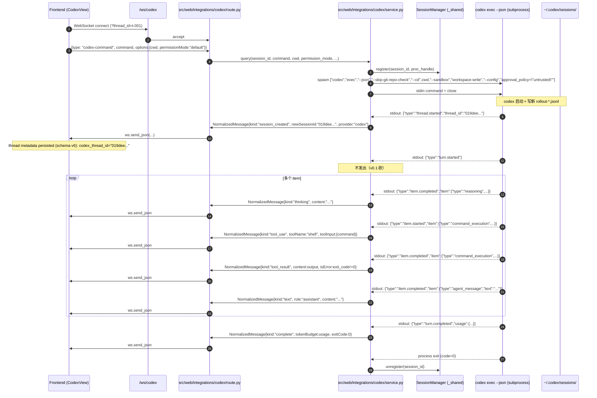
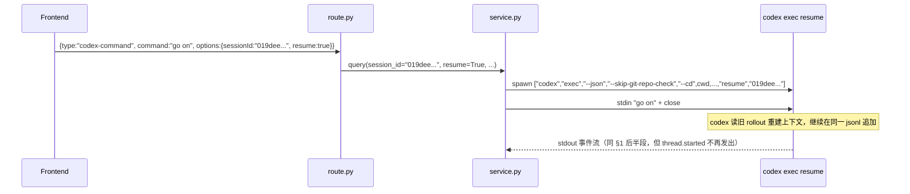
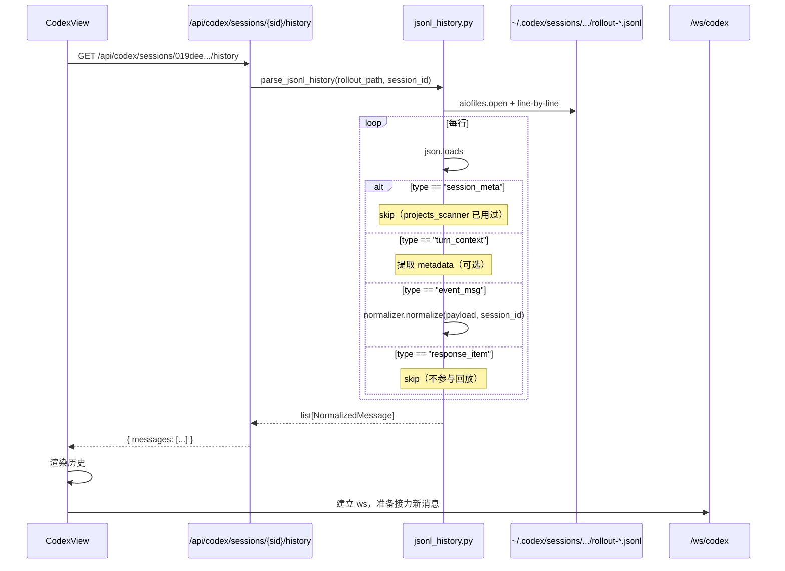
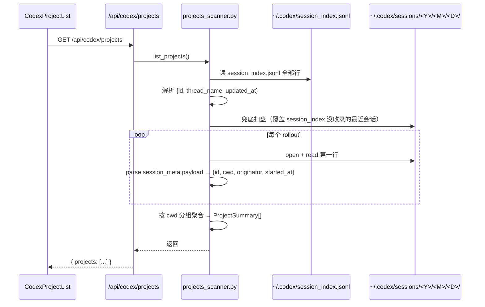
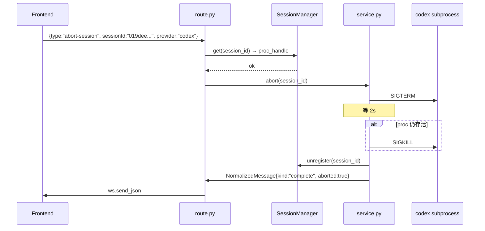

# 03 · 数据流

## 1. 一次完整的 Codex 对话链路

## 2. 续话流程

**关键点**：续话时 `thread.started` 不再发出，前端不应等这个事件——应该用前端已持有的 `sessionId` 即可。

## 3. 历史回放流程（页面刷新 / 跨设备打开）

**实测数据规模**：1 turn ≈ 77 KB rollout（约 50 行 jsonl）。10 turn 会话 ≈ 770 KB。流式逐行处理，**不一次性 read 全文**（实测有 16 MB 单文件 rollout）。

## 4. 项目浏览流程

**性能**：ccui 实测 100+ rollout 文件扫盘约 200ms，可接受。可选优化：异步扫 + 给前端流式进度（`/api/codex/projects/refresh`）。

## 5. abort 流程

**注意**：codex 子进程被 kill 后，rollout jsonl 是**不完整的**（最后 turn 没有 turn.completed）。下次 resume 时 codex 自己会处理这种 partial 状态（实测：codex resume 能从未完成 turn 续起）。我们后端不需要额外清理。

## 6. 异常路径汇总

| 场景 | 触发 | 行为 |
|---|---|---|
| codex CLI 未安装 | spawn 时 FileNotFoundError | 立刻发 `kind:error` "codex CLI not installed" |
| codex 未登录 | stderr "Not authenticated" | 立刻发 `kind:error` "run `codex login`"，子进程会 exit non-zero |
| stdout 行 parse 失败 | json.loads 抛 | 单行 skip + trace log + 发 `kind:error` 含 raw line |
| 子进程 hang（如 untrusted 卡审批） | 默认无 timeout | route 层提供 abort 按钮；可选 v0.2 加 5min 超时 |
| 网络问题 / API 限流 | codex 内部已处理（错误事件 `item.completed (error)`） | normalizer 转 `kind:error` |
| stderr 噪音（mcp 错误 / skill 加载错） | codex_core 日志 | 全部 trace 落盘，不上前端 |
| ws 断连 | route 层 finally 触发 | session 标记为 disconnected；codex 子进程**不杀**（继续在后台跑写 rollout）；用户重连时 check-session-status 重接 |

## 7. 与桌面端的并发安全

**红线再强调**：用户**正在用桌面端**。web 后端跑 codex 子进程时：

- ✅ 各自创建新 rollout 文件（thread_id 不冲突，UUIDv7 + ISO timestamp）
- ✅ 各自写 `session_index.jsonl`（codex 内部应有锁——未实测，但桌面端长期稳定使用证明可并发）
- ✅ 共用 `auth.json`（只读）
- ❌ web 后端**不主动写**任何既有文件（包括索引）

**冲突场景**：用户在桌面端 resume session A，**同时**前端也对 session A 发 codex-command。两个 codex 子进程同时写同一份 rollout-*.jsonl —— **有数据竞争风险**。

**v0.1 处置**：route 层在 query 前查 SessionManager，如该 session_id 已被 web 这边占用，**拒绝**新请求；但**不感知桌面端占用**（codex 不暴露 lockfile 给我们），所以这个冲突我们抓不住。

**v0.1 文档警告**：前端 UI 在 session card 上提示"该 session 可能正被桌面端使用，建议另开新 session"。

**v0.2+ 升级**：探索 codex 是否提供 session lock API。
