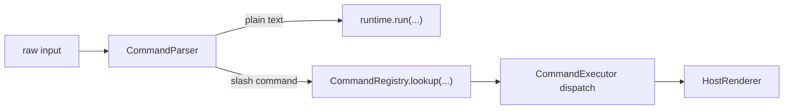

# 核心流程

## 1. 输入分流总流程



这条流程的关键点是：

- 所有宿主都先经过同一个 parser。
- `SessionBridge` 只保留一个共享入口。
- 宿主差异留在最后一跳的渲染层。

## 2. 普通文本流程

普通文本继续走现有主链，不改变 agent 的执行模型。

```text
user text
  -> CommandParser 判定为 plain text
  -> SessionBridge 调 runtime.run(...)
  -> final_message / events
  -> CLI 或 Web 按现有方式渲染
```

这条路径的目标是保持兼容：

- 非 slash 输入行为不变。
- command 模块只增加一层分流，不重写原有 run loop。

## 3. Prompt Command 流程

`prompt` 命令用于把 `/xxx args` 展开成稳定提示词，再继续走主 agent 链路。

```text
/foo arg1 arg2
  -> parser 产生命令调用
  -> registry 找到 prompt command
  -> executor 生成 expanded prompt
  -> runtime.run(expanded prompt)
  -> 宿主渲染最终结果
```

适用场景：

- 轻量 command
- 用户希望固定提示模板
- 不需要后端专用逻辑

## 4. Action Command 流程

`action` 命令用于后端直接执行确定逻辑。v0.1 第一批只放一条 `/review`，用它验证 command 主链闭环。

```text
/review [scope]
  -> parser 产生命令调用
  -> registry 找到 review action
  -> review executor 采集审查输入
  -> 启动独立 reviewer runtime
  -> 产出 review result
  -> 宿主回放结果
```

`/review` 的建议执行链：

1. 定位当前 workspace / thread 绑定的 cwd
2. 采集审查对象
   - 首版建议优先 `git diff --cached`
   - 其次允许 `git diff`
3. 组装 reviewer 输入
4. 启动独立 reviewer runtime
5. 返回 review 摘要和完整产物路径

第一批完成标准：

- CLI 输入 `/review` 能命中同一个共享 command executor
- Web 输入 `/review` 能命中同一个共享 command executor
- 两个宿主都能收到统一结构的执行结果
- reviewer 真正被触发，而不是只展开成 prompt

## 5. Interactive Command 流程

`interactive` 命令用于多步收集参数或打开一个宿主界面。

```text
/command
  -> parser 产生命令调用
  -> registry 找到 interactive command
  -> executor 返回 waiting_input / step metadata
  -> CLI 或 Web 打开对应交互界面
  -> 用户补充参数
  -> executor 完成最终动作
```

这里的共享边界是：

- 共用状态机
- 共用参数定义
- 共用完成条件

这里的宿主差异是：

- Web 用面板 / 弹层
- CLI 用 prompt / 文本向导

## 6. 未知命令与错误流程

```text
/unknown
  -> parser 判定为 command
  -> registry lookup miss
  -> 返回统一错误结果
  -> 宿主渲染“未知命令”
```

v0.1 建议规则：

- slash 开头并命令名不合法：直接报错
- slash 开头但更像路径：允许按普通文本透传的规则留到后续版本
- 首版优先行为明确，不做过多启发式回退
