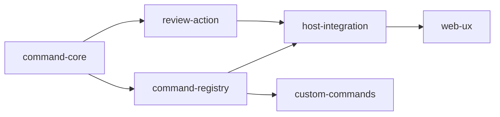

# Task Map

本文件只保留 task 映射与批次建议，模块职责与边界统一放在 `02-module-breakdown.md`。

| 模块 | 建议 task 名 | 是否创建 task | 前置依赖 | 当前状态 |
|---|---|---|---|---|
| Command Core | `command-core-v0.1` | 是 | 无 | 可进入 x-req |
| Command Registry | `command-registry-v0.1` | 是 | Command Core | 可进入 x-req |
| Review Action Executor | `command-review-action-v0.1` | 是 | Command Core | 可进入 x-req |
| Host Integration | `command-host-integration-v0.1` | 是 | Command Core、Command Registry | 可进入 x-req |
| Web UX | `command-web-ux-v0.1` | 否 | Host Integration | 第二批 |
| Custom Commands | `command-custom-commands-v0.1` | 否 | Command Registry | 第二批 |
| CLI Advanced UX | `command-cli-ux-v0.2` | 否 | v0.1 主链稳定 | 方案层 |

## 推荐拆分批次

### 第一批：共享主链闭环

| Task | 产出 |
|---|---|
| `command-core-v0.1` | parser、输入分流、共享结果模型、`CommandService` |
| `command-registry-v0.1` | builtin catalog、lookup、host 过滤 |
| `command-review-action-v0.1` | `/review` action executor、review run record、reviewer 触发闭环 |
| `command-host-integration-v0.1` | CLI / Web 共用接线、统一错误与结果回放 |

第一批验收口径：

- 普通文本路径保持可用
- slash command 路径可执行
- `/review` 成为首条内置命令
- Web 和 CLI 走同一套 parser / registry / executor
- 用户能在两个宿主看到 review 执行结果

第一批 x-req 文档：

- [command-core-v0.1](../../dev-pipeline/tasks/command-core-v0.1/README.md)
- [command-registry-v0.1](../../dev-pipeline/tasks/command-registry-v0.1/README.md)
- [command-review-action-v0.1](../../dev-pipeline/tasks/command-review-action-v0.1/README.md)
- [command-host-integration-v0.1](../../dev-pipeline/tasks/command-host-integration-v0.1/README.md)

### 第二批：用户可见能力

| Task | 产出 |
|---|---|
| `command-web-ux-v0.1` | `/` 候选面板、参数提示、结果卡片 |
| `command-custom-commands-v0.1` | workspace custom commands、持久化与加载 |

### 第三批：体验增强

| Task | 产出 |
|---|---|
| `command-cli-ux-v0.2` | CLI typeahead、参数补全、交互式命令增强 |

## x-req 入口建议

优先进入 x-req：

1. `command-core-v0.1`
2. `command-registry-v0.1`
3. `command-review-action-v0.1`
4. `command-host-integration-v0.1`

第二轮进入 x-req：

1. `command-web-ux-v0.1`
2. `command-custom-commands-v0.1`

保持在方案层：

- `command-cli-ux-v0.2`

## 方案目录

- `/Volumes/machub_app/proj/kongming-agent/docs/command-module-v0.1/`

## 推荐开发顺序

