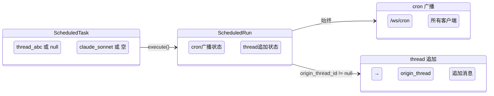

# 数据与状态

## 一、Schema v4 数据结构（增量）

### ScheduleDelivery v0.4 增量

```python
@dataclass(frozen=True)
class ScheduleDelivery:
    channel: DeliveryChannel              # v0.3 已有：web / cli
    target: str | None = None             # v0.4 新增：投递目标
    # None = 只广播到 cron 区域，不投递到具体位置
    # "thread:thread-a1b2c3d4e5f6" = 投递到该 thread
    # 未来扩展："feishu:ou_xxx" 等（当前不实现）
```

### ScheduledTask v0.4 增量字段

```python
@dataclass(frozen=True)
class ScheduledTask:
    # ... v0.3 已有字段 ...

    # v0.4 新增
    preset_id: str = ""
    """用哪个 LLM preset 跑。
    匹配 ``LLMPresetConfig.id``。
    空串表示用全局默认（base_config.model）。
    创建时从来源 thread 的 preset_id 继承。"""
```

### ScheduledRun

不加新字段。投递结果（含 target 投递）复用已有的 `delivery_status` / `delivery_error`。

### SCHEMA_VERSION

```python
SCHEMA_VERSION = 4
```

## 二、`scheduled_tasks.json` v4 格式示例

```json
{
  "schema_version": 4,
  "updated_at": "2026-05-05T10:00:00+00:00",
  "tasks": [
    {
      "task_id": "task-abc123",
      "name": "站起来活动",
      "enabled": true,
      "state": "scheduled",
      "origin": "tool",
      "trigger": {
        "trigger_type": "cron",
        "expr": "0 9 * * *",
        "timezone": "Asia/Shanghai"
      },
      "policy": {
        "session_mode": "fresh_session",
        "concurrency_policy": "forbid",
        "misfire_policy": "skip",
        "max_turns": null,
        "inactivity_timeout_seconds": 600,
        "wall_timeout_seconds": null,
        "retry_limit": 0,
        "silent_marker_enabled": true
      },
      "target": {
        "agent_name": "default",
        "input_text": "提醒用户：该站起来活动 5 分钟了！",
        "metadata": {}
      },
      "delivery": {
        "channel": "web",
        "target": "thread:thread-a1b2c3d4e5f6"
      },
      "preset_id": "claude-sonnet",
      "next_run_at": "2026-05-06T01:00:00+00:00",
      "last_run_at": null,
      "created_by": "agent:thread-a1b2c3d4e5f6",
      "created_at": "2026-05-05T10:00:00+00:00",
      "updated_at": "2026-05-05T10:00:00+00:00"
    }
  ]
}
```

## 三、`runs/task-<id>.jsonl` v4 行示例

```json
{
  "run_id": "run-sched-task-abc123-9f8e7d6c",
  "task_id": "task-abc123",
  "status": "completed",
  "scheduled_for": "2026-05-06T01:00:00+00:00",
  "started_at": "2026-05-06T01:00:00.234+00:00",
  "finished_at": "2026-05-06T01:00:05.678+00:00",
  "session_id": "sched-task-abc123-9f8e7d6c",
  "result_status": "completed",
  "final_message_excerpt": "该站起来活动 5 分钟了！...",
  "error_message": null,
  "failure_reason": null,
  "delivery_error": null,
  "silent_suppressed": false,
  "_superseded": false,

  "delivered_at": "2026-05-06T01:00:05.701+00:00",
  "delivery_status": "delivered",
  "seen_at": null
}
```

run 格式跟 v0.3 一致，不加新字段。`delivery_status=delivered` 表示广播 + target 投递都成功；`delivery_error` 记录具体哪步失败。

## 四、trace 文件布局

```
.kongming/cron/traces/
└── cron-run-sched-task-abc123-9f8e7d6c.jsonl
```

每个 cron run 独立一个 trace 文件，格式与 `JsonlTraceSink` 已有输出一致（EventKind JSON lines）。

## 五、迁移路径（v3 → v4）

### 升级步骤（重置式，与 v2→v3 一致）

1. Store 启动时检测 `schema_version`
2. 如果 != 4：
   - 备份：`scheduled_tasks.json` → `scheduled_tasks.json.v3.bak.<unix_ts>`
   - 写空 `tasks=[]` + `schema_version: 4`
   - audit: `schema_migrated_v3_to_v4`
   - stderr warning: 旧任务需重新创建
3. runs 文件不动（`_dict_to_run` 用 `.get()` 兼容缺字段）

### 兼容性

- v0.4 读 v4 → 直接用
- v0.4 读 v3 或更早 → 重置式迁移（备份 + 清空）
- v0.3 读 v4 → 不支持降级（多余字段导致反序列化失败）

### `_dict_to_task` 新字段处理

```python
# delivery.target 从 payload 反序列化
delivery_raw = payload.get("delivery")
if delivery_raw is not None:
    delivery = ScheduleDelivery(
        channel=DeliveryChannel(delivery_raw["channel"]),
        target=delivery_raw.get("target"),  # v0.4：None 兼容老数据
    )

# preset_id 顶层字段
preset_id = payload.get("preset_id", "")
```

### 单测覆盖

- `test_migrate_v3_to_v4_resets_tasks`
- `test_v4_round_trip_with_delivery_target`
- `test_v4_round_trip_with_preset_id`
- `test_dict_to_task_missing_target_defaults_none`

## 六、字段关系图


