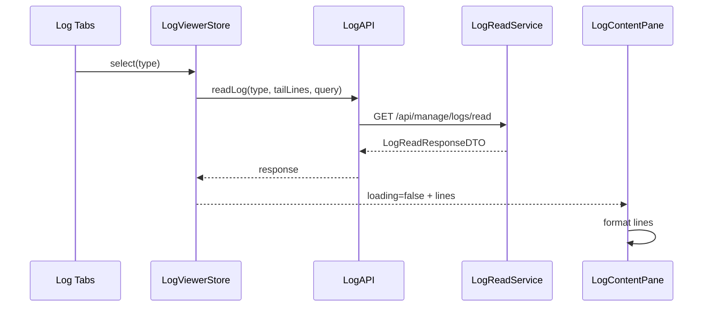
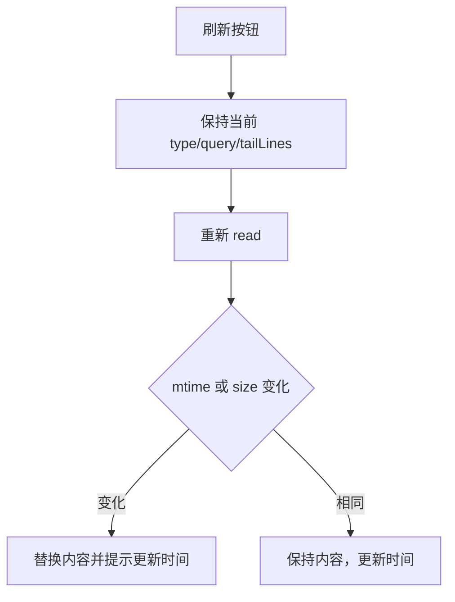
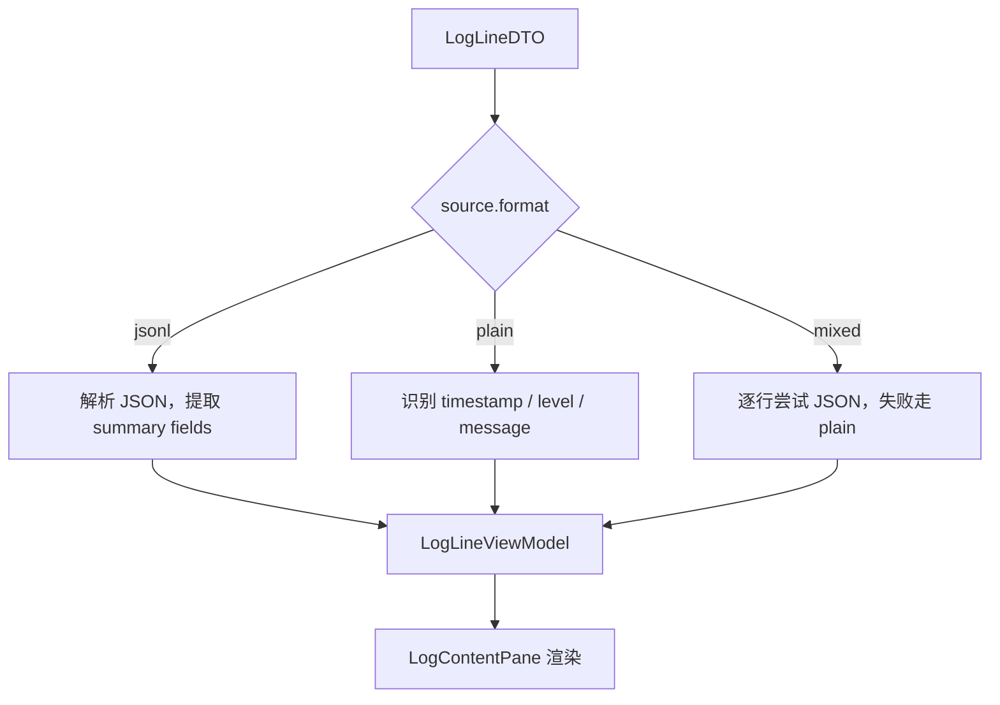

# 核心流程

## 打开日志弹出页

关键点：

- `Outlet` 保持原位置与原组件树。
- overlay host 放在 `Layout` 底部，与 `SchedulerDrawerHost`、`SitianReportDialog` 同级。
- 默认选中上次选择的日志类型；首次打开选 `web_server`。

## 切换日志类型

状态要求：

- 切换期间右侧展示 loading skeleton，左侧保持可操作。
- 当前请求通过 `AbortController` 取消，避免慢请求覆盖新选择。
- 文件缺失展示“日志文件尚未产生”，仍显示目标路径。

## 手动刷新

首版使用手动刷新。自动刷新会增加 tail 游标、滚动保持、后台 tab 节流等状态，排在 v0.3。

## 格式化流程

JSONL 摘要优先级：

1. `ts` / `timestamp` / `time`
2. `level` / `severity`
3. `kind` / `event` / `frame_type` / `action`
4. `message` / `msg` / `error`
5. `thread_id` / `run_id` / `channel` / `dir`

plain text 识别优先级：

1. Python logging：`YYYY-MM-DD HH:mm:ss,SSS LEVEL logger message`
2. ISO 时间戳开头
3. 包含 `ERROR` / `WARNING` / `INFO` / `DEBUG`
4. traceback 块：`Traceback (most recent call last):` 到下一条时间戳前

## 错误与空态

| 场景 | API | UI |
|---|---|---|
| source 不存在 | 400 | toast + 保持当前内容 |
| 文件缺失 | 200 `exists=false` | 空态 + 路径 |
| 文件为空 | 200 `lines=[]` | 空态 + 文件存在 |
| 单行 JSON 解析失败 | 200 line `parse_error` | 原文 + 错误 badge |
| 读取权限失败 | 403/500 | 错误态 + 不显示敏感绝对异常堆栈 |
| 文件过大 | 200 `truncated=true` | 顶部截断提示 |
